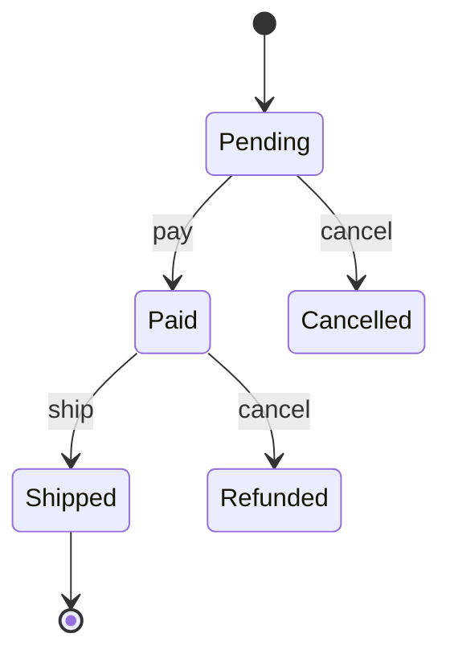

# Behavioral Design Patterns

> [!summary]
> Behavioral patterns are about **how objects communicate and divide responsibilities**. The most frequently used and asked: **Strategy, Observer, Command, State, Template Method, Iterator, Chain of Responsibility**.

Back to [[Design Index]] · Prev: [[Structural Patterns]]

---

## Strategy

**Intent:** Define a family of algorithms, encapsulate each, and make them **interchangeable at runtime**.

```javascript
const pricingStrategies = {
  regular:  (total) => total,
  member:   (total) => total * 0.9,
  blackFriday: (total) => total * 0.7,
};

class Checkout {
  constructor(strategy) { this.strategy = strategy; }
  setStrategy(s) { this.strategy = s; }
  total(cart) { return this.strategy(cart.subtotal); }
}
new Checkout(pricingStrategies.member).total({ subtotal: 100 }); // 90
```

**Real uses:** payment methods, sorting comparators (`arr.sort(compareFn)`), Passport.js auth strategies, routing algorithms, compression algorithms.
**Replaces:** `if/else` chains on "mode" → satisfies [[SOLID Principles#O — Open/Closed Principle (OCP)|OCP]].

---

## Observer

**Intent (a.k.a. Pub/Sub):** When one object (subject) changes state, all its **dependents (observers) are notified** automatically. One-to-many.

```javascript
class EventEmitter {
  #listeners = new Map();
  on(evt, fn)  { (this.#listeners.get(evt) ?? this.#listeners.set(evt, []).get(evt)).push(fn); return () => this.off(evt, fn); }
  off(evt, fn) { this.#listeners.set(evt, (this.#listeners.get(evt) ?? []).filter(f => f !== fn)); }
  emit(evt, data) { (this.#listeners.get(evt) ?? []).forEach(fn => fn(data)); }
}

const orders = new EventEmitter();
orders.on("placed", (o) => emailService.sendReceipt(o));
orders.on("placed", (o) => analytics.track("order", o));
orders.emit("placed", { id: 1, total: 42 });
```

**Real uses:** DOM `addEventListener`, Node `EventEmitter`, RxJS, Redux store subscriptions, React state → re-render, WebSockets, and at system scale [[Messaging & Event Streaming|pub/sub with Kafka/SNS]].

**Observer vs Pub/Sub:** in classic Observer, the subject knows its observers directly. In Pub/Sub, a **broker/channel** sits between publishers and subscribers, so they don't know each other (looser coupling).

**Pitfalls:** memory leaks from never unsubscribing (React `useEffect` cleanup!), unpredictable notification order, cascading updates.

---

## Command

**Intent:** Encapsulate a request as an **object**, so you can queue, log, undo/redo, or retry it.

```javascript
class AddTextCommand {
  constructor(doc, text) { this.doc = doc; this.text = text; }
  execute() { this.doc.content += this.text; }
  undo()    { this.doc.content = this.doc.content.slice(0, -this.text.length); }
}

class Editor {
  history = [];
  run(cmd) { cmd.execute(); this.history.push(cmd); }
  undo()   { this.history.pop()?.undo(); }
}
```

**Real uses:** undo/redo in editors, Redux actions (`{ type: "ADD_TODO", payload }`), job queues (a job message *is* a command), transactional outboxes, CLI commands, macro recording.

---

## State

**Intent:** Let an object **change its behavior when its internal state changes**. Each state is its own class, and the object delegates to its current state.

```javascript
const states = {
  pending:   { pay: (o) => o.setState("paid"),    ship: () => { throw Error("Not paid"); }, cancel: (o) => o.setState("cancelled") },
  paid:      { pay: () => { throw Error("Already paid"); }, ship: (o) => o.setState("shipped"), cancel: (o) => o.setState("refunded") },
  shipped:   { pay: () => { throw Error("Done"); }, ship: () => { throw Error("Done"); }, cancel: () => { throw Error("Too late"); } },
  cancelled: {}, refunded: {},
};
class Order {
  state = "pending";
  setState(s) { this.state = s; }
  pay()    { states[this.state].pay(this); }
  ship()   { states[this.state].ship(this); }
  cancel() { states[this.state].cancel(this); }
}
```



**Real uses:** order lifecycles, TCP connections, vending machines, elevators, UI flows (XState). **Very common in LLD interviews** (vending machine, elevator, ATM).
**Strategy vs State:** same structure. With Strategy the *client* picks the algorithm; with State the *object transitions itself*.

---

## Template Method

**Intent:** Define the **skeleton of an algorithm** in a base class and let subclasses override specific steps.

```javascript
class DataExporter {
  export() {                 // the template, fixed order
    const data = this.fetch();
    const formatted = this.format(data);
    this.save(formatted);
  }
  fetch() { return db.query("..."); }
  format() { throw new Error("subclass must implement"); }   // hook
  save(out) { fs.writeFileSync(this.filename(), out); }
}
class CsvExporter extends DataExporter { format(d) { return toCsv(d); } filename() { return "out.csv"; } }
```

**Real uses:** framework lifecycle hooks (React class `componentDidMount`, JUnit `setUp/tearDown`), Spring's `JdbcTemplate`.
**Template vs Strategy:** Template uses **inheritance** to vary *steps*; Strategy uses **composition** to vary the *whole algorithm*.

---

## Iterator

**Intent:** Traverse a collection **without exposing its internal structure**.

```javascript
class Range {
  constructor(start, end) { this.start = start; this.end = end; }
  *[Symbol.iterator]() { for (let i = this.start; i < this.end; i++) yield i; }
}
for (const n of new Range(0, 3)) console.log(n); // 0 1 2
```

Built into most languages (`for...of`, Java `Iterator`, Python generators). Pagination cursors in APIs are the network equivalent.

---

## Chain of Responsibility

**Intent:** Pass a request along a **chain of handlers**; each decides to handle it or pass it on.

```javascript
// Express middleware IS chain of responsibility
app.use(authenticate);      // may reject → stops chain
app.use(rateLimit);         // may reject
app.use(validateBody);
app.post("/orders", createOrder);
```

**Real uses:** middleware pipelines, logging levels, support ticket escalation, DOM event bubbling, approval workflows.

---

## Mediator

**Intent:** Reduce chaotic many-to-many dependencies by making objects communicate **through a central mediator**.

**Real uses:** chat room server (users don't message each other directly), air traffic control, form components coordinated by a parent, Redux store (arguably), message brokers.

---

## Memento

**Intent:** Capture and restore an object's **internal state snapshot** without violating encapsulation.
**Real uses:** undo (snapshot-based), save games, form drafts, DB transaction rollback.

---

## Visitor

**Intent:** Add new operations to a set of classes **without modifying them**, by moving the operation into a "visitor" object.
**Real uses:** compilers/AST traversal (Babel plugins, ESLint rules), exporting a document tree to several formats.
**Downside:** adding a new element *type* requires changing every visitor.

---

## Others (know the name)
- **Interpreter**: grammar/evaluator for a small language (regex engines, SQL parsers).

---

## Bonus: patterns you'll see in enterprise code (non-GoF)

| Pattern | What it is |
|---|---|
| **Repository** | Collection-like interface for data access (`userRepo.findById`) hiding the DB. |
| **Unit of Work** | Track changes and commit them as one transaction (ORMs). |
| **DTO** (Data Transfer Object) | Plain object for moving data across boundaries (API request/response). |
| **Service Layer** | Application logic orchestrating domain objects + repos. |
| **MVC / MVVM / MVP** | UI separation patterns. See [[Architectural Styles#MVC and friends]]. |
| **Dependency Injection** | See [[OOP Fundamentals]]. |
| **Null Object** | An object with neutral behavior instead of `null` checks (`NoopLogger`). |
| **Specification** | Composable business-rule predicates (`isPremium.and(isActive)`). |

---

## Pattern cheat sheet: "I need to..."

| I need to... | Pattern |
|---|---|
| swap algorithms at runtime | Strategy |
| notify many things when something happens | Observer / Pub-Sub |
| support undo / queue / log operations | Command (+ Memento) |
| change behavior based on lifecycle state | State |
| fix the steps of an algorithm but vary some | Template Method |
| run a request through a pipeline of checks | Chain of Responsibility |
| make an incompatible API fit | Adapter |
| add features to an object without subclassing | Decorator |
| simplify a messy subsystem | Facade |
| lazy-load / guard / cache access | Proxy |
| treat trees and leaves uniformly | Composite |
| construct complex objects step by step | Builder |
| create objects without naming concrete classes | Factory |

## Self-test
- [ ] Strategy vs State: same structure, different intent. Explain.
- [ ] How is Express middleware an example of Chain of Responsibility?
- [ ] How would you implement undo/redo?
- [ ] What memory pitfall comes with Observer?

Next: [[Low-Level Design Interview]]
