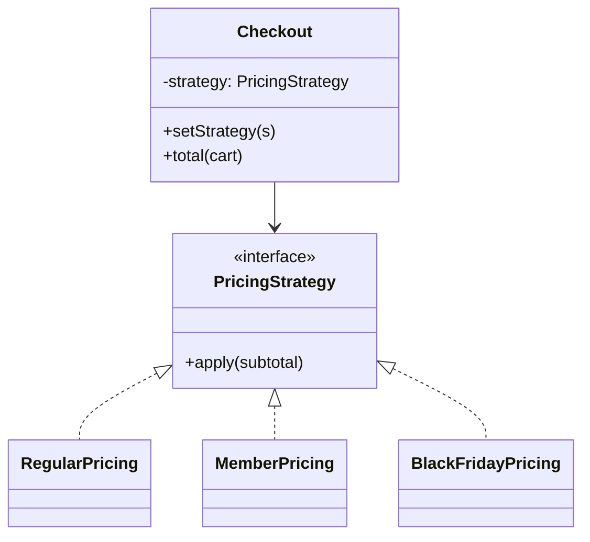
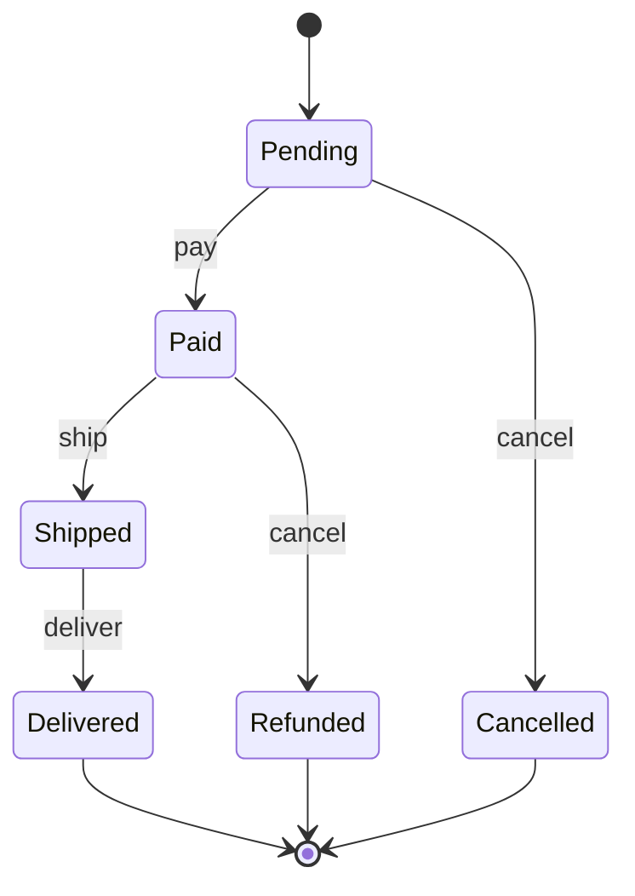
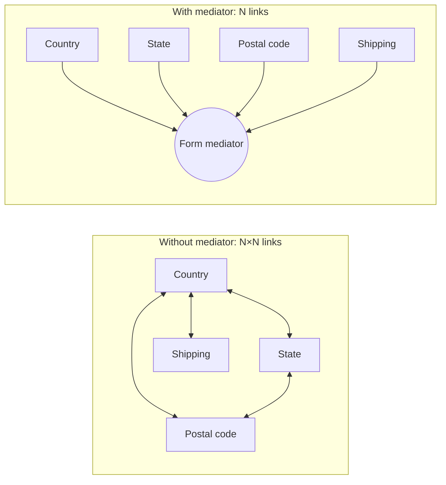

# Behavioral Design Patterns

> [!summary] What you'll learn
> Behavioral patterns are about **how objects communicate and divide responsibilities**: who decides what, who notifies whom, and how to make behavior swappable. These are the patterns you'll use most often in day-to-day code and in LLD interviews.
>
> **Most important (know deeply):** Strategy, Observer, Command, State, Template Method, Chain of Responsibility, Iterator.
> **Know the idea:** Mediator, Memento, Visitor, Interpreter.
> At the end: common **enterprise patterns** (Repository, DTO, Service Layer...) and a "which pattern do I need?" picker.

Back to [[Design Index]] · Prev: [[Structural Patterns]] · Next: [[Low-Level Design Interview]]

---

## Strategy

### The problem
You have **several ways to do the same task** (algorithms, rules, policies), and the right one depends on context. The naive solution is a growing conditional:

```javascript
function calculatePrice(cart, customerType) {
  if (customerType === "regular") return cart.subtotal;
  else if (customerType === "member") return cart.subtotal * 0.9;
  else if (customerType === "employee") return cart.subtotal * 0.7;
  else if (customerType === "blackFriday") return Math.max(cart.subtotal - 20, 0) * 0.8;
  // every new promotion = edit this function, retest everything
}
```
Problems: the function grows forever, every change risks breaking the other branches, the branches can't be unit tested in isolation, and you can't add a new pricing rule from a plugin or config.

### How it works
1. Define a common interface for the algorithm (e.g., "a function from subtotal to price").
2. Put each variant in its own **strategy** object/function.
3. The **context** (the code that needs the result) holds a strategy and delegates to it, without knowing which one it has.



```javascript
// Strategies: in JS, often just functions
const pricing = {
  regular:     (subtotal) => subtotal,
  member:      (subtotal) => subtotal * 0.9,
  employee:    (subtotal) => subtotal * 0.7,
  blackFriday: (subtotal) => Math.max(subtotal - 20, 0) * 0.8,
};

class Checkout {
  constructor(strategy = pricing.regular) { this.strategy = strategy; }
  setStrategy(strategy) { this.strategy = strategy; }       // swappable at runtime
  total(cart) { return this.strategy(cart.subtotal); }
}

const checkout = new Checkout(pricing[user.tier] ?? pricing.regular);
checkout.total({ subtotal: 100 });   // 90 for members

// Adding a new rule touches nothing existing (Open/Closed Principle)
pricing.student = (subtotal) => subtotal * 0.85;
```

### When to use it
- Several interchangeable algorithms or policies: pricing, discounts, tax rules by country, shipping cost, sorting, compression, routing, retry policies, authentication methods, matching drivers to riders.
- You see an `if/else` or `switch` that selects **behavior** and keeps growing.
- You want to choose behavior from **configuration** or at **runtime**.

### Where you've seen it
- `array.sort(compareFn)`: the comparator *is* a strategy.
- **Passport.js** "strategies" (local, Google, GitHub login).
- Validation libraries with pluggable rules; load balancer algorithms (round robin vs least connections).

### Downsides
Clients must know which strategies exist to pick one (usually solved with a factory or a lookup map). For two fixed options that never change, a simple `if` is clearer.

---

## Observer

### The problem
When something happens in one object (an order is placed, data changes, a button is clicked), **several other parts of the system need to react**: send an email, update analytics, refresh the UI, adjust inventory. If the source calls each of them directly:

```javascript
async function placeOrder(order) {
  await db.save(order);
  await emailService.sendReceipt(order);    // order code now depends on email,
  await analytics.track(order);             // analytics,
  await inventory.decrement(order.items);   // inventory,
  await loyalty.addPoints(order);           // loyalty... and must change for every new reaction
}
```
The order code is **coupled to every consumer** and must be edited each time a new reaction is added.

### How it works (also called Pub/Sub: one-to-many notification)
The **subject** (publisher) keeps a list of **observers** (subscribers). When its state changes, it notifies all of them. The subject only knows that observers have a callback; it doesn't know what they do.

```javascript
class EventEmitter {
  #listeners = new Map();   // eventName → Set of callbacks

  on(event, fn) {
    if (!this.#listeners.has(event)) this.#listeners.set(event, new Set());
    this.#listeners.get(event).add(fn);
    return () => this.off(event, fn);           // return an unsubscribe function
  }
  off(event, fn) { this.#listeners.get(event)?.delete(fn); }
  emit(event, payload) {
    for (const fn of this.#listeners.get(event) ?? []) fn(payload);
  }
}

const orders = new EventEmitter();

// Each consumer subscribes independently; the order code never changes
orders.on("orderPlaced", (o) => emailService.sendReceipt(o));
orders.on("orderPlaced", (o) => analytics.track("order", o));
orders.on("orderPlaced", (o) => inventory.decrement(o.items));

async function placeOrder(order) {
  await db.save(order);
  orders.emit("orderPlaced", order);    // "something happened"; whoever cares will react
}
```

### Observer vs Pub/Sub
| | Classic Observer | Publish/Subscribe |
|---|---|---|
| Who knows whom | Subject holds direct references to observers | Publishers and subscribers only know a **channel/topic**; a **broker** sits in between |
| Coupling | Loose | Looser |
| Usually | In-process, synchronous | Often across processes/services, asynchronous |
| Examples | DOM events, Node `EventEmitter`, RxJS | Redis pub/sub, Kafka, AWS SNS, Google Pub/Sub |

The system-scale version is covered in [[Messaging & Event Streaming]].

### When to use it
- One change must trigger **many independent reactions**, especially when the set of reactions grows over time.
- You want the source to be **unaware** of its consumers (decoupling modules or teams).
- UI updates in response to state changes.

### Where you've seen it
`element.addEventListener("click", ...)`, Node's `EventEmitter` and streams, **React state → re-render** (components "observe" state), Redux `store.subscribe`, RxJS Observables, MobX, WebSocket message handlers, webhooks.

### Pitfalls
- **Memory leaks** from forgotten subscriptions: a component subscribes and never unsubscribes, so it's never garbage-collected and keeps receiving events. (This is why React's `useEffect` returns a **cleanup** function.)
- **Unclear flow**: "Who reacts to this event?" requires searching the codebase. Use descriptive event names and document them.
- **Ordering and error handling**: observers run in some order, and one throwing might stop the others. Decide whether to isolate errors (try/catch per listener).
- **Cascades**: an observer emits an event that triggers another observer that emits... (infinite loops).

---

## Command

### The problem
You want to treat a **request/action as a thing** you can store, pass around, queue, log, retry, or **undo**, rather than an immediate method call. A direct call like `editor.deleteText(5, 10)` happens and is gone. You can't put it in an undo stack, send it to a background worker, or replay it later.

### How it works
Wrap each action in a **command object** that contains everything needed to perform it (the receiver, the parameters) and exposes `execute()` (and often `undo()`).

```javascript
class InsertTextCommand {
  constructor(doc, position, text) { Object.assign(this, { doc, position, text }); }
  execute() { this.doc.insert(this.position, this.text); }
  undo()    { this.doc.delete(this.position, this.text.length); }
}

class DeleteTextCommand {
  constructor(doc, position, length) { Object.assign(this, { doc, position, length }); }
  execute() { this.deleted = this.doc.slice(this.position, this.length); this.doc.delete(this.position, this.length); }
  undo()    { this.doc.insert(this.position, this.deleted); }   // remember what was deleted
}

class Editor {
  undoStack = [];
  redoStack = [];
  run(cmd) { cmd.execute(); this.undoStack.push(cmd); this.redoStack = []; }  // new action clears redo
  undo() { const c = this.undoStack.pop(); if (c) { c.undo(); this.redoStack.push(c); } }
  redo() { const c = this.redoStack.pop(); if (c) { c.execute(); this.undoStack.push(c); } }
}
```

### When to use it
- **Undo/redo** (text editors, drawing tools, form wizards).
- **Queuing and background jobs**: a job message `{ type: "SEND_EMAIL", to, template }` *is* a serialized command.
- **Logging / auditing / replay**: store commands to reconstruct what happened (related to event sourcing).
- **Macros and batching**: a composite command made of several commands.
- **Decoupling** the thing that triggers an action (button, keyboard shortcut, menu item) from the thing that performs it.

### Where you've seen it
- **Redux actions** (`{ type: "cart/addItem", payload: {...} }`) are commands; reducers execute them.
- Job queues (BullMQ, Sidekiq, Celery, SQS messages).
- VS Code's command palette (every action is a registered command bound to shortcuts and menus).
- Database transaction logs.

---

## State

### The problem
An object's **behavior depends on its current state**, and the rules for "what's allowed in which state" get scattered across many conditionals:

```javascript
class Order {
  ship() {
    if (this.status === "pending")   throw new Error("Not paid yet");
    if (this.status === "cancelled") throw new Error("Order cancelled");
    if (this.status === "shipped")   throw new Error("Already shipped");
    if (this.status === "paid") { this.status = "shipped"; /* ... */ }
  }
  cancel() {
    if (this.status === "shipped") throw new Error("Too late");
    if (this.status === "paid") { this.refund(); this.status = "refunded"; }
    if (this.status === "pending") this.status = "cancelled";
    // every method repeats the same status checks; adding a state means editing every method
  }
}
```

### How it works
Model each state as its own object that implements the allowed actions for that state. The main object (the **context**) delegates to its current state object, and states decide transitions. This is an explicit **finite state machine**.



```javascript
const fail = (msg) => () => { throw new Error(msg); };

const OrderStates = {
  pending: {
    pay:    (order) => order.transition("paid"),
    ship:   fail("Cannot ship: not paid"),
    cancel: (order) => order.transition("cancelled"),
  },
  paid: {
    pay:    fail("Already paid"),
    ship:   (order) => order.transition("shipped"),
    cancel: (order) => { order.refund(); order.transition("refunded"); },
  },
  shipped: {
    pay:    fail("Already paid"),
    ship:   fail("Already shipped"),
    cancel: fail("Cannot cancel after shipping"),
  },
  cancelled: { pay: fail("Cancelled"), ship: fail("Cancelled"), cancel: fail("Already cancelled") },
  refunded:  { pay: fail("Refunded"),  ship: fail("Refunded"),  cancel: fail("Already refunded") },
};

class Order {
  status = "pending";
  history = [];
  transition(next) { this.history.push({ from: this.status, to: next, at: new Date() }); this.status = next; }
  refund() { /* call payment service */ }
  pay()    { OrderStates[this.status].pay(this); }
  ship()   { OrderStates[this.status].ship(this); }
  cancel() { OrderStates[this.status].cancel(this); }
}
```
Now all of a state's rules sit together, invalid transitions are explicit, and adding a state means adding one entry instead of editing every method.

### When to use it
- Entities with **lifecycles**: orders, payments, tickets, subscriptions, documents (draft → review → published), user onboarding flows.
- Devices or games: vending machines, elevators, traffic lights, ATMs, TCP connections, player states.
- UI flows: multi-step forms, loading/success/error states (libraries like **XState**).
- **Very common in LLD interviews** (vending machine, elevator, ATM, parking spot status).

### Strategy vs State (frequently asked)
They have the **same structure** (a context delegating to an interchangeable object). The **intent** differs:
- **Strategy**: the **client chooses** the algorithm; strategies usually don't know about each other.
- **State**: the object **transitions itself** between states as events happen; states know about the next states.

---

## Template Method

### The problem
Several classes perform an algorithm with **the same overall steps in the same order**, but **some steps differ**. Copy-pasting the whole algorithm into each class duplicates the shared structure, and the copies drift apart.

Example: exporting reports. Every export does *fetch data → transform → format → write file → notify*, but CSV, PDF, and Excel differ only in the *format* step.

### How it works
A base class defines the **template method**: the fixed skeleton that calls a series of steps. Some steps are implemented in the base class; others are abstract **hooks** that subclasses must (or may) override.

```javascript
class ReportExporter {
  // The template method: the order of steps is fixed here
  async export(params) {
    const rows = await this.fetchData(params);
    const cleaned = this.transform(rows);
    const output = this.format(cleaned);        // varies by subclass
    const path = await this.write(output);
    await this.afterExport(path);               // optional hook
    return path;
  }

  async fetchData(params) { return db.query("SELECT ... WHERE date BETWEEN $1 AND $2", [params.from, params.to]); }
  transform(rows) { return rows.filter(r => !r.deleted); }
  format(rows) { throw new Error("Subclasses must implement format()"); }   // required hook
  async write(output) { const p = `/tmp/report.${this.extension()}`; await fs.writeFile(p, output); return p; }
  async afterExport(path) {}                                                // optional hook (default: no-op)
}

class CsvExporter extends ReportExporter {
  format(rows) { return rows.map(r => Object.values(r).join(",")).join("\n"); }
  extension() { return "csv"; }
}

class JsonExporter extends ReportExporter {
  format(rows) { return JSON.stringify(rows, null, 2); }
  extension() { return "json"; }
  async afterExport(path) { await slack.post(`New JSON report: ${path}`); }
}
```

### When to use it
- Several variants share an algorithm's **structure** and differ in a few steps.
- You want to **enforce the order** of steps (e.g., always validate before saving, always clean up afterward).
- Frameworks providing lifecycle "hooks" for you to fill in.

### Where you've seen it
React class components (`componentDidMount`, `render`), JUnit/Jest `beforeEach`/`afterEach`, Spring's `JdbcTemplate`, Express's request lifecycle, game loops (`init → update → render`).

### Template Method vs Strategy
- **Template Method** uses **inheritance** to vary **parts** of an algorithm. The structure is fixed at compile time.
- **Strategy** uses **composition** to swap the **whole** algorithm, possibly at runtime.
In modern code, Strategy is often preferred (composition over inheritance), but Template Method remains common in frameworks.

---

## Iterator

### The problem
You want to **traverse a collection** (list, tree, paginated API, database cursor) **without exposing how it's stored internally**, and without every caller writing its own traversal logic.

### How it works
The collection provides an **iterator** object that knows how to return the next element and whether there are more. In JavaScript, anything implementing `[Symbol.iterator]` works with `for...of`, spread, and destructuring. Generators (`function*`) make writing iterators easy.

```javascript
class Tree {
  constructor(value, children = []) { this.value = value; this.children = children; }

  // Depth-first traversal; callers don't need to know the tree's structure
  *[Symbol.iterator]() {
    yield this.value;
    for (const child of this.children) yield* child;
  }
}

const t = new Tree(1, [new Tree(2, [new Tree(4)]), new Tree(3)]);
console.log([...t]);   // [1, 2, 4, 3]

// Async iterator over a paginated API: callers just loop
async function* allOrders(api) {
  let cursor = null;
  do {
    const page = await api.get("/orders", { cursor, limit: 100 });
    yield* page.items;
    cursor = page.nextCursor;
  } while (cursor);
}
for await (const order of allOrders(api)) process(order);
```

### When to use it
- Custom data structures that callers need to loop over.
- **Lazy** sequences: data too large to load at once (stream rows, paginate APIs, read files line by line).
- Multiple traversal orders over the same structure (DFS vs BFS).

It's built into almost every modern language, so you mostly **use** it rather than design it.

---

## Chain of Responsibility

### The problem
A request may need to pass through **several checks or handlers**, and which ones apply (and in which order) should be configurable. Hardcoding them in one function makes it huge and rigid:

```javascript
function handleRequest(req) {
  if (!authenticate(req)) return 401;
  if (rateLimited(req)) return 429;
  if (!validate(req.body)) return 400;
  if (!authorize(req.user, req.path)) return 403;
  return processRequest(req);
}
```

### How it works
Each handler gets the request and decides either to **handle it (and possibly stop the chain)** or to **pass it to the next handler**. Handlers are independent and can be added, removed, or reordered.

```javascript
// Express middleware IS chain of responsibility
app.use(requestLogger);           // logs, then calls next()
app.use(authenticate);            // may respond 401 and stop the chain
app.use(rateLimit({ max: 100 })); // may respond 429 and stop
app.use(express.json());          // parses body, then next()

app.post("/orders", validate(orderSchema), authorize("orders:create"), createOrder);

// A handler's shape:
function authenticate(req, res, next) {
  const user = verifyToken(req.headers.authorization);
  if (!user) return res.status(401).json({ error: "Unauthenticated" });   // handled: chain stops
  req.user = user;
  next();                                                                   // pass along
}
```

### When to use it
- **Request pipelines**: HTTP middleware, gRPC interceptors, message processing pipelines.
- **Escalation**: support ticket → tier 1 → tier 2 → engineer; expense approval → manager → director → VP based on amount.
- **Event handling**: DOM event bubbling (an event travels up the tree until a handler stops propagation).
- **Logging levels**, **validation rule chains**, fallback chains (try cache → try DB → try backup).

### Pitfalls
A request may fall off the end of the chain unhandled (add a final default/404 handler). Order bugs are subtle (e.g., body parsing must happen before validation).

---

## Mediator

### The problem
Many objects talk **directly to each other**, creating a tangled many-to-many web. In a complex form, changing the "country" field must update "state" options, the postal code format, shipping options, and the tax display. If each field references the others, adding a field means touching all of them.

### How it works
Introduce a **mediator** that all components talk to. Components notify the mediator of events, and the mediator decides who else needs to react. Components no longer know about each other.



### When to use it
- Complex UIs where components affect each other (a parent component or form controller often acts as mediator in React).
- **Chat rooms**: users send messages to the room (mediator), not directly to each other.
- **Air traffic control**: planes coordinate through the tower.
- At system scale: message brokers, orchestrators.

### Downside
The mediator can become a **God object** that knows everything. Keep it focused.

---

## Memento

### The problem
You need to **save and restore an object's state** (for undo, checkpoints, or drafts) **without exposing its internals** to the code that stores the snapshots.

### How it works
The object (originator) produces an opaque **memento** (snapshot) of its state. A caretaker (like an undo manager) stores mementos but never inspects them. Later, the originator restores itself from a memento.

```javascript
class Editor {
  #content = ""; #cursor = 0;
  type(text) { this.#content += text; this.#cursor += text.length; }
  save() { return Object.freeze({ content: this.#content, cursor: this.#cursor }); }   // memento
  restore(m) { this.#content = m.content; this.#cursor = m.cursor; }
}

const history = [];
editor.type("Hello"); history.push(editor.save());
editor.type(" world");
editor.restore(history.pop());   // back to "Hello"
```

### Command undo vs Memento undo
- **Command** stores *how to reverse each action* (small memory, more logic).
- **Memento** stores *full snapshots* (simple, more memory).
Redux DevTools "time travel" works by storing state snapshots, which is the Memento idea.

**Where you've seen it:** undo history, game save files, browser form autosave/drafts, database savepoints.

---

## Visitor

### The problem
You have a **stable set of element types** (e.g., nodes in a syntax tree: `NumberLiteral`, `BinaryExpression`, `FunctionCall`) and you keep needing **new operations** over them (evaluate, pretty-print, type-check, lint, optimize). Adding each operation as a method to every class bloats them and mixes unrelated concerns.

### How it works
Move each operation into a **visitor** object with one method per element type. Each element has an `accept(visitor)` method that calls the matching visitor method. Adding an operation = adding a new visitor; element classes don't change.

```javascript
// Elements
class Num { constructor(v) { this.v = v; } accept(vis) { return vis.visitNum(this); } }
class Add { constructor(l, r) { this.l = l; this.r = r; } accept(vis) { return vis.visitAdd(this); } }

// Operations as visitors
const evaluate = { visitNum: (n) => n.v,         visitAdd: (a) => a.l.accept(evaluate) + a.r.accept(evaluate) };
const print    = { visitNum: (n) => String(n.v), visitAdd: (a) => `(${a.l.accept(print)} + ${a.r.accept(print)})` };

const expr = new Add(new Num(2), new Add(new Num(3), new Num(4)));
expr.accept(evaluate); // 9
expr.accept(print);    // "(2 + (3 + 4))"
```

### When to use it
Compilers and tooling over ASTs: **Babel plugins and ESLint rules** are written as visitors (`{ Identifier(path) {...}, CallExpression(path) {...} }`). Also exporting a document tree to several formats.

### Downside
Adding a new **element type** means updating **every** visitor. Use it when types are stable and operations change often (the opposite of plain polymorphism, which suits stable operations and changing types).

---

## Interpreter (know the name)
Represent a simple **grammar** as classes and evaluate sentences in that language. Examples: regex engines, SQL/expression parsers, template languages, rule engines ("if cart.total > 100 and user.isMember then discount 10%"). Usually you'd use a parser library instead of hand-rolling it.

---

## Enterprise patterns you'll see at work (not GoF)

These come from Martin Fowler's *Patterns of Enterprise Application Architecture* and DDD. They're everywhere in backend codebases.

| Pattern | Problem it solves | What it looks like |
|---|---|---|
| **Repository** | Business logic shouldn't contain SQL or depend on a specific DB | `userRepo.findById(id)`, `orderRepo.save(order)`: a collection-like interface hiding persistence. Easy to fake in tests. |
| **Unit of Work** | Several changes must be committed together, efficiently | Track new/changed/deleted objects during a request, then commit all in one transaction (built into ORMs like Hibernate and Entity Framework). |
| **Data Mapper vs Active Record** | Where persistence logic lives | Active Record: the model saves itself (`user.save()`, as in Rails and Mongoose). Data Mapper: a separate mapper/repository saves plain objects (TypeORM data mapper mode, Hibernate). |
| **DTO (Data Transfer Object)** | Internal models shouldn't leak over API boundaries (e.g., password hashes, internal IDs) | Plain objects shaped for a specific API request/response, mapped from domain objects. |
| **Service Layer** | Where use-case orchestration lives (not in controllers, not in entities) | `OrderService.placeOrder()` coordinates repositories, payment, and notifications. |
| **MVC / MVVM / MVP** | Separating UI from logic | See [[Architectural Styles#MVC and friends]]. |
| **Dependency Injection** | Hard-wired dependencies make code untestable | See [[OOP Fundamentals#Dependency Injection (DI)]]. |
| **Null Object** | Endless `if (logger) logger.log(...)` null checks | A do-nothing implementation (`NoopLogger`) used instead of `null`. |
| **Specification** | Complex business rules combined in many ways | Composable predicates: `isPremium.and(isActive).and(not(isBanned))`. |
| **Middleware / Pipeline** | Cross-cutting request handling | Chain of Responsibility applied to requests (see above). |

---

## Pattern picker: "I need to..."

| I need to... | Pattern |
|---|---|
| swap algorithms or rules at runtime | **Strategy** |
| notify many things when something happens, without coupling to them | **Observer / Pub-Sub** |
| support undo/redo, queue jobs, or log/replay actions | **Command** (+ Memento for snapshots) |
| change behavior based on lifecycle state and enforce valid transitions | **State** |
| keep an algorithm's steps fixed but vary a few of them | **Template Method** |
| run a request through a configurable pipeline of checks | **Chain of Responsibility** |
| traverse a collection without exposing its structure | **Iterator** |
| untangle many objects talking to each other | **Mediator** |
| add many operations over a stable set of node types | **Visitor** |
| make an incompatible API fit my interface | **Adapter** ([[Structural Patterns]]) |
| add optional behaviors without subclass explosion | **Decorator** ([[Structural Patterns]]) |
| simplify a messy subsystem | **Facade** ([[Structural Patterns]]) |
| lazy-load / guard / cache / remote access transparently | **Proxy** ([[Structural Patterns]]) |
| treat trees of items and groups uniformly | **Composite** ([[Structural Patterns]]) |
| construct complex objects step by step | **Builder** ([[Creational Patterns]]) |
| create objects without naming concrete classes | **Factory** ([[Creational Patterns]]) |

---

## Quick self-test
- [ ] Refactor a growing pricing `if/else` into Strategy. What principle does that satisfy?
- [ ] Strategy vs State: same structure, different intent. Explain with examples.
- [ ] How would you implement undo/redo? Compare the Command and Memento approaches.
- [ ] Why does React's `useEffect` cleanup matter in terms of the Observer pattern?
- [ ] How is Express middleware an example of Chain of Responsibility? What happens if you forget `next()`?
- [ ] Template Method vs Strategy: inheritance vs composition. When would you pick each?
- [ ] What problem does the Repository pattern solve, and how does it help testing?

Next: [[Low-Level Design Interview]]
