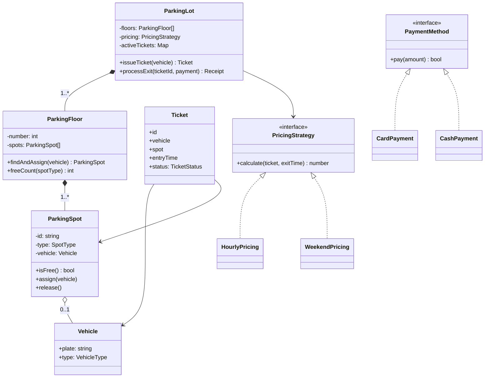

# Low-Level Design (LLD) / Object-Oriented Design Interview

> [!summary] What you'll learn
> How to approach the interview where you're asked to **design the classes for a system** (a parking lot, an elevator, a vending machine): a step-by-step framework, a fully worked example with reasoning at each step, the follow-up questions interviewers ask, and a practice list with hints.
>
> **What it is:** low-level design (LLD), also called object-oriented design (OOD), focuses on **code structure inside one application**: classes, responsibilities, relationships, method signatures, and how objects collaborate. It's different from [[System Design Interview Framework|high-level system design]], which is about servers, databases, and scaling across machines.
>
> **Who asks it:** Amazon's SDE I (L4) loop typically includes an OOD round (instead of large-scale system design). Microsoft, Uber, Flipkart, and many startups have LLD or "machine coding" rounds where you write working code in 60–90 minutes. Even when there's no dedicated round, this is how you'll be judged on design in coding interviews and real code reviews.

Back to [[Design Index]] · Related: [[OOP Fundamentals]] · [[SOLID Principles]] · [[Behavioral Patterns]] · [[Creational Patterns]]

---

## What interviewers evaluate

1. **Requirements gathering**: do you clarify scope before designing?
2. **Object modeling**: do you find the right entities and give each a clear, single responsibility?
3. **Relationships**: sensible use of composition, inheritance, and interfaces.
4. **OOP principles**: encapsulation (state guarded by methods), SRP, Open/Closed, programming to interfaces.
5. **Patterns (when natural)**: Strategy for variable rules, State for lifecycles, Observer for notifications, Factory for creation. Forced patterns count against you.
6. **Extensibility**: can your design absorb the follow-up ("now add reservations") without a rewrite?
7. **Correctness details**: edge cases, error handling, **concurrency** on shared resources.
8. **Communication**: thinking out loud, explaining tradeoffs, responding to hints.

> [!important] Reasoning beats pattern names
> Saying "I'll use the Strategy pattern" earns little by itself. Saying "pricing rules differ by vehicle type and the business will add weekend rates, so I'm putting pricing behind an interface. New rules become new classes and the parking logic doesn't change" earns a lot.

---

## The framework (45–60 minutes)

| Step | Time | What to do | Output |
|---|---|---|---|
| **1. Clarify requirements** | 5–8 min | Ask about actors, core use cases, scope, scale, constraints | A short written list of in-scope features |
| **2. Identify core entities** | 5 min | Nouns in the requirements → candidate classes; verbs → methods | List of classes + one-line responsibility each |
| **3. Define relationships** | 5 min | is-a / has-a, multiplicities, which classes own which | A class diagram sketch |
| **4. Define interfaces & key methods** | 10 min | Public methods, enums, interfaces for variable behavior | Method signatures |
| **5. Walk through use cases** | 5 min | Trace the main flows through your objects | Confidence the design works |
| **6. Code the core** | 15–20 min | If asked (or in machine coding): core classes and main flow | Working-ish code |
| **7. Extensions & edge cases** | 5–10 min | Follow-ups, concurrency, failure cases | Shows extensibility |

### Step 1 in detail: questions to ask
- **Actors**: Who uses the system? (customers, admins, staff, other systems)
- **Core use cases**: What are the 3–5 things it must do?
- **Variations**: Different types of X? (vehicle sizes, user tiers, payment methods)
- **Rules**: How is pricing/scheduling/allocation decided?
- **Scale & concurrency**: Single machine? Multiple entry points acting at once?
- **Out of scope**: Explicitly park things like UI, persistence details, auth.

> Write the agreed requirements down. You'll refer back to them, and it shows structure.

### Step 2 in detail: finding classes
Underline nouns in the requirements. Not every noun becomes a class:
- **Becomes a class** if it has its own **state and behavior** (`ParkingSpot`: has a status, can be assigned or released).
- **Becomes an enum** if it's a fixed set of categories (`SpotType`, `VehicleType`, `OrderStatus`).
- **Becomes an attribute** if it's just data on something else (a ticket's entry time).
- **Watch out for "manager" god classes**. `ParkingLotManager` that does everything violates SRP. Distribute responsibilities to the objects that own the relevant data ("information expert").

### Common modeling mistakes
- One giant class with all the logic.
- Using inheritance for things that vary by **data** or **rule** (e.g., `HourlyTicket` vs `DailyTicket` subclasses when pricing should be a Strategy).
- Public mutable fields everywhere (no encapsulation).
- Ignoring the distinction between a **type of thing** and an **instance** (Book vs BookCopy in a library: the library can own 3 copies of the same book).
- Forgetting **concurrency** on shared resources (two people booking the same seat).

---

## Worked example: Parking Lot (with the reasoning)

### Step 1: requirements (as clarified with the interviewer)
**In scope:**
1. The lot has multiple **floors**; each floor has many **spots**.
2. Spot sizes: `MOTORCYCLE`, `COMPACT`, `LARGE`. Vehicles: motorcycle, car, truck.
   - Motorcycles can park in any spot; cars in compact or large; trucks only in large.
3. On entry, a vehicle is assigned the **first suitable free spot** and gets a **ticket**.
4. On exit, the **fee** is computed from duration and vehicle type; the driver pays (card or cash); the spot is freed.
5. Display boards show **free spots per type** per floor.
6. Multiple entry and exit gates operate **at the same time**.

**Out of scope (for now):** reservations, monthly passes, EV charging, persistence.

### Step 2: entities and responsibilities
| Class / Enum | Responsibility |
|---|---|
| `ParkingLot` | Entry point: issues tickets, processes exits; owns floors and the pricing policy |
| `ParkingFloor` | Holds spots; finds a free spot for a vehicle type; tracks availability counts |
| `ParkingSpot` | Knows its type and whether it's occupied; assign/release with validation |
| `Vehicle` (+ type) | License plate and vehicle type |
| `Ticket` | Records vehicle, spot, entry time, status |
| `PricingStrategy` (interface) | Computes the fee for a ticket |
| `PaymentMethod` (interface) | Charges an amount (card, cash) |
| `SpotType`, `VehicleType`, `TicketStatus` (enums) | Fixed categories |
| `DisplayBoard` | Shows availability; observes floors |

**Design decisions and why:**
- **Pricing is a Strategy**: rates vary by vehicle type and the business will add weekend or event pricing. New rules shouldn't require editing `ParkingLot` (Open/Closed).
- **Payment is an interface**: card and cash behave differently, and more methods will come.
- **Vehicle type is an enum, not a subclass hierarchy**: vehicles here differ only in data (which spots they fit), not behavior. If they had meaningfully different behavior, subclasses could make sense.
- **The fit rules** (which vehicle fits which spot) live in one table so they're easy to change.
- **Display boards observe floors** (Observer): floors don't need to know how many boards exist.

### Step 3: class diagram


### Steps 4–6: core code
```javascript
// ---- Enums & rules ----
const SpotType = Object.freeze({ MOTORCYCLE: "MOTORCYCLE", COMPACT: "COMPACT", LARGE: "LARGE" });
const VehicleType = Object.freeze({ MOTORCYCLE: "MOTORCYCLE", CAR: "CAR", TRUCK: "TRUCK" });
const TicketStatus = Object.freeze({ ACTIVE: "ACTIVE", PAID: "PAID" });

// Which spot types each vehicle can use, in preference order (smallest suitable first)
const FITS = {
  [VehicleType.MOTORCYCLE]: [SpotType.MOTORCYCLE, SpotType.COMPACT, SpotType.LARGE],
  [VehicleType.CAR]:        [SpotType.COMPACT, SpotType.LARGE],
  [VehicleType.TRUCK]:      [SpotType.LARGE],
};

// ---- Spot: guards its own state (encapsulation) ----
class ParkingSpot {
  #vehicle = null;
  constructor(id, type) { this.id = id; this.type = type; }
  isFree() { return this.#vehicle === null; }
  assign(vehicle) {
    if (!this.isFree()) throw new Error(`Spot ${this.id} is occupied`);
    this.#vehicle = vehicle;
  }
  release() { this.#vehicle = null; }
}

// ---- Floor: finds spots, notifies observers ----
class ParkingFloor {
  #listeners = [];
  constructor(number, spots) { this.number = number; this.spots = spots; }

  onChange(fn) { this.#listeners.push(fn); }               // Observer for display boards
  #notify() { this.#listeners.forEach(fn => fn(this)); }

  findAndAssign(vehicle) {
    for (const type of FITS[vehicle.type]) {
      const spot = this.spots.find(s => s.type === type && s.isFree());
      if (spot) { spot.assign(vehicle); this.#notify(); return spot; }
    }
    return null;
  }
  release(spot) { spot.release(); this.#notify(); }
  freeCount(type) { return this.spots.filter(s => s.type === type && s.isFree()).length; }
}

// ---- Pricing strategies ----
class HourlyPricing {
  constructor(ratesPerHour) { this.rates = ratesPerHour; }        // e.g. { CAR: 4, TRUCK: 8, MOTORCYCLE: 2 }
  calculate(ticket, exitTime) {
    const hours = Math.max(1, Math.ceil((exitTime - ticket.entryTime) / 3_600_000));  // minimum 1 hour
    return hours * this.rates[ticket.vehicle.type];
  }
}

// ---- Lot: orchestrates the use cases ----
class ParkingLot {
  #active = new Map();
  constructor(floors, pricing) { this.floors = floors; this.pricing = pricing; }

  issueTicket(vehicle) {
    for (const floor of this.floors) {
      const spot = floor.findAndAssign(vehicle);
      if (spot) {
        const ticket = { id: crypto.randomUUID(), vehicle, spot, floor, entryTime: Date.now(), status: TicketStatus.ACTIVE };
        this.#active.set(ticket.id, ticket);
        return ticket;
      }
    }
    throw new Error("Parking lot is full for this vehicle type");
  }

  processExit(ticketId, paymentMethod, now = Date.now()) {
    const ticket = this.#active.get(ticketId);
    if (!ticket) throw new Error("Invalid or already-used ticket");
    const fee = this.pricing.calculate(ticket, now);
    if (!paymentMethod.pay(fee)) throw new Error("Payment failed");   // spot stays occupied until paid
    ticket.floor.release(ticket.spot);
    ticket.status = TicketStatus.PAID;
    this.#active.delete(ticketId);
    return { ticketId, fee, paidAt: now };
  }
}

// ---- Wiring ----
const floor1 = new ParkingFloor(1, [
  new ParkingSpot("1-M1", SpotType.MOTORCYCLE),
  new ParkingSpot("1-C1", SpotType.COMPACT),
  new ParkingSpot("1-L1", SpotType.LARGE),
]);
const lot = new ParkingLot([floor1], new HourlyPricing({ CAR: 4, TRUCK: 8, MOTORCYCLE: 2 }));
floor1.onChange(f => console.log(`Floor ${f.number}: ${f.freeCount(SpotType.COMPACT)} compact free`));

const t = lot.issueTicket({ plate: "ABC123", type: VehicleType.CAR });
lot.processExit(t.id, { pay: (amt) => true });
```

### Step 5: walking through a use case out loud
> "A car arrives at gate 2. The gate calls `lot.issueTicket(car)`. The lot asks each floor to `findAndAssign`. Floor 1 checks compact spots first, then large, per the fit table. It finds `1-C1`, the spot validates it's free and assigns the car, and the floor notifies display boards. The lot creates a ticket and stores it in active tickets. On exit, `processExit` computes the fee through the pricing strategy, charges through the payment interface, and only then releases the spot."

### Step 7: follow-ups and how the design absorbs them
| Follow-up | How to handle it |
|---|---|
| **"Two gates assign the same spot at the same time?"** | `findAndAssign` must be **atomic**. In one process: a lock per floor (or a single-threaded assignment queue). With a database: an atomic conditional update, `UPDATE spots SET vehicle_id = ? WHERE id = ? AND vehicle_id IS NULL`, and check that 1 row was updated; if 0, try the next spot. (See optimistic locking in [[Databases & Storage]].) |
| **"Finding a spot is slow with 10,000 spots"** | Keep a **free list / queue per spot type per floor** (O(1) pop) instead of scanning. Or a min-heap keyed by distance to the entrance for "nearest spot." |
| **"Add weekend/event pricing"** | New `PricingStrategy` implementations; select by date/event. No changes to `ParkingLot`. |
| **"Add reservations"** | New `Reservation` entity (vehicle, spot type, time window). Spot status becomes `FREE / RESERVED / OCCUPIED`; use the **State** pattern if transitions get complex. |
| **"Add EV charging spots"** | New `SpotType.EV` + fit rules + a charging fee component (a decorator around the pricing strategy). |
| **"Lost ticket"** | Look up by license plate (index active tickets by plate); charge the max daily fee. |
| **"Persist tickets"** | `TicketRepository` interface (Repository pattern) injected into `ParkingLot`. |
| **"Multiple lots in a city"** | `ParkingLot` stops being a singleton; a `ParkingSystem` holds lots. |

---

## Practice problems (with the key idea for each)

| Problem | Core entities | Key ideas / patterns to show |
|---|---|---|
| **Parking lot** | Lot, Floor, Spot, Ticket, Vehicle | Strategy (pricing), Observer (displays), fit rules, concurrency on spot assignment |
| **Elevator system** | ElevatorController, Elevator, Request, Floor buttons | **State** (idle/moving up/moving down/doors open), **Strategy** for scheduling (nearest car, SCAN/LOOK algorithms), Command (requests queue) |
| **Vending machine** | Machine, Inventory, Product, Coin/Payment | **State** (idle → has money → dispensing → giving change), change-making, out-of-stock handling |
| **ATM** | ATM, Card, Account, CashDispenser, Transaction | State (card inserted, PIN verified...), Chain of Responsibility for dispensing bills ($100 → $50 → $20), transaction atomicity |
| **Library management** | Library, **Book vs BookCopy**, Member, Loan, Fine | Type vs instance distinction, borrowing limits, overdue fines (Strategy), search |
| **Movie ticket booking (BookMyShow)** | Movie, Theater, Screen, Show, Seat, Booking | **Seat locking with a timeout** while paying, concurrency (two users, same seat), booking states |
| **Hotel / meeting room booking** | Room, Booking, Calendar | Interval overlap check (`startA < endB && startB < endA`), availability search |
| **Chess** | Board, Piece hierarchy, Player, Game, Move | Polymorphic `canMove()` per piece (true "is-a" inheritance is fine here), turn management, Command for move history/undo |
| **Tic-tac-toe / Snake & Ladder** | Board, Player, Game | Game loop, win detection, extensible board size |
| **Splitwise (expense sharing)** | User, Group, Expense, Split, BalanceSheet | Split **Strategy** (equal, exact, percentage), validation that splits add up, debt simplification |
| **LRU cache** | Cache, Node | HashMap + doubly linked list for O(1) get/put; eviction policy as Strategy for extensibility |
| **Rate limiter (in-process)** | RateLimiter, Bucket | Token bucket algorithm; Strategy to switch algorithms. See [[Design a Rate Limiter]] |
| **Logger framework** | Logger, Level, Appender/Sink, Formatter | Chain of Responsibility (levels), Strategy (sinks: console/file/remote), Singleton-ish access |
| **Pub/Sub or event bus** | Broker, Topic, Subscriber, Message | Observer, async delivery, subscriber failure isolation |
| **Shopping cart / e-commerce** | Cart, Product, Order, Payment, Inventory | Order **State** machine, Payment Strategy, discount rules (Strategy or Specification), inventory reservation |
| **Food delivery** | Restaurant, Menu, Order, DeliveryAgent | Order state machine, agent assignment Strategy, notifications (Observer) |
| **Ride sharing** | Rider, Driver, Trip, Location | Matching Strategy, Trip states, surge pricing Strategy |
| **File system** | File, Directory | **Composite** (directories contain files or directories), path resolution, permissions |
| **Notification service** | Notification, Channel, Template, Preferences | Factory/Strategy for channels (email/SMS/push), user preferences, retries |
| **In-memory key-value store with TTL** | Store, Entry | Lazy expiry on read + periodic cleanup, eviction policies |

> [!example] Practice routine
> One problem per day: 10 minutes of requirements + class list, 10 minutes for a class diagram, 30 minutes coding the core classes in JS/TS, 10 minutes writing down three follow-ups and how your design would handle them. Save your solutions in this vault (e.g., `design/LLD practice/`) so you can compare later attempts.

---

## Final checklist before saying "done"
- [ ] Requirements are written down and the design covers each one
- [ ] Every class has one clear responsibility (no God class)
- [ ] State is private and changed only through methods that enforce rules
- [ ] Enums for fixed categories; interfaces where several implementations exist or are expected
- [ ] Lifecycle/status transitions are explicit and validated
- [ ] Walked through at least one main use case end to end
- [ ] Addressed concurrency on shared resources
- [ ] Covered edge cases (full, not found, invalid input, payment failure)
- [ ] Explained how the design extends for at least one follow-up

Next: [[Architectural Styles]]
