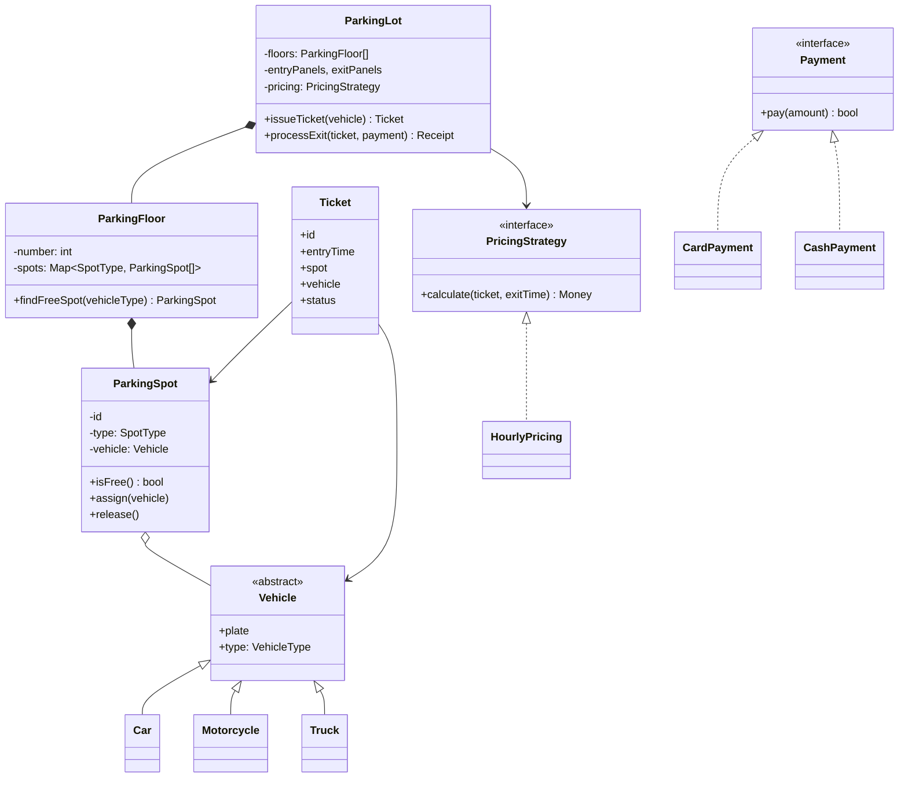

# Low-Level Design (LLD) / Object-Oriented Design Interview

> [!summary]
> The LLD/OOD round asks you to **model a system as classes**: their responsibilities, relationships, and key methods. At Amazon, the SDE I (L4) onsite typically includes an **OOD round** (parking lot, library, elevator) *instead of* large-scale system design. Some companies (Uber, Flipkart, many startups) run a "machine coding" variant where you write working code in 60–90 min.
>
> **What's graded:** clarifying requirements, clean class decomposition, OOP principles (encapsulation, SRP), sensible use of patterns, handling follow-up changes, communication. Reasoning matters more than perfect UML or pattern names.

Back to [[Design Index]] · Related: [[OOP Fundamentals]] · [[SOLID Principles]] · [[Behavioral Patterns]]

---

## The framework (≈45–60 min)

| Step | Time | What to do |
|---|---|---|
| 1. **Clarify requirements** | 5–8 min | Who are the actors? Core use cases? What's out of scope? Concurrency? Scale? |
| 2. **Identify entities** | 5 min | Underline the **nouns** in requirements → candidate classes. **Verbs** → methods. |
| 3. **Define relationships** | 5 min | is-a / has-a, multiplicity (1..*), composition vs aggregation. Sketch a class diagram. |
| 4. **Define key methods & APIs** | 10 min | Public interface of each class. Walk through 1–2 main use cases end to end. |
| 5. **Apply patterns where natural** | ongoing | Strategy for pricing, State for lifecycle, Observer for notifications, Factory for creation, Singleton for the system root. |
| 6. **Code core classes** | 15–20 min | Only if asked, or in machine coding. Focus on the core flow. |
| 7. **Handle extensions & edge cases** | 5–10 min | "Now add reservations", concurrency (two cars grab the same spot), failure cases. |

> [!tip] Communication tips
> - Narrate: "I'm making `ParkingSpot` its own class because it has its own state and rules."
> - Ask before assuming: "Should we support multiple floors? Different vehicle sizes?"
> - Prefer **enums** for fixed categories (`SpotType`, `OrderStatus`).
> - Keep classes **small and cohesive**; don't make a god `ParkingLotManager`.
> - Mention **thread safety** where shared mutable state exists (assigning spots).

---

## Worked example: Parking Lot

### 1. Requirements (after clarifying)
- Multiple **floors**, each with many **spots**.
- Spot types: `MOTORCYCLE`, `COMPACT`, `LARGE`, `EV`. Vehicles: motorcycle, car, truck.
- A vehicle gets a **ticket** on entry, assigned the nearest suitable spot.
- On exit, **fee** is computed by duration and vehicle type; pay by card/cash.
- Display shows free spots per floor/type.
- Out of scope: reservations, monthly passes (follow-up).

### 2–3. Entities & relationships



### 4. Core flow in code

```javascript
const SpotType = Object.freeze({ MOTORCYCLE: "MOTORCYCLE", COMPACT: "COMPACT", LARGE: "LARGE" });
// which spot types each vehicle can use, in preference order
const ALLOWED = {
  motorcycle: [SpotType.MOTORCYCLE, SpotType.COMPACT, SpotType.LARGE],
  car:        [SpotType.COMPACT, SpotType.LARGE],
  truck:      [SpotType.LARGE],
};

class ParkingSpot {
  #vehicle = null;
  constructor(id, type) { this.id = id; this.type = type; }
  isFree() { return this.#vehicle === null; }
  assign(v) { if (!this.isFree()) throw new Error("Spot taken"); this.#vehicle = v; }
  release() { this.#vehicle = null; }
}

class ParkingFloor {
  constructor(number, spots) { this.number = number; this.spots = spots; }
  findFreeSpot(vehicleType) {
    for (const type of ALLOWED[vehicleType]) {
      const spot = this.spots.find(s => s.type === type && s.isFree());
      if (spot) return spot;
    }
    return null;
  }
}

class HourlyPricing {                               // Strategy
  rates = { motorcycle: 1, car: 3, truck: 6 };
  calculate(ticket, exitTime) {
    const hours = Math.ceil((exitTime - ticket.entryTime) / 3_600_000);
    return Math.max(1, hours) * this.rates[ticket.vehicle.type];
  }
}

class ParkingLot {
  static #instance;                                 // Singleton (one lot per process)
  static get() { return ParkingLot.#instance; }
  constructor(floors, pricing) { this.floors = floors; this.pricing = pricing; this.active = new Map(); ParkingLot.#instance = this; }

  issueTicket(vehicle) {
    // NOTE: in a real multithreaded system, find+assign must be atomic (lock per floor, or DB row lock / compare-and-set)
    for (const floor of this.floors) {
      const spot = floor.findFreeSpot(vehicle.type);
      if (spot) {
        spot.assign(vehicle);
        const ticket = { id: crypto.randomUUID(), vehicle, spot, entryTime: Date.now(), status: "ACTIVE" };
        this.active.set(ticket.id, ticket);
        return ticket;
      }
    }
    throw new Error("Lot full");
  }

  processExit(ticketId, paymentMethod) {
    const ticket = this.active.get(ticketId);
    if (!ticket) throw new Error("Invalid ticket");
    const fee = this.pricing.calculate(ticket, Date.now());
    if (!paymentMethod.pay(fee)) throw new Error("Payment failed");
    ticket.spot.release();
    ticket.status = "PAID";
    this.active.delete(ticketId);
    return { ticketId, fee };
  }
}
```

### 7. Follow-ups you should be ready for
- **Reservations**: add a `Reservation` entity; spot state becomes `FREE / RESERVED / OCCUPIED` (State pattern).
- **Different pricing** (weekend, EV charging): new `PricingStrategy` implementations (OCP).
- **Display boards**: Observer. Spots publish `spotFreed`/`spotTaken`; boards subscribe.
- **Concurrency**: two entry gates assigning the same spot. Use locks, atomic DB updates (`UPDATE spots SET vehicle=? WHERE id=? AND vehicle IS NULL`), or a single-threaded assignment queue.
- **Fast lookup**: keep a min-heap or free list per spot type per floor instead of linear scan.
- **Persistence**: `TicketRepository` interface (Repository pattern, DIP).

---

## Common LLD questions (practice list)

| Problem | Key patterns / ideas to show |
|---|---|
| Parking lot | Strategy (pricing), Singleton, Factory (vehicle), Observer (displays), concurrency |
| Elevator system | State (moving/idle/doors), Strategy (scheduling: SCAN/LOOK), Command (requests) |
| Vending machine | State (idle, has money, dispensing), inventory |
| ATM | State, Chain of Responsibility (bill dispensing), transactions |
| Library management | Entities (Book vs BookCopy!), member, loans, fines, search |
| Movie ticket booking (BookMyShow) | Seat locking with TTL, concurrency, payment, Show/Screen/Seat |
| Hotel / meeting room booking | Interval overlap checks, reservation state |
| Chess / Tic-tac-toe / Snake & Ladder | Board, Piece hierarchy (polymorphic `canMove`), game loop, turn management |
| Splitwise (expense sharing) | Split strategies (equal/exact/percent), balance simplification |
| LRU Cache | HashMap + doubly linked list; O(1) get/put |
| Rate limiter (class-level) | Token bucket; Strategy for algorithms. See [[Design a Rate Limiter]] |
| Logger | Singleton, Chain of Responsibility (levels), Strategy (sinks) |
| Pub/Sub / Event bus | Observer, topics, async delivery |
| Online shopping cart / Amazon | Cart, Order state machine, Payment strategy, Inventory |
| Food delivery (DoorDash) | Order state machine, assignment strategy, notifications |
| Ride sharing (Uber) LLD | Matching strategy, trip state, pricing (surge) strategy |
| File system | Composite (File/Directory) |
| Cache with TTL / In-memory key-value store | Expiry, eviction strategy |

> [!example] Practice approach
> Pick one per day. Spend 10 min on requirements and a class diagram, 30 min writing core classes in JS/TS, then 10 min listing extensions. Commit them to this vault under `design/LLD practice/`.

---

## LLD checklist (before you say "done")
- [ ] Every class has a single clear responsibility
- [ ] Enums for fixed categories
- [ ] Interfaces where multiple implementations exist (payment, pricing, notification)
- [ ] State transitions are explicit and validated
- [ ] Walked through the main use case end-to-end
- [ ] Mentioned concurrency/thread-safety for shared resources
- [ ] Mentioned how to extend for at least one follow-up
- [ ] Identified edge cases (full lot, invalid ticket, payment failure)

Next: [[Architectural Styles]]
