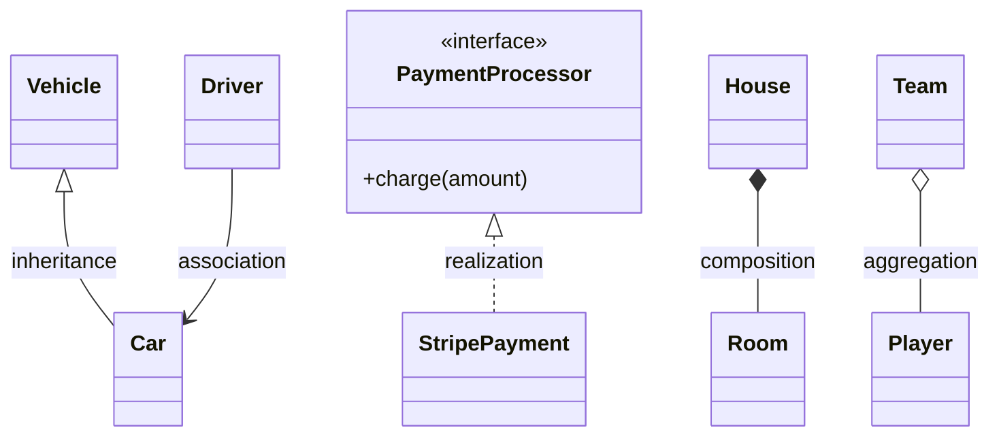

# OOP Fundamentals

> [!summary] Why this matters
> Every design pattern, every low-level design (LLD) interview, and most enterprise codebases (Java, C#, TypeScript, Python, Kotlin) are built on these ideas. If you can explain the four pillars **with examples and tradeoffs**, you're ahead of most new grads.

Back to [[Design Index]]

---

## The four pillars

### 1. Encapsulation
Bundle data with the methods that operate on it, and **hide internal state** behind a public interface.

- Callers depend on *what* an object does, not *how* it stores things.
- Lets you change internals without breaking callers.
- Enforces invariants (e.g., a balance can never go negative).

```javascript
class BankAccount {
  #balance = 0;               // private field (JS #private)

  deposit(amount) {
    if (amount <= 0) throw new Error("Deposit must be positive");
    this.#balance += amount;
  }

  withdraw(amount) {
    if (amount > this.#balance) throw new Error("Insufficient funds");
    this.#balance -= amount;
  }

  get balance() { return this.#balance; }   // read-only access
}
```

> [!tip] Interview phrasing
> "Encapsulation lets the class protect its invariants. Nobody outside can set `balance = -500` because the only way to change it is through methods that validate."

### 2. Abstraction
Expose only the **essential behavior**; hide complexity. Encapsulation is about *hiding data*; abstraction is about *hiding complexity / exposing the right concept*.

- An `EmailSender` interface with `send(to, subject, body)`. Callers don't care whether it's SMTP, SES, or SendGrid underneath.
- Achieved with interfaces, abstract classes, or just well-named functions/modules.

### 3. Inheritance
A class derives from another, reusing and extending its behavior ("**is-a**" relationship).

```javascript
class Vehicle {
  constructor(plate) { this.plate = plate; }
  wheels() { return 4; }
}
class Motorcycle extends Vehicle {
  wheels() { return 2; }       // override
}
```

**Problems with inheritance (know these!):**
- **Tight coupling**: child depends on parent internals ("fragile base class problem").
- Deep hierarchies get hard to reason about.
- Forces "is-a" even when the relationship is really "has-a" or "can-do".

### 4. Polymorphism
"Many forms": the same call behaves differently depending on the object's actual type.

- **Runtime (subtype) polymorphism**: method overriding; call `shape.area()` without knowing if it's a `Circle` or `Square`.
- **Compile-time (ad hoc) polymorphism**: method overloading (Java/C#/C++; JS doesn't really have it).
- **Parametric polymorphism**: generics (`List<T>`).

```javascript
const shapes = [new Circle(2), new Square(3)];
const total = shapes.reduce((sum, s) => sum + s.area(), 0); // each computes its own area
```

Polymorphism is what lets you replace `if/else` or `switch` on type with **objects that know how to do their own thing**. That idea is the heart of the [[Behavioral Patterns#Strategy|Strategy]] and [[Behavioral Patterns#State|State]] patterns.

---

## Composition over inheritance

> [!important] One of the most-cited design principles
> Prefer building objects out of smaller objects ("**has-a**") rather than inheriting ("**is-a**").

```javascript
// Inheritance explosion: FlyingDuck, SwimmingDuck, FlyingSwimmingDuck, RubberDuck...
// Composition: give a Duck behaviors.
class Duck {
  constructor(flyBehavior, quackBehavior) {
    this.flyBehavior = flyBehavior;
    this.quackBehavior = quackBehavior;
  }
  fly()   { return this.flyBehavior.fly(); }
  quack() { return this.quackBehavior.quack(); }
}
const rubberDuck = new Duck({ fly: () => "can't fly" }, { quack: () => "squeak" });
```

Use inheritance when there's a true, stable "is-a" relationship and you genuinely want to share behavior (e.g., framework base classes). Otherwise compose.

---

## Class relationships (UML vocabulary)

You'll use these words in LLD interviews and design docs.

| Relationship | Meaning | Example | Lifetime |
|---|---|---|---|
| **Association** | A uses/knows B | `Driver` – `Car` | Independent |
| **Aggregation** | A has B, but B can exist alone (weak "has-a") | `Team` has `Players` | B outlives A |
| **Composition** | A owns B; B dies with A (strong "has-a") | `House` has `Rooms` | B's lifetime bound to A |
| **Inheritance / Generalization** | A is a B | `Car` is a `Vehicle` | — |
| **Realization / Implementation** | A implements interface B | `StripePayment` implements `PaymentProcessor` | — |
| **Dependency** | A temporarily uses B (param, local var) | `ReportService.generate(printer)` | Very loose |



---

## Interfaces vs abstract classes

| | Interface | Abstract class |
|---|---|---|
| Purpose | A **contract** ("can-do") | A **partial implementation** ("is-a" + shared code) |
| State | Usually none | Can have fields |
| Multiple? | A class can implement many | Usually single inheritance |
| Use when | Unrelated classes share a capability (`Comparable`, `Serializable`) | Related classes share code + must implement some hooks |

> In TypeScript, `interface` is a compile-time contract only. In plain JS there are no interfaces; you rely on duck typing ("if it has a `.send()` it's a sender").

---

## Coupling & cohesion

- **Cohesion**: how focused a module is. **High cohesion = good**: everything in `InvoiceCalculator` is about calculating invoices.
- **Coupling**: how much modules depend on each other. **Low coupling = good**: changing one doesn't ripple everywhere.
- Goal: **high cohesion, low coupling**. Nearly every principle in [[SOLID Principles]] and [[Design Principles]] serves this goal.

Types of coupling, from worst to best (useful vocab):
1. **Content**: one module reaches into another's internals.
2. **Common/global**: shared global state.
3. **Control**: passing flags that tell another module what to do (`process(data, isAdmin=true)`).
4. **Stamp**: passing a whole object when only a field is needed.
5. **Data**: passing only the primitive data needed. ✅

---

## Other must-know OOP terms

- **Object vs class**: a class is a blueprint; an object is an instance.
- **Constructor / destructor**: initialization / cleanup.
- **Static members**: belong to the class, not instances (shared).
- **Access modifiers**: `public`, `private`, `protected`, package/internal.
- **Method overriding vs overloading**: same signature in subclass vs same name with different params.
- **Immutability**: objects whose state can't change after creation. Thread-safe, easier to reason about. Favor it for value objects (`Money`, `DateRange`).
- **Value object vs entity**: value objects are equal by value (two `$5` are the same); entities have identity (two users named "Bob" are different). See [[Domain-Driven Design]].
- **Dependency injection (DI)**: pass dependencies *in* rather than constructing them inside. Enables testing and swapping implementations. Spring (Java), .NET, Angular, and NestJS are DI-heavy. See [[SOLID Principles#D — Dependency Inversion Principle (DIP)|DIP]].

```javascript
// ❌ hard-wired dependency
class OrderService {
  constructor() { this.db = new PostgresClient(); }
}
// ✅ injected — easy to pass a fake in tests
class OrderService {
  constructor(db) { this.db = db; }
}
```

---

## Quick self-test
- [ ] Explain encapsulation vs abstraction in one sentence each.
- [ ] Why might you prefer composition over inheritance? Give an example.
- [ ] Composition vs aggregation: what's the difference?
- [ ] When would you use an abstract class instead of an interface?
- [ ] What is dependency injection and why does it help testing?

Next: [[SOLID Principles]]
