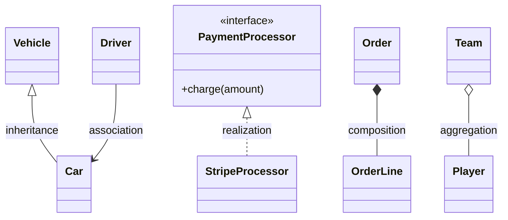

# OOP Fundamentals

> [!summary] What you'll learn
> Object-oriented programming (OOP) organizes code around **objects**: bundles of data (state) plus the functions that operate on that data (behavior). This note explains the four pillars (encapsulation, abstraction, inheritance, polymorphism), why "composition over inheritance" is the most-repeated advice in software design, how to describe relationships between classes, and the coupling/cohesion ideas that every other design principle is built on.
>
> **Why it matters:** design patterns, SOLID, low-level design interviews, and most enterprise codebases (Java, C#, TypeScript, Kotlin, Python) assume you think in these terms. Even in JavaScript/React, where you may write mostly functions, the *ideas* (hiding state, programming to contracts, swapping implementations) are the same.

Back to [[Design Index]] · Next: [[SOLID Principles]]

---

## Classes and objects: the starting point

A **class** is a blueprint: it describes what data an object holds and what it can do. An **object** (instance) is one concrete thing built from that blueprint, with its own copy of the data.

```javascript
class User {
  constructor(name, email) {   // runs when you call `new User(...)`
    this.name = name;          // instance fields: each object gets its own
    this.email = email;
  }
  greet() {                    // method: behavior shared by all Users
    return `Hi, ${this.name}`;
  }
}

const a = new User("Brendan", "b@example.com");
const b = new User("Ana", "ana@example.com");
a.greet(); // "Hi, Brendan"
```

**The problem OOP was invented to solve:** in large procedural programs, data lives in global structures and any function anywhere can change it. When something goes wrong, you can't tell *who* changed the data or *which rules* were supposed to apply. OOP puts the data and the rules for that data **in the same place**, and restricts who can touch the data. That makes big programs easier to reason about, change, and divide among teams.

---

## Pillar 1: Encapsulation

### What it is
Encapsulation means **keeping an object's internal state private** and only allowing changes through the object's own methods. The outside world interacts with a small public surface (the *interface*) and never reaches into the internals.

### The problem it solves
Imagine a bank account represented as a plain object:

```javascript
const account = { balance: 100 };
account.balance = -5000;   // nothing stops this
```

Every piece of code that touches `account` must remember the rule "balance can't go negative." If even one place forgets, you have corrupted data, and you'd have to search the whole codebase to find which place did it.

With encapsulation, the rule lives in **one place**, and it's impossible to bypass:

```javascript
class BankAccount {
  #balance = 0;                 // `#` = truly private field in modern JS

  deposit(amount) {
    if (amount <= 0) throw new Error("Deposit must be positive");
    this.#balance += amount;
  }

  withdraw(amount) {
    if (amount > this.#balance) throw new Error("Insufficient funds");
    this.#balance -= amount;
  }

  get balance() { return this.#balance; }  // read-only from outside
}

const acct = new BankAccount();
acct.deposit(100);
acct.balance;          // 100
acct.balance = -5000;  // ignored (no setter); acct.#balance is a SyntaxError outside the class
```

### Key vocabulary
- **Invariant**: a rule that must always be true about an object ("balance ≥ 0", "an order's total equals the sum of its lines"). Encapsulation is how you *guarantee* invariants.
- **Access modifiers** (Java/C#/TS): `public` (anyone), `private` (only this class), `protected` (this class + subclasses), package/internal (same module).
- **Getters/setters**: controlled access. A setter that just assigns with no validation provides almost no encapsulation. The value comes from *validating* or *hiding* things.

### When to use it
Always, by default. Make fields private and expose behavior, not data. A good habit: instead of `account.setBalance(account.getBalance() - 50)`, write `account.withdraw(50)`. The object makes its own decisions. (This is the "Tell, Don't Ask" principle in [[Design Principles]].)

### Benefits in practice
- You can **change the internals** (store cents instead of dollars, add caching) without breaking any caller.
- Bugs are localized: if the balance is wrong, the bug is inside `BankAccount`.
- Easier to make thread-safe: only the class's own methods touch the state.

---

## Pillar 2: Abstraction

### What it is
Abstraction means **exposing only what a caller needs to know and hiding the complexity of how it's done.** You give people a simple concept to work with.

The difference from encapsulation is subtle but often asked:
- **Encapsulation** = *protecting data* (hide the fields, guard the invariants).
- **Abstraction** = *hiding complexity* (present a simple concept; callers don't need the details).

They usually show up together.

### The problem it solves
Code that depends on details is fragile. If your checkout code is full of Stripe-specific HTTP calls, switching providers (or adding PayPal) means rewriting checkout. If checkout only knows "there's a thing that can `charge(amount)`," the details can change freely.

```typescript
// The abstraction: what any payment processor can do
interface PaymentProcessor {
  charge(amountCents: number, currency: string): Promise<{ id: string }>;
}

// Details hidden behind it
class StripeProcessor implements PaymentProcessor {
  async charge(amountCents: number, currency: string) {
    // build HTTP request, auth headers, retries, parse Stripe's response format...
    return { id: "ch_123" };
  }
}

// Checkout depends only on the abstraction
async function checkout(cart: Cart, payments: PaymentProcessor) {
  const result = await payments.charge(cart.totalCents, "USD");
  return result.id;
}
```

Everyday examples: `fetch(url)` hides TCP sockets, TLS, and HTTP parsing. `array.sort()` hides the sorting algorithm. A car's steering wheel hides the steering rack.

### How it's achieved
- **Interfaces / abstract classes** (Java, C#, TypeScript).
- **Well-named functions and modules**: `sendWelcomeEmail(user)` is an abstraction over templates, SMTP, and retries.
- **Duck typing** in JS: anything with a `.charge()` method works.

### When to use it
At **boundaries where change is likely**: third-party services, storage, I/O, and algorithms that vary. Don't add an interface for every class "just in case" (see YAGNI in [[Design Principles]]). One implementation and no foreseeable second one usually means you don't need the extra layer yet.

---

## Pillar 3: Inheritance

### What it is
A **subclass** (child) derives from a **superclass** (parent), automatically getting its fields and methods and optionally **overriding** some. It models an **"is-a"** relationship: a `Motorcycle` *is a* `Vehicle`.

```javascript
class Vehicle {
  constructor(plate) { this.plate = plate; }
  wheels() { return 4; }
  describe() { return `${this.plate} has ${this.wheels()} wheels`; }
}

class Motorcycle extends Vehicle {
  wheels() { return 2; }           // override
}

new Motorcycle("ABC123").describe(); // "ABC123 has 2 wheels": parent code calls the child's override
```

### The problem it solves
Code reuse and a shared type. Several related classes share fields and behavior; you write it once in the parent. Code can also treat all subclasses uniformly as the parent type (which enables polymorphism, below).

### Why inheritance is often a trap
Inheritance is the **tightest form of coupling** between two classes. The child depends not only on the parent's public interface but often on its *internal behavior*:

1. **Fragile base class problem**: a change to the parent (even a "harmless" internal refactor) can silently break subclasses you didn't know existed.
2. **Rigid hierarchies**: real-world categories don't form clean trees. Is a `FlyingCar` a `Car` or an `Aircraft`? Most languages allow only single inheritance.
3. **Class explosion**: to combine features you end up with `LoggingCachingRetryingHttpClient`.
4. **Inheriting things you don't want**: `Penguin extends Bird` inherits `fly()`. Now you have to override it to throw an error, which breaks the [[SOLID Principles#L — Liskov Substitution Principle (LSP)|Liskov Substitution Principle]].

### When to use it
- A **genuine, stable "is-a"** relationship where the subclass can be used anywhere the parent is expected without surprises.
- **Framework extension points** that are designed for it (e.g., `class MyError extends Error`, React class components historically, Java's `HttpServlet`).
- Shallow hierarchies (1–2 levels). Deep trees are a smell.

---

## Pillar 4: Polymorphism

### What it is
"Many forms." **The same method call does different things depending on the actual object it's called on.** The calling code doesn't need to know or care which specific type it has.

```javascript
class Circle { constructor(r) { this.r = r; }  area() { return Math.PI * this.r ** 2; } }
class Square { constructor(s) { this.s = s; }  area() { return this.s ** 2; } }
class Triangle { constructor(b, h) { this.b = b; this.h = h; } area() { return 0.5 * this.b * this.h; } }

const shapes = [new Circle(1), new Square(2), new Triangle(3, 4)];
const total = shapes.reduce((sum, s) => sum + s.area(), 0);  // each shape computes its own area
```

### The problem it solves
Without polymorphism you write **type-checking conditionals** everywhere:

```javascript
function area(shape) {
  if (shape.type === "circle") return Math.PI * shape.r ** 2;
  if (shape.type === "square") return shape.s ** 2;
  // add triangle → edit this function, and perimeter(), and draw(), and toJSON()...
}
```

Every new type means hunting down every `if/switch` in the codebase. With polymorphism, you add one new class and nothing else changes. That's the [[SOLID Principles#O — Open/Closed Principle (OCP)|Open/Closed Principle]], and it's the core mechanism behind the [[Behavioral Patterns#Strategy|Strategy]], [[Behavioral Patterns#State|State]], and [[Behavioral Patterns#Command|Command]] patterns.

### Kinds of polymorphism
| Kind | How | Example |
|---|---|---|
| **Subtype (runtime)** | Subclasses/implementations override a method; the right one is chosen at runtime ("dynamic dispatch") | `shape.area()` |
| **Ad hoc (overloading)** | Same function name, different parameter types/counts, chosen at compile time | Java `print(int)` vs `print(String)`. JS doesn't support true overloading. |
| **Parametric (generics)** | Code works over any type parameter | `List<T>`, `Array<T>`, `Map<K, V>` |
| **Duck typing** | "If it has `.area()`, it's a shape" (no declared relationship needed) | JavaScript, Python |

### When to use it
Whenever you see a `switch`/`if` on a "type" or "mode" field that's **repeated in several places** or **grows over time**. One `switch` in one factory is fine; the same `switch` copied into five functions is the smell.

---

## Composition over inheritance

> [!important] One of the most cited design principles
> **Build objects by combining smaller objects that each do one thing ("has-a") rather than by inheriting from a parent ("is-a").** From the 1994 *Design Patterns* (Gang of Four) book: "Favor object composition over class inheritance."

### The problem
Suppose you model ducks with inheritance:

```
Duck
├── MallardDuck      (flies, quacks)
├── RubberDuck       (doesn't fly, squeaks)
├── DecoyDuck        (doesn't fly, silent)
└── RobotDuck        (flies with rockets, beeps)
```

The `fly()` and `quack()` behaviors get duplicated or awkwardly overridden in every subclass. Adding "swims" or "can be remote-controlled" multiplies the subclasses.

### The solution: compose behaviors

```javascript
// Small, focused behavior objects
const flyWithWings = { fly: () => "flap flap" };
const cannotFly    = { fly: () => "can't fly" };
const quack        = { sound: () => "quack" };
const squeak       = { sound: () => "squeak" };

class Duck {
  constructor(name, flyBehavior, soundBehavior) {
    this.name = name;
    this.flyBehavior = flyBehavior;     // has-a
    this.soundBehavior = soundBehavior; // has-a
  }
  fly()  { return this.flyBehavior.fly(); }
  speak() { return this.soundBehavior.sound(); }
  setFlyBehavior(b) { this.flyBehavior = b; }   // can change at runtime!
}

const mallard = new Duck("Mallard", flyWithWings, quack);
const rubber  = new Duck("Rubber", cannotFly, squeak);
```

### Why it's better
- **Mix and match**: any combination of behaviors without a subclass for each.
- **Change at runtime**: swap a behavior object while the program runs.
- **Loose coupling**: `Duck` only depends on "something with `.fly()`", not on a parent's internals.
- **Easier testing**: inject a fake behavior.

### When inheritance is still fine
When the relationship is truly "is-a," stable, and shallow, and you want the shared code. Example: `class ValidationError extends Error`. Rule of thumb: **reach for composition first; use inheritance when it clearly fits.**

> React learned this lesson too: its docs recommend composition (passing components as props/children) over component inheritance, and hooks replaced most class-based reuse.

---

## Describing relationships between classes (UML vocabulary)

In low-level design interviews and design docs, you'll describe how classes relate. These words have precise meanings:

| Relationship | Meaning | Example | Lifetime |
|---|---|---|---|
| **Association** | A knows about/uses B (often stored as a field) | `Driver` → `Car` | Independent |
| **Aggregation** | A *has* Bs, but Bs can exist without A (weak has-a) | `Team` has `Player`s; delete the team, players still exist | Independent |
| **Composition** | A *owns* Bs; Bs don't exist without A (strong has-a) | `Order` has `OrderLine`s; delete the order, the lines go too | B's lifetime = A's |
| **Inheritance (generalization)** | A is a B | `Car` is a `Vehicle` | — |
| **Realization (implementation)** | A implements interface B | `StripeProcessor` implements `PaymentProcessor` | — |
| **Dependency** | A uses B temporarily (parameter or local variable) | `ReportService.print(printer)` | Very loose |



**Multiplicity** describes how many: `1`, `0..1`, `*` (many), `1..*` (at least one). E.g., "a `ParkingFloor` has `1..*` `ParkingSpot`s."

---

## Interfaces vs abstract classes

Both define a contract that other classes fulfill, but they solve different problems.

| | Interface | Abstract class |
|---|---|---|
| What it is | A pure **contract**: method signatures, no implementation (Java 8+ allows default methods) | A **partially implemented** class that can't be instantiated directly |
| State (fields) | None | Can have fields |
| Multiple? | A class can implement **many** interfaces | A class can extend **one** class (in most languages) |
| Relationship | "**can-do**" (`Comparable`, `Serializable`, `Closeable`) | "**is-a**" + shared code |
| Use when | Unrelated classes share a capability; you want maximum flexibility | Related classes share real code, and each must fill in a few specific steps (see [[Behavioral Patterns#Template Method\|Template Method]]) |

In **TypeScript**, `interface` exists only at compile time. In **plain JavaScript** there are no interfaces; you rely on duck typing and documentation (or JSDoc types).

---

## Coupling and cohesion: the goal behind everything

These two ideas are the "why" behind nearly every principle and pattern.

### Cohesion: how focused is a module?
**High cohesion** means everything in a module/class belongs together and serves one purpose. An `InvoiceCalculator` that only calculates invoice totals, taxes, and discounts is highly cohesive. A `Utils` class with `formatDate`, `sendEmail`, and `parseCsv` has low cohesion.

*Why it matters:* cohesive modules are easy to name, understand, test, and reuse. When requirements change, the change is localized.

### Coupling: how much do modules depend on each other?
**Low (loose) coupling** means a module can change without forcing changes elsewhere. High coupling means a change ripples across the codebase.

Types of coupling, from **worst to best**:
1. **Content coupling**: module A reaches into B's internals (modifies its private data). Worst.
2. **Common/global coupling**: modules share global mutable state.
3. **Control coupling**: A passes a flag telling B *how* to do its job (`render(data, isPrintMode)`).
4. **Stamp coupling**: A passes a whole object when B needs only one field.
5. **Data coupling**: A passes only the simple data B needs. Best.

> [!tip] The one-line goal
> **High cohesion, low coupling.** SOLID, design patterns, microservice boundaries, and clean architecture are all strategies for achieving this at different scales.

---

## Dependency Injection (DI)

### The problem
```javascript
class OrderService {
  constructor() {
    this.db = new PostgresClient("prod-connection-string");  // hard-wired
    this.mailer = new SendGridMailer(process.env.KEY);
  }
}
```
You can't unit test `OrderService` without a real database and email provider. You can't swap Postgres for something else without editing this class. The class creates its own dependencies, so it's tightly coupled to them.

### The solution
**Pass dependencies in** (usually through the constructor) instead of creating them inside:

```javascript
class OrderService {
  constructor(db, mailer) {       // injected
    this.db = db;
    this.mailer = mailer;
  }
  async place(order) {
    await this.db.insert("orders", order);
    await this.mailer.send(order.email, "Order confirmed");
  }
}

// Production wiring (often in one "composition root" file)
const service = new OrderService(new PostgresClient(url), new SendGridMailer(key));

// Test wiring: fakes, no network
const fakeDb = { insert: async () => {} };
const fakeMailer = { send: jest.fn() };
const testService = new OrderService(fakeDb, fakeMailer);
```

- **Constructor injection** (most common), **setter injection**, **parameter injection**.
- **DI containers / IoC frameworks** (Spring in Java, ASP.NET Core DI, NestJS, Angular) automatically construct and wire objects for you based on declared dependencies.
- DI is the practical technique behind the [[SOLID Principles#D — Dependency Inversion Principle (DIP)|Dependency Inversion Principle]].

---

## Other OOP terms you should be able to define

- **Constructor**: initializes a new object. **Destructor/finalizer**: cleanup (rare in garbage-collected languages; use explicit `close()`/`dispose()`).
- **Static members**: belong to the class itself, not to instances (`Math.max`, `User.fromJSON(json)`). Shared across all instances.
- **Method overriding vs overloading**: overriding = subclass redefines a parent method with the same signature (runtime). Overloading = same name, different parameter lists (compile time).
- **`this` / `self`**: reference to the current object. (In JS, `this` depends on *how* a function is called. Arrow functions capture it lexically, a frequent source of bugs.)
- **Immutability**: an object whose state can't change after creation. Immutable objects are automatically thread-safe, safe to share, and easy to reason about. Use them for **value objects** like `Money`, `DateRange`, `Coordinates`. In JS: `Object.freeze`, or return new objects instead of mutating (as in React state updates).
- **Value object vs entity**: a value object is defined by its values (two `$5` bills are interchangeable). An entity has an identity that persists even when its attributes change (user #42 is still user #42 after changing their email). See [[Domain-Driven Design]].
- **Mixin**: a way to add methods from multiple sources to a class without inheritance (common in JS/Python).
- **SOLID / GRASP**: principle sets for assigning responsibilities. See [[SOLID Principles]].

---

## Quick self-test
- [ ] Explain encapsulation vs abstraction in one sentence each, with an example.
- [ ] Why is inheritance considered tight coupling? Name two problems it causes.
- [ ] Refactor a `switch(type)` into polymorphic classes. What principle does that satisfy?
- [ ] Composition vs aggregation: give an example of each.
- [ ] When would you choose an abstract class over an interface?
- [ ] What problem does dependency injection solve? Show it with a before/after.
- [ ] What does "high cohesion, low coupling" mean, and why is it the goal?

Next: [[SOLID Principles]]
