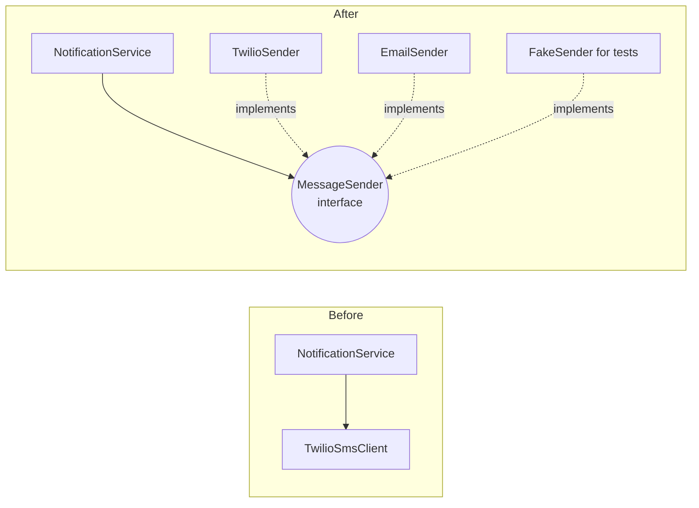

# SOLID Principles

> [!summary] What you'll learn
> SOLID is five design principles, popularized by Robert C. Martin ("Uncle Bob") in the early 2000s, for writing classes and modules that are **easy to change without breaking things**. Each one targets a specific way code becomes rigid or fragile. This note explains each principle as **the pain it prevents → the rule → a violation → the fix → when not to over-apply it.**
>
> **Interview angle:** "Explain SOLID," "Which principle does this code violate?", and in LLD rounds, designs graded on whether they follow these (especially SRP and OCP).

Back to [[Design Index]] · Prev: [[OOP Fundamentals]] · Next: [[Design Principles]]

| Letter | Principle | One-liner | Pain it prevents |
|---|---|---|---|
| **S** | Single Responsibility | A class should have one reason to change | Unrelated changes colliding in one file |
| **O** | Open/Closed | Open for extension, closed for modification | Editing (and re-breaking) working code for every new feature |
| **L** | Liskov Substitution | Subtypes must be usable wherever their parent is | Subclasses that surprise callers |
| **I** | Interface Segregation | Don't force clients to depend on methods they don't use | Fat interfaces with dummy implementations |
| **D** | Dependency Inversion | Depend on abstractions, not concrete details | Business logic welded to databases/vendors; untestable code |

> [!note] Why these matter more than they first appear
> Software spends most of its life being **changed**, not written. A design is "good" largely to the extent that the *next* change is cheap and safe. SOLID is a checklist for that.

---

## S — Single Responsibility Principle (SRP)

### The rule
> **"A module should have one, and only one, reason to change."**
> Martin's refined version: "A module should be responsible to one, and only one, **actor**" (a group of stakeholders who request changes).

### The pain it prevents
When one class serves several masters, their changes collide. A change requested by finance accidentally breaks something the operations team relies on, because both live in the same class. Merge conflicts, regressions, and huge test surfaces follow.

### Violation
```javascript
class Employee {
  calculatePay()  { /* rules owned by Finance (CFO) */ }
  reportHours()   { /* rules owned by Operations (COO) */ }
  save()          { /* SQL owned by the DBAs/platform team (CTO) */ }
}
```
Suppose `calculatePay()` and `reportHours()` both use a shared private helper `regularHours()`. Finance asks to change how overtime affects pay, a developer edits `regularHours()`, and now Operations' hour reports are silently wrong. One class, three reasons to change, and they interfere.

### Fix
Split by **who requests the change**:
```javascript
class PayCalculator   { calculatePay(employee) {} }   // Finance
class HourReporter    { reportHours(employee) {} }    // Operations
class EmployeeRepository { save(employee) {} }        // Persistence
// Employee becomes a simple data object (or keeps only behavior intrinsic to it)
```

### A very common real example: the fat Express route handler
```javascript
// ❌ validation + business rules + SQL + email + response formatting in one place
app.post("/orders", async (req, res) => {
  if (!req.body.items?.length) return res.status(400).send("No items");
  const total = req.body.items.reduce((t, i) => t + i.price * i.qty, 0) * 1.1;
  await db.query("INSERT INTO orders ...", [total]);
  await sendgrid.send({ to: req.user.email, subject: "Thanks!" });
  res.json({ total });
});

// ✅ each layer has one job
app.post("/orders", validate(orderSchema), async (req, res) => {   // validation middleware
  const order = await orderService.place(req.user, req.body.items); // business logic
  res.status(201).json(toOrderDTO(order));                          // presentation
});
// orderService uses orderRepository (SQL) and notifier (email) — each its own module
```

### How to apply it (and not over-apply it)
- Ask: "If requirements change, **who** would ask for it?" Different answers mean separate modules.
- Look for "and" in descriptions: "This class parses the CSV **and** validates rows **and** writes to the DB."
- ⚠️ SRP does **not** mean "a class should do only one tiny thing" or "one method per class." Splitting everything into 3-line classes creates its own complexity. Group things that change together, separate things that change for different reasons. That's also the definition of **high cohesion** (see [[OOP Fundamentals#Coupling and cohesion: the goal behind everything]]).

---

## O — Open/Closed Principle (OCP)

### The rule
> **Software entities should be open for extension but closed for modification.** (Bertrand Meyer, 1988)

You should be able to **add new behavior by adding new code**, not by editing existing, tested code.

### The pain it prevents
Every time you edit working code, you risk breaking it. If adding a new payment type means editing the checkout function, the shipping function, and the refund function, each feature is risky and touches many files (this is "shotgun surgery").

### Violation
```javascript
function calculateShipping(order) {
  switch (order.shippingMethod) {
    case "standard": return 5;
    case "express":  return order.weight * 2 + 10;
    case "overnight": return order.weight * 4 + 25;
    // Marketing wants "drone delivery" → edit this function (and any other switch on shippingMethod)
  }
}
```

### Fix: depend on an abstraction, add implementations
```javascript
const shippingMethods = {
  standard:  { cost: (o) => 5,                     eta: () => "5-7 days" },
  express:   { cost: (o) => o.weight * 2 + 10,     eta: () => "2 days" },
  overnight: { cost: (o) => o.weight * 4 + 25,     eta: () => "1 day" },
};

// Adding drone delivery = adding one entry (or registering a plugin). Existing code untouched.
shippingMethods.drone = { cost: (o) => 15, eta: () => "2 hours" };

function calculateShipping(order) {
  const method = shippingMethods[order.shippingMethod];
  if (!method) throw new Error(`Unknown shipping method ${order.shippingMethod}`);
  return method.cost(order);
}
```

### How OCP is achieved
- **Polymorphism**: new subclasses/implementations of an interface.
- **[[Behavioral Patterns#Strategy|Strategy]]**: pluggable algorithms (shown above).
- **[[Structural Patterns#Decorator|Decorator]]** and middleware: add behavior by wrapping.
- **[[Behavioral Patterns#Observer|Observer]]** and events: add new reactions without changing the emitter.
- **Plugins / registries / configuration**: VS Code extensions, Express middleware, webpack loaders.

### When not to over-apply it
You can't make code open to *every* possible change, and trying produces abstraction soup. Apply OCP **where variation actually occurs or is clearly coming**: you already have 3 shipping methods and marketing keeps adding more. For something that has never changed, a plain `if` is fine. A common heuristic is to refactor toward OCP the second or third time the same kind of change hits.

---

## L — Liskov Substitution Principle (LSP)

### The rule
> **If S is a subtype of T, then objects of type T may be replaced with objects of type S without breaking the program.** (Barbara Liskov, 1987)

In plain terms: **a subclass must honor the promises its parent makes.** Code written against the parent must keep working, without special cases, when handed any subclass.

The formal conditions (good to know):
- **Preconditions can't be strengthened**: the subclass can't demand more of its inputs than the parent does.
- **Postconditions can't be weakened**: the subclass must deliver at least what the parent promises.
- **Invariants must be preserved.**
- **No new unexpected exceptions.**

### The pain it prevents
If subclasses can violate the parent's contract, polymorphism becomes a lie. Callers start writing `if (x instanceof Special) {...}` defensively, which defeats the purpose of having a shared type, and bugs appear only with particular subclasses.

### Classic violation: Square extends Rectangle
Mathematically a square *is a* rectangle, so inheritance seems natural:

```javascript
class Rectangle {
  setWidth(w)  { this.width = w; }
  setHeight(h) { this.height = h; }
  area() { return this.width * this.height; }
}

class Square extends Rectangle {
  setWidth(w)  { this.width = w; this.height = w; }   // must keep sides equal
  setHeight(h) { this.width = h; this.height = h; }
}

// Code written against Rectangle's contract: "width and height are independent"
function stretch(rect) {
  rect.setWidth(5);
  rect.setHeight(4);
  return rect.area();   // expects 20
}
stretch(new Rectangle()); // 20 ✓
stretch(new Square());    // 16 ✗ surprise
```
`Square` changed the parent's behavioral promise (independent sides). It's a valid "is-a" in math but not in **behavior**.

**Fixes:** make shapes immutable (`new Rectangle(5, 4)`; no setters), or don't relate them by inheritance. Have both implement a `Shape` interface with `area()`.

### Another classic: Birds that can't fly
```javascript
class Bird { fly() { /* ... */ } }
class Penguin extends Bird { fly() { throw new Error("Penguins can't fly"); } }

function migrate(birds) { birds.forEach(b => b.fly()); }  // crashes on penguins
```
**Fix:** model capabilities separately: `Bird` (eat, layEggs) plus a `Flyer` capability that only flying birds have. (This also relates to [[#I — Interface Segregation Principle (ISP)|ISP]].)

### Real-world LSP smells
- A subclass method that throws `NotImplementedError` / `UnsupportedOperationException`.
- `instanceof` or `type ===` checks before calling a method.
- Overrides that silently do nothing.
- A "read-only" subclass of a mutable collection whose `add()` throws (Java's `Collections.unmodifiableList` is a famous pragmatic violation).

> [!tip] Interview phrasing
> "LSP is about behavioral compatibility, not just method signatures. If I have to check the concrete type before calling a method, the hierarchy is wrong."

---

## I — Interface Segregation Principle (ISP)

### The rule
> **Clients should not be forced to depend on methods they do not use.**

Prefer **several small, role-focused interfaces** over one large "do everything" interface.

### The pain it prevents
Fat interfaces force implementers to write dummy methods (often throwing errors, which also violates LSP). They also couple clients to changes in methods they never call: change the `fax()` signature and every class implementing `Machine` must be updated and redeployed, even those that only print.

### Violation
```typescript
interface Worker {
  work(): void;
  eat(): void;
  attendMeeting(): void;
}

class HumanEngineer implements Worker { work() {} eat() {} attendMeeting() {} }

class RobotArm implements Worker {
  work() {}
  eat() { throw new Error("Robots don't eat"); }          // forced, meaningless
  attendMeeting() { throw new Error("No meetings"); }
}
```

### Fix
```typescript
interface Workable  { work(): void; }
interface Feedable  { eat(): void; }
interface Meetable  { attendMeeting(): void; }

class HumanEngineer implements Workable, Feedable, Meetable { work() {} eat() {} attendMeeting() {} }
class RobotArm implements Workable { work() {} }

// Functions ask only for what they need
function runShift(workers: Workable[]) { workers.forEach(w => w.work()); }
```

### ISP beyond classes
- **APIs**: a mobile client that needs 3 fields shouldn't be forced to download a 50-field response. That's one motivation for [[API Design#GraphQL|GraphQL]] and the Backend-for-Frontend (BFF) pattern.
- **React props**: a component that takes a whole `user` object when it only needs `user.avatarUrl` is coupled to the entire user shape. Passing `avatarUrl` is the ISP-friendly version.
- **Function parameters**: accept the narrowest type that works (`Iterable` instead of `Array`, `{ email }` instead of the full `User`).

---

## D — Dependency Inversion Principle (DIP)

### The rule
> 1. **High-level modules should not depend on low-level modules. Both should depend on abstractions.**
> 2. **Abstractions should not depend on details. Details should depend on abstractions.**

- **High-level module** = business policy (what the app *is for*: "place an order," "notify the user").
- **Low-level module** = technical detail (Postgres, Twilio, the filesystem, HTTP).

### The pain it prevents
In a naive design, dependencies point in the same direction as calls: `OrderService → PostgresOrderTable → pg driver`. The *important* code (business rules) depends on the *volatile* code (vendors, frameworks). Consequences:
- You can't unit test business logic without a real database or network.
- Switching vendors (Twilio → AWS SNS) means editing business logic.
- Framework upgrades ripple through the entire codebase.

### Why "inversion"?
Normally the high-level module would `import` the low-level one. With DIP, the **high-level module defines the interface it needs**, and the low-level module **implements** it. The source-code dependency now points *from* the detail *to* the policy: it's inverted relative to the flow of control.



### Violation → fix
```javascript
// ❌ business logic welded to a vendor
class NotificationService {
  constructor() { this.twilio = new TwilioClient(process.env.TWILIO_KEY); }
  notifyShipped(user, order) {
    this.twilio.messages.create({ to: user.phone, body: `Order ${order.id} shipped` });
  }
}

// ✅ depends on an abstraction ("something with send(user, text)"), injected from outside
class NotificationService {
  constructor(sender) { this.sender = sender; }
  notifyShipped(user, order) {
    return this.sender.send(user, `Order ${order.id} shipped`);
  }
}

class TwilioSender { send(user, text) { /* Twilio API call */ } }
class EmailSender  { send(user, text) { /* SES call */ } }

const prod = new NotificationService(new TwilioSender());
const test = new NotificationService({ send: jest.fn() });
```

### DIP vs DI vs IoC (commonly confused)
| Term | What it is |
|---|---|
| **Dependency Inversion Principle** | The *design principle*: depend on abstractions; policy owns the interface |
| **Dependency Injection** | A *technique*: pass dependencies in from outside instead of constructing them (see [[OOP Fundamentals#Dependency Injection (DI)]]) |
| **Inversion of Control (IoC)** | The broader idea that a framework calls your code rather than you calling it ("don't call us, we'll call you"). DI containers are one form. |

DIP at architecture scale **is** [[Architectural Styles#Hexagonal / Ports & Adapters|Hexagonal Architecture]] and [[Architectural Styles#Clean Architecture|Clean Architecture]]: the domain defines "ports," infrastructure provides "adapters."

### When not to over-apply it
Not every dependency needs an interface. Depending directly on stable things (the standard library, `Math`, a well-established utility like `lodash`) is fine. Invert dependencies on things that are **volatile** (vendors, I/O, frameworks) or that you need to **fake in tests**.

---

## Putting it together: spotting violations in code review

| Code smell | Likely violation | Typical fix |
|---|---|---|
| A 2,000-line "God class" touching HTTP, DB, email, and business rules | SRP | Split by responsibility (controller / service / repository / notifier) |
| A `switch(type)` that grows every sprint, duplicated in several places | OCP | Strategy / polymorphism / registry |
| Subclass throws `NotSupported`, or callers use `instanceof` | LSP | Rethink the hierarchy; composition; capability interfaces |
| Implementations full of empty or throwing methods | ISP | Split into smaller interfaces |
| `new ConcreteVendorClient()` deep inside business logic; can't unit test | DIP | Inject an abstraction |

> [!quote] Pragmatism
> SOLID is a set of heuristics, not laws. Each principle adds some indirection. In interviews and at work, show that you know the principle **and** when the cost isn't worth it: "I'd introduce a `PaymentProcessor` interface because we already integrate two providers and plan a third. For the CSV export there's only one format, so a simple function is enough for now."

---

## Quick self-test
- [ ] Explain SRP using the "actor" definition. Give a real example from an Express/React app.
- [ ] Refactor a growing `switch` statement to satisfy OCP. What pattern did you use?
- [ ] Explain why Square/Rectangle violates LSP even though a square is a rectangle in math.
- [ ] Give an example of ISP applied to an API or React component, not just a class.
- [ ] What's the difference between DIP, dependency injection, and IoC?
- [ ] For each principle, name a situation where applying it would be over-engineering.

Next: [[Design Principles]]
