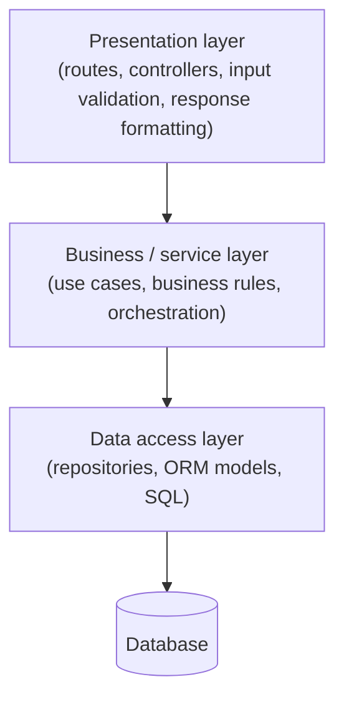
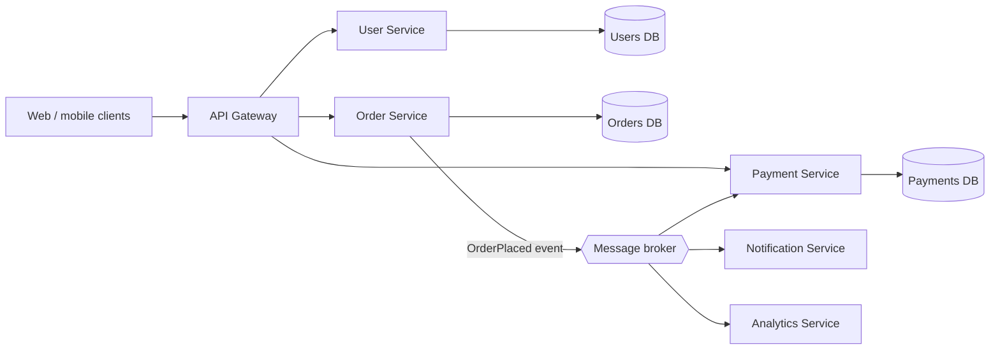
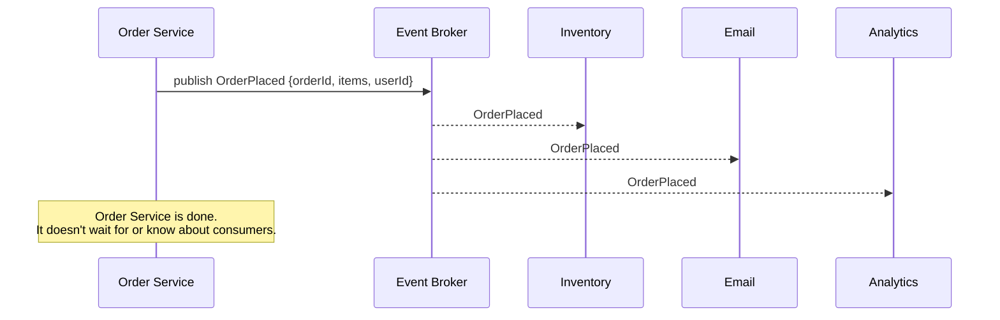
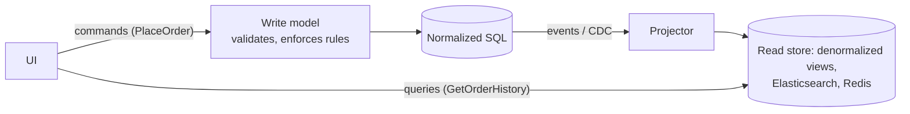
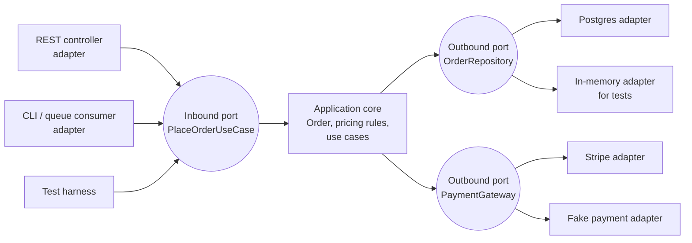

# Architectural Styles

> [!summary] What you'll learn
> **Software architecture** is the high-level structure of a system: how it's divided into parts, how those parts communicate, and where data lives. Architecture decisions are the expensive-to-change ones, so they're made deliberately and argued about in design docs.
>
> This note explains the major styles you'll encounter (layered, MVC, monolith, modular monolith, microservices, event-driven, CQRS/event sourcing, hexagonal/clean, serverless), with **the problem each one solves, how it works, what it costs, and when to choose it**.
>
> **Interview angle:** you'll rarely be asked "define hexagonal architecture," but you'll constantly be asked to **justify** choices: "Why microservices here?" "How would you split this monolith?" The right answer is always "it depends on…" followed by concrete factors.

Back to [[Design Index]] · Related: [[API Design]] · [[Domain-Driven Design]] · [[Messaging & Event Streaming]]

---

## Layered (N-tier) architecture

### The problem it solves
Without structure, code that handles HTTP requests, enforces business rules, and runs SQL gets tangled together. Changing the database means touching request handlers; testing a pricing rule requires spinning up a web server.

### How it works
Organize code into horizontal **layers**, each with one kind of responsibility. Each layer only depends on the layer **directly below** it.



A typical MERN/Express backend:
```
src/
  routes/        → map URLs to controllers
  controllers/   → parse req, call a service, shape the res        (presentation)
  services/      → business logic: placeOrder(), applyDiscount()   (business)
  repositories/  → database queries                                (data access)
  models/        → schemas (Mongoose/Prisma)
```

```javascript
// controller: HTTP concerns only
async function createOrder(req, res) {
  const order = await orderService.placeOrder(req.user.id, req.body.items);
  res.status(201).json(order);
}
// service: business rules, no HTTP, no SQL
async function placeOrder(userId, items) {
  if (items.length === 0) throw new ValidationError("Cart is empty");
  const total = pricing.total(items);
  return orderRepository.create({ userId, items, total });
}
// repository: persistence only
const orderRepository = { create: (data) => db.collection("orders").insertOne(data) };
```

**Strict vs relaxed layering:** strict means each layer only calls the one directly below; relaxed allows skipping layers. Most apps use relaxed layering.

**"3-tier"** usually refers to the *physical* split: client (browser) → application server → database server.

### Pros and cons
| ✅ Pros | ❌ Cons |
|---|---|
| Simple and familiar; easy to onboard | Business logic tends to leak into controllers or into the DB layer |
| Clear place for each kind of code | "Lasagna code": many pass-through layers doing nothing |
| Layers can be tested and replaced separately | Data model often drives everything (database-centric design) |
| | Features are spread horizontally across all layers |

### When to use it
The default for most CRUD-heavy web applications and APIs, small-to-medium teams, and most monoliths. It's the starting point; the styles below refine it.

---

## MVC and friends

### The problem
UI code mixes three concerns: the **data** being shown, **how** it's displayed, and **how user input** changes things. Mixed together, UIs become impossible to test and change.

### The patterns
| Pattern | Pieces | Flow | Where you see it |
|---|---|---|---|
| **MVC** (Model–View–Controller) | **Model**: data + business rules. **View**: renders the model. **Controller**: handles input, updates the model, picks a view. | User → Controller → Model → View | Server-side frameworks: Rails, Django (calls it MTV), Spring MVC, ASP.NET MVC, Laravel, Express + templates |
| **MVP** (Model–View–Presenter) | View is passive; **Presenter** holds UI logic and updates the view through an interface | View ↔ Presenter ↔ Model | Older Android, WinForms (testable because the view is an interface) |
| **MVVM** (Model–View–ViewModel) | **ViewModel** exposes state and commands that the view **binds to** declaratively | View ⇄ (data binding) ⇄ ViewModel → Model | Angular, Vue, SwiftUI, Jetpack Compose, WPF |
| **Flux / Redux** | **Unidirectional** flow: Action → Dispatcher/Reducer → Store → View → Action | One-way loop | React ecosystem (Redux, Zustand, and conceptually React's own state model) |

React itself is "just the V," but a React app with hooks and a state store is close to MVVM/Flux: components render state, and actions change state.

---

## Monolith

### What it is
The whole application (all features, all modules) is built and **deployed as one unit**, typically one codebase, one process type, and one main database. Most successful products started as monoliths (Shopify, GitHub, Stack Overflow, early Amazon, Twitter, and Facebook).

### Why teams start here
- **Fast to build and change**: refactor across modules with your IDE; one repo, one deploy.
- **Simple operations**: one thing to deploy, monitor, and debug; stack traces show the whole request.
- **In-process calls**: function calls are nanoseconds and never fail due to the network.
- **Easy transactions**: one database means ACID transactions across any data.

### When monoliths hurt
These problems appear as the codebase and the organization grow, not on day one:
| Problem | Why |
|---|---|
| Slow builds and deploys | Every change rebuilds and redeploys everything |
| Teams block each other | 50 engineers in one codebase means merge conflicts, coordinated releases, and one team's bug blocking everyone's deploy |
| Can't scale parts independently | The image-processing feature needs 10× CPU, but you have to scale the whole app |
| One failure takes down everything | A memory leak in reporting crashes checkout |
| Big ball of mud | Without enforced boundaries, everything ends up depending on everything |
| Technology lock-in | The whole app is stuck on one language and framework version |

---

## Modular monolith

### What it is
A monolith (one deployable) with **strong internal boundaries**: the code is divided into modules by business capability (`orders`, `billing`, `catalog`, `users`), each with a public API, and modules **may not reach into each other's internals or tables**.

```
src/modules/
  orders/   index.ts (public API) · internal/ · db tables: orders, order_lines
  billing/  index.ts (public API) · internal/ · db tables: invoices, payments
  catalog/  ...
```
Boundaries are enforced with lint rules (e.g., `eslint-plugin-boundaries`), separate packages in a monorepo, or architecture tests.

### Why it's often the best starting point
You get most of the **organizational** benefits of microservices (clear ownership, independent reasoning, a path to extraction) without the **distributed-systems tax** (network failures, eventual consistency, operational overhead). If you later need to extract `billing` into a service, its boundary already exists. Shopify is a well-known example of running a large modular monolith.

---

## Microservices

### What it is
The system is split into **small, independently deployable services**, each owning **one business capability and its own data**, communicating over the network (HTTP/gRPC or messaging).



### The problems it solves
Microservices primarily solve **organizational scaling problems**:
- **Independent deployment**: the payments team ships 10 times a day without coordinating with the catalog team.
- **Team autonomy**: each team owns a service end to end (code, data, on-call). This is Amazon's "two-pizza team" model.
- **Independent scaling**: scale the search service to 100 instances while user-profile runs on 3.
- **Fault isolation**: if recommendations crash, checkout keeps working (if designed for it).
- **Technology freedom**: the ML service in Python, the API in Go, the frontend BFF in Node.

### What it costs (be ready to discuss these)
| Cost | What it means in practice |
|---|---|
| **Network calls fail** | Every call can time out or fail partially. You need timeouts, retries, circuit breakers ([[Reliability & Observability]]). |
| **Latency adds up** | A request touching 6 services pays 6 network hops. |
| **No cross-service transactions** | "Charge the card and reserve inventory" spans two databases, so you need [[Distributed Systems Patterns#Saga pattern\|sagas]] and must accept **eventual consistency**. |
| **Data duplication** | Services keep copies of others' data (e.g., the order service stores the product name at purchase time). |
| **Operational overhead** | Each service needs CI/CD, monitoring, alerting, logs, scaling config, security patches. |
| **Debugging is harder** | One user request spans many services; you need **distributed tracing** and correlation IDs. |
| **Testing across services** | Contract tests and integration environments become necessary ([[Testing Strategy]]). |
| **Versioning** | API changes must be backward compatible because services deploy independently. |

### The distributed monolith anti-pattern
Services that **must be deployed together**, share a database, or call each other synchronously in long chains. You pay all the costs of microservices and get none of the benefits. Common causes: splitting by technical layer ("the database service") instead of by business capability, and sharing database tables between services.

### Building blocks you'll hear about
- **API Gateway**: a single entry point for clients; handles routing, authentication, rate limiting, and request aggregation (see [[Networking Essentials#API Gateway]]).
- **Service discovery**: how services find each other's current addresses (Kubernetes DNS, Consul, Eureka).
- **Database per service**: no shared tables; other services go through the owning service's API or events.
- **Asynchronous messaging**: events via Kafka/SNS/SQS reduce runtime coupling (the producer doesn't need the consumer to be up).
- **Service mesh** (Istio, Linkerd): sidecar proxies next to each service handle mTLS encryption, retries, timeouts, and telemetry, so app code doesn't have to.
- **BFF (Backend for Frontend)**: a thin backend tailored to one client type (web, iOS) that aggregates calls to many services.
- **Observability**: centralized logging, metrics, distributed tracing (OpenTelemetry).

### How to split services
Split by **business capability / bounded context** (Orders, Billing, Catalog, Shipping), not by technical layer. See [[Domain-Driven Design#Bounded Context]]. A good service boundary means most changes touch only one service.

### Monolith → microservices migration: the Strangler Fig pattern
Don't rewrite everything at once. Put a routing layer (proxy/gateway) in front of the monolith. Build a new service for one capability, route that capability's traffic to it, and repeat. The monolith gradually shrinks until it can be retired. It's named after a vine that grows around a tree and eventually replaces it. This approach is low-risk because each step is small and reversible.

### Conway's Law
> "Organizations which design systems are constrained to produce designs which are copies of the communication structures of these organizations." — Melvin Conway, 1967

If three teams build a compiler, you get a three-pass compiler. Architecture and team structure are linked: microservices work when each service has an owning team. The **Inverse Conway Maneuver** is deliberately structuring teams to produce the architecture you want.

> [!question] Interview answer template: "Monolith or microservices?"
> "For a new product with one small team, I'd start with a **modular monolith**: fastest iteration, simplest operations, real transactions. I'd extract a service only when there's a concrete driver:
> 1. A component with very different **scaling** needs (video transcoding),
> 2. A team that needs **independent deploys**,
> 3. A different **reliability or security boundary** (payments, PCI scope),
> 4. A different **technology** need (ML in Python).
> Microservices trade code complexity for operational and distributed-systems complexity, so I want a reason before paying that."

---

## Service-Oriented Architecture (SOA)
The 2000s enterprise predecessor to microservices: coarse-grained services (often large), frequently communicating through a central **Enterprise Service Bus (ESB)** that handled routing, transformation, and orchestration, using SOAP/XML. The ESB became a bottleneck and a central point of complexity. Microservices are sometimes described as "SOA done right": **smart endpoints, dumb pipes** (logic lives in the services, and the transport just moves messages).

---

## Event-Driven Architecture (EDA)

### The problem it solves
With direct calls, the service that does something must know about and call every service that cares. The order service calls email, inventory, analytics, and loyalty, and if any of them is down or slow, ordering is affected. Adding a new consumer requires changing the order service.

### How it works
Services **publish events** (facts about things that happened, named in the past tense: `OrderPlaced`, `PaymentFailed`, `UserSignedUp`) to a broker. Other services **subscribe** and react. The producer doesn't know who's listening.



### Three flavors of events (Martin Fowler's distinction)
1. **Event notification**: a thin event ("order 123 was placed"); consumers call back to the source if they need details. Simple, but creates callback traffic.
2. **Event-carried state transfer**: the event contains all the relevant data, so consumers don't need to call back and can keep their own local copy. More decoupled, larger events.
3. **Event sourcing**: events are the **system of record**. Instead of storing current state, you store the sequence of events (`AccountOpened`, `Deposited 100`, `Withdrew 30`), and current state is derived by replaying them. Gives a complete audit log and the ability to rebuild state or answer "what was the balance on March 3?" Used in banking, ledgers, and order history. Costs: complex to query (you need projections, see CQRS), and event schemas must be versioned forever.

### Pros and cons
| ✅ Pros | ❌ Cons |
|---|---|
| Loose coupling: add consumers without touching the producer | Harder to see the overall flow ("what happens when an order is placed?") |
| Resilience: if email is down, orders still succeed; email catches up later | **Eventual consistency**: consumers lag behind |
| Absorbs traffic spikes (the broker buffers) | Must handle **duplicates, ordering, and retries** (idempotent consumers) |
| Natural audit trail and analytics feed | Event schema evolution and versioning |
| | Debugging needs tracing across async hops |

### When to use it
Workflows where several parts of the system react to the same business fact; integrating many services; high-throughput pipelines (analytics, notifications); when you want producers to be unaffected by consumer failures. Details in [[Messaging & Event Streaming]].

---

## CQRS

### The problem it solves
**Command Query Responsibility Segregation.** Often the way you **write** data and the way you **read** it have very different needs:
- Writes need validation, business rules, and a normalized model for consistency.
- Reads need fast, denormalized, pre-joined views tailored to specific screens (dashboards, search, feeds), often at 100× the volume of writes.

Forcing both through one model means complex queries with many joins on the read side, or a write model polluted with read-specific fields.

### How it works
Use **separate models**, and often separate data stores, for commands (writes) and queries (reads). The write side publishes changes (events or change data capture), and **projectors** update read-optimized views.



### When to use it
- Read and write workloads are very different in shape or scale.
- Complex domains where the write model is rich in rules.
- Multiple different read views of the same data (search index, analytics, mobile summary).
- Often paired with **event sourcing**.

### Costs
More moving parts; the read side is **eventually consistent** (a user may not see their own write immediately, which you must handle in the UI); more code to keep projections correct. **Don't use it for simple CRUD.** A lightweight version (read replicas, or a separate search index fed by CDC) is very common and gives most of the benefit.

---

## Hexagonal / Ports & Adapters

### The problem it solves
In many applications, business logic is tangled with frameworks and infrastructure: Mongoose models with business methods, Express `req`/`res` passed deep into services, SQL inside domain logic. Consequences:
- You can't test business rules without a database and web server.
- Changing a framework or database means rewriting business logic.
- The most valuable code (the business rules) depends on the most volatile code (vendors, frameworks).

### How it works
(Alistair Cockburn, 2005.) Put the **application core (domain + use cases) at the center**, with no dependencies on frameworks, databases, or HTTP.
- The core defines **ports**: interfaces describing what it needs or offers.
  - **Inbound (driving) ports**: use cases the outside world can invoke (`PlaceOrder`).
  - **Outbound (driven) ports**: what the core needs from the outside (`OrderRepository`, `PaymentGateway`, `EmailSender`).
- **Adapters** connect ports to real technology: a REST controller adapter calls the inbound port; a Postgres adapter implements the repository port; a Stripe adapter implements the payment port.



```javascript
// core/placeOrder.js: no imports from express, pg, or stripe
export function makePlaceOrder({ orderRepo, payments }) {        // outbound ports injected
  return async function placeOrder({ userId, items }) {          // inbound port
    if (!items.length) throw new Error("Empty cart");
    const total = items.reduce((t, i) => t + i.priceCents * i.qty, 0);
    const charge = await payments.charge(userId, total);
    return orderRepo.save({ userId, items, total, chargeId: charge.id });
  };
}

// test: no DB, no network
const placeOrder = makePlaceOrder({ orderRepo: inMemoryRepo(), payments: { charge: async () => ({ id: "fake" }) } });
```

It's the [[SOLID Principles#D — Dependency Inversion Principle (DIP)|Dependency Inversion Principle]] applied to a whole application.

## Clean Architecture

(Robert Martin, 2012.) The same idea as hexagonal, drawn as concentric circles:
1. **Entities** (innermost): enterprise-wide business rules and objects.
2. **Use cases**: application-specific business rules (`PlaceOrder`, `CancelSubscription`).
3. **Interface adapters**: controllers, presenters, gateways that convert data between the use cases and external formats.
4. **Frameworks & drivers** (outermost): web framework, database, UI, external services.

**The Dependency Rule:** source code dependencies point **inward only**. Inner circles know nothing about outer ones. **Onion Architecture** (Jeffrey Palermo) is the same family.

### When to use hexagonal/clean
- Business logic that is **complex and long-lived** (finance, insurance, logistics).
- You need heavy unit testing of rules, or expect to swap infrastructure.
- Large teams where clear boundaries matter.

**When not to:** simple CRUD apps, prototypes, small scripts. The extra interfaces and mapping layers are overhead without much benefit when there's little business logic to protect.

---

## Serverless

### What it is
You deploy **functions** (or containers) and the cloud provider runs them **on demand**, scales them automatically (including to zero), and bills per invocation and compute time. No servers to provision or patch. Examples: AWS Lambda, Google Cloud Functions/Cloud Run, Azure Functions, Vercel/Netlify functions, Cloudflare Workers. "Serverless" also describes managed services like DynamoDB, S3, and SQS that you use without managing servers.

### How it typically looks
An event triggers a function: an HTTP request (via API Gateway), a file upload to S3, a message on a queue, a cron schedule, a database change.
```javascript
// AWS Lambda handler: resize an image when it's uploaded to S3
export const handler = async (event) => {
  for (const record of event.Records) {
    const { bucket, object } = record.s3;
    const image = await s3.getObject({ Bucket: bucket.name, Key: object.key });
    const thumb = await sharp(image.Body).resize(200).toBuffer();
    await s3.putObject({ Bucket: "thumbnails", Key: object.key, Body: thumb });
  }
};
```

### Pros and cons
| ✅ Pros | ❌ Cons |
|---|---|
| No server management | **Cold starts**: the first invocation after idle can add 100ms to seconds of latency |
| Automatic scaling, including to zero (no idle cost) | **Execution limits** (e.g., Lambda's maximum is 15 minutes) |
| Pay only for what you use; cheap for low or spiky traffic | **Stateless**: no in-memory state between invocations; connection pooling to databases is tricky |
| Great fit for event-driven glue | **Vendor lock-in**; harder local development and testing |
| | Can become **expensive at sustained high load** compared with always-on servers |
| | Debugging and observability across many functions |

### When to use it
Spiky or unpredictable workloads, event-driven tasks (file processing, webhooks, scheduled jobs), small APIs and prototypes, glue between managed services. Less ideal for steady high-throughput services, long-running jobs, or very latency-sensitive paths.

---

## Other styles worth knowing
- **Client–server**: clients request, servers respond. The basis of the web.
- **Peer-to-peer**: nodes act as both client and server with no central authority (BitTorrent, blockchains, WebRTC calls).
- **Pipe-and-filter**: data flows through a series of independent transformation stages (Unix pipes `cat | grep | sort`, ETL pipelines, stream processing, compilers).
- **Microkernel / plugin**: a minimal core plus plugins that add features (VS Code, Obsidian, browsers, Eclipse, webpack).
- **Cell-based architecture**: replicate the entire stack into isolated "cells," each serving a subset of customers, so one failure only affects that cell (AWS and Slack use this to limit blast radius).
- **Micro-frontends**: split a large frontend by feature or team, with each part built and deployed independently, composed in the browser or at the edge.
- **Space-based**: in-memory data grids replicated across processing units to avoid database bottlenecks (high-volume trading, ticketing).

---

## Choosing: a comparison

| Style | Best for | Biggest risk |
|---|---|---|
| **Layered monolith** | Small–medium apps, small teams, MVPs | Becoming a big ball of mud over time |
| **Modular monolith** | Growing products, several teams, still one deploy | Boundaries erode without enforcement |
| **Microservices** | Large organizations, independent scaling and deployment | Operational cost, distributed failure modes, distributed monolith |
| **Event-driven** | Decoupled workflows, many consumers of the same facts, high-throughput async | Debuggability, eventual consistency, duplicate handling |
| **CQRS / event sourcing** | Audit-heavy domains, very different read/write needs | Complexity; eventual consistency on reads |
| **Hexagonal / clean** | Complex, long-lived business logic | Over-engineering simple CRUD |
| **Serverless** | Spiky, event-triggered workloads; glue code | Cold starts, limits, lock-in, cost at scale |

Real systems mix these: a modular monolith with hexagonal modules, some event-driven integration, and a few serverless functions for background tasks is completely normal.

---

## Quick self-test
- [ ] Describe the layers of a typical Express backend and what belongs in each.
- [ ] What problems do microservices solve, and what new problems do they create? Give three of each.
- [ ] What is a distributed monolith, and how do teams end up with one?
- [ ] Explain the Strangler Fig pattern for migrating off a monolith.
- [ ] What's the difference between event notification, event-carried state transfer, and event sourcing?
- [ ] What problem does CQRS solve? What does it cost? When is it overkill?
- [ ] Explain hexagonal architecture's ports and adapters, and how it makes business logic testable.
- [ ] Give two workloads that fit serverless well and two that don't.

Next: [[API Design]]
