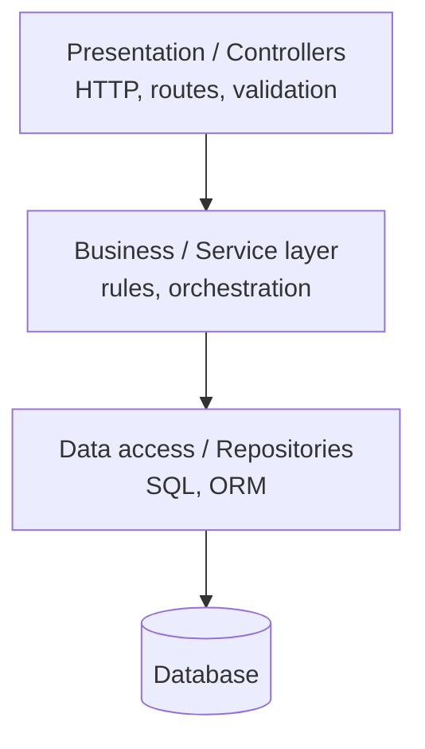
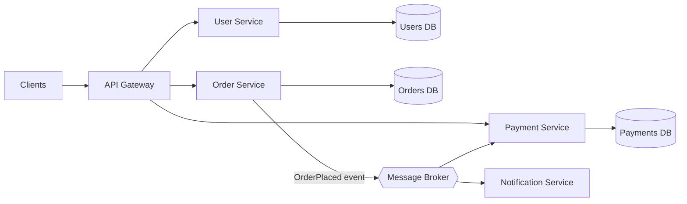
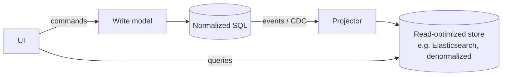
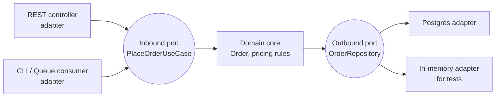

# Architectural Styles

> [!summary]
> Architecture is the **high-level structure** of a system: how it's split into parts, how they communicate, and the tradeoffs those choices create. At work you'll join an existing architecture. In interviews you'll be asked to **justify** choices like "monolith or microservices?". The answer is always **"it depends on..."** followed by concrete factors.

Back to [[Design Index]] · Related: [[API Design]] · [[Domain-Driven Design]] · [[Messaging & Event Streaming]]

---

## Layered (N-tier) architecture

The most common starting point for enterprise apps.

- Each layer depends only on the layer **below** it.
- ✅ Simple, familiar, easy to onboard. Your MERN Express apps likely look like `routes → controllers → services → models`.
- ❌ Business logic can leak into controllers; the DB schema can drive the whole design; "lasagna" of pass-through layers.

**3-tier (physical)**: client (browser) → app server → database.

---

## MVC and friends

| Pattern | Pieces | Where you see it |
|---|---|---|
| **MVC** (Model-View-Controller) | Model = data/logic, View = UI, Controller = handles input, updates model | Rails, Django (MTV), Spring MVC, ASP.NET MVC, Express apps |
| **MVP** (Model-View-Presenter) | Presenter holds UI logic; View is passive | Older Android, WinForms |
| **MVVM** (Model-View-ViewModel) | ViewModel exposes bindable state; View binds to it | Angular, Vue, SwiftUI, WPF, Jetpack Compose |
| **Flux / Redux** | Unidirectional: Action → Dispatcher/Reducer → Store → View | React ecosystem |

---

## Monolith

One deployable unit containing all features.

| ✅ Pros | ❌ Cons |
|---|---|
| Simple to develop, test, deploy, debug | Codebase grows unwieldy; slow builds |
| In-process calls (fast, no network failures) | Scale everything together (can't scale just "search") |
| Easy transactions (one DB) | One bug can take down everything |
| Easy refactoring across modules | Many teams stepping on each other; deploy coordination |
| | Locked into one tech stack |

> [!tip] Modular monolith
> A monolith with **strict internal module boundaries** (separate packages, no reaching into another module's tables). It gets most microservice organizational benefits without the distributed-systems tax. Shopify famously runs one. Often the **recommended starting point**.

---

## Microservices

The system is split into **small, independently deployable services**, each owning one business capability and **its own data**.

| ✅ Pros | ❌ Cons |
|---|---|
| Independent deploys & scaling per service | **Distributed systems complexity**: network failures, latency, partial failure |
| Team autonomy (Conway's Law: services mirror team structure) | No cross-service ACID transactions → [[Distributed Systems Patterns#Saga pattern\|sagas]], eventual consistency |
| Fault isolation (if done right) | Operational overhead: CI/CD, monitoring, tracing per service |
| Polyglot tech per service | Debugging across services needs distributed tracing |
| | Data duplication and consistency challenges |
| | Risk of a **"distributed monolith"**: services that must deploy together |

**Key microservice building blocks:**
- **API Gateway**: single entry point; routing, auth, rate limiting, aggregation.
- **Service discovery**: how services find each other (Consul, Eureka, Kubernetes DNS).
- **Database per service**: no shared tables.
- **Async messaging** via a broker to reduce temporal coupling.
- **Circuit breakers, retries, timeouts**. See [[Reliability & Observability]].
- **Distributed tracing** (OpenTelemetry, Jaeger) and centralized logging.
- **Service mesh** (Istio, Linkerd): sidecar proxies handling mTLS, retries, and telemetry.
- **BFF (Backend for Frontend)**: a tailored backend per client type (web, mobile).

> [!question] Interview answer template: "Monolith or microservices?"
> "For a new product with a small team, I'd start with a **modular monolith**: faster iteration, simple ops, easy transactions. I'd split out a service when there's a concrete driver: a component with very different **scaling** needs, a separate **team** needing independent deploys, a different **reliability/security** boundary (payments), or a different **tech** need. Microservices trade code complexity for operational complexity."

### Conway's Law
"Organizations design systems that mirror their communication structure." Amazon's **"two-pizza teams"** each own services. The **"Inverse Conway Maneuver"** is structuring teams to get the architecture you want.

---

## Service-Oriented Architecture (SOA)
The predecessor to microservices (2000s enterprise): coarse-grained services, often communicating via an **Enterprise Service Bus (ESB)** with SOAP/XML. Microservices are often called "SOA done right": smart endpoints, dumb pipes.

---

## Event-Driven Architecture (EDA)

Components communicate by **producing and consuming events** ("OrderPlaced", "PaymentFailed") instead of direct calls.

- **Event notification**: "something happened"; consumers fetch details if needed.
- **Event-carried state transfer**: the event contains the data, so consumers don't call back.
- **Event sourcing**: store the **sequence of events** as the source of truth; current state = replay of events. Gives you a full audit log and time travel. Used in banking and ledgers.

| ✅ Pros | ❌ Cons |
|---|---|
| Loose coupling (producer doesn't know consumers) | Harder to trace flow ("who handles this event?") |
| Easy to add new consumers | Eventual consistency |
| Absorbs load spikes (queue buffers) | Ordering, duplicates, and idempotency concerns |
| Natural audit trail | Schema evolution of events |

Deep dive: [[Messaging & Event Streaming]]

---

## CQRS

**Command Query Responsibility Segregation:** use **separate models** (sometimes separate databases) for **writes (commands)** and **reads (queries)**.

- When reads and writes have very different shapes or scale (dashboards, search).
- Often paired with event sourcing.
- Cost: complexity + read-side **eventual consistency**.

---

## Hexagonal / Ports & Adapters

(Alistair Cockburn.) The **domain/business logic sits at the center** and knows nothing about frameworks, DBs, or HTTP. It defines **ports** (interfaces). **Adapters** implement them for specific tech.

- ✅ Business logic is testable without a DB, and you can swap tech.
- Direct application of [[SOLID Principles#D — Dependency Inversion Principle (DIP)|DIP]].

## Clean Architecture
(Uncle Bob.) Same idea as hexagonal, drawn as concentric circles: **Entities → Use Cases → Interface Adapters → Frameworks & Drivers**. **Dependency rule:** source code dependencies point **inward only**. **Onion Architecture** is the same family.

---

## Serverless

Run functions (AWS Lambda, Google Cloud Functions, Azure Functions, Vercel/Cloudflare functions) on demand; the provider manages servers and scaling.

| ✅ | ❌ |
|---|---|
| No server management; scales to zero; pay per use | **Cold starts** (latency on first invocation) |
| Great for spiky/event-driven workloads (image resize on upload, webhooks, cron) | Execution time limits (e.g., Lambda max 15 min) |
| | Vendor lock-in; harder local testing; stateless only |
| | Can get expensive at sustained high load |

---

## Other styles worth knowing
- **Client–server**: the basic split; almost everything web.
- **Peer-to-peer**: no central server (BitTorrent, blockchain).
- **Pipe-and-filter**: a data pipeline of independent transform stages (Unix pipes, ETL, stream processing).
- **Microkernel / plugin**: a minimal core plus plugins (VS Code, Obsidian, browsers).
- **Space-based / cell-based**: replicate whole "cells" of the stack for blast-radius isolation (AWS uses cell-based architecture).
- **Micro-frontends**: split a frontend by team/feature, each independently deployed.

---

## Choosing: comparison

| Style | Best for | Watch out for |
|---|---|---|
| Layered monolith | Small–medium apps, small teams, MVPs | Big ball of mud over time |
| Modular monolith | Growing product, multiple teams, one deploy | Enforcing boundaries takes discipline |
| Microservices | Large orgs, independent scaling/deploy | Ops cost, distributed failure modes |
| Event-driven | Decoupled workflows, high-throughput async | Debuggability, eventual consistency |
| Serverless | Spiky, event-triggered, glue code | Cold starts, limits, lock-in |
| CQRS / Event sourcing | Audit-heavy, read/write asymmetry | Complexity |

## Self-test
- [ ] Give 3 concrete reasons to split a monolith into services.
- [ ] What is a "distributed monolith" and how do you end up with one?
- [ ] Explain hexagonal architecture and how it helps testing.
- [ ] What problem does CQRS solve? What does it cost?

Next: [[API Design]]
