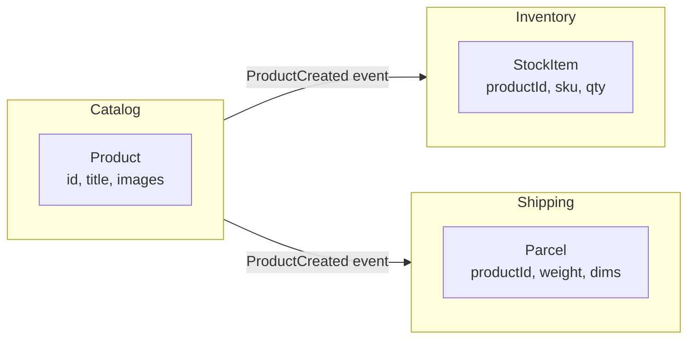

# Domain-Driven Design (DDD) Essentials

> [!summary] What you'll learn
> **Domain-Driven Design** (Eric Evans, 2003) is an approach to building software for **complex business domains** by modeling the code closely on how the business actually works, in close collaboration with domain experts.
>
> You don't need to be a DDD expert at entry or mid level. But its vocabulary is everywhere in enterprise teams, and it's the main tool for **deciding service and module boundaries**. This note explains the key ideas: **ubiquitous language, subdomains, bounded contexts, context maps, entities vs value objects, aggregates, domain events, and repositories**, with when DDD is worth it and when it's overkill.

Back to [[Design Index]] · Related: [[Architectural Styles]] · [[OOP Fundamentals]]

---

## The problem DDD addresses

In complex domains (insurance, banking, logistics, healthcare, large e-commerce), the hardest part of software isn't the technology. It's **understanding and correctly modeling the business rules**. Common failures:
- Developers and business experts use **different words** for the same things, so requirements get lost in translation.
- One giant shared data model (`Customer` with 80 fields) tries to serve every department and satisfies none.
- Business rules end up scattered across controllers, SQL, and UI code, so nobody can say where "the rule for refunds" lives.
- Service boundaries are drawn along technical lines, so every feature change touches several services.

DDD's answer has two halves:
- **Strategic design**: how to divide a large domain into parts with clear boundaries (big picture, team and service structure).
- **Tactical design**: patterns for modeling the business inside one of those parts (code level).

---

## Strategic DDD

### Ubiquitous Language
**A shared, precise vocabulary** used by developers and domain experts, in conversations, documents, *and the code itself*.

If the insurance team says "policyholder," "claim," "premium," and "underwriting," the code has `Policyholder`, `Claim`, `Premium`, and `UnderwritingDecision`, not `Customer`, `Ticket`, `Payment`, and `ApprovalStatus`.

**Why it matters:** translation between "business speak" and "developer speak" is where bugs come from. When a domain expert can read a method name like `claim.approveForPayout()` and say "no, approval and payout are separate steps," you've caught a bug before writing it.

### Domain and subdomains
The **domain** is the business area your software serves. It breaks down into **subdomains**, which aren't all equally important:
| Type | Meaning | Strategy | Example (ride-sharing company) |
|---|---|---|---|
| **Core domain** | What makes the business **unique and competitive** | Build in-house with your best people; invest heavily | Driver–rider matching, dynamic pricing |
| **Supporting subdomain** | Necessary and specific to your business, but not a differentiator | Build, but more simply | Driver onboarding, vehicle inspection tracking |
| **Generic subdomain** | Solved problems that every business has | **Buy or use off-the-shelf** | Authentication (Auth0/Okta), payments (Stripe), email (SendGrid), accounting |

This tells you where to spend engineering effort. Don't build your own auth system; do build the thing that wins customers.

### Bounded Context
**An explicit boundary inside which a particular model and its language are consistent.** The key insight is that **the same word means different things in different parts of the business**, and trying to force one model on everyone creates a bloated, contradictory mess.

> **"Product"** in different contexts of an e-commerce company:
> - **Catalog** context: title, description, images, categories, SEO tags.
> - **Inventory** context: SKU, warehouse location, quantity on hand, reorder threshold.
> - **Pricing** context: base price, discounts, price history.
> - **Shipping** context: weight, dimensions, hazardous-materials flag.
>
> **"Customer"**: to **Sales** it's a lead with a pipeline stage; to **Support** it's someone with tickets and a satisfaction score; to **Billing** it's an account with a payment method and invoices.

Instead of one `Product` class with every field, **each bounded context has its own model** containing only what it needs. Contexts share an identifier (`productId`) and exchange information through well-defined interfaces or events.



**Why bounded contexts matter for architecture:** a bounded context is a **natural boundary for a microservice, a module in a modular monolith, and a team**. Changes inside one context rarely affect others. When teams split services along bounded contexts, most features touch only one service. Splitting along technical layers ("the database service") or by entity ("the Product service" serving every department) tends to produce the distributed monolith described in [[Architectural Styles]].

### Context Map
A diagram of how bounded contexts relate and integrate. Some common relationships:
- **Shared kernel**: two contexts share a small common model (must coordinate changes carefully).
- **Customer/supplier**: the upstream context provides what the downstream needs; downstream priorities influence upstream.
- **Conformist**: the downstream simply adopts the upstream's model (e.g., you conform to Stripe's model of payments).
- **Anti-Corruption Layer (ACL)**: the downstream builds a **translation layer** so a messy external or legacy model doesn't leak into its own clean model. This is the [[Structural Patterns#Adapter|Adapter pattern]] at system scale, and it's extremely common when integrating legacy systems or third-party APIs.
- **Open host service / published language**: the upstream offers a well-documented public API or event schema for many consumers.

---

## Tactical DDD (building blocks in code)

### Entity
An object defined by its **identity**, which persists over time even as its attributes change.
- User #42 is still user #42 after changing their name, email, and address.
- Two users with the same name are still different users.
- Entities are usually **mutable** and have a lifecycle (created, updated, archived).

### Value Object
An object defined **only by its attributes**, with no identity of its own.
- Two `Money(500, "USD")` objects are completely interchangeable.
- Value objects should be **immutable**: to "change" one, you create a new one.
- They encapsulate validation and behavior for a concept that would otherwise be a raw primitive.

```javascript
class Money {
  constructor(cents, currency) {
    if (!Number.isInteger(cents)) throw new Error("Money must be whole cents");
    if (!/^[A-Z]{3}$/.test(currency)) throw new Error("Invalid currency code");
    this.cents = cents;
    this.currency = currency;
    Object.freeze(this);                       // immutable
  }
  add(other) {
    if (other.currency !== this.currency) throw new Error("Cannot add different currencies");
    return new Money(this.cents + other.cents, this.currency);   // returns a NEW object
  }
  multiply(factor) { return new Money(Math.round(this.cents * factor), this.currency); }
  equals(other) { return other.cents === this.cents && other.currency === this.currency; }
  toString() { return `${(this.cents / 100).toFixed(2)} ${this.currency}`; }
}
```

**The problem value objects solve:** "primitive obsession" (see [[Design Principles#Code smells and refactorings]]). With `price: number` everywhere, nothing stops you from adding dollars to euros, storing 9.99 as a float, or passing a quantity where a price was expected. A `Money` type makes those mistakes impossible. Other good value objects: `EmailAddress`, `DateRange`, `Address`, `Coordinates`, `PhoneNumber`, `Percentage`.

| | Entity | Value Object |
|---|---|---|
| Identity | Has a unique ID | None (equal if attributes are equal) |
| Mutability | Usually mutable | Immutable |
| Examples | User, Order, Account, Product | Money, Address, DateRange, Email |
| Persistence | Own table/row | Often embedded columns or JSON in the owning entity |

### Aggregate and Aggregate Root
An **aggregate** is a cluster of entities and value objects that must be **kept consistent together**, treated as a single unit for changes. The **aggregate root** is the one entity through which all outside access happens.

**The problem it solves:** without aggregates, any code can modify any object. Rules that span several objects, like "an order's total must equal the sum of its lines" or "you can't add lines after the order is placed," can be violated by code that edits an `OrderLine` directly.

**Example:** `Order` (root) + `OrderLine`s + `ShippingAddress` (value object). Outside code never touches an `OrderLine` directly; it calls `order.addLine(...)`, and the order enforces the rules.

```javascript
class Order {                                   // aggregate root
  #lines = [];
  #status = "DRAFT";

  constructor(id, customerId) {
    this.id = id;
    this.customerId = customerId;               // reference another aggregate BY ID, not by object
  }

  addLine(productId, quantity, unitPrice) {
    if (this.#status !== "DRAFT") throw new Error("Cannot modify an order after it's placed");   // invariant
    if (quantity <= 0) throw new Error("Quantity must be positive");
    const existing = this.#lines.find(l => l.productId === productId);
    if (existing) existing.quantity += quantity;
    else this.#lines.push({ productId, quantity, unitPrice });
  }

  total() {
    return this.#lines.reduce((sum, l) => sum.add(l.unitPrice.multiply(l.quantity)), new Money(0, "USD"));
  }

  place() {
    if (this.#lines.length === 0) throw new Error("Cannot place an empty order");
    this.#status = "PLACED";
    return { type: "OrderPlaced", orderId: this.id, customerId: this.customerId, total: this.total() };  // domain event
  }
}
```

### Aggregate design rules (these matter in system design too)
1. **Protect invariants inside the boundary.** Everything that must be consistent *immediately* belongs in the same aggregate.
2. **One transaction modifies one aggregate.** If placing an order must also update the customer's loyalty points, don't update both in one transaction. Update the order, publish `OrderPlaced`, and let the loyalty context update points **eventually**.
3. **Reference other aggregates by ID**, not by holding object references (`customerId`, not `customer`). This keeps aggregates independent and allows them to live in different services or databases.
4. **Keep aggregates small.** A huge aggregate (e.g., `Customer` containing every order ever) causes lock contention and slow loads.

**Why this matters beyond DDD:** these rules map directly onto distributed systems. "One transaction per aggregate" plus "eventual consistency between aggregates via events" is exactly how microservices avoid distributed transactions. An aggregate is often the natural **unit of sharding** (all of an order's data on one shard).

### Domain Event
A record of **something meaningful that happened in the domain**, named in the past tense: `OrderPlaced`, `PaymentCaptured`, `ShipmentDelivered`, `SubscriptionCancelled`.
- Lets other parts of the system react without the source knowing about them (decoupling).
- The bridge between aggregates and between bounded contexts.
- Published through a message broker for cross-service communication (see [[Messaging & Event Streaming]]).

### Repository
A collection-like interface for **loading and saving whole aggregates**, hiding the persistence technology.
```javascript
// The domain depends on this interface...
// orderRepository.findById(id) → Order | null
// orderRepository.save(order)  → void

// ...and infrastructure implements it
class PostgresOrderRepository {
  async findById(id) { /* SELECT order + lines, rebuild the Order aggregate */ }
  async save(order)  { /* INSERT/UPDATE order and its lines in ONE transaction */ }
}
```
One repository **per aggregate root** (an `OrderRepository`, but no `OrderLineRepository`, because lines are only accessed through their order).

### Domain Service
Business logic that **doesn't naturally belong to any single entity**, usually because it involves several. Example: `TransferService.transfer(fromAccount, toAccount, amount)` or `PricingService.quote(cart, customer, promotions)`. Domain services are stateless and named in the ubiquitous language.

### Factory
Encapsulates **complex creation** of aggregates (see [[Creational Patterns]]), e.g., `OrderFactory.fromCart(cart, customer)` that validates and builds a consistent `Order`.

### Application Service vs Domain Service
- **Application service** (use case): orchestrates a request. It loads aggregates from repositories, calls domain methods, saves, and publishes events. Contains **no business rules** itself.
- **Domain service**: contains business rules that span entities.

```javascript
// Application service (use case): orchestration only
async function placeOrderUseCase({ orderId }, { orderRepo, eventBus }) {
  const order = await orderRepo.findById(orderId);
  const event = order.place();              // business rule lives in the aggregate
  await orderRepo.save(order);
  await eventBus.publish(event);
}
```

---

## Anemic vs rich domain models
- **Anemic domain model**: entities are bags of getters and setters with no behavior; all logic lives in service classes (`orderService.calculateTotal(order)`, `orderService.validateCanShip(order)`). Common in CRUD apps. Martin Fowler calls it an anti-pattern **for complex domains**, because rules end up scattered and duplicated across services.
- **Rich domain model**: entities and aggregates enforce their own rules (`order.place()`, `order.total()`, as above). Business logic sits with the data it governs.

> [!tip] Pragmatism
> For simple CRUD (an admin panel, a settings page), an anemic model with straightforward services is **fine**, and full DDD would be overkill. Use rich models and DDD's tactical patterns where the **business logic is genuinely complex**.

---

## Event Storming
A collaborative workshop technique (Alberto Brandolini) for discovering a domain. Developers and domain experts put sticky notes on a long wall:
- 🟧 **Domain events** (orange): "Order Placed," "Payment Failed," in time order.
- 🟦 **Commands** (blue): what triggers each event ("Place Order").
- 🟨 **Actors/aggregates** (yellow): who or what handles the command.
- 🟪 **Policies** (purple): "whenever X happens, do Y."
- 🟥 **Hot spots** (red): open questions and disagreements.

Clusters of related events reveal **aggregates** and **bounded contexts**. You may take part in one when a large company plans a new system.

---

## When to use DDD (and when not)

| Use DDD when | Skip (most of) it when |
|---|---|
| The business logic is complex and central to the product | The app is mostly CRUD over a database |
| Domain experts are available to collaborate | Requirements are simple and stable |
| The system is long-lived and will keep evolving | It's a prototype or short-lived tool |
| Several teams need clear boundaries | One small team owns everything |

Even when you skip the tactical patterns, **bounded contexts and ubiquitous language are almost always valuable**.

---

## Quick self-test
- [ ] What's a bounded context? Give an example of one word meaning different things in two contexts.
- [ ] How do bounded contexts relate to microservice and team boundaries?
- [ ] Core vs supporting vs generic subdomain: where should you build vs buy?
- [ ] Entity vs value object: definitions plus two examples each. Why should value objects be immutable?
- [ ] What's an aggregate root? Why should one transaction modify only one aggregate?
- [ ] Why reference other aggregates by ID?
- [ ] What is an Anti-Corruption Layer, and which design pattern does it resemble?
- [ ] Anemic vs rich domain model: when is each appropriate?

Next: [[System Design Interview Framework]]
