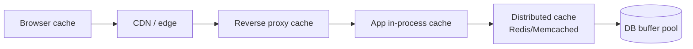

# Caching

> [!summary]
> Caching stores copies of data in a faster layer (usually memory) to **reduce latency and load** on slower systems. It's the single most common scaling technique in interviews and at work, and it comes with the hardest problem: **invalidation**.
> "There are only two hard things in Computer Science: cache invalidation and naming things." — Phil Karlton

Back to [[Design Index]] · Prev: [[Databases & Storage]]

---

## Where caches live (layers)



| Layer | Example | Notes |
|---|---|---|
| Client/browser | HTTP `Cache-Control`, service workers, React Query/SWR | Fastest; you control it only via headers |
| CDN | CloudFront, Cloudflare | Static and media; some dynamic |
| Reverse proxy | Nginx, Varnish | Full HTTP responses |
| Application (local) | In-memory LRU map, Caffeine (Java) | Super fast; **not shared** between servers; inconsistent across instances |
| **Distributed cache** | **Redis**, Memcached | Shared across app servers; the usual "cache" box in diagrams |
| Database | Buffer pool, query cache | Automatic |

---

## Caching strategies (read/write patterns)

### Cache-aside (lazy loading): the most common
App checks the cache; on a miss, reads the DB and populates the cache.

```javascript
async function getUser(id) {
  const key = `user:${id}`;
  const cached = await redis.get(key);
  if (cached) return JSON.parse(cached);           // hit

  const user = await db.users.findById(id);        // miss
  if (user) await redis.set(key, JSON.stringify(user), "EX", 3600);  // TTL 1h
  return user;
}

async function updateUser(id, data) {
  await db.users.update(id, data);
  await redis.del(`user:${id}`);                   // invalidate (don't update) on write
}
```
- ✅ Only caches what's requested; the cache failing ≠ the app failing.
- ❌ The first request is always slow (miss); data can be stale until TTL/invalidation.
- Why **delete** rather than update on write? It avoids races where two concurrent writes leave the cache holding the older value.

### Read-through
The cache itself loads from the DB on a miss (the library/provider handles it). Same tradeoffs; cleaner app code.

### Write-through
Write to the cache **and** DB synchronously on every write.
- ✅ Cache is always fresh. ❌ Higher write latency; caches data that may never be read.

### Write-behind (write-back)
Write to the cache; flush to the DB **asynchronously** in batches.
- ✅ Very fast writes; absorbs spikes. ❌ **Data loss risk** if the cache dies before flush; complex.
- Use for counters, likes, view counts, analytics.

### Write-around
Write directly to the DB, skipping the cache; the cache fills on read. Good for data written once and rarely read soon after (logs).

| Strategy | Read perf | Write perf | Consistency | Risk |
|---|---|---|---|---|
| Cache-aside | Good after warm-up | Normal | Stale until TTL/invalidate | Low |
| Write-through | Good | Slower | Strong(er) | Low |
| Write-behind | Good | Fastest | Eventual | Data loss |
| Write-around | Miss on recent writes | Normal | OK | Low |

---

## Eviction policies

When the cache is full, what goes?
- **LRU (Least Recently Used)**: the default in most systems. (Classic coding problem: implement it with a HashMap + doubly linked list for O(1) ops.)
- **LFU (Least Frequently Used)**: keeps popular items; slow to adapt to changes.
- **FIFO**: simple, rarely optimal.
- **TTL-based expiry**: items expire after a time-to-live.
- **Random**: surprisingly OK and cheap.
Redis supports `allkeys-lru`, `allkeys-lfu`, `volatile-ttl`, and others.

---

## Invalidation strategies
1. **TTL**: simplest; accept staleness up to N seconds. Always set one as a safety net.
2. **Explicit invalidation on write**: delete the key when the source changes.
3. **Event-driven**: publish change events (or use **CDC** from the DB) → consumers invalidate/update caches.
4. **Versioned keys**: `user:42:v7`; bump the version on change. Great for CDN assets (`app.3f9a2c.js`).

---

## Cache problems & fixes

| Problem | What happens | Fixes |
|---|---|---|
| **Cache stampede / thundering herd / dogpile** | A hot key expires → thousands of requests hit the DB at once | **Request coalescing** (single-flight lock: one request recomputes, others wait), **stale-while-revalidate**, probabilistic early refresh, TTL **jitter** |
| **Cache penetration** | Requests for keys that **don't exist** always miss and hit the DB (often an attack) | Cache negative results (`null` with a short TTL); **Bloom filter** of valid keys |
| **Cache avalanche** | Many keys expire at the same time, or the cache cluster goes down → DB overwhelmed | Randomized TTLs; cache replication/HA; circuit breakers; warm-up |
| **Hot key** | One key (a celebrity profile) overloads one cache node | Local in-process cache in front; replicate the key across nodes (`key#1..#N`) |
| **Stale data / inconsistency** | Cache and DB disagree | Short TTLs, delete-on-write, CDC; accept it where the business allows |
| **Big keys** | Huge values slow the network and evictions | Split values; compress |

---

## Redis vs Memcached

| | Redis | Memcached |
|---|---|---|
| Data types | Strings, hashes, lists, sets, **sorted sets**, streams, bitmaps, HyperLogLog, geo | Strings only |
| Persistence | Optional (RDB snapshots, AOF log) | None |
| Replication / HA | Yes (replicas, Sentinel, Cluster) | No (client-side sharding) |
| Threads | Mostly single-threaded command execution (I/O threads available) | Multi-threaded |
| Extras | Pub/sub, Lua scripts, transactions, TTLs, rate limiting, leaderboards, distributed locks | Simple and fast |

> Redis is the default answer. Common uses: cache, **sessions**, **rate limiting** counters, **leaderboards** (sorted sets), **distributed locks**, pub/sub, simple queues, geo queries.

(Note: Redis changed its license in 2024. **Valkey** is the Linux Foundation open-source fork, now offered by AWS/GCP. Same API.)

---

## What to cache (and not)
✅ Read-heavy, rarely changing, expensive-to-compute data: user profiles, product details, config, rendered pages, session data, results of expensive aggregations, feeds.
❌ Highly volatile data that must be exact (account balances for transactions), data with low hit rates, and sensitive data without care (PII in a shared cache).

**Cache hit ratio** = hits / (hits + misses). Monitor it; < ~80% suggests the strategy needs work.

## Self-test
- [ ] Walk through cache-aside reads and writes. Why delete instead of update on write?
- [ ] What's a cache stampede and two ways to prevent it?
- [ ] Write-through vs write-behind tradeoffs?
- [ ] Implement an LRU cache (coding question). What data structures?
- [ ] When should you NOT cache?

Next: [[Messaging & Event Streaming]]
