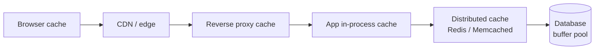
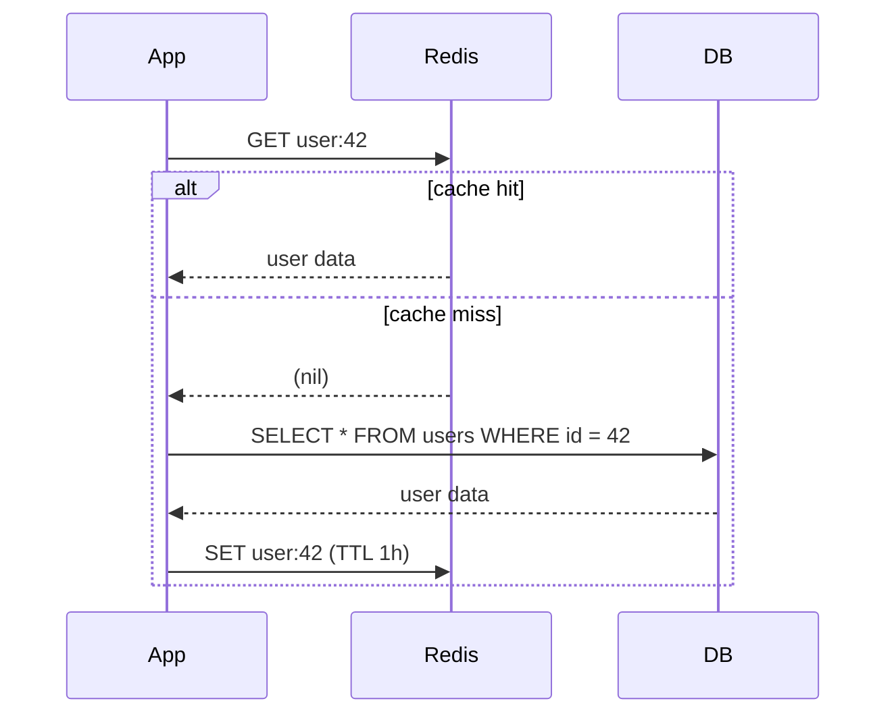

# Caching

> [!summary] What you'll learn
> A **cache** stores a copy of data in a faster place (usually memory) so future requests can be served without redoing expensive work: a database query, a computation, a network call. Caching is the single most common technique for **reducing latency and protecting databases** under read-heavy load.
>
> This note covers **where caches live**, the **read/write strategies** (cache-aside, read-through, write-through, write-behind, write-around), **eviction** policies, **invalidation**, the classic **failure modes** (stampede, penetration, avalanche, hot keys) and their fixes, **Redis vs Memcached**, and **what should and shouldn't be cached**.
>
> "There are only two hard things in Computer Science: cache invalidation and naming things." — Phil Karlton

Back to [[Design Index]] · Prev: [[Databases & Storage]] · Next: [[Messaging & Event Streaming]]

---

## Why caching works

1. **Speed gap:** reading from memory takes ~100 ns; a database query involves a network round trip (~0.5 ms in the same datacenter) plus query execution and possibly disk reads (often 1–50 ms). A cache hit can be **10–100× faster**.
2. **Skewed access:** in most systems a small fraction of data gets most of the traffic (popular products, celebrity profiles, today's news). Often ~20% of items get ~80% of requests, so a cache holding a small hot subset absorbs most reads.
3. **Repeated work:** the same expensive computation (a rendered page, an aggregated dashboard, a personalized recommendation list) is requested many times.

The result: lower latency for users, and far less load on databases and downstream services, so they don't need to scale as much.

**The fundamental tradeoff:** a cache holds a **copy**, and copies can become **stale**. Every caching decision is about how much staleness you can tolerate and how you'll keep copies acceptably fresh.

---

## Where caches live



| Layer | Example | What it caches | Notes |
|---|---|---|---|
| **Client / browser** | HTTP cache (`Cache-Control`), service workers, React Query / SWR / Apollo client caches | Static assets, API responses | Fastest (no network). You control it only through headers and client code |
| **CDN** | CloudFront, Cloudflare, Fastly | Static files, media, cacheable pages/API responses | Close to users globally. See [[Networking Essentials#CDN]] |
| **Reverse proxy** | Nginx, Varnish | Full HTTP responses | Shields app servers |
| **Application (in-process)** | A `Map`/LRU in memory, `node-cache`, Caffeine (Java) | Hot config, small lookup tables, computed values | **Fastest server-side** (no network at all), but **not shared**: each app instance has its own copy, so instances can disagree, and memory is limited |
| **Distributed cache** | **Redis**, Memcached, Valkey | Query results, sessions, objects, computed results | **Shared** across all app servers; the usual "cache" box in system design diagrams. Costs one network hop (~0.2–1 ms) |
| **Database** | Postgres shared buffers, MySQL InnoDB buffer pool | Recently used data pages | Automatic; tune memory size |

Multi-level caching is common: a tiny in-process cache (seconds of TTL) in front of Redis (minutes) in front of the database.

---

## Caching strategies (read and write patterns)

### Cache-aside (lazy loading): the most common
The **application** manages the cache explicitly:
- **Read:** check the cache. **Hit** → return it. **Miss** → read from the database, **store it in the cache** with a TTL, return it.
- **Write:** update the database, then **delete (invalidate)** the cache entry so the next read reloads fresh data.



```javascript
async function getUser(id) {
  const key = `user:${id}`;
  const cached = await redis.get(key);
  if (cached) return JSON.parse(cached);                         // hit

  const user = await db.users.findById(id);                      // miss → source of truth
  if (user) await redis.set(key, JSON.stringify(user), { EX: 3600 });   // populate with TTL
  return user;
}

async function updateUser(id, changes) {
  await db.users.update(id, changes);                            // 1. write the source of truth
  await redis.del(`user:${id}`);                                 // 2. invalidate; next read reloads
}
```
- ✅ Only data that's actually requested gets cached (memory-efficient).
- ✅ **Resilient**: if the cache is down, the app still works (slower) by reading the database.
- ✅ Flexible: the app controls the format (cache a whole rendered object, not just a row).
- ❌ Every first request (and every request after expiry) is a slow miss.
- ❌ Data can be stale until the TTL or invalidation.
- ❌ Cache logic lives in app code.

**Why delete on write instead of updating the cache?** With two concurrent writers, "write DB, then set cache" can leave the cache holding the **older** value if the writes interleave (A writes DB, B writes DB, B sets cache, A sets cache → cache has A's stale value). Deleting avoids that: the next read loads whatever is in the database. (A small race remains with concurrent reads; short TTLs bound how long any inconsistency lasts.)

### Read-through
Like cache-aside, but the **cache library or service loads from the database itself** on a miss. The application only talks to the cache. Same tradeoffs, cleaner app code. Common with caching libraries and some managed caches (DynamoDB Accelerator, DAX).

### Write-through
Every write goes to the **cache and the database synchronously** (the cache layer writes to the DB before acknowledging).
- ✅ The cache is always fresh; reads right after writes are hits.
- ❌ Writes are slower (two writes); the cache fills with data that may never be read (combine with TTLs).
- **Use for:** data that's read soon and often after being written, where staleness is unacceptable.

### Write-behind (write-back)
Writes go to the **cache only**; the cache **flushes to the database asynchronously** in batches.
- ✅ **Very fast writes**; batching reduces database load; absorbs write spikes.
- ❌ **Risk of data loss** if the cache crashes before flushing; the database is temporarily behind; more complex.
- **Use for:** high-frequency counters and metrics where losing a few updates is acceptable: view counts, like counts, "last seen" timestamps, analytics events.

```javascript
// Write-behind counter: increment in Redis, flush to the DB every few seconds
await redis.incr(`views:post:${postId}`);
// background job:
//   for each key matching views:post:* → GETDEL → UPDATE posts SET views = views + n WHERE id = ...
```

### Write-around
Writes go **directly to the database**, bypassing the cache; data enters the cache only when read (as in cache-aside).
- ✅ Avoids filling the cache with data that's written but rarely read (logs, bulk imports).
- ❌ A read right after a write is a miss.

### Refresh-ahead
The cache **proactively refreshes** popular entries **before** they expire, so users never hit a miss for hot keys. Good for predictable hot data (homepage content); wasteful if predictions are wrong.

### Comparison
| Strategy | Read performance | Write performance | Freshness | Risk | Typical use |
|---|---|---|---|---|---|
| **Cache-aside** | Good after warm-up | Normal (DB write + delete) | Stale until TTL/invalidation | Low | **Default for most reads** |
| **Read-through** | Same as cache-aside | Normal | Same | Low | When your cache layer supports it |
| **Write-through** | Excellent, even right after writes | Slower | Fresh | Low | Read-after-write-heavy data |
| **Write-behind** | Excellent | **Fastest** | DB lags | **Data loss** | Counters, metrics |
| **Write-around** | Miss after write | Normal | OK | Low | Write-once, read-rarely data |

---

## Eviction policies

Caches have limited memory. When full, the cache must **evict** something to make room.

| Policy | Evicts | Good for | Weakness |
|---|---|---|---|
| **LRU** (Least Recently Used) | The item not accessed for the longest time | **General purpose; the default** in most caches | A one-time scan of many items can flush out genuinely popular ones |
| **LFU** (Least Frequently Used) | The item accessed the fewest times | Stable popularity (some items are always hot) | Slow to adapt when popularity shifts; old popular items linger |
| **FIFO** | The oldest inserted item | Simplicity | Ignores usage |
| **TTL-based** | Items whose time-to-live expired | Freshness guarantees | Not a capacity policy by itself |
| **Random** | A random item | Very cheap; surprisingly decent | Unpredictable |

**Redis eviction policies** (`maxmemory-policy`): `allkeys-lru`, `allkeys-lfu`, `volatile-lru` (only keys with a TTL), `volatile-ttl` (evict soonest-expiring), `noeviction` (reject writes when full).

> **LRU cache is a classic coding interview question.** Implement it with a **hash map** (key → node, for O(1) lookup) plus a **doubly linked list** (to move an item to the front on access and drop the tail on eviction in O(1)). In JavaScript, a `Map` preserves insertion order, so you can delete and re-insert a key on access and evict `map.keys().next().value`.

```javascript
class LRUCache {
  constructor(capacity) { this.capacity = capacity; this.map = new Map(); }
  get(key) {
    if (!this.map.has(key)) return -1;
    const value = this.map.get(key);
    this.map.delete(key); this.map.set(key, value);          // move to "most recent" end
    return value;
  }
  put(key, value) {
    if (this.map.has(key)) this.map.delete(key);
    this.map.set(key, value);
    if (this.map.size > this.capacity) this.map.delete(this.map.keys().next().value);   // evict least recent
  }
}
```

---

## Cache invalidation strategies

How do cached copies get updated when the source data changes?

1. **TTL (time-to-live) expiry**: every entry expires after N seconds. Simplest, and it **bounds staleness** ("at most 60 seconds old"). **Always set a TTL**, even when you also invalidate explicitly, as a safety net for missed invalidations.
2. **Explicit invalidation on write**: delete (or update) the key when the data changes, as in the cache-aside example. Fresh, but you must find **every** key affected by a change (a product update might affect `product:1`, `category:5:page:1`, `search:"keycaps"`...).
3. **Event-driven invalidation**: services publish change events (or you use **CDC** from the database log), and a consumer invalidates or updates caches. Decoupled and reliable even when changes come from several services or direct DB updates.
4. **Versioned keys**: include a version in the key (`user:42:v7`, or a fingerprint in asset URLs like `app.3f9a2c.js`). A change bumps the version, so old entries are simply never read again and expire naturally. Excellent for CDN assets.

**Choosing a TTL:** balance freshness against hit rate. Ask "how stale can this be without hurting users?" Product description: an hour. Stock count: seconds, or don't cache. Feature flags: 30 seconds. Session: matches the session lifetime.

---

## Cache failure modes and fixes

These come up often in deep dives.

### Cache stampede (thundering herd / dogpile)
**What happens:** a very popular key expires (or is evicted). In the moment before it's repopulated, **thousands of concurrent requests all miss** and all hit the database to recompute the same value. The database can be overwhelmed, causing an outage at exactly the moment traffic is highest.

**Fixes:**
- **Request coalescing / single-flight / mutex**: on a miss, only **one** request acquires a short lock (e.g., Redis `SET lock:key 1 NX EX 10`) and recomputes; the others wait briefly and re-read the cache, or are served the stale value.
- **Stale-while-revalidate**: keep serving the old value past its soft expiry while one background request refreshes it.
- **Probabilistic early expiration**: each request has a small, increasing chance of refreshing the value *before* it expires, which spreads out refreshes.
- **Jitter on TTLs**: don't give every key the same TTL (`3600 + random(0, 300)` seconds), so they don't all expire at once.

```javascript
// Single-flight within one process: concurrent callers share one in-flight promise
const inFlight = new Map();
async function getWithCoalescing(key, loader, ttl = 300) {
  const cached = await redis.get(key);
  if (cached) return JSON.parse(cached);
  if (inFlight.has(key)) return inFlight.get(key);            // join the existing load
  const promise = (async () => {
    try {
      const value = await loader();
      await redis.set(key, JSON.stringify(value), { EX: ttl + Math.floor(Math.random() * 60) });  // jitter
      return value;
    } finally { inFlight.delete(key); }
  })();
  inFlight.set(key, promise);
  return promise;
}
```

### Cache penetration
**What happens:** requests for keys that **don't exist** in the database (e.g., `GET /users/999999999`, often from bugs or attackers) always miss the cache, because there's nothing to cache, and always hit the database.

**Fixes:**
- **Cache negative results**: store a "not found" marker with a short TTL (`user:999999999 → NULL`, 60 s).
- **Bloom filter** of all valid keys in front of the cache: if the filter says "definitely not present," reject immediately without touching the database. (See [[Distributed Systems Patterns#Data integrity tools]].)
- Input validation and rate limiting.

### Cache avalanche
**What happens:** a **large number of keys expire at the same time** (e.g., they were all loaded at startup with the same TTL), or the **cache cluster itself fails**. The database suddenly receives the full traffic load.

**Fixes:** randomized TTLs (jitter); a highly available cache (replicas, Redis Sentinel/Cluster, multi-AZ); circuit breakers and rate limiting in front of the database; gradual cache warm-up after restarts.

### Hot keys
**What happens:** one key gets so much traffic that the **single cache node** holding it is overloaded (a celebrity's profile, a viral post, a flash-sale product), even though the cluster as a whole has spare capacity.

**Fixes:** a small **in-process (local) cache** in each app server in front of Redis for the hottest keys (even a 1–5 second TTL absorbs huge load); **replicate** the hot key across several nodes under different names (`post:123#1` … `post:123#10`) and read a random one; read from replicas.

### Big keys
Very large values (a multi-MB list) slow down the network, block single-threaded Redis while being read, and make eviction expensive. Split them into smaller keys, paginate, or compress.

### Inconsistency between cache and database
Some window of staleness is inherent. Keep it small and bounded: delete-on-write, short TTLs, event/CDC-driven invalidation. For data that must **never** be stale (account balances at the moment of a payment decision), **read from the source of truth**.

---

## Redis vs Memcached

| | **Redis** | **Memcached** |
|---|---|---|
| Data types | Strings, hashes, lists, sets, **sorted sets**, streams, bitmaps, HyperLogLog, geospatial indexes, JSON (module) | Strings (blobs) only |
| Persistence | Optional: RDB snapshots and/or AOF append-only log | None (pure cache) |
| Replication & HA | Replicas, Redis Sentinel (failover), Redis Cluster (sharding) | None built in (client-side sharding across nodes) |
| Threading | Commands execute on a single thread (I/O threads available), so each command is atomic | Multi-threaded |
| Extras | Pub/sub, Lua scripting (atomic multi-step operations), transactions, TTLs per key, streams | Very simple and fast |
| Typical uses | Cache, sessions, **rate limiting**, **leaderboards** (sorted sets), **distributed locks**, queues, pub/sub, counters, geo queries | Simple, large, multi-threaded object caching |

> **Redis is the default answer** in interviews and most new systems. Memcached is still used at huge scale (Meta famously runs massive Memcached fleets) for simple object caching.
> Note: Redis changed its license in 2024; the Linux Foundation fork **Valkey** is API-compatible and offered by AWS, Google Cloud, and others. (Redis later added an open-source AGPL option again in 2025.)

### Redis data types and what they're for
| Type | Example use |
|---|---|
| String | Cached JSON blob; counters (`INCR`); simple flags |
| Hash | An object's fields (`HSET user:42 name Bo email b@x.com`) |
| List | Recent activity; simple queues (`LPUSH`/`BRPOP`) |
| Set | Unique visitors; tags; "who liked this" |
| **Sorted set** | **Leaderboards** (`ZADD leaderboard 1500 player42`, `ZREVRANGE ... 0 9` for the top 10), priority queues, time-ordered feeds |
| Stream | Lightweight event log with consumer groups |
| HyperLogLog | Approximate unique counts with ~12 KB of memory |
| Geo | "Drivers within 2 km" (`GEOSEARCH`) |

---

## What to cache (and what not to)

✅ **Good candidates:**
- Read-heavy, rarely changing data: product details, user profiles, configuration, feature flags, reference data (country lists).
- Results of **expensive computations or queries**: aggregated dashboards, recommendations, search results, rendered HTML.
- **Session data** and authentication tokens' derived info.
- Responses from **slow or rate-limited external APIs** (exchange rates, weather).
- Precomputed views (a user's feed).

❌ **Poor candidates / be careful:**
- Data that must be **exactly current** for correctness: balances during a transaction, inventory at the moment of checkout (read the source; use the cache only for display).
- Data with **very low reuse** (each key read once). It just churns the cache.
- Rapidly changing data where invalidation would be constant.
- **Sensitive data** (PII, tokens) in a shared cache without encryption, access control, and appropriate TTLs.
- Huge objects that won't fit sensibly in memory.

### Metrics to watch
- **Hit ratio** = hits ÷ (hits + misses). A low hit ratio (< ~80% for a typical read cache) suggests wrong keys, TTLs too short, or a cache that's too small.
- **Eviction rate** (memory pressure), **latency** (p99 of cache calls), **memory usage**, **hot keys**.

---

## Quick self-test
- [ ] Why does caching work? Name the two properties of real workloads that make it effective.
- [ ] Walk through cache-aside for reads and writes. Why delete instead of update on write?
- [ ] Write-through vs write-behind vs write-around: tradeoffs and a use case for each.
- [ ] Implement an LRU cache. What data structures give O(1) operations?
- [ ] What's a cache stampede? Give two fixes and explain how request coalescing works.
- [ ] Cache penetration vs cache avalanche: causes and fixes.
- [ ] How do you handle a hot key that overloads one Redis node?
- [ ] Why use a TTL even when you also invalidate on write?
- [ ] Which Redis data type would you use for a leaderboard? For unique visitor counts?
- [ ] Give three things you should not cache, and why.

Next: [[Messaging & Event Streaming]]
