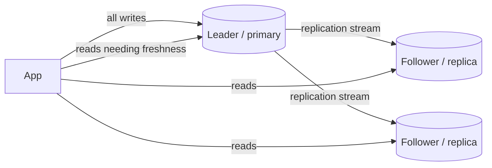
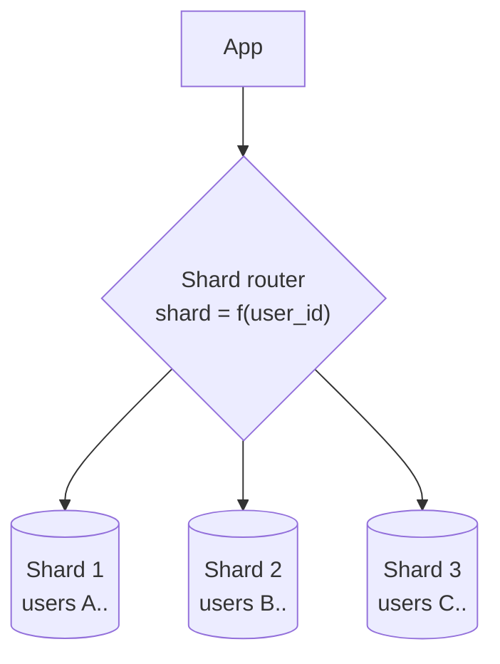
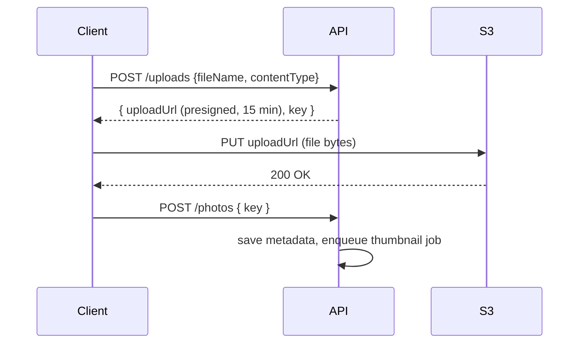

# Databases & Storage

> [!summary] What you'll learn
> Data is the hardest part of a system to scale and the most expensive to get wrong. This note explains **relational databases** and **NoSQL families** (and how to choose), **indexes** (B-trees, LSM trees, and when an index helps), **transactions and isolation levels**, **locking strategies**, **replication** (leader-follower, multi-leader, leaderless/quorums), **sharding** (strategies and shard-key choice), **storage types** (object, block, file), and the **OLTP vs OLAP** split.
>
> **Interview angle:** "Which database, and why?" appears in every system design interview, and deep dives often probe indexing, replication lag, or sharding.

Back to [[Design Index]] · Prev: [[Networking Essentials]] · Next: [[Caching]]

---

## Relational (SQL) databases

### What they are
Data is stored in **tables** (relations) of **rows** and **columns** with a **fixed schema**. Relationships are expressed with **foreign keys**, data is combined with **JOINs**, and changes happen inside **ACID transactions**. You query with **SQL**, a declarative language: you describe *what* you want, and the query planner decides *how* to get it.

**Examples:** PostgreSQL, MySQL, SQL Server, Oracle, SQLite. **Distributed SQL** (horizontally scalable, still relational and transactional): Google Spanner, CockroachDB, YugabyteDB, Amazon Aurora (scales reads, with a distributed storage layer).

### Their strengths
- **Data integrity**: constraints (`NOT NULL`, `UNIQUE`, `CHECK`, foreign keys) are enforced by the database, not left to app code.
- **Transactions**: multi-row, multi-table changes that are all-or-nothing ("debit A, credit B").
- **Flexible querying**: you can ask questions you didn't anticipate when designing the schema (ad-hoc reports, analytics, joins across entities).
- **Maturity**: decades of tooling, optimization, and operational knowledge.

### Choose relational when
- Data is **structured and relational** (users, orders, products, payments, inventory, bookings).
- You need **transactions** and strong consistency (money, inventory).
- You need **complex or ad-hoc queries**.
- **Default choice.** Most applications, even large ones, run on Postgres or MySQL for years. Pick something else only for a concrete reason.

### Normalization vs denormalization
**Normalization** organizes tables so that **each fact is stored exactly once** (normal forms 1NF → 3NF):
```
users(id, name, email)
orders(id, user_id → users.id, created_at)
order_items(order_id → orders.id, product_id → products.id, qty, unit_price)
products(id, name, price)
```
- ✅ No duplicated data, so no inconsistencies (change a user's name in one place). Smaller writes.
- ❌ Reads need **JOINs**, which get expensive at scale or across shards.

**Denormalization** deliberately **duplicates data** to make reads faster:
```
orders(id, user_id, user_name, user_email, total, item_count, ...)
```
- ✅ One fast read, no joins.
- ❌ Writes must update every copy; copies can drift out of sync (update anomalies); more storage.
- Common in **read-heavy** systems, caches, search indexes, and NoSQL data models.

**Rule of thumb:** start normalized; denormalize specific hot read paths when measurements justify it.

### SQL refresher
```sql
-- Top 5 customers by 2026 spend, only those over $100
SELECT c.id, c.name, SUM(o.total_cents) AS spend_cents
FROM customers c
JOIN orders o ON o.customer_id = c.id          -- INNER JOIN: only customers with orders
WHERE o.created_at >= '2026-01-01'
GROUP BY c.id, c.name
HAVING SUM(o.total_cents) > 10000              -- filter on aggregates (WHERE filters rows before grouping)
ORDER BY spend_cents DESC
LIMIT 5;

-- Window function: each customer's most recent order
SELECT * FROM (
  SELECT o.*, ROW_NUMBER() OVER (PARTITION BY customer_id ORDER BY created_at DESC) AS rn
  FROM orders o
) t WHERE rn = 1;

-- CTE (common table expression) for readability
WITH monthly AS (
  SELECT date_trunc('month', created_at) AS month, SUM(total_cents) AS revenue
  FROM orders GROUP BY 1
)
SELECT month, revenue, revenue - LAG(revenue) OVER (ORDER BY month) AS change FROM monthly;
```
Know: INNER vs LEFT vs FULL joins, `GROUP BY`/`HAVING`, subqueries, window functions (`ROW_NUMBER`, `RANK`, `LAG`), CTEs, and reading `EXPLAIN` output.

---

## NoSQL families

"NoSQL" ("not only SQL") covers several very different database types that emerged in the late 2000s to handle scale, flexibility, or access patterns relational databases struggled with. Each **trades away** something (usually joins, flexible queries, or strong consistency) to **gain** something (horizontal scale, write throughput, schema flexibility, or a specialized query type).

### Key-value stores
- **Model:** a giant distributed hash map: `key → value` (the value is an opaque blob or simple structure).
- **Examples:** Redis, Memcached, DynamoDB (also document-like), etcd, RocksDB (embedded).
- **Strengths:** extremely fast lookups by key; scales horizontally easily.
- **Weaknesses:** you can't query by anything other than the key (no "find all users in Seattle" without a separate index).
- **Use for:** caching, sessions, feature flags, shopping carts, rate-limit counters, simple lookups at massive scale.

### Document databases
- **Model:** JSON-like **documents** in collections; each document can have a different structure; nested objects and arrays are natural.
```json
{ "_id": "p_1", "name": "Cherry MX keycap set", "price": 4500,
  "variants": [{ "color": "black", "stock": 12 }, { "color": "white", "stock": 0 }],
  "specs": { "profile": "OEM", "material": "PBT" } }
```
- **Examples:** **MongoDB**, Couchbase, Firestore, Amazon DocumentDB; DynamoDB supports document-style items.
- **Strengths:** flexible schema (great when records vary, as with product catalogs with different attributes per category); data that's read together is stored together (one read instead of joins); intuitive for JS developers.
- **Weaknesses:** joins across documents are limited (`$lookup` exists but isn't the strength); multi-document transactions exist in MongoDB since 4.0 but cost performance; easy to end up with inconsistent data shapes without schema validation.
- **Use for:** product catalogs, content management, user profiles, event data, apps whose schema evolves quickly.
- **Modeling rule:** **embed** data that is read together and owned by the parent (an order's line items); **reference** data that is shared or grows unboundedly (a user's thousands of orders).

### Wide-column stores
- **Model:** tables with rows identified by a **partition key**; within a partition, rows are **sorted by clustering columns**. Each row can have different columns. Built on **LSM trees** (see indexes below) for fast writes.
```sql
-- Cassandra CQL: messages partitioned by conversation, sorted newest-first
CREATE TABLE messages (
  conversation_id uuid,
  message_id timeuuid,
  sender_id uuid,
  body text,
  PRIMARY KEY ((conversation_id), message_id)
) WITH CLUSTERING ORDER BY (message_id DESC);

SELECT * FROM messages WHERE conversation_id = ? LIMIT 50;   -- fast: one partition, already sorted
```
- **Examples:** **Apache Cassandra**, ScyllaDB, HBase, Google Bigtable.
- **Strengths:** **massive write throughput** and storage, linear horizontal scaling, high availability across data centers (leaderless replication), tunable consistency.
- **Weaknesses:** you must **design tables around your queries** (query-first modeling); no joins; limited ad-hoc queries; secondary indexes are limited; data is often duplicated across tables for different query patterns.
- **Use for:** time-series data, messaging (Discord stores trillions of messages in ScyllaDB/Cassandra), activity feeds, IoT, event logs: write-heavy data accessed by a known key and time range.

### Graph databases
- **Model:** **nodes** (entities) and **edges** (relationships), both with properties. Traversing relationships is the core operation.
```cypher
// Neo4j Cypher: friends-of-friends who like keycaps, not already my friends
MATCH (me:User {id: 42})-[:FRIEND]->(f)-[:FRIEND]->(fof)-[:LIKES]->(:Topic {name: "keycaps"})
WHERE NOT (me)-[:FRIEND]->(fof) AND fof <> me
RETURN fof LIMIT 10;
```
- **Examples:** Neo4j, Amazon Neptune, JanusGraph, TigerGraph.
- **Strengths:** multi-hop relationship queries that would need many expensive self-joins in SQL.
- **Weaknesses:** less suited for bulk aggregates and simple CRUD; smaller ecosystem; harder to scale horizontally.
- **Use for:** social graphs, recommendations, fraud detection (rings of connected accounts), knowledge graphs, network/dependency analysis.

### Search engines
- **Model:** documents indexed with an **inverted index** (word → list of documents containing it), plus relevance scoring.
- **Examples:** Elasticsearch, OpenSearch, Apache Solr, Algolia, Meilisearch, Typesense.
- **Strengths:** full-text search, fuzzy matching, typo tolerance, relevance ranking, faceting/filters, log analytics.
- **Weaknesses:** not a good **primary** source of truth (eventual consistency, weaker durability guarantees); usually fed from the main database via events or CDC.
- **Use for:** product search, site search, autocomplete, log search (the "ELK stack").

### Time-series databases
- **Model:** data points indexed by time (metric name + tags + timestamp + value), optimized for appends and time-range aggregation, with downsampling and retention policies.
- **Examples:** Prometheus, InfluxDB, TimescaleDB (a Postgres extension), Amazon Timestream.
- **Use for:** metrics and monitoring, IoT sensor data, financial ticks.

### Vector databases
- **Model:** high-dimensional **embedding vectors** (from ML models) with **approximate nearest neighbor (ANN)** search: "find the items most similar to this one."
- **Examples:** pgvector (Postgres extension), Pinecone, Weaviate, Milvus, Qdrant; Elasticsearch and Redis also support vectors.
- **Use for:** semantic search, retrieval-augmented generation (RAG) for LLM apps, recommendations, image similarity.

---

## SQL vs NoSQL: how to decide

| Factor | Lean SQL | Lean NoSQL |
|---|---|---|
| **Data shape** | Structured, with relationships between entities | Semi-structured or varying (documents), or simple key-based records |
| **Consistency needs** | Strong, transactional (money, inventory) | Eventual is acceptable, or tunable per query |
| **Query patterns** | Complex, ad-hoc, joins, aggregations, unknown future queries | Known in advance, simple lookups by key or key + time range |
| **Scale** | Up to very large with replicas and careful sharding | Massive write throughput and data volume with easy horizontal scaling |
| **Schema evolution** | Stable; migrations are acceptable | Rapidly changing |

> [!tip] A strong interview answer is specific and often uses both
> "I'll use **PostgreSQL** for users, orders, and payments: relational data where we need transactions. **Chat messages** are write-heavy, with a simple access pattern (latest messages in a conversation), so I'd put them in **Cassandra** partitioned by `conversation_id`. **Product search** goes in **Elasticsearch**, fed from Postgres through change data capture."
> Using several databases, each for what it's best at, is called **polyglot persistence**.

---

## Indexes

### The problem
Without an index, finding rows matching `WHERE email = 'b@x.com'` requires a **full table scan**: reading every row. Fine for 1,000 rows; disastrous for 100 million.

### What an index is
A separate data structure, maintained by the database, that maps column values to row locations, like a book's index. It turns lookups from O(n) scans into roughly O(log n).

**The tradeoff:** every index **speeds up reads** that use it, but **slows down every write** (the index must be updated on insert, update, and delete) and **uses extra storage**. Index the columns you filter, join, and sort on, not every column.

### B-tree / B+tree indexes (the default)
- A **balanced tree** with high fan-out (each node holds hundreds of keys), so even billions of rows need only ~3–4 levels. That's 3–4 disk/memory page reads per lookup.
- Keys are kept **sorted**, so B-trees support **equality** (`=`), **ranges** (`>`, `BETWEEN`), **prefix** matches (`LIKE 'abc%'`), and `ORDER BY` without sorting.
- Updates happen **in place** (random writes to pages).
- The default index type in PostgreSQL, MySQL (InnoDB), SQL Server, and Oracle.

### Hash indexes
- Map hashed keys to locations: O(1) **equality** lookups.
- **No range queries or ordering.**
- Used in some in-memory stores and as an option in Postgres.

### LSM trees (Log-Structured Merge trees)
How write-optimized databases (Cassandra, ScyllaDB, RocksDB, LevelDB, HBase, and parts of DynamoDB) store data:
1. Writes go to an in-memory sorted structure (the **memtable**) and an append-only **commit log** (for durability).
2. When the memtable fills, it's flushed to disk as an immutable, sorted file (an **SSTable**). This is a fast **sequential** write.
3. Background **compaction** merges SSTables, discarding overwritten and deleted values.
4. Reads check the memtable, then SSTables from newest to oldest. **Bloom filters** let the database skip SSTables that definitely don't contain the key.

| | B-tree | LSM tree |
|---|---|---|
| Writes | Slower (random in-place updates) | **Much faster** (sequential appends) |
| Reads | **Faster, predictable** (one tree lookup) | Slower (may check several files; mitigated by Bloom filters and compaction) |
| Space | Some fragmentation | Temporary duplication until compaction |
| Best for | Read-heavy, mixed OLTP | **Write-heavy** workloads |

### Other index types
- **Inverted index**: term → documents (full-text search engines; Postgres GIN indexes).
- **Geospatial**: R-trees, geohashes, quadtrees (PostGIS, MongoDB 2dsphere) for "find within 5 km."
- **Bitmap indexes**: for low-cardinality columns in analytics databases.

### Index concepts you'll be asked about
- **Primary vs secondary index**: the primary index is on the primary key; secondary indexes are on other columns.
- **Clustered index**: the table's rows are **physically stored in index order** (InnoDB's primary key is clustered). There's only one per table. Range scans on it are very fast.
- **Composite (multi-column) index** `(a, b, c)`: sorted by `a`, then `b` within each `a`, then `c`. It serves queries filtering on `a`, on `a, b`, or on `a, b, c` (the **leftmost prefix rule**), but **not** on `b` alone or `c` alone. Column order matters: put equality-filtered columns first, then range or sort columns.
- **Covering index**: the index contains every column the query needs, so the database never touches the table (an "index-only scan").
- **Selectivity / cardinality**: indexes help most on columns with many distinct values (`email`, `user_id`). An index on `is_active` (two values) rarely helps.
- **Partial index**: index only some rows (`WHERE deleted_at IS NULL`).
- Check with **`EXPLAIN ANALYZE`**: look for "Seq Scan" (full scan, often bad on big tables) vs "Index Scan."

```sql
-- Query: a user's 20 most recent orders
SELECT * FROM orders WHERE customer_id = $1 ORDER BY created_at DESC LIMIT 20;

-- This composite index serves both the filter and the sort: no full scan, no sort step
CREATE INDEX idx_orders_customer_created ON orders (customer_id, created_at DESC);
```

### The N+1 query problem
Fetching a list with one query, then running **one more query per item** for related data:
```javascript
const posts = await db.query("SELECT * FROM posts LIMIT 50");            // 1 query
for (const p of posts) {
  p.author = await db.query("SELECT * FROM users WHERE id = $1", [p.authorId]);  // + 50 queries
}
```
51 round trips instead of 1–2. Common with ORMs and GraphQL. **Fixes:** a JOIN, a batched `WHERE id IN (...)` query, ORM eager loading (`include`/`populate`), or DataLoader-style batching.

---

## Transactions & isolation levels

### What a transaction is
A group of operations that the database treats as **one unit**: either all of them take effect or none do (atomicity), and concurrent transactions are isolated from each other to some degree.
```sql
BEGIN;
  UPDATE accounts SET balance = balance - 100 WHERE id = 1;
  UPDATE accounts SET balance = balance + 100 WHERE id = 2;
COMMIT;   -- both happen, or (on error/ROLLBACK) neither does
```

### Concurrency anomalies (what can go wrong when transactions overlap)
| Anomaly | What happens | Example |
|---|---|---|
| **Dirty read** | You read data another transaction wrote but **hasn't committed** (and might roll back) | You see a $1M deposit that's then rolled back |
| **Non-repeatable read** | You read the same row twice in one transaction and get **different values** because someone committed in between | A report reads a balance at the start and end and gets different numbers |
| **Phantom read** | You re-run a range query and **new rows appear** | "Count orders today" returns 10, then 11 within the same transaction |
| **Lost update** | Two transactions read a value, both modify it, and one overwrites the other | Two people increment a counter from 5; result is 6 instead of 7 |
| **Write skew** | Two transactions read overlapping data, make **different** writes, and together violate an invariant | Rule: at least one doctor on call. Two doctors each check "someone else is on call" and both go off call |

### Isolation levels (SQL standard)
Higher isolation prevents more anomalies but reduces concurrency (more locking/aborts, lower throughput).

| Isolation level | Dirty read | Non-repeatable read | Phantom | Notes |
|---|---|---|---|---|
| **Read Uncommitted** | possible | possible | possible | Almost never used |
| **Read Committed** | ✅ prevented | possible | possible | **PostgreSQL's default**; also Oracle and SQL Server |
| **Repeatable Read** | ✅ | ✅ | possible* | **MySQL InnoDB's default**. *Postgres implements it as snapshot isolation, which also prevents phantoms |
| **Serializable** | ✅ | ✅ | ✅ | Results equivalent to running transactions one at a time. Safest; slowest; transactions may be aborted and must be retried |

Lost updates and write skew require Serializable, explicit locks, or careful conditional updates.

### MVCC (Multi-Version Concurrency Control)
How Postgres, MySQL InnoDB, and Oracle provide isolation without readers blocking writers: each write creates a **new version** of the row; each transaction reads from a consistent **snapshot** of versions that were committed when it started. Old versions are cleaned up later (Postgres's `VACUUM`).

### Locking strategies
**Pessimistic locking**: assume conflicts will happen; **lock first**, then work.
```sql
BEGIN;
SELECT * FROM seats WHERE id = 'A12' FOR UPDATE;   -- other transactions trying to lock A12 wait
-- check it's free, then book it
UPDATE seats SET booked_by = 42 WHERE id = 'A12';
COMMIT;
```
- ✅ Simple correctness under **high contention** (the last concert seat, the last item in stock).
- ❌ Waiting reduces throughput; risk of **deadlocks** (two transactions each waiting for the other's lock; databases detect and abort one).

**Optimistic locking**: assume conflicts are rare; **don't lock**; detect conflicts at write time with a **version** column.
```sql
-- Read: SELECT id, balance, version FROM accounts WHERE id = 1;   → version 7
UPDATE accounts SET balance = 50, version = 8
WHERE id = 1 AND version = 7;
-- 1 row updated → success.  0 rows updated → someone changed it first → reload and retry (or return 409 Conflict)
```
- ✅ No waiting; great when conflicts are rare (most web app edits).
- ❌ Under high contention, many retries.
- Same idea in HTTP: **ETags** with `If-Match` (see [[API Design]]).

---

## Replication

### The problem it solves
A single database server is a **single point of failure** (if it dies, data may be lost and the app goes down) and a **read bottleneck**. **Replication** keeps copies of the same data on multiple machines for:
1. **High availability**: if one node fails, another takes over.
2. **Durability**: data survives the loss of a machine.
3. **Read scaling**: spread reads across copies.
4. **Lower latency**: copies located near users in different regions.

### Leader–follower (primary–replica)

- **All writes go to the leader**, which records them in its log (write-ahead log / binlog) and streams changes to **followers**.
- **Reads can be served by followers**, which **scales reads** (add followers as read traffic grows).
- The most common setup (Postgres streaming replication, MySQL replication, MongoDB replica sets, Redis replicas).

**Synchronous vs asynchronous replication:**
| | Synchronous | Asynchronous |
|---|---|---|
| How | Leader waits for follower(s) to confirm before acknowledging the write | Leader acknowledges immediately; followers catch up shortly after |
| Durability | ✅ Write exists on 2+ machines before success is reported | ❌ If the leader dies, recent writes not yet replicated are **lost** |
| Latency | ❌ Every write waits for the network round trip | ✅ Fast |
| Availability | ❌ A slow or dead follower can block writes | ✅ |
| Common compromise | **Semi-synchronous**: wait for **one** follower, others async | |

**Replication lag** (with async): followers can be milliseconds to seconds (or minutes, under load) behind. Problems this causes:
- **Read-your-writes violations**: a user updates their profile, the next read hits a lagging follower, and the update "disappears." Fix: route a user's reads to the leader for a short time after they write, or for their own data.
- **Monotonic read violations**: successive reads hit different followers, so data appears to go back in time. Fix: pin each user to one follower.
- **Causality violations**: seeing an answer before the question. Fix: causal consistency mechanisms.

**Failover:** when the leader dies, a follower is **promoted** (automatically via tools like Patroni, or by a managed service like RDS). Risks: lost writes (with async replication), and **split brain**, where the old leader comes back still thinking it's the leader, so two nodes accept writes. Fencing mechanisms prevent this.

### Multi-leader replication
**Several nodes accept writes** (typically one leader per data center/region), and they replicate to each other.
- ✅ Low write latency for users in every region; each region keeps working if another region goes offline.
- ❌ **Write conflicts**: two regions can modify the same record concurrently. You need a conflict-resolution strategy (last-write-wins, merge logic, CRDTs), and conflicts are subtle to get right.
- **Use for:** multi-region apps that need local writes; offline-capable apps (each device is effectively a leader, as in calendar sync or collaborative editors).

### Leaderless replication (Dynamo-style)
**Any replica accepts reads and writes**; the client (or a coordinator node) sends each write to several replicas and reads from several. (Amazon's 2007 Dynamo paper; used by Cassandra, ScyllaDB, Riak, and DynamoDB internally.)

**Quorums:** with **N** replicas of each piece of data, a write must be acknowledged by **W** replicas and a read must hear from **R** replicas.
- If **W + R > N**, every read set **overlaps** every write set by at least one replica, so a read is guaranteed to see the latest acknowledged write (using version numbers to pick the newest).
- Example: **N = 3, W = 2, R = 2**. Tolerates one replica down for both reads and writes.
- Tuning: **W = 1** for fast writes (weaker guarantees); **R = 1** for fast reads; `QUORUM` in Cassandra means a majority.
- Stale replicas are repaired by **read repair** (fix them when a read notices stale data) and **anti-entropy** processes (compare data using Merkle trees in the background).
- ✅ Highly available; no failover needed. ❌ Eventual consistency semantics; conflict handling; more complex reasoning.

---

## Sharding / Partitioning

### The problem it solves
Replication copies **all** the data to every node, which scales **reads** but not **writes** (every node still applies every write) or **storage** (every node must hold everything). When data or write volume outgrows one machine, you split the data so **each node holds only a subset**. That's **partitioning**, usually called **sharding** when the partitions are on different machines.

### Vertical vs horizontal partitioning
- **Vertical partitioning**: split by **columns or tables**: user data in one database, orders in another, product catalog in a third. Often the first step (and natural with microservices).
- **Horizontal partitioning (sharding)**: split **rows** of the same table across machines based on a **shard key**: users 1–10M on shard 1, 10M–20M on shard 2, and so on.



### Sharding strategies
| Strategy | How | ✅ Pros | ❌ Cons |
|---|---|---|---|
| **Range-based** | Contiguous key ranges per shard (IDs 1–1M, names A–F, dates by month) | Range queries are efficient (one or few shards); easy to understand | **Hot spots**: e.g., time-based keys send all new writes to the newest shard; ranges must be rebalanced as data grows |
| **Hash-based** | `shard = hash(key) mod N` | **Even distribution** of keys and load | Range queries hit **all** shards; **changing N remaps almost every key**, forcing massive data movement. Use **consistent hashing** instead ([[Distributed Systems Patterns#Consistent hashing]]) |
| **Directory / lookup-based** | A lookup table maps each key (or tenant) to a shard | Total flexibility; can move individual big tenants | The directory is an extra hop and must be highly available and fast (cached) |
| **Geographic** | By user region (EU users on EU shards) | Data locality, lower latency, data-residency compliance (GDPR) | Uneven load across regions |

### Choosing a shard key (the most important decision)
A good shard key:
1. Has **high cardinality** (many distinct values), so data can spread over many shards.
2. Distributes **load evenly**: no key or range gets a disproportionate share of traffic.
3. **Matches the dominant access pattern**, so most queries hit **one shard**.

| System | Good shard key | Why |
|---|---|---|
| Chat messages | `conversation_id` | "Load this conversation" hits one shard |
| Social feed / user data | `user_id` | Most queries are about one user |
| Multi-tenant SaaS | `tenant_id` | Tenant data stays together; but huge tenants may need their own shard |
| E-commerce orders | `customer_id` (for "my orders") or `order_id` (for even spread) | Depends on the main query |
| ❌ Bad: `country` | Low cardinality and very skewed | |
| ❌ Bad: `created_at` (range) | All new writes hit one shard | |

### Problems sharding introduces
- **Cross-shard queries**: "Top 10 products by sales globally" must query every shard and merge (scatter-gather), which is slow.
- **Cross-shard joins**: not supported by most databases; do them in the application or denormalize.
- **Cross-shard transactions**: atomic updates across shards need distributed transactions (2PC) or [[Distributed Systems Patterns#Saga pattern|sagas]].
- **Hot shards**: a celebrity user or a huge tenant overloads one shard. Mitigate by splitting hot keys (adding a suffix), caching, or giving big tenants dedicated shards.
- **Rebalancing**: adding shards means moving data while serving traffic. Common technique: create many more **logical shards** than physical machines (e.g., 1,024 logical shards on 8 servers), and move whole logical shards between servers as you grow.
- **Unique IDs**: auto-increment no longer works globally. See [[Distributed Systems Patterns#Unique ID generation]].
- **Operational complexity**: backups, schema migrations, and monitoring across many shards.

> [!tip] The order of operations when a database is struggling
> 1. **Optimize queries and add indexes** (often a 10–100× win).
> 2. **Add a cache** for hot reads.
> 3. **Add read replicas** for read scaling.
> 4. **Scale vertically** (bigger machine).
> 5. **Partition vertically** (split tables or services into separate databases).
> 6. **Shard horizontally**, or move to a natively distributed database (Cassandra, DynamoDB, Spanner, CockroachDB, Vitess for MySQL, Citus for Postgres).
> Sharding is a last resort because of the complexity it adds. Say this in interviews; it shows judgment.

---

## Storage types

| Type | What it is | Access | Examples | Use for |
|---|---|---|---|---|
| **Object storage** | A flat namespace of **objects** (files + metadata) identified by keys, accessed over an HTTP API; virtually unlimited capacity; extremely durable (S3 is designed for 99.999999999%, "11 nines") and cheap | `PUT`/`GET` whole objects by key; no in-place edits | AWS S3, Google Cloud Storage, Azure Blob, Cloudflare R2, MinIO | **Images, video, user uploads, backups, logs, static websites, data lakes.** The default answer for media and large files |
| **Block storage** | Raw disk volumes attached to a single VM, which formats them with a file system | Low-latency random reads/writes at the block level | AWS EBS, GCP Persistent Disk | Database data files, OS boot disks, anything needing a fast local disk |
| **File storage** | A shared, hierarchical file system mounted by many servers (NFS/SMB) | Standard file operations from multiple machines | AWS EFS, Azure Files, NAS appliances | Shared files across servers, legacy apps expecting a file system, home directories |

### Pattern: presigned URLs for uploads and downloads
Instead of streaming large files **through** your app servers (which wastes bandwidth and ties up connections):
1. The client asks your API for permission to upload.
2. The API checks authorization and returns a **presigned URL**: a short-lived URL that grants permission to upload one specific object directly to S3.
3. The client uploads **directly to S3**.
4. The client (or an S3 event notification) tells your API the upload is complete; you record the object key in the database and trigger any processing (thumbnails, virus scan, transcoding).



---

## OLTP vs OLAP, warehouses, and data pipelines

| | **OLTP** (online transaction processing) | **OLAP** (online analytical processing) |
|---|---|---|
| Workload | Many small reads and writes from the app ("load user 42," "insert order") | Few, huge queries scanning millions or billions of rows ("revenue by region by month") |
| Storage layout | **Row-oriented** (all of a row's columns together) | **Column-oriented** (each column stored together, which compresses well and reads only needed columns) |
| Examples | PostgreSQL, MySQL, DynamoDB | BigQuery, Snowflake, Redshift, ClickHouse, Databricks |
| Users | The application | Analysts, data scientists, dashboards |

You don't run heavy analytics on the production OLTP database (it would slow down the app). Instead:
- **ETL / ELT** pipelines copy data from OLTP systems into a **data warehouse** (tools: Airflow, dbt, Fivetran, Spark).
- **Data lake**: raw files (often Parquet format) in object storage, queried with engines like Athena, Trino, or Spark.
- **CDC (Change Data Capture)**: stream every insert/update/delete from the database's log (WAL/binlog) to other systems in near real time (Debezium → Kafka). Used to keep **search indexes, caches, warehouses, and other services** in sync without dual writes from application code.

---

## Quick self-test
- [ ] When would you choose MongoDB vs PostgreSQL vs Cassandra vs Elasticsearch? Give a use case for each.
- [ ] Normalization vs denormalization: what does each optimize for?
- [ ] How does a B-tree index differ from an LSM tree? Which favors writes, and why?
- [ ] Does a composite index on `(a, b)` help `WHERE b = ?`? Why or why not?
- [ ] What is the N+1 query problem, and how do you fix it?
- [ ] Name the isolation levels and the anomalies each prevents. What's Postgres's default?
- [ ] Optimistic vs pessimistic locking: when to use each? Write the optimistic UPDATE.
- [ ] Sync vs async replication tradeoffs. What problems does replication lag cause, and how do you provide read-your-writes?
- [ ] Explain quorums: why does W + R > N guarantee reading the latest write?
- [ ] Pick a shard key for chat messages, a multi-tenant SaaS app, and user feeds. Explain why.
- [ ] Why is hash-mod-N sharding painful when adding shards?
- [ ] What's the order of steps to scale a struggling database before sharding?
- [ ] How do presigned URLs work, and why use them?

Next: [[Caching]]
