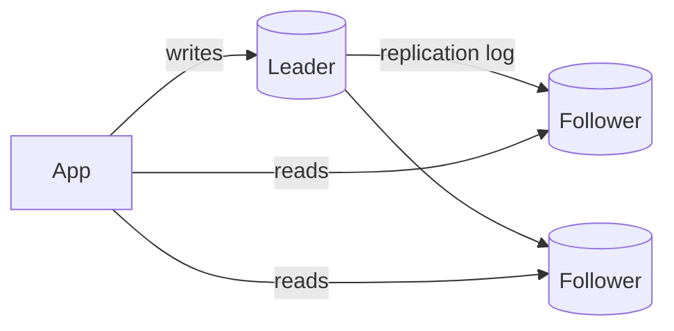

# Databases & Storage

> [!summary]
> Data is the hardest part of system design to scale. Know **SQL vs NoSQL tradeoffs**, **indexes**, **transactions/isolation**, **replication**, **sharding**, and the main **storage types** (object, block, file). "Which database and why?" comes up in every design interview.

Back to [[Design Index]] · Prev: [[Networking Essentials]] · Related: [[Caching]]

---

## Relational (SQL) databases

Tables with rows/columns, fixed **schema**, relationships via **foreign keys**, **JOINs**, **ACID transactions**, SQL query language.
*PostgreSQL, MySQL, SQL Server, Oracle, SQLite; distributed SQL: Google Spanner, CockroachDB, YugabyteDB, Amazon Aurora.*

**Choose when:** structured data with relationships, need for transactions/integrity (payments, orders, inventory, user accounts), complex ad-hoc queries/reporting.

### Normalization vs denormalization
- **Normalize** (1NF→3NF): eliminate duplication; each fact stored once. ✅ integrity, smaller writes. ❌ more JOINs on read.
- **Denormalize**: duplicate data to make reads fast (store `authorName` on each post). ✅ fast reads. ❌ update anomalies, more storage. Common in read-heavy systems and NoSQL.

### SQL refresher (likely asked in some form)
```sql
-- Top 5 customers by spend in 2026
SELECT c.id, c.name, SUM(o.total_cents) AS spend
FROM customers c
JOIN orders o ON o.customer_id = c.id
WHERE o.created_at >= '2026-01-01'
GROUP BY c.id, c.name
HAVING SUM(o.total_cents) > 10000
ORDER BY spend DESC
LIMIT 5;
```
Know: INNER/LEFT/RIGHT/FULL JOIN, GROUP BY/HAVING, subqueries, window functions (`ROW_NUMBER() OVER (PARTITION BY ...)`), CTEs (`WITH`), `EXPLAIN`.

---

## NoSQL families

| Type | Model | Examples | Great for | Weak at |
|---|---|---|---|---|
| **Key-value** | `key → blob` | Redis, DynamoDB, Memcached, etcd | Caching, sessions, simple lookups at huge scale | Queries by anything but key |
| **Document** | JSON-like documents, flexible schema | **MongoDB**, Couchbase, Firestore, DynamoDB | Varied/evolving schemas, nested data read together (product catalog, user profiles, CMS) | Cross-document joins and transactions (MongoDB now supports multi-doc txns, but at a cost) |
| **Wide-column** | Rows with dynamic columns, partitioned by key; LSM-tree storage | **Cassandra**, HBase, ScyllaDB, Bigtable | Massive write throughput, time series, messages, activity logs | Ad-hoc queries; must design tables around queries |
| **Graph** | Nodes + edges | Neo4j, Amazon Neptune | Relationship traversal (social graph, recommendations, fraud rings) | Bulk aggregate analytics |
| **Search engine** | Inverted index | Elasticsearch, OpenSearch, Solr | Full-text search, fuzzy matching, log analytics | Primary source of truth; strong consistency |
| **Time-series** | Time-ordered metrics | InfluxDB, TimescaleDB, Prometheus | Metrics, IoT, monitoring | General-purpose queries |
| **Vector** | Embedding vectors with ANN search | pgvector, Pinecone, Weaviate, Milvus | Semantic search, RAG for LLM apps, recommendations | Exact filtering at scale (improving) |

### SQL vs NoSQL: how to decide

| Factor | Lean SQL | Lean NoSQL |
|---|---|---|
| Data shape | Structured, relational | Semi-structured, nested, or simple key access |
| Consistency | Strong, transactional | Eventual OK (or tunable) |
| Queries | Complex, ad-hoc, joins, aggregations | Known access patterns, simple lookups |
| Scale | Up to very large with replicas/sharding (most apps never outgrow Postgres) | Massive write throughput, easy horizontal scale |
| Schema | Stable, enforced | Rapidly changing |

> [!tip] Interview answer
> "I'll default to **PostgreSQL** because the data is relational and we need transactions for orders. For the **activity feed / messages**, which are write-heavy with a simple access pattern (fetch by user, sorted by time), I'd use **Cassandra/DynamoDB** partitioned by user ID." This is **polyglot persistence**: use the right DB per need.

---

## Indexes

An index is a separate data structure that makes lookups fast **at the cost of slower writes and extra storage**.

- **B-tree / B+tree** (default in Postgres/MySQL): balanced tree, O(log n) lookup; supports equality **and range** queries and `ORDER BY`.
- **Hash index**: O(1) equality only; no ranges.
- **LSM tree** (Log-Structured Merge, used by Cassandra, RocksDB, LevelDB): writes go to an in-memory memtable → flushed to sorted immutable files (SSTables) → compacted in the background. **Very fast writes**, slower reads (check multiple files; **Bloom filters** help).
- **Inverted index**: word → list of documents (search engines).
- **Geospatial**: R-tree, geohash, quadtree (PostGIS, "find nearby").

Index concepts:
- **Primary vs secondary** index.
- **Clustered index**: table rows physically stored in index order (InnoDB primary key). One per table.
- **Composite index** `(a, b, c)`: usable for queries on `a`, `a,b`, `a,b,c` (the **leftmost prefix rule**), not `b` alone.
- **Covering index**: index contains all queried columns → no table lookup.
- **Selectivity**: indexes help most on high-cardinality columns (email), not booleans.
- Use `EXPLAIN ANALYZE` to see if a query uses the index (seq scan vs index scan).

```sql
CREATE INDEX idx_orders_customer_created ON orders (customer_id, created_at DESC);
-- serves: WHERE customer_id = ? ORDER BY created_at DESC LIMIT 20
```

> The **N+1 query problem**: fetching a list (1 query) then each item's related data (N queries). Fix with JOINs, `IN (...)` batching, ORM eager loading, or DataLoader.

---

## Transactions & isolation levels

Concurrency anomalies:
- **Dirty read**: read uncommitted data from another txn.
- **Non-repeatable read**: re-reading a row gives a different value.
- **Phantom read**: re-running a range query returns new rows.
- **Lost update**: two read-modify-write cycles overwrite each other.
- **Write skew**: two txns read the same data, make disjoint writes that together violate an invariant (two doctors both go off call).

| Isolation level | Dirty | Non-repeatable | Phantom | Notes |
|---|---|---|---|---|
| Read Uncommitted | possible | possible | possible | Rarely used |
| **Read Committed** | ✅ prevented | possible | possible | **Postgres default** |
| **Repeatable Read** | ✅ | ✅ | possible* | **MySQL InnoDB default**; *Postgres's RR (snapshot isolation) also prevents phantoms |
| **Serializable** | ✅ | ✅ | ✅ | Safest; slowest; may abort txns to retry |

**MVCC (Multi-Version Concurrency Control)**: readers see a snapshot and don't block writers (Postgres, MySQL InnoDB, Oracle).

### Locking strategies
- **Pessimistic locking**: lock first. `SELECT ... FOR UPDATE`. Use for high contention (booking the last seat).
- **Optimistic locking**: no lock; check a `version` column on write; retry on conflict.
```sql
UPDATE accounts SET balance = 50, version = 8 WHERE id = 1 AND version = 7;
-- 0 rows updated → someone else changed it → reload and retry (or return 409)
```
Use when conflicts are rare (most web apps).

---

## Replication

Copy data to multiple nodes for **availability, durability, and read scaling**.

### Leader–follower (primary–replica, master–slave)

- Writes go to the leader; reads can go to followers → **scales reads**.
- **Synchronous** replication: the leader waits for the follower ack → durable but slower; a slow follower blocks writes.
- **Asynchronous**: fast, but **replication lag** → followers may serve stale data, and recent writes may be lost if the leader dies.
- **Semi-sync**: wait for at least one follower.
- **Failover**: promote a follower when the leader dies (risk: split brain, lost writes).
- **Replication lag problems**: read-your-writes violations (route a user's reads to the leader briefly after they write), monotonic reads.

### Multi-leader
Multiple nodes accept writes (e.g., one per region). ✅ Low write latency globally, tolerates datacenter outage. ❌ **Write conflicts** must be resolved (last-write-wins, merge, CRDTs).

### Leaderless (Dynamo-style)
Any replica accepts writes (Cassandra, DynamoDB, Riak). Uses **quorums**: with N replicas, write to W, read from R. **If W + R > N**, reads overlap the latest write. E.g., N=3, W=2, R=2. Repair stale replicas via read repair and anti-entropy (Merkle trees).

---

## Sharding / Partitioning

Split data across multiple machines so **each holds a subset** → **scales writes and storage**.

- **Vertical partitioning**: split by columns/tables (users DB vs orders DB).
- **Horizontal partitioning (sharding)**: split rows by a **shard key**.

| Strategy | How | ✅ | ❌ |
|---|---|---|---|
| **Range-based** | `user_id 1–1M → shard 1`, A–M / N–Z, dates | Range queries efficient | **Hot spots** (all new writes hit the latest range) |
| **Hash-based** | `hash(key) % N` | Even distribution | Range queries scatter; **resharding moves almost everything** when N changes → use **consistent hashing** |
| **Directory / lookup** | A lookup service maps key → shard | Flexible, can move tenants | Lookup is an extra hop and potential SPOF |
| **Geo** | By region | Data locality, compliance (GDPR) | Uneven load |

**Choosing a shard key** ⭐: high cardinality, even distribution, and **matches the main access pattern** so queries hit one shard (e.g., `user_id` for a per-user feed, `conversation_id` for chat messages).

**Sharding problems:**
- Cross-shard **joins and transactions** are hard (do them in the app, denormalize, or use [[Distributed Systems Patterns#Saga pattern|sagas]]).
- **Hot shards / celebrity problem**: add a suffix to split hot keys, or cache.
- **Resharding/rebalancing**: consistent hashing, virtual nodes, or pre-splitting into many logical shards mapped to fewer physical nodes.
- Globally unique IDs: see [[Distributed Systems Patterns#Unique ID generation]].

> [!tip] Order of operations when a DB is struggling
> 1. Optimize queries + **add indexes** → 2. **Cache** → 3. **Read replicas** → 4. Vertical scaling → 5. Split by function (vertical partitioning) → 6. **Shard**. Sharding is a last resort; it adds a lot of complexity.

---

## Storage types

| Type | What | Examples | Use for |
|---|---|---|---|
| **Object storage** | Flat namespace of immutable blobs + metadata via HTTP API; effectively unlimited; very durable (S3 advertises 11 nines) | AWS S3, GCS, Azure Blob, Cloudflare R2 | Images, video, backups, logs, data lakes, static sites. **Default answer for media.** |
| **Block storage** | Raw disk volumes attached to a VM | AWS EBS, persistent disks | Databases, OS disks |
| **File storage** | Shared hierarchical file system (NFS) | AWS EFS, NAS | Shared files across servers, legacy apps |

**Pattern: presigned URLs.** The client asks your API for a short-lived signed URL, then **uploads directly to S3**. Large files never pass through your servers.

---

## Data warehousing & analytics (awareness)
- **OLTP** (online transaction processing): many small reads/writes; row-oriented (Postgres).
- **OLAP** (analytical processing): big scans and aggregations; **columnar** storage (BigQuery, Snowflake, Redshift, ClickHouse).
- **ETL/ELT** pipelines move data from OLTP → warehouse (Airflow, dbt, Spark).
- **Data lake**: raw files in object storage (Parquet) + query engines (Athena, Trino).
- **CDC (Change Data Capture)**: stream DB changes (from the WAL/binlog) to other systems (Debezium → Kafka). Keeps search indexes, caches, and warehouses in sync.

## Self-test
- [ ] When would you choose MongoDB vs Postgres vs Cassandra?
- [ ] How does a B-tree index differ from an LSM tree? Which favors writes?
- [ ] Composite index `(a,b)`: does it help `WHERE b = ?`
- [ ] Explain replication lag and one fix for read-your-writes.
- [ ] Pick a shard key for: chat messages, e-commerce orders, a multi-tenant SaaS.
- [ ] Optimistic vs pessimistic locking: when to use each?
- [ ] W + R > N: why does it guarantee overlap?

Next: [[Caching]]
