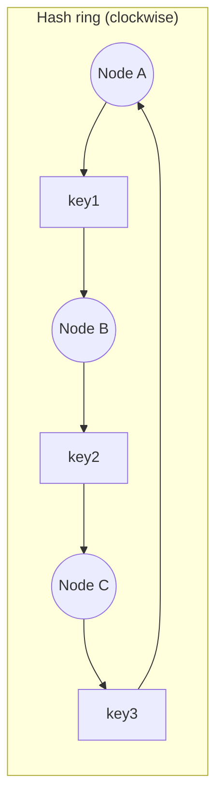
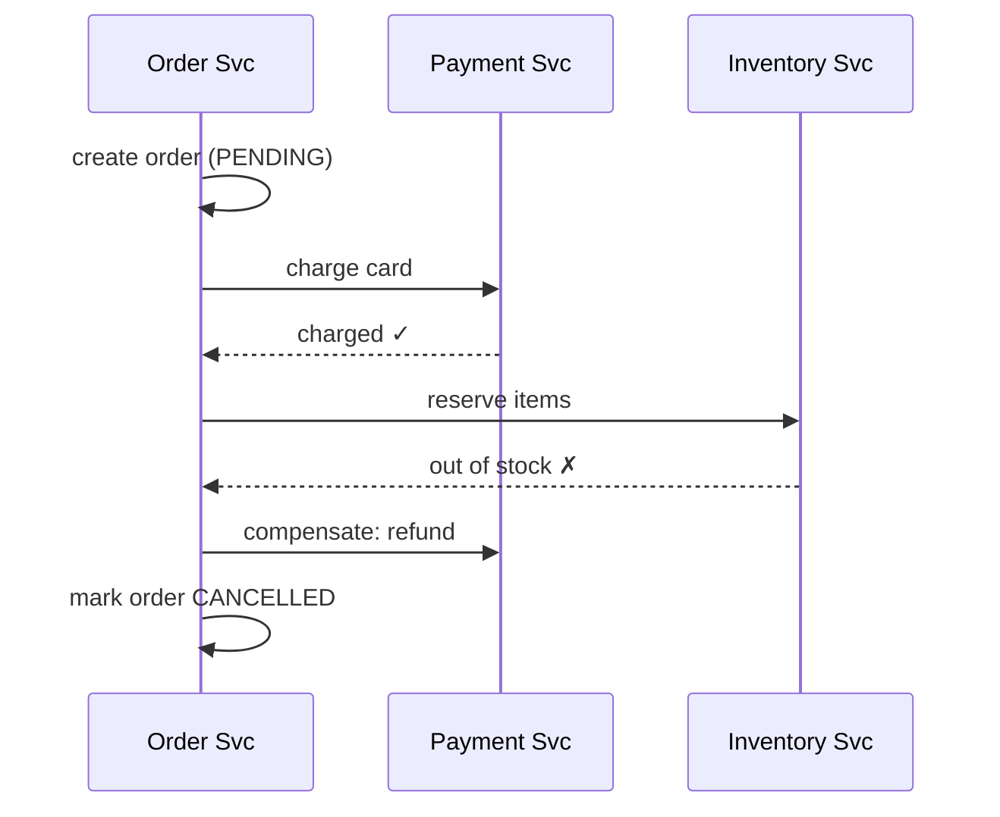

# Distributed Systems Patterns

> [!summary]
> Once you have more than one machine, everything can fail independently: networks drop, clocks drift, nodes pause. These are the core concepts and patterns used to build correct systems anyway. Mid-level interviews often probe **consistent hashing, idempotency, distributed transactions/sagas, ID generation, and leader election** in deep dives.

Back to [[Design Index]] · Prev: [[Messaging & Event Streaming]]

---

## The fallacies of distributed computing
Assumptions engineers wrongly make (Peter Deutsch / Sun):
1. The network is reliable. 2. Latency is zero. 3. Bandwidth is infinite. 4. The network is secure. 5. Topology doesn't change. 6. There is one administrator. 7. Transport cost is zero. 8. The network is homogeneous.

**Partial failure** is the defining problem: a request times out. Did it fail, succeed, or is it still running? **You can't know.** That's why we need timeouts, retries, and **idempotency**.

---

## Idempotency

An operation is idempotent if applying it multiple times = applying it once. Needed because retries (client, LB, queue redelivery) are inevitable.

Techniques:
- **Idempotency keys**: the client sends a unique key; the server stores the result keyed by it and returns the same result on repeats. See [[API Design#Idempotency]].
- **Natural idempotency**: `SET status = 'shipped'` (✅) vs `balance = balance + 10` (❌).
- **Dedup table**: store processed message IDs (with a unique constraint) in the same transaction as the side effect.
- **Conditional writes**: `UPDATE ... WHERE version = 7`; DynamoDB conditional expressions.
- **Upserts**: `INSERT ... ON CONFLICT DO NOTHING/UPDATE`.

---

## Consistent hashing

**Problem:** with `hash(key) % N`, changing N (adding or removing a cache/DB node) remaps **almost every key** → a cache miss storm and massive data movement.

**Solution:** place both **nodes and keys on a hash ring** (0 … 2^32−1). Each key goes to the **first node clockwise**. Adding or removing a node only moves the keys between it and its neighbor: **~K/N keys** instead of nearly all.


(key1 → B, key2 → C, key3 → A)

**Virtual nodes (vnodes):** each physical node gets many positions on the ring (e.g., 100–200), which **evens out distribution** and spreads a failed node's load across many others. Heterogeneous hardware gets more vnodes.

**Used by:** DynamoDB, Cassandra, Riak, Memcached clients, CDNs, load balancers (Maglev, ring hash in Envoy), Discord.

```javascript
// Minimal consistent hash ring
import { createHash } from "crypto";
const h = (s) => parseInt(createHash("md5").update(s).digest("hex").slice(0, 8), 16);

class HashRing {
  constructor(nodes = [], vnodes = 100) { this.vnodes = vnodes; this.ring = []; nodes.forEach(n => this.add(n)); }
  add(node) {
    for (let i = 0; i < this.vnodes; i++) this.ring.push({ pos: h(`${node}#${i}`), node });
    this.ring.sort((a, b) => a.pos - b.pos);
  }
  remove(node) { this.ring = this.ring.filter(v => v.node !== node); }
  get(key) {
    const p = h(key);
    // binary search for first pos >= p (wrap around)
    let lo = 0, hi = this.ring.length;
    while (lo < hi) { const mid = (lo + hi) >> 1; this.ring[mid].pos < p ? lo = mid + 1 : hi = mid; }
    return this.ring[lo % this.ring.length].node;
  }
}
```

---

## Unique ID generation

Auto-increment doesn't work across shards. Options:

| Approach | Pros | Cons |
|---|---|---|
| **UUID v4** (random 128-bit) | No coordination | Not sortable; poor B-tree index locality; 128 bits |
| **UUID v7** (time-ordered, standardized 2024 in RFC 9562) | Sortable by time; no coordination; good index locality | 128 bits |
| **Twitter Snowflake** (64-bit) | Sortable by time; compact; ~4K IDs/ms per machine | Needs machine IDs assigned; relies on clocks |
| **DB ticket server / ranges** | Simple; numeric | Central dependency (mitigate by handing out ranges/blocks of IDs) |
| **ULID / KSUID** | Sortable, string-friendly | Not as universal |

**Snowflake layout (64 bits):** `1 sign bit | 41 bits timestamp (ms since custom epoch, ~69 yrs) | 10 bits machine ID (1024 machines) | 12 bits sequence (4096 per ms)`.

---

## Distributed transactions

### Two-Phase Commit (2PC)
A coordinator asks all participants to **prepare** (vote yes/no), then tells all to **commit** or **abort**.
- ✅ Atomic across nodes.
- ❌ **Blocking**: if the coordinator dies after prepare, participants hold locks indefinitely. Slow (multiple round trips); reduces availability. Rarely used across microservices; used inside some distributed databases.

### Saga pattern
A long-running transaction split into a **sequence of local transactions**, each with a **compensating action** to undo it if a later step fails. Gives up isolation; eventually consistent.



- **Choreography**: services react to each other's events (no central coordinator). ✅ Loose coupling. ❌ Hard to follow the flow; risk of cyclic dependencies.
- **Orchestration**: a central orchestrator tells each service what to do. ✅ Clear flow, easy monitoring. ❌ Orchestrator logic centralizes (Temporal and Step Functions help).
- Compensations must be **idempotent** and should be retried until they succeed.

---

## Consensus & coordination

Getting multiple nodes to **agree** on a value (who's leader, committed log order) despite failures.
- **Paxos**: the original; notoriously hard to understand.
- **Raft**: designed to be understandable. Leader election + log replication; a majority **quorum** (needs 2f+1 nodes to tolerate f failures, so 3 nodes tolerate 1, 5 tolerate 2).
- **Used in:** etcd (Kubernetes' brain), Consul, ZooKeeper (ZAB protocol), CockroachDB, Kafka KRaft mode (replaced ZooKeeper).

**What you use them for:** leader election, distributed locks, configuration, service discovery, cluster membership.

### Leader election
Only one node should do some work (e.g., run the scheduler). Use a lease/lock in etcd/ZooKeeper/Consul, or a DB row with an expiring lease. Beware **split brain** (two nodes think they're leader). Use **fencing tokens** (monotonically increasing numbers checked by the resource).

### Distributed locks
- Redis `SET key value NX PX 30000` (with care: Redlock is debated), ZooKeeper/etcd locks, DB row locks.
- Always use **TTLs/leases** (a crashed holder must not hold forever) and **fencing tokens** for correctness.
- Prefer designs that avoid locks (single writer per partition, optimistic concurrency).

---

## Time & ordering
- **Clocks drift**; NTP sync is approximate (ms level). **Don't rely on wall-clock timestamps for ordering** across machines (last-write-wins can lose data).
- **Lamport timestamps**: logical counters giving a causal order.
- **Vector clocks**: detect concurrent (conflicting) updates (Dynamo, Riak).
- **Google TrueTime** (Spanner): GPS + atomic clocks with bounded uncertainty → externally consistent transactions.
- **Hybrid Logical Clocks (HLC)**: CockroachDB.

## Conflict resolution (multi-writer systems)
- **Last-write-wins (LWW)**: simple; can silently drop writes.
- **Application merge**: e.g., merge shopping cart items.
- **CRDTs** (Conflict-free Replicated Data Types): data structures that merge automatically and deterministically (counters, sets, text). Used in collaborative apps (Figma-like, Yjs, Automerge), Redis Enterprise, Riak.
- **Operational Transformation (OT)**: Google Docs' approach to concurrent text edits.

---

## Failure detection & membership
- **Heartbeats**: nodes ping; missing N heartbeats → suspected dead.
- **Gossip protocol**: nodes randomly share state with peers; information spreads epidemically (Cassandra, Consul). Scalable and decentralized.
- **Phi accrual failure detector**: probabilistic suspicion level instead of a binary verdict.

## Data integrity tools
- **Bloom filter**: a probabilistic set. "Definitely not present" or "maybe present." Tiny memory. Used in LSM-tree reads, cache penetration protection, "has this user seen this post?", spell check, malicious URL checks.
- **Merkle tree**: hash tree; efficiently find which ranges differ between replicas (anti-entropy in Cassandra/DynamoDB; Git; blockchains).
- **HyperLogLog**: approximate count of distinct items with tiny memory (unique visitors). Redis `PFADD`/`PFCOUNT`.
- **Count-Min Sketch**: approximate frequency counts (heavy hitters / top-K trending).
- **Geohash / Quadtree / S2 / H3**: spatial indexing for "nearby" queries (Uber uses H3 hexagons).

## Self-test
- [ ] Why does `hash % N` fail when scaling, and how does consistent hashing fix it? Why virtual nodes?
- [ ] Design a 64-bit unique ID scheme.
- [ ] 2PC vs Saga: tradeoffs. Choreography vs orchestration?
- [ ] Why do Raft clusters use odd numbers of nodes?
- [ ] What is a fencing token?
- [ ] Use cases for a Bloom filter?

Next: [[Reliability & Observability]]
