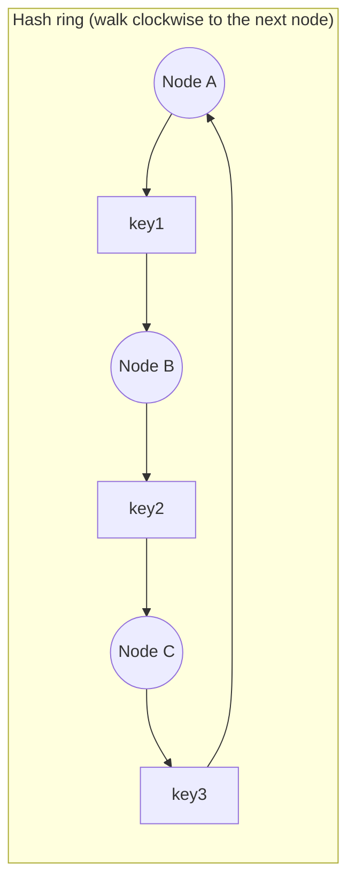
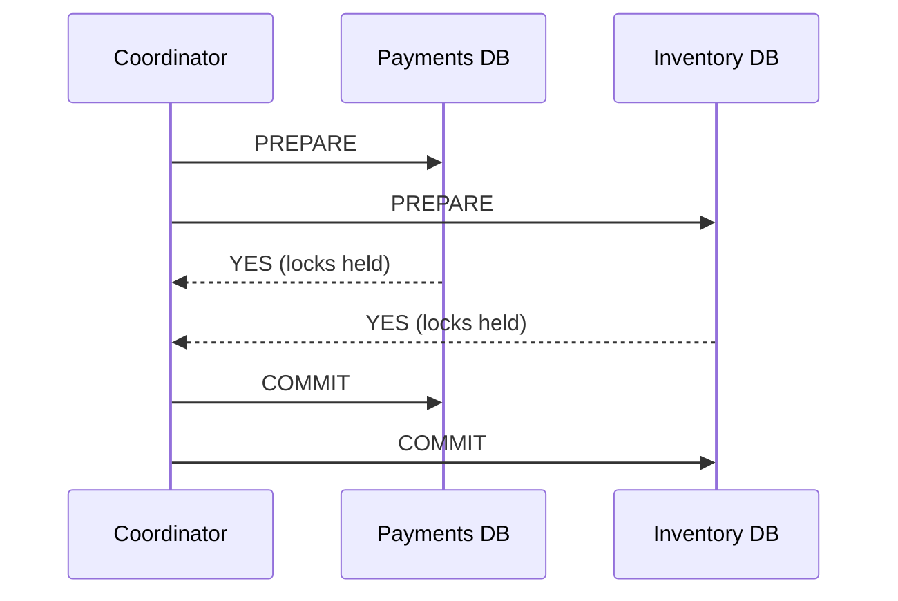
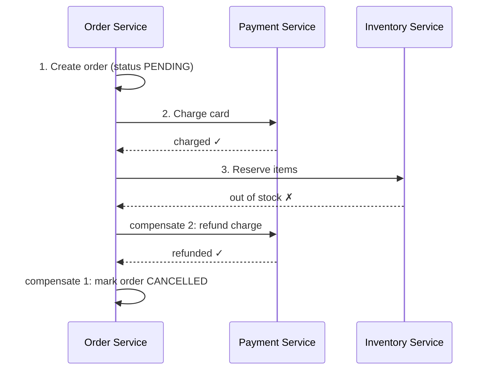
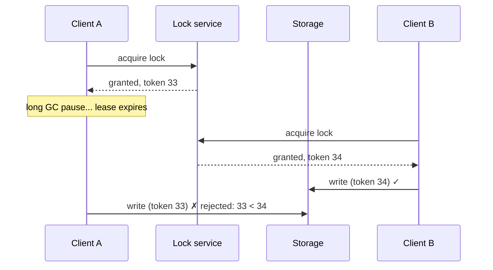

# Distributed Systems Patterns

> [!summary] What you'll learn
> As soon as a system runs on more than one machine, new problems appear: networks drop or delay messages, machines fail independently, clocks disagree, and you can't tell a slow node from a dead one. This note explains the core problems and the standard patterns for handling them:
> **idempotency**, **consistent hashing**, **unique ID generation**, **distributed transactions (2PC) vs sagas**, **consensus (Raft) and leader election**, **distributed locks and fencing tokens**, **time and ordering (logical clocks)**, **conflict resolution (LWW, CRDTs)**, **failure detection (heartbeats, gossip)**, and **probabilistic data structures** (Bloom filters, HyperLogLog, Count-Min Sketch, geospatial indexes).
>
> **Interview angle:** mid-level deep dives often probe consistent hashing, idempotency, ID generation, distributed transactions/sagas, and leader election.

Back to [[Design Index]] · Prev: [[Messaging & Event Streaming]] · Next: [[Reliability & Observability]]

---

## Why distributed systems are hard

### The eight fallacies of distributed computing
Assumptions that developers new to distributed systems tend to make, all false (L. Peter Deutsch and others at Sun Microsystems, 1990s):
1. The network is reliable.
2. Latency is zero.
3. Bandwidth is infinite.
4. The network is secure.
5. Topology doesn't change.
6. There is one administrator.
7. Transport cost is zero.
8. The network is homogeneous.

### Partial failure: the defining problem
On one machine, a function call either returns or throws. Across a network, when you send a request and **get no response (a timeout)**, any of these could be true:
- The request never arrived.
- It arrived and the server is still working on it.
- The server processed it successfully, but the **response** was lost.
- The server crashed halfway through.

**You can't tell which.** So you don't know whether retrying is safe (if the payment already went through, retrying charges twice). This single fact drives most of the patterns below: timeouts, retries, and above all **idempotency**.

---

## Idempotency

### What it means
An operation is **idempotent** if performing it **multiple times has the same effect as performing it once**.
- `SET status = 'shipped'` → idempotent (running it twice still leaves "shipped").
- `DELETE /users/42` → idempotent (the user is gone either way).
- `balance = balance + 100` → **not** idempotent (each run adds another $100).
- `POST /orders` → **not** idempotent (each call creates a new order).

### The problem it solves
Retries are unavoidable: clients retry on timeouts, load balancers retry failed requests, message brokers redeliver un-acked messages ([[Messaging & Event Streaming#Delivery semantics]]), and users double-click. Without idempotency, every retry risks **duplicate side effects**: double charges, duplicate orders, duplicate emails.

### Techniques
| Technique | How it works | Example |
|---|---|---|
| **Idempotency key** | The client generates a unique key per logical operation; the server stores `key → result` and returns the stored result for repeats | `Idempotency-Key` header on `POST /payments` ([[API Design#Idempotency]]) |
| **Natural idempotency** | Design operations as "set to X" rather than "change by Δ" | `SET quantity = 3` instead of `quantity = quantity + 1` |
| **Dedup table** | Record processed message/request IDs with a **unique constraint**, in the **same transaction** as the side effect | `INSERT INTO processed_events(event_id) ... ON CONFLICT DO NOTHING` |
| **Conditional writes** | Only apply a change if the current state is as expected | `UPDATE orders SET status='paid' WHERE id=? AND status='pending'`; DynamoDB condition expressions |
| **Upserts** | Insert-or-update by a unique key, so repeats overwrite rather than duplicate | `INSERT ... ON CONFLICT (id) DO UPDATE` |
| **Version numbers** | Ignore updates older than what you've already applied | `UPDATE ... WHERE version < $newVersion` |

> [!tip] Interview phrasing
> "Because the network can fail after the server processes a request, the client can't know if it succeeded, so it will retry. I'll make the payment endpoint idempotent with a client-supplied idempotency key stored with a unique constraint, so retries return the original result instead of charging again."

---

## Consistent hashing

### The problem
You have N cache servers (or database shards) and need to decide which one holds each key. The obvious approach is `server = hash(key) % N`.

That works until **N changes**. Add a fifth server to four, and `hash(key) % 5` gives a different answer than `% 4` for **about 80% of keys**. For a cache, that means a sudden flood of misses hitting the database. For a database, it means moving most of the data. Removing a failed server has the same effect.

### How consistent hashing works
1. Imagine a **ring** of hash values (e.g., 0 to 2^32 − 1, wrapping around).
2. Hash each **server** to one or more positions on the ring.
3. Hash each **key** onto the ring and walk **clockwise** to the first server: that server owns the key.


(key1 → Node B, key2 → Node C, key3 → Node A)

**Adding a node** only takes over the keys between it and its predecessor: roughly **1/N of the keys** move, all from one neighbor. **Removing a node** hands its keys to its clockwise neighbor. Everything else stays put.

### Virtual nodes (vnodes)
With only one position per server, the ring is lumpy: some servers own big arcs, others tiny ones, and when a server dies, **one** neighbor absorbs all its load. The fix: give each physical server **many positions** (e.g., 100–256 virtual nodes) spread around the ring.
- Load is spread **evenly**.
- When a server fails, its load is spread across **many** servers instead of one.
- **Heterogeneous hardware**: give bigger servers more vnodes.

```javascript
import { createHash } from "crypto";
const hash = (s) => parseInt(createHash("md5").update(s).digest("hex").slice(0, 8), 16);

class HashRing {
  constructor(nodes = [], vnodesPerNode = 100) {
    this.vnodes = vnodesPerNode;
    this.ring = [];                       // sorted array of { pos, node }
    nodes.forEach((n) => this.addNode(n));
  }
  addNode(node) {
    for (let i = 0; i < this.vnodes; i++) this.ring.push({ pos: hash(`${node}#${i}`), node });
    this.ring.sort((a, b) => a.pos - b.pos);
  }
  removeNode(node) { this.ring = this.ring.filter((v) => v.node !== node); }
  getNode(key) {
    const p = hash(key);
    let lo = 0, hi = this.ring.length;    // binary search: first vnode with pos >= p
    while (lo < hi) {
      const mid = (lo + hi) >> 1;
      if (this.ring[mid].pos < p) lo = mid + 1; else hi = mid;
    }
    return this.ring[lo % this.ring.length].node;   // wrap around past the end
  }
}

const ring = new HashRing(["cache-a", "cache-b", "cache-c"]);
ring.getNode("user:42");   // e.g. "cache-b". Adding "cache-d" moves only ~25% of keys
```

### Where it's used
DynamoDB and Cassandra (partitioning data across nodes), Memcached client libraries, CDNs and load balancers (Google's Maglev, Envoy's ring-hash), Discord (routing users to servers), sharded caches in general. Replication is often added by storing each key on the next **R** distinct nodes clockwise.

---

## Unique ID generation

### The problem
On a single database, `AUTO_INCREMENT` / `SERIAL` gives unique IDs. With **many shards or many app servers** creating records independently, there's no single counter. You need IDs that are **unique without coordination**, and ideally **sortable by time** (so recent items sort together and B-tree indexes stay efficient) and **compact**.

### Options
| Approach | How | ✅ Pros | ❌ Cons |
|---|---|---|---|
| **UUID v4** | 122 random bits | No coordination at all; universally supported | 128 bits (16 bytes; 36 chars as text); **random order** hurts B-tree insert performance and cache locality; not time-sortable |
| **UUID v7** | Timestamp (ms) prefix + random bits (standardized in RFC 9562, 2024) | Time-sortable, no coordination, index-friendly | Still 128 bits |
| **Snowflake ID** (Twitter, 2010) | 64-bit integer: timestamp + machine ID + sequence | **Compact** (fits a `BIGINT`), **time-sortable**, very fast, no coordination per ID | Requires assigning unique machine IDs; depends on reasonably accurate clocks (clock going backward must be handled) |
| **Database ticket server / ID ranges** | A central service hands out **blocks** of IDs (e.g., 1,000 at a time) that each server uses locally | Simple numeric IDs; low coordination (one call per block) | The central service is a dependency (make it redundant); IDs from different servers interleave |
| **ULID / KSUID** | Time-prefixed, base32/base62 strings | Sortable, URL-friendly | Less universal |

### Snowflake layout (64 bits)
```
| 1 bit  |       41 bits        |   10 bits    |   12 bits    |
| unused | timestamp (ms since  |  machine ID  |  sequence    |
| (sign) |  a custom epoch)     | (1024 nodes) | (4096 / ms)  |
```
- 41 bits of milliseconds ≈ **69 years** from the chosen epoch.
- 10 bits → up to **1,024** generator machines.
- 12 bits → **4,096 IDs per millisecond per machine** (~4M/sec per machine); if exceeded, wait for the next millisecond.
- Sorting by ID ≈ sorting by creation time.
- Variants: Discord, Instagram (which put shard ID in the bits), Sonyflake, Baidu UidGenerator.

```javascript
class Snowflake {
  constructor(machineId, epoch = 1_700_000_000_000n) {
    this.machineId = BigInt(machineId) & 0x3ffn;   // 10 bits
    this.epoch = epoch; this.seq = 0n; this.lastMs = -1n;
  }
  next() {
    let now = BigInt(Date.now());
    if (now < this.lastMs) throw new Error("Clock moved backwards");
    if (now === this.lastMs) {
      this.seq = (this.seq + 1n) & 0xfffn;          // 12 bits
      if (this.seq === 0n) while ((now = BigInt(Date.now())) <= this.lastMs) {}   // wait for next ms
    } else this.seq = 0n;
    this.lastMs = now;
    return ((now - this.epoch) << 22n) | (this.machineId << 12n) | this.seq;
  }
}
```

> Exposing sequential IDs publicly can leak business volume (competitors can estimate your order count) and allow enumeration (`/invoices/1001`, `/invoices/1002`...). Use random or opaque public IDs where that matters, and **always** check authorization regardless of ID guessability.

---

## Distributed transactions

### The problem
"Charge the customer's card, reserve inventory, and create the order" must happen **all together or not at all**. If these live in **different services or databases**, no single database transaction can cover them.

### Two-Phase Commit (2PC)
A **coordinator** runs a protocol with all **participants**:
1. **Prepare phase**: the coordinator asks each participant "can you commit?" Each participant does the work, durably records it, **holds its locks**, and votes yes or no.
2. **Commit phase**: if **all** voted yes, the coordinator tells everyone to commit; if **any** voted no (or timed out), it tells everyone to abort.


- ✅ True atomicity across nodes.
- ❌ **Blocking**: if the coordinator crashes after participants voted yes, they're stuck holding locks, unable to commit or abort, until it recovers.
- ❌ **Slow**: multiple round trips, and locks held across the network.
- ❌ **Reduced availability**: every participant must be up.
- **Where it's used:** inside some distributed databases (Spanner and CockroachDB use variants combined with consensus), and XA transactions in traditional enterprise systems. **Rarely used between microservices.**

### Saga pattern
A **saga** breaks a long business transaction into a **sequence of local transactions**, each committed independently in its own service. If a later step fails, the saga runs **compensating transactions** to undo the earlier steps.



**Key properties:**
- Each step is a normal local ACID transaction. No distributed locks.
- **Not isolated**: other requests can see intermediate states (an order that's PENDING, a charge that will be refunded). Design for it with explicit status fields ("pending," "awaiting payment") and semantic locks.
- **Compensations are business actions**, not database rollbacks: "refund the charge," "release the reservation," "send an apology email." Some actions can't be undone (an email already sent), so order steps so that hard-to-reverse ones come last.
- Compensations and steps must be **idempotent** and **retried until they succeed**.

**Two ways to coordinate a saga:**
| | **Choreography** | **Orchestration** |
|---|---|---|
| How | Each service listens for events and emits its own (`OrderCreated` → payment charges → `PaymentCaptured` → inventory reserves → ...) | A central **orchestrator** tells each service what to do next and tracks the saga's state |
| ✅ | Loose coupling; no central component; simple for 2–3 steps | The flow is explicit in one place; easy to monitor, debug, and change; handles complex branching |
| ❌ | The overall flow is implicit and hard to follow; risk of cyclic dependencies; hard to answer "where is order 123 stuck?" | The orchestrator is extra infrastructure and can become a "god service" |
| Tools | Kafka/SNS events | Temporal, AWS Step Functions, Camunda, Netflix Conductor, or a hand-written state machine |

> [!tip] Interview phrasing
> "Payment and inventory live in different services, so instead of 2PC, I'd use an orchestrated saga: create the order as PENDING, charge, reserve, then confirm. If reserving fails, the orchestrator refunds the payment and cancels the order. Each step is idempotent so retries are safe."

---

## Consensus and coordination

### The problem
Many distributed systems need several nodes to **agree on something** despite failures: which node is the leader, the order of writes in a replicated log, whether a configuration change happened, who holds a lock. Agreement is hard because messages can be delayed or lost and nodes can crash at any point.

### Consensus algorithms
- **Paxos** (Leslie Lamport, 1989/1998): the original, provably correct, and notoriously hard to understand and implement.
- **Raft** (Ongaro & Ousterhout, 2014): designed to be understandable. It's the one to know.

**Raft in brief:**
1. Nodes are **followers**, **candidates**, or the **leader**. Time is divided into numbered **terms**.
2. **Leader election**: if a follower hears nothing from a leader within a randomized timeout, it becomes a candidate and requests votes. A candidate that gets votes from a **majority** becomes leader for that term.
3. **Log replication**: clients send writes to the leader, which appends them to its log and replicates them to followers. An entry is **committed** once a **majority** has stored it, and only then applied.
4. A majority (**quorum**) is required for progress. With **2f + 1** nodes, the cluster tolerates **f** failures: **3 nodes tolerate 1 failure; 5 tolerate 2**. That's why consensus clusters use odd sizes; a 4-node cluster still only tolerates 1 failure.
5. A minority partition can't elect a leader or commit writes, which prevents split brain. This is a **CP** design.

**Systems built on consensus:** **etcd** (Raft; stores all Kubernetes cluster state), **Consul** (Raft), **ZooKeeper** (ZAB, a Paxos-like protocol), CockroachDB and TiDB (Raft per data range), Kafka's KRaft mode (replaced ZooKeeper), Google's Chubby and Spanner (Paxos).

**What you use them for (usually indirectly):** leader election, distributed locks, service discovery, cluster membership, storing small critical configuration and metadata. You almost never implement consensus yourself. You use etcd, ZooKeeper, or Consul, or a database built on Raft.

### Leader election
**The problem:** some work must be done by **exactly one node** at a time: a scheduler that triggers jobs, a process that compacts data, the single writer for a partition. If two nodes do it, jobs run twice or data gets corrupted.

**Approaches:**
- Use a consensus service: acquire a **lease** (a lock with a time limit) in etcd/ZooKeeper/Consul; the holder is leader and must keep renewing; if it dies, the lease expires and another node takes over.
- A database row with an expiring lease (`UPDATE leader SET node=?, expires_at=now()+30s WHERE expires_at < now()`), which works for simpler needs.
- Kubernetes provides a leader-election helper built on its API (backed by etcd).

**The danger: split brain.** The old leader may be **paused** (a long garbage-collection pause, a VM migration) or partitioned, its lease expires, a new leader is elected, and then the old one wakes up and keeps acting as leader. Two leaders now exist. The defense is **fencing tokens**.

### Distributed locks and fencing tokens
A distributed lock ensures only one process at a time works on a resource across machines.
- **Implementations:** etcd/ZooKeeper locks (strongest), Redis `SET lock:resource <uniqueValue> NX PX 30000` (fast; the multi-node "Redlock" variant is debated for correctness-critical uses), database row locks or advisory locks (`pg_advisory_lock`).
- **Always use a TTL/lease**: a crashed lock holder must not hold the lock forever.
- **Release only your own lock**: check the unique value before deleting, atomically (a Lua script in Redis).

**Fencing tokens:** every time the lock is granted, the lock service hands out a **monotonically increasing number**. The protected resource (storage, database) **rejects any write with a token lower than the highest it has seen**. Then even if a paused old holder wakes up and tries to write with token 33 after the new holder used token 34, the write is rejected.



> Prefer designs that **avoid** distributed locks when possible: a single writer per partition (route all writes for a key to one consumer, as with Kafka partitions), optimistic concurrency control (version checks), or atomic conditional updates in the database.

---

## Time and ordering

### The problem with clocks
Each machine has its own clock, synchronized via **NTP**, typically to within a few milliseconds but sometimes much worse, and clocks can **jump backward** after a sync. So you **can't reliably order events across machines by wall-clock timestamps**. Two writes 1 ms apart on different machines may get timestamps in the wrong order. Systems that use **last-write-wins by timestamp** can silently discard the write that actually came last.

### Logical clocks
- **Lamport timestamps** (1978): each node keeps a counter, increments it on each event, and sends it with messages; on receiving a message, a node sets its counter to `max(local, received) + 1`. This gives an ordering consistent with **causality** (if A caused B, A's timestamp < B's), but can't tell you whether two events were concurrent.
- **Vector clocks**: each node keeps a vector of counters (one per node). Comparing two vectors tells you whether one event happened before the other or they were **concurrent** (a conflict). Used in Dynamo-style systems (Riak) to detect conflicting writes.
- **Hybrid Logical Clocks (HLC)**: combine physical time with a logical counter, close to wall-clock time but causally consistent (CockroachDB, MongoDB).
- **Google TrueTime** (Spanner): GPS receivers and atomic clocks in every datacenter provide time with a **known uncertainty bound** (a few ms). Spanner waits out the uncertainty before committing, which yields globally consistent ("externally consistent") transactions.

**Practical takeaway:** for ordering within one entity, use a **sequence number assigned by a single authority** (the leader, the partition, the database) rather than client or server wall-clock times.

---

## Conflict resolution (when several nodes accept writes)

With multi-leader or leaderless replication, or offline-capable clients, two replicas can accept **conflicting writes** to the same data. Options:
| Strategy | How | Tradeoff |
|---|---|---|
| **Last-write-wins (LWW)** | Keep the write with the highest timestamp | Simple; **silently loses data** (and clock skew makes "last" unreliable). OK for caches or "latest location" |
| **Application-defined merge** | Custom logic: union shopping-cart items, sum counters, prompt the user | Correct for the domain; more code |
| **Keep siblings** | Store all conflicting versions and let the next reader resolve them (Riak, CouchDB) | Pushes complexity to the app |
| **CRDTs** (Conflict-free Replicated Data Types) | Data structures mathematically designed so that **concurrent updates merge automatically and deterministically**, in any order, with all replicas converging | Limited to supported types; some metadata overhead |
| **Operational Transformation (OT)** | Transform concurrent edit operations against each other so they apply consistently | Classic for collaborative text editing (Google Docs); usually needs a central server |

**CRDT examples:** G-Counter (grow-only counter: each node increments its own slot; the value is the sum), PN-Counter (increments and decrements), OR-Set (add/remove set), LWW-Register, sequence CRDTs for collaborative text. **Used in:** collaborative and local-first apps (Figma's multiplayer uses CRDT-inspired techniques; Yjs and Automerge libraries), Redis Enterprise active-active, Riak, and Apple Notes sync.

---

## Failure detection and membership

### Heartbeats
Nodes periodically send "I'm alive" messages. If a node misses several heartbeats (or a timeout passes), it's **suspected** dead. The fundamental tradeoff: **short timeouts** detect failures quickly but cause false positives (a slow or briefly paused node is declared dead, triggering needless and possibly harmful failovers); **long timeouts** are safer but slower to react.

### Gossip protocols
Each node periodically picks a few random peers and exchanges what it knows (membership lists, heartbeat counters, state). Information spreads through the cluster **like an epidemic**, reaching all N nodes in about O(log N) rounds, without any central coordinator.
- ✅ Scalable, decentralized, robust to failures.
- ❌ Eventually consistent knowledge; some background traffic.
- **Used in:** Cassandra and ScyllaDB (cluster membership and failure detection), Consul and Serf (the SWIM protocol), Redis Cluster, DynamoDB internals.

### Phi accrual failure detector
Instead of a binary "dead or alive" after a fixed timeout, it outputs a **suspicion level** based on the statistical distribution of past heartbeat arrival times, and the application picks a threshold (Cassandra, Akka).

---

## Data integrity tools

Compact probabilistic and specialized data structures that come up often in system design. Each trades a small, controlled amount of accuracy for **huge savings in memory or time**.

### Bloom filter
**Answers "is X in the set?" with either "definitely not" or "probably yes,"** using very little memory.
- **How:** a bit array of m bits plus k hash functions. To **add** an item, set the k bits it hashes to. To **check**, look at those k bits: if any is 0, the item was **definitely never added**; if all are 1, it was **probably** added (the bits might have been set by other items: a **false positive**). **No false negatives.**
- Memory: about **10 bits per item for a ~1% false-positive rate**, regardless of item size.
- Can't remove items (counting Bloom filters or Cuckoo filters can).
- **Use for:** skipping disk lookups for keys that don't exist (LSM-tree databases like Cassandra, RocksDB, and HBase check a Bloom filter per SSTable); preventing **cache penetration** ([[Caching#Cache penetration]]); "has this user already seen this post or recommendation?"; checking usernames against a huge list; web crawlers' "already visited this URL?"; malicious-URL checks in browsers (historically Chrome).

### Merkle tree
A tree of hashes: leaves are hashes of data blocks; each parent is the hash of its children; the root summarizes everything. Two replicas compare **root hashes**; if they match, the data is identical. If not, they descend only into subtrees whose hashes differ, finding exactly which ranges are out of sync while exchanging very little data.
- **Use for:** anti-entropy repair between replicas (Cassandra, DynamoDB), **Git** (commits and trees are Merkle structures), blockchains, file sync and integrity verification (IPFS, ZFS).

### HyperLogLog
**Estimates the number of distinct items** (cardinality) in a huge stream using ~**12 KB** of memory with ~**0.8% error**, regardless of how many items there are (counting distinct values exactly would require storing them all).
- **Use for:** unique visitors per page per day, unique searches, distinct IPs. Redis supports it directly (`PFADD`, `PFCOUNT`, `PFMERGE`).

### Count-Min Sketch
**Estimates how often each item appears** in a stream, using a small 2D array of counters and several hash functions. It can **overestimate** (hash collisions) but never underestimates.
- **Use for:** **heavy hitters / top-K** (trending hashtags, most-viewed videos, the most frequent IPs in DDoS detection), approximate frequency counts in stream processing. Often combined with a min-heap to track the top K.

### Geospatial indexes
**The problem:** "find drivers within 2 km of this rider" or "restaurants near me." A plain index on latitude and longitude can't efficiently answer a 2D proximity query.
- **Geohash**: encodes a (lat, lng) into a string where **shared prefixes mean nearby** (`9q8yy...` are all in San Francisco). Proximity search becomes a prefix search over the cell and its neighbors. Simple; supported by Redis (`GEOSEARCH`), Elasticsearch, DynamoDB patterns.
- **Quadtree**: recursively splits 2D space into four quadrants, subdividing dense areas further (adapts to uneven density, like cities vs countryside). Often in-memory.
- **Google S2** (sphere cells) and **Uber H3** (hexagonal cells, which have uniform neighbor distances): hierarchical cell systems used for ride matching, surge-pricing areas, and analytics.
- **R-tree**: indexes rectangles/shapes; used by PostGIS and spatial databases.

---

## Quick self-test
- [ ] What is "partial failure," and why does it make retries dangerous without idempotency?
- [ ] Give five techniques for making an operation idempotent.
- [ ] Why does `hash(key) % N` fail when N changes? How does consistent hashing fix it, and why use virtual nodes?
- [ ] Design a 64-bit unique ID. What do the bits represent? What happens if the clock goes backward?
- [ ] UUID v4 vs UUID v7 vs Snowflake: tradeoffs.
- [ ] 2PC vs saga: how each works and why microservices usually use sagas.
- [ ] Choreography vs orchestration: pros and cons.
- [ ] Why do Raft clusters use an odd number of nodes? How many failures does a 5-node cluster tolerate?
- [ ] What's split brain, and how do fencing tokens prevent damage from it?
- [ ] Why can't you order events across machines by wall-clock time? What do you use instead?
- [ ] What's a CRDT? Give an example.
- [ ] How does a Bloom filter work? Can it have false negatives? Give three use cases.
- [ ] Which structure would you use for unique visitor counts? For trending topics? For "nearby drivers"?

Next: [[Reliability & Observability]]
