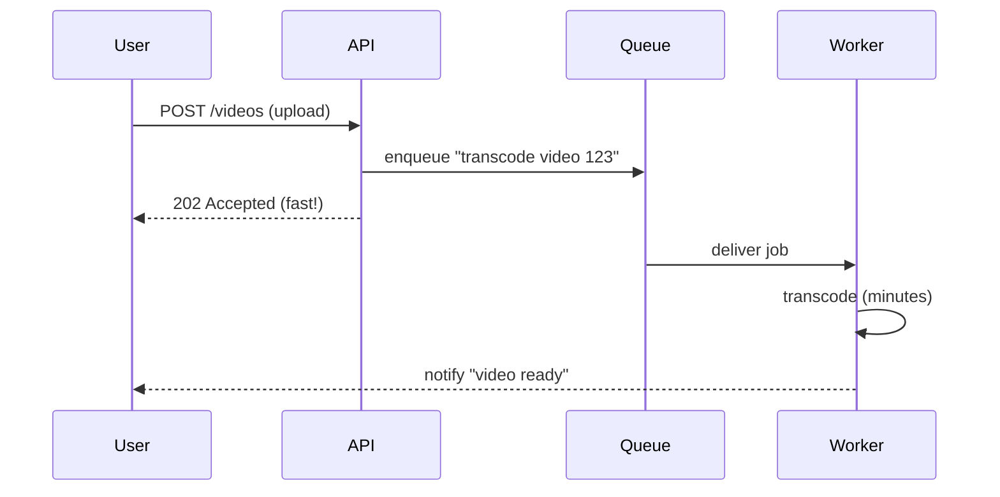
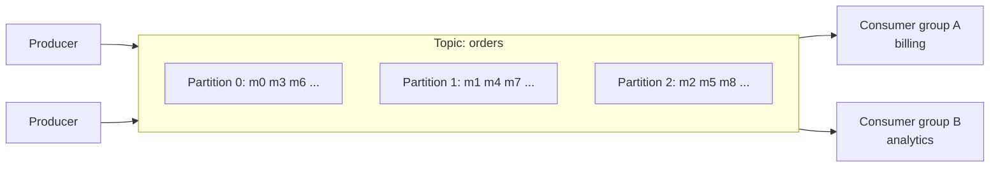

# Messaging & Event Streaming

> [!summary]
> Message queues and event streams let services **communicate asynchronously**: a producer drops a message and moves on, and consumers process it when they can. This decouples services, smooths traffic spikes, and moves slow work out of the request path. Know **queue vs pub/sub vs log (Kafka)**, **delivery semantics**, and **ordering/idempotency**.

Back to [[Design Index]] · Prev: [[Caching]] · Related: [[Architectural Styles#Event-Driven Architecture (EDA)]]

---

## Why async?



- **Decoupling**: producer and consumer don't need to know each other or be up at the same time.
- **Load leveling / buffering**: absorb bursts; consumers process at their own rate.
- **Responsiveness**: return fast; do slow work (emails, image processing, reports) in the background.
- **Reliability**: messages persist; a failed consumer retries later.
- **Fan-out**: one event, many independent consumers.

Costs: eventual consistency, harder debugging and tracing, duplicate/out-of-order handling, another system to operate.

---

## Messaging models

### Point-to-point queue (work queue)
Each message is consumed by **exactly one** consumer from a pool (competing consumers). The message is deleted after acknowledgment.
*Use for:* background jobs, task distribution.
*Examples:* **AWS SQS**, **RabbitMQ**, ActiveMQ, Redis lists/BullMQ, Sidekiq, Celery.

### Publish/subscribe
A message published to a **topic** is delivered to **every subscriber**.
*Use for:* "OrderPlaced" → email service, analytics, inventory all react independently.
*Examples:* **AWS SNS**, Google Pub/Sub, RabbitMQ fanout exchanges, Redis pub/sub (fire-and-forget, no persistence).

**SNS + SQS fan-out**: an SNS topic → multiple SQS queues (one per consuming service). Each service gets its own durable queue.

### Distributed log / event stream (Kafka model)
An **append-only, partitioned, replicated log**. Messages are **retained** (days, or forever) and **not deleted on consume**. Each consumer group tracks its own **offset** (position).



- **Topic** → split into **partitions** (the unit of parallelism and ordering).
- **Ordering is guaranteed only within a partition.** Messages with the same **key** (e.g., `orderId`) go to the same partition, so all events for one order stay in order.
- **Consumer group**: each partition is read by one consumer in the group → scale consumers up to the number of partitions.
- **Replay**: reset offsets to reprocess history (rebuild a cache, fix a bug, onboard a new service).
- Extremely high throughput (sequential disk writes, batching, zero-copy).
*Examples:* **Apache Kafka**, AWS Kinesis, Redpanda, Apache Pulsar, Azure Event Hubs.

### Queue vs Kafka: when to use which

| | Traditional queue (SQS/RabbitMQ) | Log (Kafka) |
|---|---|---|
| After consume | Deleted | Retained; replayable |
| Consumers | Compete for messages | Many independent groups each read everything |
| Ordering | Best effort (SQS FIFO for strict order) | Per partition |
| Per-message features | Ack, delay, visibility timeout, priority, DLQ, routing | Simpler per message; offset-based |
| Throughput | High | Very high (millions/s) |
| Best for | Task/job queues, work distribution | Event streaming, event sourcing, analytics pipelines, CDC, activity tracking, log aggregation |

---

## Delivery semantics

| Guarantee | Meaning | How |
|---|---|---|
| **At-most-once** | May lose messages, never duplicates | Ack before processing; fire-and-forget |
| **At-least-once** | Never lose; **may duplicate** | Ack after processing; retry on failure. **Most common default.** |
| **Exactly-once** | Each message affects state once | Hard in general. Kafka offers exactly-once *within Kafka* (idempotent producers + transactions). End-to-end, it's achieved as **at-least-once + idempotent consumers** |

> [!important] Rule of thumb
> Assume **at-least-once** delivery and make consumers **idempotent**: dedupe by message ID (store processed IDs), use upserts, or use conditional updates. See [[Distributed Systems Patterns#Idempotency]].

---

## Important queue concepts
- **Acknowledgment (ack)**: the consumer confirms success; un-acked messages get redelivered.
- **Visibility timeout** (SQS): once a message is received, it's hidden for N seconds. If not deleted by then, it reappears for another consumer.
- **Dead Letter Queue (DLQ)**: after N failed attempts, move the message aside for inspection so a **poison message** doesn't block the queue forever. Alert on DLQ depth.
- **Retries with exponential backoff + jitter**.
- **Backpressure**: if consumers lag, the queue grows. Monitor **queue depth / consumer lag** and auto-scale consumers on it.
- **Ordering vs parallelism tradeoff**: strict global order = one consumer = no parallelism. Partition by key for per-entity order.
- **Message schema evolution**: use schemas (Avro/Protobuf + Schema Registry) and keep changes backward compatible.
- **Delayed / scheduled messages**: "send a reminder in 24h".

---

## Key patterns

### Transactional Outbox
Problem: you need to update the DB **and** publish an event atomically. If you write the DB, then the publish fails (or vice versa), the systems drift. You can't do a distributed transaction across Postgres and Kafka.

Solution: in the **same DB transaction**, write the business row **and** an `outbox` row. A separate relay process (polling, or **CDC** with Debezium) reads the outbox and publishes to the broker, then marks rows sent. Delivery is at-least-once, so consumers stay idempotent.

```sql
BEGIN;
  INSERT INTO orders (...) VALUES (...);
  INSERT INTO outbox (id, topic, payload) VALUES (gen_random_uuid(), 'OrderPlaced', '{...}');
COMMIT;
```

### Other patterns
- **Competing consumers**: scale workers horizontally on one queue.
- **Fan-out**: pub/sub to many queues.
- **Request–reply over queues**: correlation IDs plus a reply queue.
- **Saga**: multi-step workflows across services using events. See [[Distributed Systems Patterns#Saga pattern]].
- **Event sourcing / CQRS**: see [[Architectural Styles#CQRS]].
- **Stream processing**: continuous computation over event streams (windowed counts, joins). *Kafka Streams, Apache Flink, Spark Structured Streaming.* Used for trending topics, fraud detection, and real-time dashboards.

## Workflow orchestration (enterprise)
For long-running multi-step business processes with retries and state: **Temporal**, AWS Step Functions, Netflix Conductor, Airflow (batch/data). These are increasingly common at large companies instead of hand-rolled saga code.

## Self-test
- [ ] Queue vs pub/sub vs log: one use case each.
- [ ] How does Kafka guarantee ordering, and what's the limit?
- [ ] Why is "exactly-once" hard? What do we do in practice?
- [ ] What's a DLQ and when does a message go there?
- [ ] Explain the transactional outbox and the problem it solves.

Next: [[Distributed Systems Patterns]]
