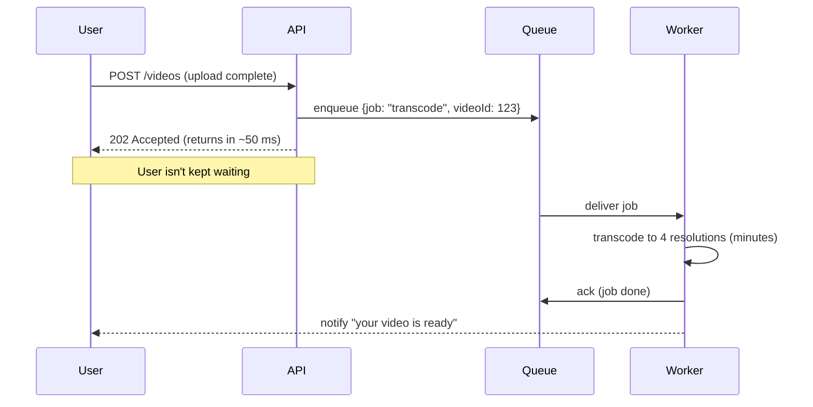
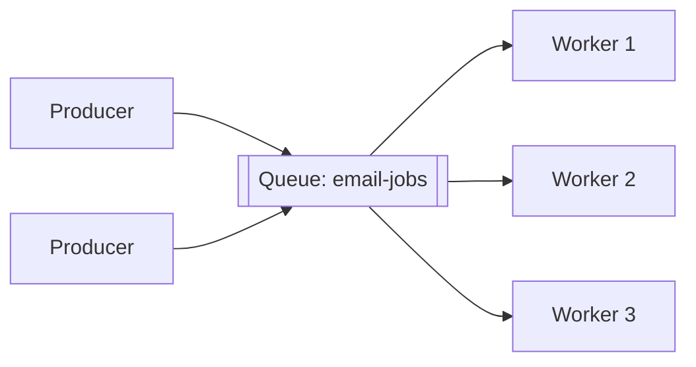
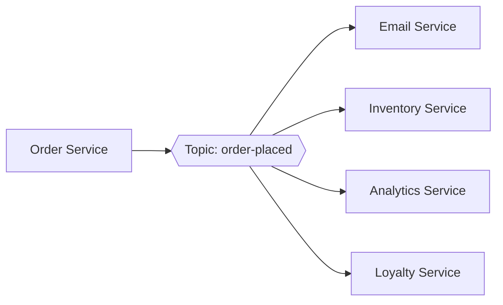
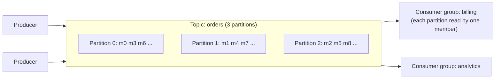
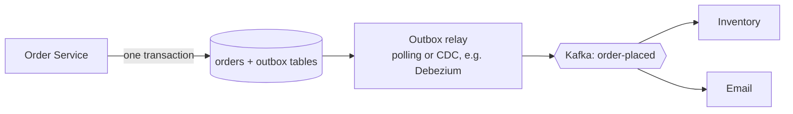

# Messaging & Event Streaming

> [!summary] What you'll learn
> Message queues and event streams let parts of a system **communicate asynchronously**: a producer hands off a message and moves on, and one or more consumers process it when they can. This note explains **why async helps**, the three messaging models (**point-to-point queues**, **publish/subscribe**, and **distributed logs like Kafka**), **delivery guarantees** (at-most-once, at-least-once, exactly-once), **ordering**, **dead-letter queues**, **backpressure**, and the **transactional outbox** pattern, with when to use each.
>
> **Interview angle:** "put this on a queue" is one of the most common moves in system design. Interviewers then probe: what happens on failure? Duplicates? Ordering? What if consumers fall behind?

Back to [[Design Index]] · Prev: [[Caching]] · Next: [[Distributed Systems Patterns]] · Related: [[Architectural Styles#Event-Driven Architecture (EDA)]]

---

## Synchronous vs asynchronous communication

**Synchronous** (request/response, e.g., HTTP or gRPC): the caller sends a request and **waits** for the result.
- ✅ Simple to reason about; you get the result (or error) immediately.
- ❌ The caller is blocked; **both sides must be up at the same time**; the caller's latency includes the callee's; failures cascade up the chain.

**Asynchronous** (messaging): the caller (producer) puts a message on a **queue or topic** managed by a **broker**, gets a quick acknowledgment from the broker, and continues. Consumers pull messages and process them independently.



### The problems async messaging solves
1. **Slow work out of the request path**: sending emails, generating PDFs, resizing images, transcoding video, calling slow third-party APIs. Users get a fast response; the work happens in the background.
2. **Temporal decoupling**: the producer doesn't need the consumer to be up. If the email service is down for 10 minutes, messages wait in the queue and are processed when it recovers. Nothing is lost, and ordering keeps working.
3. **Load leveling (buffering)**: a traffic spike (a flash sale, a viral moment) fills the queue instead of overwhelming downstream services. Consumers drain it at their sustainable pace.
4. **Independent scaling**: add more consumers (workers) when the queue grows; scale producers and consumers separately.
5. **Fan-out**: one event can be delivered to many independent consumers (email, analytics, inventory, search indexing) without the producer knowing about them.
6. **Reliability through retries**: if processing fails, the message is redelivered and retried.

### What it costs
- **Eventual consistency**: the effect happens *later* (the user may not see their video for a minute).
- **Harder debugging**: work flows across processes and time; you need correlation IDs and tracing.
- **New failure cases**: duplicates, out-of-order messages, poison messages, consumer lag.
- **Another system to operate** (or pay for).
- You can't return the result of the async work in the same HTTP response (use polling, webhooks, WebSockets, or notifications instead).

---

## Messaging models

### 1. Point-to-point queue (work queue / task queue)
Each message is delivered to **exactly one** consumer out of a pool of **competing consumers**. Once processed and acknowledged, it's **removed** from the queue.


- **Use for:** background jobs and task distribution: send this email, resize this image, generate this report. Each job should be done once, by any available worker.
- Scale by adding workers.
- **Examples:** **AWS SQS**, **RabbitMQ**, ActiveMQ, Azure Service Bus queues, Google Cloud Tasks; Redis-backed job libraries like **BullMQ** (Node), Sidekiq (Ruby), Celery (Python).

```javascript
// BullMQ (Node + Redis) example
import { Queue, Worker } from "bullmq";
const emailQueue = new Queue("emails", { connection });

// producer (in the API request handler)
await emailQueue.add("welcome", { userId: 42 }, { attempts: 5, backoff: { type: "exponential", delay: 1000 } });

// consumer (a separate worker process)
new Worker("emails", async (job) => {
  const user = await users.findById(job.data.userId);
  await mailer.send(user.email, "Welcome!");
}, { connection, concurrency: 10 });
```

### 2. Publish/subscribe (pub/sub)
A message published to a **topic** is delivered to **every subscriber** of that topic. Each subscriber gets its own copy.


- **Use for:** broadcasting **events** ("an order was placed") that several independent services react to. The producer doesn't know or care who's subscribed, so adding a new consumer requires no producer changes.
- **Examples:** **AWS SNS**, Google Cloud Pub/Sub, Azure Service Bus topics, RabbitMQ fanout/topic exchanges, Redis Pub/Sub (fire-and-forget: if a subscriber is offline, it misses messages).

**Common combination: SNS → SQS fan-out.** An SNS topic delivers each event into **several SQS queues**, one per consuming service. Each service gets its own **durable** queue (messages wait if the service is down) and its own retry and DLQ behavior.

### 3. Distributed log / event streaming (the Kafka model)
An **append-only, partitioned, replicated log**. Producers append messages (records) to a **topic**. Messages are **retained** for a configured time (days, weeks, or forever) and **not deleted when consumed**. Each consumer tracks its own position (**offset**) in the log, so many consumers can read the same data independently, at their own pace, and even **re-read history**.



**Key concepts:**
- **Topic**: a named stream of records (`orders`, `page-views`).
- **Partition**: a topic is split into partitions, each an ordered log stored on a broker and replicated to others. Partitions are the unit of **parallelism** and of **ordering**.
- **Key-based partitioning**: records with the same **key** (e.g., `orderId` or `userId`) always go to the same partition, so **all events for one order are in order**.
- **Ordering guarantee**: **only within a partition**, not across a whole topic.
- **Consumer group**: a set of consumers sharing the work for one application. Each partition is assigned to **exactly one consumer in the group** at a time, so you can scale a group up to the number of partitions. Different groups (billing, analytics) each independently read **all** messages.
- **Offset**: each consumer group's position in each partition. Consumers **commit** offsets to record progress. To reprocess, reset offsets.
- **Retention and replay**: because data is kept, you can rebuild a cache or search index, fix a bug and reprocess, or onboard a new service by reading history.
- **Throughput**: Kafka is extremely fast (millions of messages/sec per cluster) because it appends sequentially to disk, batches, and uses zero-copy transfers.

**Examples:** **Apache Kafka** (and managed versions: Confluent, AWS MSK), AWS Kinesis, Redpanda, Apache Pulsar, Azure Event Hubs.

### Queue vs log: which to use?
| | Traditional queue (SQS, RabbitMQ) | Log (Kafka, Kinesis) |
|---|---|---|
| After consumption | Message deleted | Message **retained**; replayable |
| Consumers | Compete for messages (each processed once) | Many independent groups each read **everything** |
| Ordering | Best effort (SQS FIFO queues give strict order per group) | Strict **per partition** |
| Per-message features | Acks, per-message retries, delays, visibility timeouts, priorities, DLQs, flexible routing (RabbitMQ) | Simpler: consumers track offsets; per-message retry needs extra patterns |
| Throughput | High | **Very high** |
| Scaling consumers | Add workers freely | Up to the number of partitions per group |
| **Best for** | **Task/job queues**: "do this work once" | **Event streaming**: event-driven architectures, analytics pipelines, activity tracking, log aggregation, **CDC**, event sourcing, stream processing |

> Rule of thumb: **"Do this job"** → queue. **"This happened"** (a fact many systems care about, possibly later) → log/topic.

---

## Delivery semantics

Messages cross networks, and both producers and consumers can crash at any moment. That makes the delivery guarantee one of the most important properties of a messaging setup.

| Guarantee | Meaning | How it happens | Risk |
|---|---|---|---|
| **At-most-once** | Each message is delivered **zero or one** time | Consumer acks **before** processing (or producer doesn't retry). If it crashes mid-processing, the message is lost | **Message loss** |
| **At-least-once** | Each message is delivered **one or more** times | Consumer acks **after** processing; on failure or timeout the broker redelivers. Producers retry until the broker acks | **Duplicates** |
| **Exactly-once** | Each message **affects the system once** | Very hard end to end. Kafka supports exactly-once *within Kafka* (idempotent producers + transactions for read-process-write between topics). Across external systems (a DB, an email provider), it's achieved by **at-least-once delivery + idempotent processing** | Complexity |

**Why duplicates happen even when nothing is "wrong":** a consumer processes a message, writes to the database, and then crashes (or its network blips) **before** sending the ack. The broker never got the ack, so it redelivers to another consumer, which processes it again.

> [!important] The rule
> **Assume at-least-once delivery and make consumers idempotent.** Processing the same message twice must have the same effect as processing it once.

**Making consumers idempotent:**
```javascript
async function handlePaymentCaptured(msg) {
  // 1. Dedupe by a unique message/event ID, inside the same DB transaction as the side effect
  await db.tx(async (t) => {
    const inserted = await t.query(
      "INSERT INTO processed_events (event_id) VALUES ($1) ON CONFLICT DO NOTHING RETURNING event_id",
      [msg.eventId]
    );
    if (inserted.rowCount === 0) return;                         // already processed: skip
    await t.query("UPDATE orders SET status = 'paid' WHERE id = $1", [msg.orderId]);
  });
}
```
Other techniques: **upserts** instead of inserts; **conditional updates** (`UPDATE ... WHERE status = 'pending'`); naturally idempotent operations (`SET status = 'paid'` rather than `balance = balance + 10`). More in [[Distributed Systems Patterns#Idempotency]].

---

## Ordering

**Global ordering across everything** requires a single partition or queue processed by a single consumer, which means **no parallelism**. Most systems don't actually need it. They need **per-entity ordering**: all events for *this order*, or *this user*, or *this conversation*, in order.

**Solution:** partition by the entity's key (Kafka partition key, SQS FIFO message group ID). Events for different entities are processed in parallel; events for the same entity stay ordered.

**Ordering pitfalls:**
- **Retries can reorder**: if message 1 fails and is retried after message 2 succeeds, they're processed out of order. If order matters, include a sequence number or version and ignore stale updates (`UPDATE ... WHERE version < $newVersion`).
- **Multiple producers** sending events for the same entity may race. Assign versions at the source.

---

## Important operational concepts

### Acknowledgments and visibility timeouts
- **Ack**: the consumer tells the broker it finished processing. Un-acked messages are redelivered.
- **Visibility timeout (SQS)**: when a consumer receives a message, it becomes **invisible** to others for N seconds. If the consumer doesn't delete it in time (crash or slow processing), it reappears for another consumer. Set the timeout **longer than your processing time**, or extend it for long jobs; otherwise jobs get processed twice.

### Retries with backoff
Transient failures (a downstream timeout) should be retried after increasing delays (1 s, 2 s, 4 s, 8 s...) with **jitter**, rather than immediately and repeatedly. See [[Reliability & Observability#Retries with exponential backoff + jitter]].

### Dead Letter Queue (DLQ)
A **poison message** is one that fails every time (malformed data, a bug for that particular input). Retried forever, it wastes resources and, in ordered queues, **blocks everything behind it**.

A **DLQ** is a separate queue where messages go after **N failed attempts**. The main queue keeps flowing, and engineers can inspect the DLQ, fix the bug, and **redrive** (replay) the messages.
- **Always configure a DLQ** for important queues.
- **Alert on DLQ depth > 0**; a growing DLQ means something is broken.

### Backpressure and consumer lag
If producers outpace consumers, the queue grows. **Monitor queue depth / consumer lag** (how far behind consumers are, in messages or seconds). Responses:
- **Auto-scale consumers** based on queue depth (e.g., Kubernetes KEDA, SQS-based scaling).
- Make consumers faster (batching, more concurrency).
- If the backlog is unbounded, apply **backpressure** to producers (reject or slow down) or shed low-priority work.
- Set retention so a long outage doesn't lose messages.

### Message design and schema evolution
- Include a unique **event ID**, an **event type**, a **timestamp**, a **version**, and a **correlation ID** for tracing.
- Prefer **event-carried state** (include the data consumers need) to avoid callback storms, but keep messages reasonably small (store large payloads in S3 and send a reference: the "claim check" pattern).
- Use schemas (**Avro, Protobuf, or JSON Schema** with a **schema registry**) and keep changes **backward compatible** (add optional fields; never remove or repurpose fields consumers rely on).

### Delayed and scheduled messages
"Send a reminder in 24 hours," "cancel the unpaid order after 15 minutes." Use delay features (SQS delay up to 15 minutes, BullMQ delayed jobs, RabbitMQ delayed exchange) or a scheduler service for long delays.

---

## Key patterns

### Transactional Outbox
**The problem (dual writes):** after placing an order you must (1) save it to the database and (2) publish `OrderPlaced` to Kafka. These are two different systems, so you can't wrap them in one transaction:
- Save to DB, then publish, and the process crashes between them: the order exists but **no event is ever sent** (inventory never reserved, no confirmation email).
- Publish, then save, and the DB write fails: consumers act on an order that **doesn't exist**.

**The solution:** write the event into an **`outbox` table in the same database transaction** as the business data. A separate **relay** process reads the outbox and publishes to the broker, marking rows as sent.

```sql
BEGIN;
  INSERT INTO orders (id, user_id, total_cents, status) VALUES ('o_1', 42, 5000, 'placed');
  INSERT INTO outbox (id, topic, key, payload)
    VALUES (gen_random_uuid(), 'order-placed', 'o_1', '{"orderId":"o_1","userId":42,"total":5000}');
COMMIT;   -- both rows commit atomically, or neither does
```

- The relay either **polls** the outbox table or uses **CDC** to tail the database log.
- The relay may publish an event more than once (if it crashes after publishing but before marking the row sent), so **consumers must be idempotent**, which they should be anyway.
- **Inbox pattern** (the consumer-side mirror): store incoming event IDs in a table to dedupe, as in the idempotent consumer example above.

### Competing consumers
Many workers on one queue for parallel processing (shown above). Scale by queue depth.

### Fan-out
One event, many consumers: pub/sub topics, or one Kafka topic with several consumer groups.

### Request–reply over messaging
When you need a response asynchronously: include a **correlation ID** and a **reply-to** queue in the request; the responder sends its answer to that queue with the same correlation ID.

### Saga
Multi-step business workflows across services, coordinated by events or an orchestrator, with compensating actions on failure. See [[Distributed Systems Patterns#Saga pattern]].

### Event sourcing and CQRS
Events as the source of truth, with projections for reads. See [[Architectural Styles#CQRS]].

### Stream processing
**Continuous computation over event streams** as they arrive, instead of batch jobs: windowed counts ("likes per post per minute"), joins between streams, filtering, enrichment, anomaly detection. Used for **trending topics, fraud detection, real-time dashboards, ad click aggregation, metrics**.
- **Tools:** Kafka Streams, **Apache Flink**, Spark Structured Streaming, Apache Beam / Google Dataflow, ksqlDB.
- **Concepts:** windows (tumbling, sliding, session), event time vs processing time, watermarks for late events, stateful operators with checkpoints.

---

## Workflow orchestration (common in enterprise systems)

For **long-running, multi-step business processes** (order fulfillment, user onboarding with KYC checks, payment flows with retries and timeouts), hand-rolling sagas with queues gets complicated. **Workflow engines** let you write the workflow as code, and the engine durably persists each step's state, retries failures, handles timers ("wait 3 days"), and survives crashes.
- **Examples:** **Temporal** (very popular; used at Netflix, Stripe, Snap), AWS Step Functions, Netflix Conductor, Cadence; **Apache Airflow** for batch/data pipelines.

---

## Choosing a messaging tool (quick guide)

| Need | Reasonable choice |
|---|---|
| Background jobs in a Node app | BullMQ (Redis), or SQS |
| Simple, managed, durable task queue on AWS | **SQS** (FIFO if you need ordering per group) |
| Broadcast events to several AWS services | **SNS → SQS** fan-out, or EventBridge |
| Complex routing rules, priorities, classic enterprise messaging | **RabbitMQ** |
| High-throughput event streaming, replay, many consumer groups, CDC, analytics | **Kafka** (or Kinesis / Redpanda / Pulsar) |
| Long-running workflows with retries and timers | **Temporal** / Step Functions |
| Fire-and-forget real-time fan-out, OK to lose messages | Redis Pub/Sub |

---

## Quick self-test
- [ ] List four problems async messaging solves and three things it costs.
- [ ] Queue vs pub/sub vs log: give one use case each.
- [ ] How does Kafka guarantee ordering, and what's the limit? How do you get per-user ordering?
- [ ] What's a consumer group, and why can't you have more active consumers than partitions?
- [ ] Explain at-most-once, at-least-once, and exactly-once. Why do duplicates occur with at-least-once?
- [ ] Write an idempotent consumer that dedupes by event ID.
- [ ] What's a poison message, and how does a DLQ help? What should you alert on?
- [ ] What's the visibility timeout in SQS, and what happens if it's too short?
- [ ] Explain the dual-write problem and how the transactional outbox solves it.
- [ ] When would you use a workflow engine like Temporal instead of raw queues?

Next: [[Distributed Systems Patterns]]
