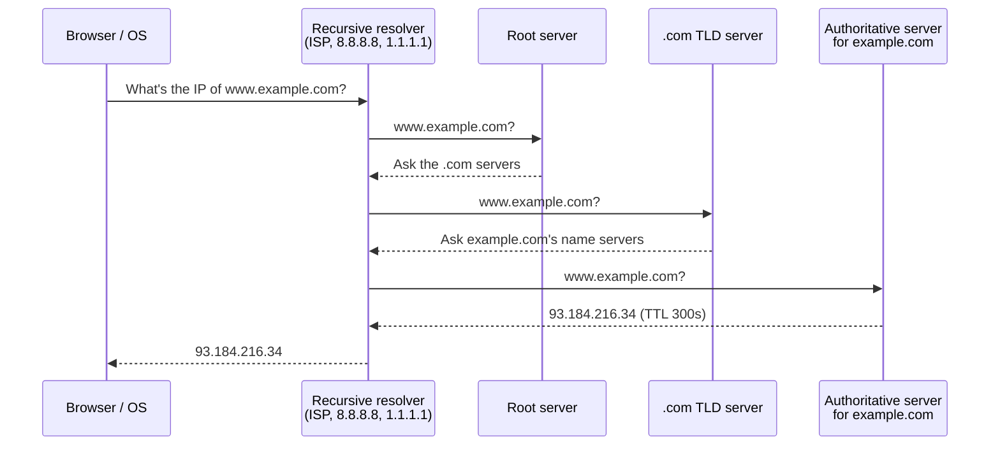
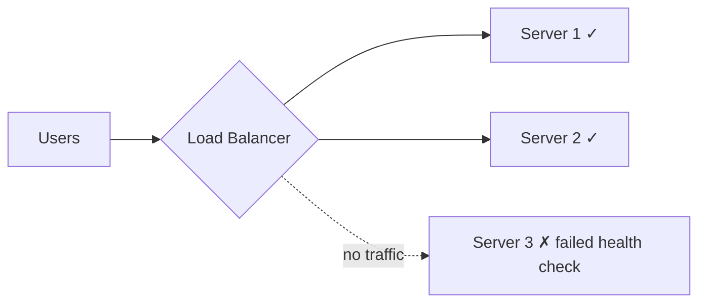
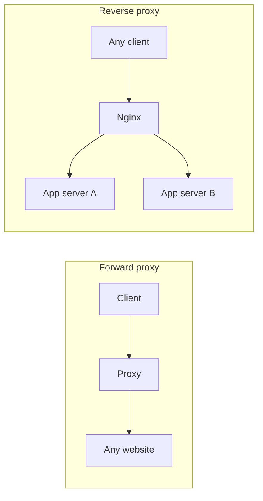
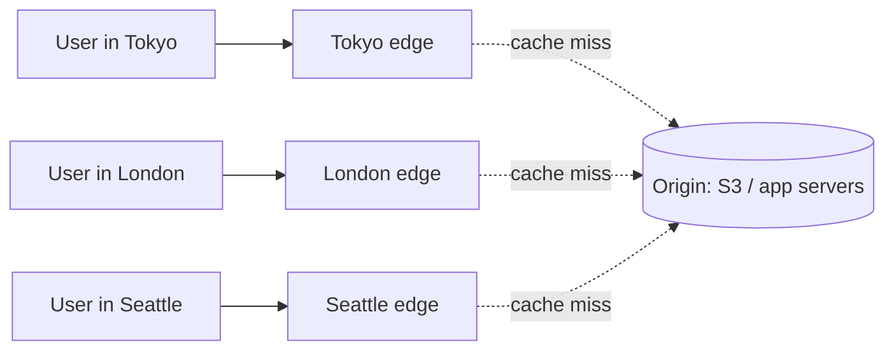

# Networking Essentials

> [!summary] What you'll learn
> How a request travels from a user's browser to your code and back, and the infrastructure along the way: the **network layers**, **TCP vs UDP**, **HTTP/1.1 vs 2 vs 3**, **TLS**, **DNS**, **load balancers** (L4 vs L7, algorithms, health checks), **proxies**, **API gateways**, and **CDNs**. For each piece: what problem it solves and when you'd use it.
>
> The classic question **"What happens when you type a URL into the browser and press Enter?"** tests all of this, and it's asked from new-grad to senior level.

Back to [[Design Index]] · Prev: [[Scalability & Core Concepts]] · Next: [[Databases & Storage]]

---

## The network layers (just enough)

Networking is organized in **layers**, each building on the one below. You mainly need to know where common protocols sit, because terms like "L4 load balancer" and "L7 load balancer" refer to them.

| Layer (OSI number) | Responsibility | Examples |
|---|---|---|
| **Application (L7)** | The protocol your app speaks | HTTP, HTTPS, gRPC, WebSocket, DNS, SMTP, SSH |
| Presentation / Session (L6/L5) | Encoding, encryption, sessions (often folded into L7 in practice) | TLS is commonly described here or between L4 and L7 |
| **Transport (L4)** | End-to-end delivery between processes, identified by **ports** | **TCP**, **UDP**, QUIC |
| **Network (L3)** | Routing packets between machines across networks, identified by **IP addresses** | IPv4, IPv6, ICMP (ping) |
| Data link (L2) | Delivery on a local network segment (MAC addresses) | Ethernet, Wi-Fi |
| Physical (L1) | Bits on wires or radio | Cables, fiber, radio |

An **IP address** identifies a machine; a **port** identifies a process on that machine (HTTP 80, HTTPS 443, Postgres 5432, Redis 6379).

---

## TCP vs UDP

Both are transport-layer protocols that carry data between programs. They make opposite tradeoffs.

### TCP (Transmission Control Protocol)
- **Connection-oriented**: before sending data, the client and server perform a **three-way handshake** (SYN → SYN-ACK → ACK), costing one round trip.
- **Reliable and ordered**: every byte is acknowledged; lost packets are retransmitted; data arrives in the order sent.
- **Flow control** (don't overwhelm the receiver) and **congestion control** (don't overwhelm the network).
- **Cost**: handshake latency, retransmission delays, and **head-of-line blocking** (if one packet is lost, everything after it waits until it's resent).
- **Used by**: HTTP/1.1 and HTTP/2, database connections, SSH, email, file transfer. Basically anything where every byte must arrive intact.

### UDP (User Datagram Protocol)
- **Connectionless**: just send packets ("datagrams"); no handshake.
- **No guarantees**: packets can be lost, duplicated, or arrive out of order. The application must cope.
- **Low overhead, low latency.**
- **Used by**: live video and voice calls, online games, live streaming, DNS lookups, and QUIC/HTTP/3. In these cases a late packet is useless anyway: in a video call it's better to skip a frame than to freeze waiting for it.

| | TCP | UDP |
|---|---|---|
| Setup | Handshake (1 RTT, plus TLS) | None |
| Delivery | Guaranteed, ordered | Best effort |
| Overhead | Higher | Lower |
| Best for | Correctness (web, APIs, DBs) | Timeliness (real-time media, games) |

### QUIC
A newer transport (designed at Google, standardized in 2021) built **on top of UDP** that provides TCP-like reliability **per stream**, with TLS 1.3 encryption built in and faster connection setup (often 1 RTT, or 0 RTT when resuming). Lost packets only block their own stream, not others. It also survives network changes (switching from Wi-Fi to cellular) better. It's the transport underneath **HTTP/3**.

---

## HTTP versions

**HTTP** (HyperText Transfer Protocol) is the application protocol of the web: a client sends a **request** (method, path, headers, optional body) and the server returns a **response** (status code, headers, optional body).

```http
GET /api/orders/123 HTTP/1.1
Host: api.example.com
Authorization: Bearer eyJhbGci...
Accept: application/json

HTTP/1.1 200 OK
Content-Type: application/json
Cache-Control: private, max-age=60

{ "id": 123, "status": "shipped" }
```

| Version | Key features | Problem it solved | Remaining problem |
|---|---|---|---|
| **HTTP/1.1** (1997) | Text-based; persistent **keep-alive** connections | Reusing connections instead of one per request | Only **one request at a time per connection** (head-of-line blocking), so browsers open ~6 parallel connections per host |
| **HTTP/2** (2015) | Binary framing; **multiplexing** many requests/responses over one TCP connection; header compression (HPACK) | Many parallel requests without many connections | One lost **TCP** packet still stalls all streams (TCP-level head-of-line blocking) |
| **HTTP/3** (2022) | HTTP/2's semantics over **QUIC (UDP)** | Removes TCP head-of-line blocking; faster setup; better on lossy mobile networks | Some networks block/throttle UDP (falls back to HTTP/2) |

### HTTPS and TLS
**HTTPS = HTTP over TLS** (Transport Layer Security; its predecessor was SSL). TLS provides:
1. **Encryption**: eavesdroppers on the network can't read the traffic.
2. **Integrity**: tampering is detected.
3. **Authentication**: the server proves its identity with a **certificate** signed by a trusted **Certificate Authority (CA)**, so you know you're really talking to `bank.com`.

The **TLS handshake** negotiates encryption keys using asymmetric cryptography, then switches to fast symmetric encryption for the data. TLS 1.3 needs just **1 round trip** (0 with session resumption). More in [[Security Fundamentals#Encryption basics]].

---

## DNS (Domain Name System)

### The problem it solves
Computers route by IP address (`142.250.72.14`), but humans use names (`google.com`). Names also let operators **change IP addresses** (move servers, fail over, route by geography) without users noticing.

### How resolution works

1. The browser and OS check their **caches** first.
2. Otherwise they ask a **recursive resolver** (from your ISP or a public one like Google 8.8.8.8 or Cloudflare 1.1.1.1).
3. The resolver walks the hierarchy: **root** servers → **TLD** servers (`.com`) → the domain's **authoritative** name servers, which hold the actual records.
4. Every answer is **cached for its TTL** (time to live) at each level, so most lookups are answered from a cache in milliseconds.

### Record types
| Record | Maps | Example use |
|---|---|---|
| **A** | Name → IPv4 address | `api.example.com → 203.0.113.10` |
| **AAAA** | Name → IPv6 address | |
| **CNAME** | Name → another name (alias) | `www.example.com → example.netlify.app` |
| **MX** | Domain → mail servers | Email delivery |
| **TXT** | Arbitrary text | Domain verification, SPF/DKIM email authentication |
| **NS** | Domain → its authoritative name servers | Delegation |

### DNS in system design
- **DNS-based load balancing**: return several IPs, or rotate them (round-robin DNS).
- **GeoDNS / latency-based routing**: return the IP of the **nearest region** to the user (AWS Route 53, Cloudflare). This is how global services route users to the closest data center.
- **Failover**: health-checked DNS removes unhealthy endpoints. It's **slow** because clients and resolvers cache old answers until the TTL expires (and some ignore TTLs), so short TTLs (30–60 s) are used for records that may need to fail over.
- DNS is itself a massively distributed, heavily cached, **eventually consistent (AP)** system.

---

## "What happens when you type a URL and press Enter?"

A strong answer walks through the layers in order. About 2 minutes:

1. **Parse the URL**: scheme (`https`), host (`www.example.com`), path, query. The browser checks HSTS (should it force HTTPS?) and whether it already has a cached response.
2. **DNS lookup**: resolve the host to an IP (browser cache → OS → resolver → root/TLD/authoritative, as above). Often it's a CDN or load balancer address.
3. **TCP connection**: three-way handshake to port 443 (or QUIC over UDP for HTTP/3).
4. **TLS handshake**: the server presents its certificate; the browser verifies it against trusted CAs; they agree on encryption keys.
5. **Send the HTTP request**: `GET /` with headers (cookies, user agent, accepted encodings).
6. **Server side**: the request typically hits a **CDN edge** (which may answer from cache), then a **load balancer**, maybe a **reverse proxy/API gateway**, then an **application server**, which may consult caches, databases, and other services, then builds a response.
7. **Response**: a status code, headers (cache rules, cookies), and the HTML body, often compressed (gzip/brotli).
8. **Rendering**: the browser parses HTML into the **DOM**, discovers CSS/JS/images and fetches them (more requests, often from the CDN, reusing the connection), builds the CSSOM, runs JavaScript, computes **layout**, and **paints** pixels.
9. The connection is kept alive for further requests.

---

## Load balancers

### The problem they solve
One server can only handle so much traffic and is a single point of failure. A **load balancer (LB)** sits in front of a group of servers and **distributes incoming requests** across them, so you can scale horizontally and survive individual server failures.



### What load balancers do
- **Distribute traffic** using an algorithm (below).
- **Health checks**: periodically probe each server (e.g., `GET /health`) and stop sending traffic to unhealthy ones; add them back when they recover.
- **TLS termination**: decrypt HTTPS at the LB so backend servers don't have to (backends then get plain HTTP inside the private network, or re-encrypted traffic with mTLS for zero-trust setups). It also centralizes certificate management.
- **Enable zero-downtime deploys**: drain connections from servers being updated.
- Often: compression, request logging, basic DDoS protection, connection limits.

### L4 vs L7 load balancing
| | **L4 (transport layer)** | **L7 (application layer)** |
|---|---|---|
| Sees | IP addresses and ports (TCP/UDP), not the content | The full HTTP request: URL path, headers, cookies, method |
| Routing decisions | Per connection | **Per request, based on content**: `/api/*` → API servers, `/images/*` → image service, header `X-Beta: true` → canary |
| Performance | Very fast, low CPU; handles any TCP/UDP protocol | More CPU (must parse HTTP and usually terminate TLS) |
| Features | Simple forwarding | Path/host routing, header rewriting, cookie-based stickiness, auth, rate limiting, retries, WebSocket upgrades, gRPC awareness |
| Examples | AWS NLB, Google TCP/UDP LB, HAProxy (TCP mode), LVS | AWS ALB, Nginx, Envoy, HAProxy (HTTP mode), Traefik, Google HTTPS LB |
| Use when | Raw speed, non-HTTP protocols, huge numbers of long-lived connections | Microservices routing, HTTP features, most web apps |

### Load balancing algorithms
| Algorithm | How it works | Good for | Weakness |
|---|---|---|---|
| **Round robin** | Send each request to the next server in turn | Identical servers, similar requests | Ignores current load; one slow request doesn't change routing |
| **Weighted round robin** | Like round robin, but bigger servers get proportionally more | Mixed server sizes | Still load-unaware |
| **Least connections** | Send to the server with the fewest active connections | Long-lived connections (WebSockets), variable request times | Needs connection tracking |
| **Least response time** | Send to the server responding fastest | Heterogeneous performance | Needs measurement |
| **IP hash / consistent hashing** | Hash the client IP or a key (user ID) to pick a server, so the same client lands on the same server | Cache affinity (each server caches a subset), sticky behavior without cookies | Uneven if keys are skewed; see [[Distributed Systems Patterns#Consistent hashing]] |
| **Random / power of two choices** | Pick two servers at random; send to the less loaded one | Large fleets; surprisingly close to optimal with little coordination | |

### Sticky sessions (session affinity)
Configuring the LB to send a given user to the **same server** every time (via a cookie or IP hash). It's sometimes needed for legacy stateful apps or WebSocket connections, but **avoid it when you can**: it unbalances load, and when that server dies, the users pinned to it lose their state. Prefer stateless servers (see [[Scalability & Core Concepts#Stateless services: the key to horizontal scaling]]).

### Making the LB itself highly available
The LB would otherwise be a single point of failure. Options: a pair of LBs in active–passive mode sharing a floating IP (keepalived/VRRP), multiple LBs behind DNS, **anycast**, or managed cloud load balancers, which are redundant across availability zones by design.

### Global load balancing (GSLB)
Routing users across **regions**, using GeoDNS, latency-based DNS, or anycast IPs, combined with per-region LBs.

---

## Proxies

A proxy is an intermediary server that forwards traffic.

### Forward proxy
Sits in front of **clients** and makes requests **on their behalf**. The destination server sees the proxy's IP, not the client's.
- **Used for**: corporate networks (filtering, logging, caching outbound traffic), privacy, bypassing geo-restrictions (VPN-like).

### Reverse proxy
Sits in front of **servers** and receives requests **on their behalf**. Clients think they're talking to the real server.
- **Used for**: load balancing, TLS termination, caching responses, compression, serving static files, rate limiting, request buffering (protecting slow app servers from slow clients), hiding internal topology, and routing different paths to different backends.
- **Examples**: **Nginx**, HAProxy, Envoy, Caddy, Traefik.
- A load balancer is a kind of reverse proxy; in practice the terms overlap heavily (Nginx is both).



---

## API Gateway

### The problem it solves
With many microservices, clients would otherwise need to know every service's address, and **every service would have to implement** authentication, rate limiting, logging, CORS, and request validation itself. That's duplicated work and inconsistent behavior.

### What it is
A specialized reverse proxy that acts as the **single entry point** for client traffic into a set of backend services, handling cross-cutting concerns centrally:
- **Routing**: `/users/*` → user service; `/orders/*` → order service.
- **Authentication** (validate JWTs/API keys) and coarse authorization.
- **Rate limiting** and quotas per client or API key.
- **Request/response transformation** (e.g., REST to gRPC, field filtering).
- **Aggregation**: one client call fans out to several services and combines the results.
- **Observability**: centralized logging, metrics, tracing headers.
- **Caching**, CORS handling, API versioning, developer API keys and analytics.

**Examples:** Kong, AWS API Gateway, Google Apigee, Azure API Management, Envoy-based gateways, Tyk.

### Gateway vs load balancer vs service mesh
| | Load balancer | API gateway | Service mesh |
|---|---|---|---|
| Main job | Spread traffic across instances of a service | Single front door for clients, with API-level policies | Service-to-service communication inside the cluster |
| Traffic direction | Either | **North–south** (clients → system) | **East–west** (service → service) |
| Typical features | Health checks, algorithms, TLS | Auth, rate limiting, routing, transformation | mTLS, retries, timeouts, circuit breaking, telemetry via sidecars |
| Examples | ALB, NLB, HAProxy | Kong, Apigee, AWS API Gateway | Istio, Linkerd, Consul Connect |

**Caution:** don't put business logic in the gateway, or it becomes a bottleneck that every team must change.

---

## CDN

### The problem it solves
**Content Delivery Network.** Physics: a user in Sydney fetching an image from a server in Virginia pays ~200+ ms per round trip, and a web page needs many round trips. Serving every image, video, and JS file from your origin servers also costs huge bandwidth and makes traffic spikes dangerous.

### How it works
A CDN is a **globally distributed network of edge servers** (points of presence, PoPs) in hundreds of cities. Users are routed (via DNS or anycast) to the **nearest edge**, which serves content from its cache. On a **cache miss**, the edge fetches from your **origin** (your servers or S3), stores it, and serves it, so later users in that region get it fast.



### What to put on a CDN
- **Static assets**: JS bundles, CSS, fonts, images, icons. Almost always.
- **Media**: images, video segments (streaming services serve almost all video from CDNs), downloads.
- **Cacheable API responses** and whole pages for anonymous users (product pages, articles).
- Increasingly, **edge compute**: run code at the edge (Cloudflare Workers, Lambda@Edge, Vercel/Netlify edge functions) for redirects, A/B tests, auth checks, personalization.

### Benefits
- **Lower latency** for users worldwide (tens of ms instead of hundreds).
- **Offloads your origin**: most traffic never reaches your servers, which cuts bandwidth costs.
- **Absorbs spikes** and provides **DDoS protection** (CDNs have enormous capacity).

### Pull vs push CDNs
- **Pull** (most common): the edge fetches from origin on the first request, then caches per TTL. Zero setup; the first request in each region is slow.
- **Push**: you upload content to the CDN ahead of time. Good for large files that rarely change.

### Cache invalidation
When content changes, cached copies must be updated:
- **TTL expiry**: content refreshes after `max-age` seconds.
- **Purge/invalidation APIs**: explicitly remove a URL from all edges (takes seconds to minutes; may cost money).
- **Versioned (fingerprinted) URLs**, the best practice: build tools emit filenames with a content hash (`app.3f9a2c.js`). A new deploy produces new URLs, so you can cache files **forever** (`Cache-Control: max-age=31536000, immutable`) and never need to purge. Only the small HTML file referencing them needs a short TTL.

**Providers:** Cloudflare, Akamai, AWS CloudFront, Fastly, Google Cloud CDN, Azure Front Door.

> [!tip] In system design interviews
> Whenever media or static content appears, say: **"Store it in object storage like S3 and serve it through a CDN."** Never store images in the database.

---

## Other networking terms
- **Anycast**: the same IP address is advertised from many locations, and internet routing delivers packets to the nearest one. Used by CDNs and DNS providers (1.1.1.1).
- **NAT (Network Address Translation)**: maps private internal IPs to a public IP (why your home devices share one public IP).
- **VPC (Virtual Private Cloud)**: your own isolated network in the cloud. **Public subnets** hold internet-facing things (load balancers); **private subnets** hold app servers and databases that shouldn't be directly reachable.
- **Connection pooling / keep-alive**: reuse TCP/TLS connections to avoid repeated handshake costs.
- **RTT (round-trip time)**: time for a packet to go to a destination and back.
- **Head-of-line blocking**: one slow or lost item delays everything queued behind it.
- **Firewall / security groups**: rules allowing or denying traffic by IP, port, and protocol.

---

## Quick self-test
- [ ] TCP vs UDP: give two use cases for each and explain why.
- [ ] What problem did HTTP/2 solve, and what problem does HTTP/3 solve?
- [ ] Walk through DNS resolution. Why is DNS-based failover slow?
- [ ] Explain "what happens when you type a URL" in under 2 minutes.
- [ ] L4 vs L7 load balancer: what can L7 do that L4 can't? When would you use L4?
- [ ] Round robin vs least connections: when does each fit better?
- [ ] Why should you avoid sticky sessions?
- [ ] Reverse proxy vs API gateway vs load balancer vs service mesh: overlaps and differences.
- [ ] What problems does a CDN solve? How do fingerprinted URLs solve CDN invalidation?

Next: [[Databases & Storage]]
