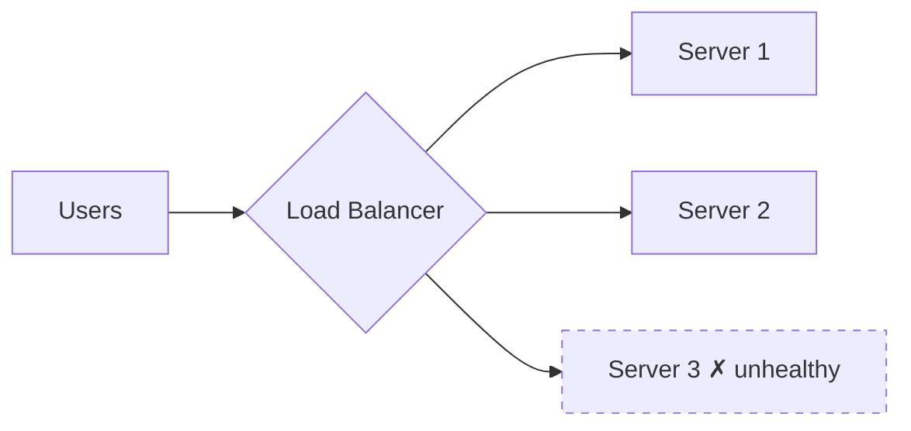

# Networking Essentials

> [!summary]
> How a request gets from a browser to your code and back: DNS, TCP/UDP, HTTP versions, TLS, load balancers, reverse proxies, API gateways, and CDNs. The classic question **"What happens when you type a URL into the browser?"** tests all of this.

Back to [[Design Index]] · Prev: [[Scalability & Core Concepts]]

---

## The OSI / TCP-IP model (just enough)

| Layer (OSI #) | What | Examples |
|---|---|---|
| Application (7) | App protocols | HTTP, gRPC, WebSocket, DNS, SMTP |
| Transport (4) | End-to-end delivery, ports | **TCP**, **UDP**, QUIC |
| Network (3) | Routing between networks | IP |
| Data link / Physical (2/1) | Local delivery, signals | Ethernet, Wi-Fi |

"**L4 vs L7** load balancer" refers to these layers.

---

## TCP vs UDP

| | TCP | UDP |
|---|---|---|
| Connection | Connection-oriented (3-way handshake: SYN, SYN-ACK, ACK) | Connectionless |
| Reliability | Guaranteed, ordered delivery; retransmits | Best effort; can lose or reorder |
| Flow/congestion control | Yes | No |
| Overhead / latency | Higher | Lower |
| Use for | Web, APIs, DBs, file transfer, email | Video calls, live streaming, gaming, DNS lookups, VoIP |

**QUIC**: built on UDP by Google; reliable streams, built-in TLS 1.3, faster handshakes, no head-of-line blocking across streams. It's the transport for **HTTP/3**.

---

## HTTP versions

| Version | Key features |
|---|---|
| HTTP/1.1 | Text; keep-alive connections; one request at a time per connection (head-of-line blocking) → browsers open ~6 connections per host |
| HTTP/2 | Binary framing; **multiplexing** many streams over one TCP connection; header compression (HPACK); server push (deprecated in practice) |
| HTTP/3 | HTTP/2 semantics over **QUIC (UDP)**; fixes TCP-level head-of-line blocking; faster connection setup, better on lossy mobile networks |

**HTTPS = HTTP + TLS.** TLS provides encryption, integrity, and server authentication (certificates signed by a CA). TLS 1.3 handshake is 1 RTT (0-RTT on resumption). See [[Security Fundamentals#Encryption basics]].

**Cookies vs tokens**, **CORS**: see [[Security Fundamentals]].

---

## DNS (Domain Name System)

Translates `www.example.com` → IP address. It's a hierarchical, distributed, heavily cached **AP** system.

Resolution: browser cache → OS cache → **recursive resolver** (ISP, 8.8.8.8, 1.1.1.1) → **root** server → **TLD** server (`.com`) → **authoritative** name server for `example.com` → IP. Cached per **TTL**.

Record types: **A** (→IPv4), **AAAA** (→IPv6), **CNAME** (alias → another name), **MX** (mail), **TXT** (verification, SPF), **NS** (name servers).

DNS in system design:
- **DNS-based load balancing / GeoDNS**: return different IPs by user location (route to the nearest region).
- **Failover**: health-checked DNS (Route 53) removes unhealthy endpoints. Slow because of TTL caching.

---

## "What happens when you type google.com and press Enter?"

1. Browser parses the URL; checks HSTS and caches.
2. **DNS lookup** → IP address.
3. **TCP handshake** with the server (or QUIC for HTTP/3).
4. **TLS handshake**: certificate verified, keys negotiated.
5. Browser sends an **HTTP GET** request.
6. The request travels through **CDN/edge → load balancer → reverse proxy → app server**, which may call caches, DBs, and other services.
7. Server returns an **HTTP response** (status, headers, HTML).
8. Browser **parses HTML** → builds the DOM, fetches CSS/JS/images (more requests, often from the CDN), builds CSSOM, runs JS, layout, paint.
9. Connection kept alive for further requests.

---

## Load balancers

Distribute incoming traffic across servers to increase **capacity and availability**.

### L4 vs L7

| | L4 (transport) | L7 (application) |
|---|---|---|
| Sees | IP + port (TCP/UDP) | Full HTTP: URL, headers, cookies |
| Routing | Connection-level | Content-based: `/api/*` → API servers, `/images/*` → static |
| Speed | Faster, less CPU | More features, more work |
| Features | Simple forwarding | TLS termination, path routing, header rewriting, auth, compression, WebSocket upgrade |
| Examples | AWS NLB, HAProxy (TCP mode), LVS | AWS ALB, Nginx, Envoy, HAProxy (HTTP mode), GCP HTTPS LB |

### Algorithms
- **Round robin**: rotate through servers. Simple; assumes equal servers and requests.
- **Weighted round robin**: more traffic to bigger servers.
- **Least connections**: send to the server with the fewest active connections (good for long-lived connections).
- **Least response time**.
- **IP hash / consistent hashing**: the same client or key always goes to the same server (cache affinity, sticky sessions). See [[Distributed Systems Patterns#Consistent hashing]].
- **Random / power of two choices**: pick 2 random servers and choose the less loaded one. Surprisingly effective.

### Other LB concepts
- **Health checks**: active (ping `/health`) or passive (observe failures); remove bad nodes.
- **Sticky sessions (session affinity)**: pin a user to one server. Avoid when possible; it breaks even distribution and failover. Prefer stateless servers.
- **TLS termination**: the LB decrypts HTTPS so backends get plain HTTP (or re-encrypts with mTLS).
- **The LB itself must not be a SPOF**: run redundant LBs (active–passive with a floating IP) or use managed cloud LBs.
- **Global server load balancing (GSLB)**: across regions via GeoDNS or anycast.

---

## Proxies

- **Forward proxy**: sits in front of **clients**, acting on their behalf (corporate proxy, VPN). The server sees the proxy's IP.
- **Reverse proxy**: sits in front of **servers**, acting on their behalf. The client doesn't know which backend served it. Does load balancing, TLS termination, caching, compression, rate limiting, and security (hides backend topology). *Nginx, HAProxy, Envoy, Caddy, Traefik.*

## API Gateway
A specialized reverse proxy and the single entry point for microservices: **routing, authentication, rate limiting, request/response transformation, aggregation, API keys, analytics**. Examples: Kong, AWS API Gateway, Apigee, Envoy-based gateways. Distinct from a **service mesh**, which handles **east–west** (service-to-service) traffic; the gateway handles **north–south** (client-to-system).

---

## CDN

A geographically distributed network of **edge servers (PoPs)** that cache content close to users.

- **What**: static assets (JS, CSS, images, fonts), video segments, downloadable files; increasingly dynamic content and edge compute (Cloudflare Workers, Lambda@Edge).
- **Why**: lower latency (~10s of ms instead of 100+), offload origin servers, absorb traffic spikes, DDoS protection.
- **Pull CDN**: the edge fetches from origin on first request (cache miss), then caches per TTL. Easy; the first user pays the miss.
- **Push CDN**: you upload content proactively. Good for large, rarely changing files.
- **Invalidation**: purge APIs, or better, **versioned/fingerprinted URLs** (`app.3f9a2c.js`) so new deploys get new URLs and old ones can be cached forever.
- Providers: Cloudflare, Akamai, AWS CloudFront, Fastly, Google Cloud CDN.

> [!tip] In nearly every design with media (images, video), say: "Store in object storage (S3), serve via CDN."

---

## Other networking terms
- **Anycast**: the same IP advertised from many locations; routing goes to the nearest one (used by CDNs and DNS).
- **NAT**: maps private IPs to public.
- **VPC / subnets**: private cloud networks; public vs private subnets.
- **Keep-alive / connection pooling**: reuse TCP connections to avoid handshake cost.
- **Head-of-line blocking**: one slow item blocks those behind it.
- **MTU, packets, latency vs RTT**: RTT = round-trip time.

## Self-test
- [ ] Walk through "what happens when you type a URL" in under 2 minutes.
- [ ] L4 vs L7 load balancer: when would you use each?
- [ ] Why avoid sticky sessions?
- [ ] Reverse proxy vs API gateway vs load balancer: overlaps and differences.
- [ ] How do you invalidate CDN-cached JS after a deploy?

Next: [[Databases & Storage]]
