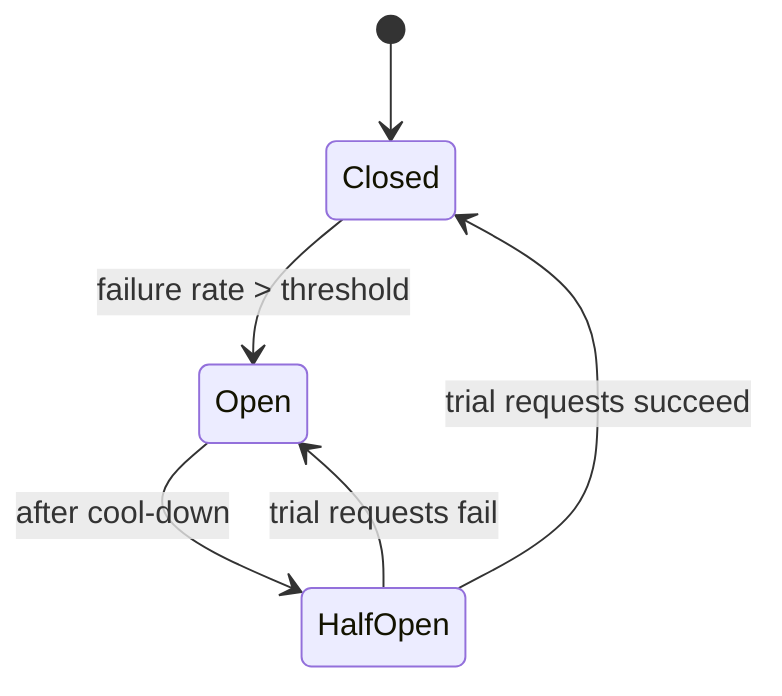

# Reliability & Observability

> [!summary]
> Production systems fail, so you design for it. This note covers **resilience patterns** (timeouts, retries, circuit breakers), **SLIs/SLOs/SLAs**, **observability** (logs, metrics, traces), and **incident practices**. At FAANG you'll join an **on-call rotation**, so expect to use all of this in your first months.

Back to [[Design Index]] · Prev: [[Distributed Systems Patterns]] · Related: [[CI-CD & Deployment]]

---

## Resilience patterns

### Timeouts
**Every network call needs a timeout.** Without one, a slow dependency ties up threads and connections until your whole service stalls. Set timeouts based on the dependency's p99 latency plus a margin.

### Retries with exponential backoff + jitter
Retry **transient** failures (timeouts, 503, 429), not permanent ones (400, 404).
```javascript
async function withRetry(fn, { retries = 4, base = 100, max = 5000 } = {}) {
  for (let attempt = 0; ; attempt++) {
    try { return await fn(); }
    catch (err) {
      if (attempt >= retries || !isTransient(err)) throw err;
      const backoff = Math.min(max, base * 2 ** attempt);
      const delay = Math.random() * backoff;            // "full jitter"
      await new Promise(r => setTimeout(r, delay));
    }
  }
}
```
- **Jitter** prevents synchronized retry waves (thundering herd).
- Only retry **idempotent** operations (or use idempotency keys).
- **Retry storms**: if every layer retries 3×, a 5-layer call chain can amplify load 3^5 = 243×. Retry at **one layer**, and use **retry budgets** (e.g., retries ≤ 10% of requests).

### Circuit breaker
Stop calling a failing dependency so it can recover, and fail fast instead of waiting on timeouts.


- **Closed**: requests flow; failures are counted.
- **Open**: requests fail immediately (or return a fallback).
- **Half-open**: let a few requests through to test recovery.
*Libraries:* Resilience4j (Java), Polly (.NET), opossum (Node), Envoy/Istio (mesh level).

### Bulkhead
Isolate resources (separate thread or connection pools per dependency) so one slow dependency can't exhaust everything. Named after a ship's watertight compartments.

### Fallbacks & graceful degradation
Return cached or default data, or hide a non-critical feature, instead of failing the whole page. *Netflix: if the personalized row fails, show popular titles.*

### Rate limiting & load shedding
Protect services from overload. See [[Design a Rate Limiter]]. Under extreme load, drop low-priority traffic first.

### Health checks
- **Liveness**: is the process alive? (If not, restart it.)
- **Readiness**: can it serve traffic now? (If not, remove it from the LB, e.g., during warm-up.)
Kubernetes uses both probes.

### Redundancy & failover
No SPOFs: multiple instances across **availability zones (AZs)**; multi-region for critical systems. **Disaster recovery** metrics:
- **RPO (Recovery Point Objective)**: how much data loss is acceptable (time since the last backup/replica sync).
- **RTO (Recovery Time Objective)**: how long until service is restored.
Backups are worthless until you've **tested restores**.

### Chaos engineering
Deliberately inject failures in production-like environments to find weaknesses. Netflix's **Chaos Monkey** randomly kills instances. Also game days and fault-injection testing.

---

## SLI, SLO, SLA

| Term | What | Example |
|---|---|---|
| **SLI** (Indicator) | A measured metric of service health | % of requests succeeding; p99 latency |
| **SLO** (Objective) | Internal **target** for an SLI over a window | 99.9% of requests succeed over 30 days; p99 < 300 ms |
| **SLA** (Agreement) | **Contract** with customers, with penalties (credits) if broken | 99.9% monthly uptime or 10% credit |

- SLO should be **stricter** than the SLA (buffer).
- **Error budget** = 100% − SLO. At 99.9%, you may "spend" 0.1% (~43 min/month) on failures. If the budget is exhausted → freeze risky launches and focus on reliability. This aligns dev velocity with reliability (Google SRE).

---

## Observability: the three pillars

| Pillar | What | Tools |
|---|---|---|
| **Logs** | Discrete timestamped events with context | ELK/OpenSearch, Splunk, Datadog, CloudWatch, Loki |
| **Metrics** | Numeric time series, aggregated, cheap to store | **Prometheus** + **Grafana**, Datadog, CloudWatch |
| **Traces** | The path of one request across services (spans with timing) | **OpenTelemetry** (standard), Jaeger, Zipkin, Honeycomb, AWS X-Ray |

**Monitoring** tells you *that* something is wrong; **observability** lets you ask *why* without shipping new code.

### Logging best practices
- **Structured logs** (JSON), not free text: `{ "level":"error", "msg":"payment failed", "orderId":"o_1", "traceId":"abc", "latencyMs": 532 }`.
- Include a **correlation/trace ID** propagated across services.
- Use levels properly: DEBUG < INFO < WARN < ERROR.
- **Never log secrets or PII** (passwords, tokens, card numbers).
- Sample high-volume debug logs.

### What metrics to track
- **The Four Golden Signals** (Google SRE): **Latency, Traffic, Errors, Saturation**.
- **RED** (for services): **Rate, Errors, Duration**.
- **USE** (for resources): **Utilization, Saturation, Errors** (CPU, memory, disk, network).
- Business metrics: orders/min, signups. Often the first to show a problem.
- Metric types: counter, gauge, histogram (for percentiles).
- Beware **high cardinality** labels (user ID as a label explodes metric storage).

### Distributed tracing
A trace = a tree of **spans**. Context (trace ID, span ID) propagates via headers (W3C `traceparent`). Shows where time is spent across 10 microservices, and critical-path bottlenecks.

### Alerting
- Alert on **symptoms** users feel (SLO burn rate, error rate, latency), not every cause (CPU 80%).
- Every page must be **actionable**, with a **runbook** link.
- Avoid alert fatigue; tune noisy alerts.
- Severity tiers: page (wake someone) vs ticket (fix during work hours).

---

## Incident management & on-call

1. **Detect**: alert fires or a user reports.
2. **Triage**: assess severity (SEV1–SEV4); declare an incident; assign an **incident commander**.
3. **Mitigate first, root-cause later**: **roll back**, fail over, toggle a feature flag off, scale up. Restore service before debugging deeply.
4. **Communicate**: status page, stakeholder updates at a regular cadence.
5. **Resolve**, then write a **blameless postmortem**: timeline, impact, root cause(s) (e.g., *5 Whys*), what went well and what didn't, **action items** with owners.

> [!tip] Behavioral interview gold
> "Tell me about a time something broke in production" → use this structure: detect → mitigate → root cause → prevention.

## Self-test
- [ ] Why add jitter to retries? What's a retry storm?
- [ ] Explain the circuit breaker states.
- [ ] SLI vs SLO vs SLA, and what an error budget is.
- [ ] What are the four golden signals?
- [ ] During an incident, why roll back before root-causing?
- [ ] RPO vs RTO?

Next: [[Security Fundamentals]]
