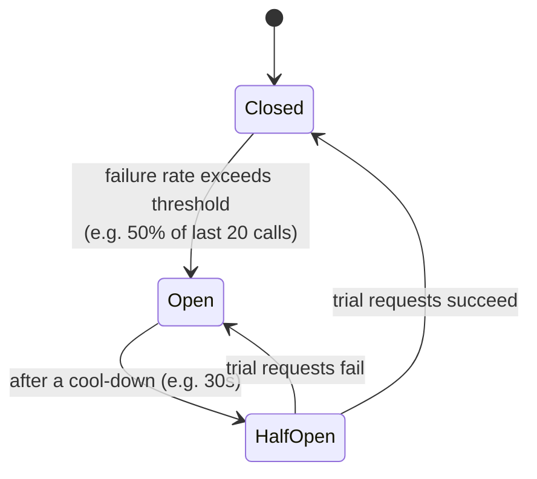

# Reliability & Observability

> [!summary] What you'll learn
> Every production system fails sometimes. **Reliability engineering** is about designing so that failures are rare, contained, and quickly fixed. **Observability** is about being able to see what's happening inside a running system so you can detect and diagnose problems.
>
> This note covers **resilience patterns** (timeouts, retries with backoff and jitter, circuit breakers, bulkheads, fallbacks, health checks, redundancy, disaster recovery), **SLIs, SLOs, SLAs, and error budgets**, the **three pillars of observability** (logs, metrics, traces) plus alerting, and **incident management and postmortems**.
>
> **Why it matters early in your career:** at most large companies, engineers join an **on-call rotation** within months. You'll use dashboards, read traces, respond to pages, and write postmortems. "Tell me about a production issue you handled" is also a classic behavioral question.

Back to [[Design Index]] · Prev: [[Distributed Systems Patterns]] · Next: [[Security Fundamentals]] · Related: [[CI-CD & Deployment]]

---

## Why systems fail, and how failures spread

Common causes of outages, roughly in order of frequency:
1. **Changes**: bad deploys, config changes, feature-flag flips. Most outages are triggered by a change. This is why gradual rollouts and fast rollback matter so much.
2. **Dependency failures**: a database, cache, third-party API, or internal service slows down or fails.
3. **Overload**: traffic spikes, retry storms, a runaway batch job.
4. **Resource exhaustion**: memory leaks, full disks, exhausted connection pools or file descriptors, expired certificates.
5. **Hardware and infrastructure failures**: machines, disks, network partitions, availability-zone outages.

**Cascading failure** is how one small problem becomes a big outage. Example: the database slows down → app requests take longer → by [[Scalability & Core Concepts#Little's Law|Little's Law]], more requests are in flight at once → connection pools and threads fill up → the app stops responding to health checks → the load balancer removes instances → the remaining instances get even more load → they fail too → clients retry, adding even more load. The patterns below exist to **break this chain**.

---

## Resilience patterns

### Timeouts
**The problem:** a call to a slow or hung dependency without a timeout can wait **forever**, holding a thread, a connection, and memory. Enough of these and your service stops serving everyone, even requests that don't touch that dependency.

**The rule:** **every network call must have a timeout**: HTTP clients, database queries, cache calls, queue operations.
- Base it on the dependency's normal latency: e.g., if p99 is 200 ms, a timeout of ~500 ms–1 s.
- Use **deadlines that propagate**: if the user's request has 2 seconds total, a downstream call made after 1.5 seconds should get at most the remaining 0.5 s (gRPC propagates deadlines automatically).
- Note that many libraries default to **no timeout or very long ones**. Always set them explicitly.

```javascript
// fetch with a timeout via AbortSignal
const res = await fetch(url, { signal: AbortSignal.timeout(1000) });   // abort after 1s
```

### Retries with exponential backoff + jitter
**The problem:** many failures are **transient**: a brief network blip, a node restarting, a momentary overload. Retrying often succeeds. But naive immediate retries make overload **worse**, and synchronized retries from thousands of clients hit the recovering service all at once.

**How to retry well:**
1. **Only retry transient errors**: timeouts, connection errors, 429 (rate limited), 502/503/504. **Don't** retry 400, 401, 403, 404, 422: they'll fail the same way every time.
2. **Only retry idempotent operations**, or use idempotency keys ([[Distributed Systems Patterns#Idempotency]]).
3. **Exponential backoff**: wait longer after each failure (100 ms, 200 ms, 400 ms, 800 ms...) with a cap.
4. **Jitter**: randomize each wait so clients don't retry in synchronized waves (the "thundering herd").
5. **Limit attempts** (e.g., 3–5) and respect `Retry-After` headers.

```javascript
async function withRetry(fn, { retries = 4, baseMs = 100, maxMs = 5000 } = {}) {
  for (let attempt = 0; ; attempt++) {
    try {
      return await fn();
    } catch (err) {
      const transient = err.code === "ECONNRESET" || err.name === "TimeoutError" || [429, 502, 503, 504].includes(err.status);
      if (!transient || attempt >= retries) throw err;
      const backoff = Math.min(maxMs, baseMs * 2 ** attempt);   // exponential with a cap
      const delay = Math.random() * backoff;                      // "full jitter"
      await new Promise((r) => setTimeout(r, delay));
    }
  }
}
```

**Retry storms (retry amplification):** if each of 5 layers in a call chain retries 3 times, one failing request at the bottom can turn into 3^5 = **243** requests. That can keep a struggling service down. Mitigations:
- Retry at **one layer** only (usually the outermost or the one closest to the failure), not every layer.
- Use a **retry budget**: retries may add at most ~10–20% extra load; beyond that, fail fast.
- Combine with **circuit breakers**.

### Circuit breaker
**The problem:** when a dependency is **down**, continuing to call it wastes resources (each call waits for a timeout), adds latency for users, and keeps hammering the dependency so it can't recover.

**How it works** (named after the electrical device): the circuit breaker wraps calls to a dependency and tracks failures.

- **Closed** (normal): requests pass through; failures are counted.
- **Open** (tripped): requests **fail immediately** without calling the dependency (or return a fallback). This fails fast, saves resources, and gives the dependency room to recover.
- **Half-open**: after a cool-down, allow a few **trial requests**. If they succeed, close the circuit; if they fail, open it again.

```javascript
class CircuitBreaker {
  constructor(fn, { failureThreshold = 5, cooldownMs = 30_000 } = {}) {
    Object.assign(this, { fn, failureThreshold, cooldownMs, failures: 0, state: "CLOSED", openedAt: 0 });
  }
  async call(...args) {
    if (this.state === "OPEN") {
      if (Date.now() - this.openedAt < this.cooldownMs) throw new Error("Circuit open: failing fast");
      this.state = "HALF_OPEN";                       // allow a trial request
    }
    try {
      const result = await this.fn(...args);
      this.failures = 0; this.state = "CLOSED";       // success closes the circuit
      return result;
    } catch (err) {
      this.failures++;
      if (this.state === "HALF_OPEN" || this.failures >= this.failureThreshold) {
        this.state = "OPEN"; this.openedAt = Date.now();
      }
      throw err;
    }
  }
}
const recommendations = new CircuitBreaker((userId) => recsClient.get(userId));
```
**Libraries:** Resilience4j (Java), Polly (.NET), opossum (Node.js); also built into service meshes (Istio/Envoy outlier detection).

### Bulkhead
**The problem:** if all outgoing calls share **one** thread or connection pool, a single slow dependency can consume every thread, and calls to healthy dependencies starve.

**How it works:** like a ship's watertight compartments, **isolate resources** per dependency or per type of work: separate connection pools, thread pools, concurrency limits, or even separate service instances for critical vs non-critical traffic. A failure floods one compartment, not the whole ship.
- Example: give the payment client a pool of 20 connections and the recommendation client 10, so a recommendations outage can't block payments.
- At the infrastructure level: separate clusters for internal batch jobs vs user traffic; [[Architectural Styles#Other styles worth knowing|cell-based architecture]].

### Fallbacks and graceful degradation
**The problem:** treating every dependency failure as a total failure makes the whole product as fragile as its weakest part.

**How it works:** when a **non-critical** dependency fails, return something reasonable and keep the core experience working:
- Serve **cached or stale** data ("prices as of 5 minutes ago").
- Serve a **default** (popular items instead of personalized recommendations; Netflix does exactly this).
- **Hide** the feature (no "people also bought" section today).
- **Queue the work** for later (accept the order; send the confirmation email when the email service recovers).

Decide in advance which dependencies are **critical** (fail the request) and which are **optional** (degrade).

### Rate limiting and load shedding
Protect services from overload by limiting requests per client ([[Design a Rate Limiter]]) and, under extreme load, **shedding** lower-priority traffic first (drop analytics and prefetch requests before checkout requests) with fast 503s rather than slowing everything down.

### Health checks
Load balancers and orchestrators need to know which instances can take traffic.
- **Liveness check**: "Is this process alive and not deadlocked?" If it fails, **restart** the instance. Keep it simple; don't check dependencies here, or a database blip will restart your entire fleet.
- **Readiness check**: "Can this instance serve traffic **right now**?" (finished startup, warmed caches, has DB connections). If it fails, **stop routing traffic** to it (don't restart). Used during startup, deploys, and temporary overload.
- **Startup probe**: give slow-starting apps time before liveness checks begin.
Kubernetes supports all three probes.

```javascript
app.get("/healthz", (req, res) => res.sendStatus(200));                       // liveness: process is up
app.get("/readyz", async (req, res) => {                                       // readiness: can serve
  const ok = appInitialized && (await db.ping().then(() => true).catch(() => false));
  res.sendStatus(ok ? 200 : 503);
});
```

### Redundancy, failover, and disaster recovery
- **No single points of failure**: run multiple instances spread across **availability zones** (separate datacenters within a region); replicate databases; use redundant load balancers.
- **Multi-region** for the most critical systems (survive the loss of an entire region), at significant cost and complexity (data replication across regions, consistency choices).
- **Disaster recovery (DR) objectives:**
  - **RPO (Recovery Point Objective)**: how much **data loss** is acceptable, measured in time ("at most 5 minutes of data"). Drives backup frequency and replication mode.
  - **RTO (Recovery Time Objective)**: how long until service is **restored** ("within 1 hour"). Drives standby infrastructure and automation.
- **Backups**: automated, stored separately (another region or account), encrypted, and **regularly test-restored**. An untested backup should be assumed not to work.
- **DR strategies** from cheapest/slowest to most expensive/fastest: backup & restore → pilot light (minimal standby) → warm standby → active–active multi-region.

### Graceful shutdown
On deploys and scale-downs, instances should stop accepting new requests, **finish in-flight requests** (with a deadline), close connections cleanly, and then exit. Handle `SIGTERM`, and fail readiness first so the load balancer stops sending traffic.

### Chaos engineering
**Deliberately inject failures** to find weaknesses before real incidents do: kill instances, add network latency, fail a dependency, fill a disk. Start in test environments, then carefully in production with a limited blast radius.
- Netflix's **Chaos Monkey** randomly terminates production instances, forcing every service to tolerate instance loss. The broader "Simian Army" and tools like Gremlin, AWS Fault Injection Service, and LitmusChaos followed.
- **Game days**: scheduled exercises where teams simulate an outage and practice the response.

---

## SLI, SLO, SLA

These terms (popularized by Google's SRE book) turn "is the service reliable?" into measurable targets.

| Term | What it is | Example |
|---|---|---|
| **SLI** (Service Level **Indicator**) | A **measurement** of some aspect of service health, usually a ratio of good events to total events | Fraction of HTTP requests that return non-5xx in under 300 ms; fraction of messages processed within 1 minute |
| **SLO** (Service Level **Objective**) | An internal **target** for an SLI over a time window | 99.9% of requests succeed within 300 ms, measured over 30 days |
| **SLA** (Service Level **Agreement**) | A **contract** with customers specifying consequences (refunds, credits) if service falls below a level | 99.9% monthly uptime, or customers get a 10% credit |

**Good SLIs measure what users experience**: availability (successful requests ÷ all requests), latency (fraction under a threshold), correctness, freshness (how stale the data is), durability. CPU usage is **not** a good SLI; users don't care about your CPU.

**Set the SLO stricter than the SLA** (e.g., SLO 99.95%, SLA 99.9%) so you get warned and can react before you owe customers money.

**Don't aim for 100%.** It's impossibly expensive, and users can't tell the difference past a point (their own Wi-Fi and phones are less reliable than that). Pick the level users actually need.

### Error budgets
**Error budget = 100% − SLO.** With a 99.9% SLO over 30 days, you're "allowed" 0.1% failures, about **43 minutes** of full downtime or the equivalent in failed requests.
- While budget remains, teams can ship features and take reasonable risks.
- If the budget is **exhausted**, the team shifts to reliability work: freeze risky launches, fix the causes, improve testing and rollout safety.
- This turns the classic dev-vs-ops argument ("ship faster" vs "don't break things") into a shared, data-driven rule.

**Burn-rate alerts:** alert when the budget is being consumed much faster than planned (e.g., "at this rate, we'll exhaust the monthly budget in 2 days"). That's better than alerting on every brief blip.

---

## Observability: the three pillars

**Monitoring** tells you **that** something is wrong (known failure modes, dashboards, alerts). **Observability** is the ability to understand **why**, including for problems you didn't anticipate, by asking new questions of your telemetry data without shipping new code.

| Pillar | What it is | Strengths | Weaknesses | Tools |
|---|---|---|---|---|
| **Logs** | Timestamped records of discrete events, with context | Rich detail about specific events; essential for debugging | Expensive at high volume; hard to aggregate | ELK/OpenSearch, Splunk, Datadog, CloudWatch Logs, Grafana Loki |
| **Metrics** | Numeric measurements aggregated over time (counts, rates, percentiles) | Cheap to store and query; ideal for dashboards and alerting; shows trends | Little detail about individual events; limited by label cardinality | **Prometheus + Grafana**, Datadog, CloudWatch, StatsD |
| **Traces** | The path of a single request through all the services it touched, with timing for each step (**spans**) | Shows **where** time is spent and **which** service failed in a multi-service request | Usually sampled; requires instrumentation in every service | **OpenTelemetry** (the standard), Jaeger, Zipkin, Honeycomb, Datadog APM, AWS X-Ray |

### Logging best practices
- **Structured logs** (JSON), not free text, so they can be searched and aggregated by field:
```json
{ "ts": "2026-11-01T09:12:03.120Z", "level": "error", "service": "checkout", "msg": "payment declined",
  "orderId": "o_123", "userId": "u_42", "reason": "insufficient_funds", "latencyMs": 532,
  "traceId": "4bf92f3577b34da6a3ce929d0e0e4736" }
```
- Include a **correlation / trace ID** in every log line and propagate it to downstream calls, so you can find every log for one user request across services.
- Use **levels** consistently: DEBUG (verbose, usually off in prod) < INFO (normal events) < WARN (unexpected but handled) < ERROR (failed operation needing attention).
- **Never log secrets or sensitive data**: passwords, tokens, API keys, full card numbers, and minimize personal data (a compliance and security issue).
- **Sample** high-volume logs; set retention periods (logs are expensive).
- Log **errors with context** (what was being attempted, with which IDs), not just the stack trace.

### What to measure: standard frameworks
- **The Four Golden Signals** (Google SRE book), for any user-facing system:
  1. **Latency**: how long requests take (percentiles; separate successful from failed requests).
  2. **Traffic**: demand (requests/sec, messages/sec).
  3. **Errors**: rate of failed requests (explicit 5xx, wrong content, too slow).
  4. **Saturation**: how "full" the service is (CPU, memory, connection pools, queue depth).
- **RED method** (for request-driven services): **R**ate, **E**rrors, **D**uration.
- **USE method** (for resources like CPU, disks, networks): **U**tilization, **S**aturation, **E**rrors.
- **Business metrics**: orders per minute, signups, payments succeeded. These often reveal problems that technical metrics miss (everything is "green" but nobody can check out).

**Metric types:** **counter** (only goes up: total requests), **gauge** (goes up and down: current memory, queue depth), **histogram** (distribution of values, used to compute percentiles like p99 latency).

**Watch cardinality:** each unique combination of metric labels is a separate time series. Using `userId` or `orderId` as a label creates millions of series and can overwhelm the metrics system. Use logs or traces for per-entity detail.

### Distributed tracing
A **trace** represents one request's journey; it's made of **spans** (one per operation: "API gateway," "order-service: placeOrder," "SQL INSERT," "payment-service: charge"), each with start time, duration, and metadata, arranged as a tree.

```
Trace 4bf92f35...  total 820 ms
├─ api-gateway                 820 ms
│  └─ order-service.placeOrder 790 ms
│     ├─ postgres INSERT order   12 ms
│     ├─ payment-service.charge 740 ms   ← the slow part
│     │  └─ stripe API call     720 ms
│     └─ kafka publish            5 ms
```
Context (trace ID + parent span ID) is passed between services in headers (the W3C `traceparent` standard). **OpenTelemetry** provides vendor-neutral SDKs and auto-instrumentation for most frameworks. Tracing is how you answer "why is checkout slow?" in a microservice system.

### Alerting
- **Alert on symptoms users feel**: SLO burn rate, error rate, latency, failed checkouts. Not on every possible cause (high CPU by itself may be fine).
- **Every page must be actionable**: if the person woken up can't do anything about it, it shouldn't page. Link each alert to a **runbook** (what it means, how to diagnose, how to mitigate).
- **Severity tiers**: **page** (urgent, wake someone up) vs **ticket** (handle during work hours) vs dashboard-only.
- **Avoid alert fatigue**: noisy, flapping, or duplicate alerts train people to ignore pages, which is how real incidents get missed. Tune or delete them.
- **Dashboards**: one per service showing the golden signals, its dependencies, and recent deploys (deploys explain many anomalies).

---

## Incident management & on-call

### On-call basics
Engineers take turns (often a week at a time) being the first responder for their team's services, carrying a pager (PagerDuty, Opsgenie). Good on-call practice includes runbooks, a reasonable page volume, escalation paths, and handoff notes between rotations.

### The incident lifecycle
1. **Detect**: an alert fires, or customers/support report a problem.
2. **Triage**: assess impact and declare a **severity** (e.g., SEV1 = major customer-facing outage; SEV3 = minor degradation). For significant incidents, declare an incident formally and open a dedicated channel.
3. **Assign roles** (for bigger incidents): **Incident Commander** (coordinates and makes decisions, doesn't debug), **operations/subject-matter leads** (investigate and fix), **communications lead** (status page, stakeholder updates).
4. **Mitigate first, root-cause later.** Restore service as fast as possible, **even before you fully understand the problem**:
   - **Roll back** the most recent deploy or config change (the most common fix).
   - Turn off a **feature flag**.
   - **Fail over** to a healthy replica or region.
   - **Scale up** or shed load.
   - Block abusive traffic.
5. **Communicate** regularly: status page updates, internal updates at a fixed cadence ("next update in 30 minutes"), even if there's no news.
6. **Resolve and monitor**: confirm metrics are back to normal.
7. **Postmortem** (also called an incident review or retrospective).

### Blameless postmortems
A written analysis after a significant incident. "Blameless" means focusing on **how the system and processes allowed the failure**, not on who made a mistake. People make errors; systems should make errors hard to make and easy to catch. Blame makes people hide information, which makes future incidents worse.

Typical sections:
- **Summary** and **impact** (who was affected, how long, how badly: "12% of checkouts failed for 47 minutes").
- **Timeline** (detection, key decisions, mitigation, resolution, with timestamps).
- **Root cause(s) and contributing factors** (techniques: the **5 Whys**: keep asking "why?" past the first answer).
- **What went well / what went poorly / where we got lucky.**
- **Action items** with **owners and due dates** (add a test, add an alert, add a safety check to the deploy pipeline, fix the bug, update the runbook).

> [!tip] Behavioral interview gold
> "Tell me about a time something broke in production" → structure your answer as **detect → mitigate → root cause → prevention**, and emphasize what you changed so it couldn't happen again. Even a story from a personal project (your app went down, how you noticed, what you fixed, what monitoring you added) works.

---

## Quick self-test
- [ ] Explain how a slow database can cascade into a full outage. Which patterns break the chain?
- [ ] Why does every network call need a timeout? What's deadline propagation?
- [ ] Which errors should you retry, and which not? Why add jitter? What's a retry storm, and how do you prevent it?
- [ ] Explain the three circuit breaker states and what triggers each transition.
- [ ] What is a bulkhead? Give an example.
- [ ] Liveness vs readiness checks: what happens when each fails? Why shouldn't liveness check the database?
- [ ] RPO vs RTO, with an example of each.
- [ ] SLI vs SLO vs SLA. What's an error budget, and what happens when it runs out?
- [ ] Logs vs metrics vs traces: what is each best at?
- [ ] Name the four golden signals. Why is high-cardinality labeling a problem?
- [ ] What makes an alert good? What's alert fatigue?
- [ ] During an incident, why roll back before finding the root cause? What goes in a blameless postmortem?

Next: [[Security Fundamentals]]
