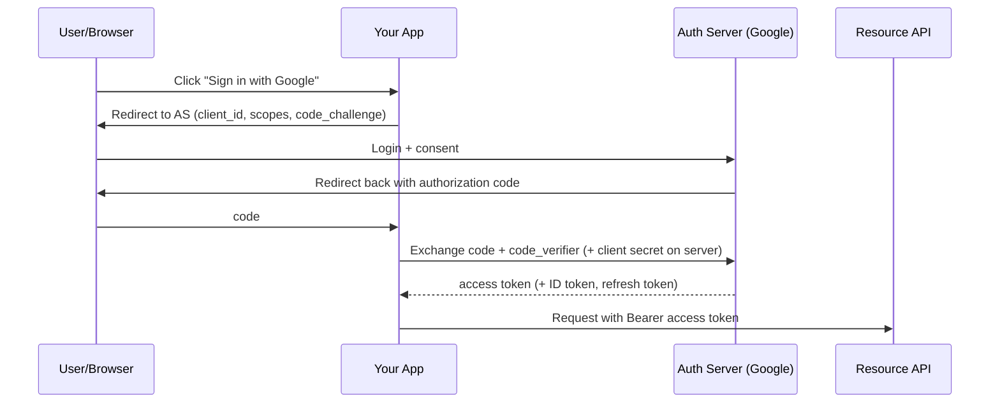

# Security Fundamentals

> [!summary]
> Security comes up in design interviews ("how do you authenticate users?", "how do you secure this API?") and in every code review at work. Know **authN vs authZ**, **sessions vs JWTs**, **OAuth 2.0 / OIDC**, **password storage**, **encryption**, **OWASP Top 10**, and **secrets management**.

Back to [[Design Index]] · Prev: [[Reliability & Observability]] · Related: [[API Design]]

---

## Authentication vs Authorization

| | Authentication (AuthN) | Authorization (AuthZ) |
|---|---|---|
| Question | **Who are you?** | **What are you allowed to do?** |
| Failure HTTP code | **401** Unauthorized | **403** Forbidden |
| Mechanisms | Passwords, MFA, SSO, passkeys, OAuth/OIDC | Roles, permissions, policies, ACLs |

### Authorization models
- **RBAC (Role-Based)**: users → roles → permissions (`admin`, `editor`, `viewer`). Most common.
- **ABAC (Attribute-Based)**: policies over attributes (user.department == doc.department AND time < 6pm). Flexible, complex.
- **ReBAC (Relationship-Based)**: permissions from relationships ("can edit if owner of the folder containing the doc"). Google **Zanzibar** (powers Drive/YouTube sharing); open-source: OpenFGA, SpiceDB.
- **ACLs**: per-resource lists of who can do what.
- **Principle of least privilege**: grant the minimum access needed.
- Check authorization **server-side on every request**. Never trust the client. **IDOR** (Insecure Direct Object Reference): `GET /invoices/124` returns someone else's invoice because ownership wasn't checked.

---

## Sessions vs tokens (JWT)

### Server-side sessions
Login → server creates a session (stored in Redis/DB) → sends a **session ID cookie** (`HttpOnly; Secure; SameSite`). Each request looks up the session.
- ✅ Easy revocation (delete the session); small cookie.
- ❌ Needs a shared session store to scale horizontally.

### JWT (JSON Web Token)
`header.payload.signature`, Base64URL-encoded and **signed** (HS256 shared secret or RS256/ES256 public/private key). The payload has claims (`sub`, `exp`, `roles`). The server **verifies the signature**, so no DB lookup is needed: **stateless**.
- ✅ Stateless; works across services (any service with the public key can verify).
- ❌ **Hard to revoke** before expiry → keep access tokens **short-lived** (5–15 min) + **refresh tokens** (long-lived, stored securely, rotatable, revocable).
- ❌ Payload is **readable by anyone** (signed, not encrypted). Never put secrets in it.
- Common pattern: short-lived access JWT + refresh token in an `HttpOnly` cookie.

> [!warning] Where to store tokens in the browser
> `localStorage` is readable by any JS → vulnerable to **XSS** theft. `HttpOnly` cookies can't be read by JS but need **CSRF** protection (SameSite + CSRF tokens). Most guidance favors HttpOnly, Secure, SameSite cookies.

---

## OAuth 2.0 & OpenID Connect

- **OAuth 2.0** = **delegated authorization**: let an app access a user's resources on another service without sharing the password ("Allow this app to read your Google Calendar"). Issues **access tokens**.
- **OpenID Connect (OIDC)** = an **authentication** layer on top of OAuth 2.0; adds an **ID token** (a JWT about the user). This is "Sign in with Google/Apple/GitHub".
- **SAML**: older XML-based enterprise SSO (Okta/Azure AD with corporate apps).

**Authorization Code flow + PKCE** (recommended for web/mobile apps):

- Other grants: **Client Credentials** (service-to-service, no user), **Device Code** (TVs/CLIs). The Implicit and Password grants are deprecated.
- **Scopes** limit what a token can do.

---

## Password storage
- **Never store plaintext or reversibly encrypted passwords.**
- Use a **slow, salted, adaptive hash**: **Argon2id** (preferred), **bcrypt**, scrypt, or PBKDF2.
- **Salt**: a unique random value per password, which defeats rainbow tables (bcrypt/Argon2 handle it).
- **Pepper**: an optional app-wide secret stored outside the DB.
- **Not** MD5/SHA-1/SHA-256 alone. They're too fast to resist brute force.
- Add rate limiting/lockouts on login, **MFA**, and breached-password checks. **Passkeys (WebAuthn)** are the modern passwordless direction.

---

## Encryption basics
- **In transit**: **TLS** (HTTPS) everywhere, including internal traffic (mTLS in service meshes = mutual TLS where both sides present certificates).
- **At rest**: disk/DB encryption (AES-256), often provider-managed; **KMS** (AWS KMS, GCP KMS) manages keys. **Envelope encryption**: data encrypted with a data key, which is encrypted with a master key in KMS.
- **Symmetric** (AES): same key encrypts and decrypts; fast. **Asymmetric** (RSA, ECC): public/private key pair; used for key exchange, signatures, and TLS handshakes.
- **Hashing ≠ encryption**: hashing is one-way (integrity, passwords); encryption is reversible with a key.
- **HMAC**: hash + secret key → verifies integrity and authenticity (webhook signatures, JWT HS256).
- **End-to-end encryption (E2EE)**: only endpoints can decrypt (Signal protocol in WhatsApp).

---

## OWASP Top 10 (web app risks; know the big ones)

| Risk | Example | Defense |
|---|---|---|
| **Broken Access Control** (#1) | IDOR, missing auth checks, privilege escalation | Server-side checks on every request, deny by default |
| **Injection** (SQL, NoSQL, command) | `"SELECT * FROM users WHERE name = '" + input + "'"` | **Parameterized queries**/prepared statements, ORMs, input validation |
| **XSS** (Cross-Site Scripting; part of injection) | User input rendered as HTML runs `<script>` | Output encoding/escaping (React escapes by default; beware `dangerouslySetInnerHTML`), **Content-Security-Policy** |
| **Cryptographic Failures** | Plaintext passwords, HTTP, weak algorithms | TLS, strong hashing, KMS |
| **Insecure Design** | No rate limits on password reset | Threat modeling during design |
| **Security Misconfiguration** | Default creds, open S3 buckets, verbose errors, permissive CORS | Hardened defaults, IaC review |
| **Vulnerable & Outdated Components** | Old npm packages with CVEs | Dependabot/Snyk, `npm audit`, SBOM |
| **Identification & Authentication Failures** | Weak passwords, no MFA, session fixation | MFA, secure session handling |
| **Software & Data Integrity Failures** | Unsigned updates, compromised CI pipeline, unsafe deserialization | Signed artifacts, supply-chain security |
| **Logging & Monitoring Failures** | Breach undetected for months | Audit logs, alerts |
| **SSRF** (Server-Side Request Forgery) | Server fetches a user-supplied URL → reaches internal metadata endpoints | Allowlist destinations, block internal IP ranges |

**CSRF (Cross-Site Request Forgery)**: a malicious site makes the victim's browser send an authenticated request (cookies auto-attach). Defend with **SameSite cookies**, **CSRF tokens**, and checking the Origin header.

**CORS (Cross-Origin Resource Sharing)**: a browser mechanism letting servers allow specific other origins to read responses (`Access-Control-Allow-Origin`). It's *not* a server-side security control; it relaxes the browser's same-origin policy. Don't use `*` with credentials.

---

## Secrets management
- **Never commit secrets** to git (API keys, DB passwords). Use `.env` locally (gitignored) and **secret managers** in prod: AWS Secrets Manager, HashiCorp Vault, GCP Secret Manager.
- Rotate secrets; prefer short-lived credentials (IAM roles, workload identity) over long-lived keys.
- Scan repos for leaked secrets (GitHub secret scanning, gitleaks).

## Other must-knows
- **Input validation** at every trust boundary (schema validation with zod/Joi; allowlists over denylists).
- **Rate limiting & bot protection** on auth endpoints. See [[Design a Rate Limiter]].
- **DDoS protection**: CDN/WAF (Cloudflare, AWS Shield), autoscaling.
- **WAF**: Web Application Firewall that filters malicious HTTP patterns.
- **Zero Trust**: never trust based on network location; authenticate and authorize every request (Google BeyondCorp).
- **Defense in depth**: multiple layers of controls.
- **Audit logging** for sensitive actions (who did what, when).
- **Compliance awareness**: GDPR (EU privacy, right to deletion), CCPA, HIPAA (health), PCI-DSS (cards; use Stripe so card data never touches your servers), SOC 2.
- **Threat modeling** (STRIDE: Spoofing, Tampering, Repudiation, Information disclosure, Denial of service, Elevation of privilege).

## Self-test
- [ ] 401 vs 403, and authN vs authZ.
- [ ] Sessions vs JWT: how do you revoke a JWT?
- [ ] OAuth vs OIDC: what does each provide?
- [ ] How should passwords be stored? Why not SHA-256?
- [ ] How do you prevent SQL injection? XSS? CSRF?
- [ ] What's IDOR, and how would you catch it in code review?

Next: [[Design a URL Shortener]]
