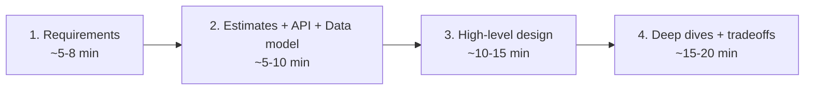
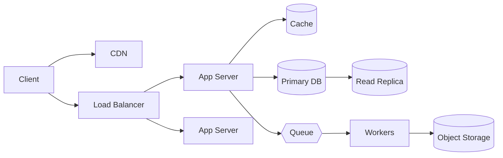

# System Design Interview Framework

> [!summary]
> A system design (high-level design, HLD) interview is a **45–60 minute open-ended conversation** where you design a large-scale system ("Design Twitter", "Design a URL shortener"). There is no single right answer. You're graded on **structured thinking, tradeoff reasoning, and communication**.

Back to [[Design Index]]

---

## Who gets this round? (as of 2025–2026)

| Level | Typical design round | Notes |
|---|---|---|
| **New grad / entry** (Google L3, Meta E3, Amazon SDE I/L4, Microsoft 59–60) | Usually **no** large-scale system design. Amazon SDE I has an **OOD/LLD** round. | Coding + behavioral dominate. Still expect design discussion in behavioral/project deep dives ("how did you architect your project?"). |
| **Mid-level** (Google L4, Meta E4, Amazon SDE II/L5, Microsoft 61–62) | **Yes, increasingly standard.** Reports say system design moved into most L4/E4 loops by 2025. | The bar is lower than senior: reasonable components, ~2 layers of depth, sound tradeoffs, good communication. Over-scoping is a common failure. |
| **Senior+** (L5/E5/SDE III) | Yes, 1–2 rounds, deep | Expected to drive the conversation, go 3–4 layers deep, and discuss failure modes and operations proactively. |

> [!info] Why prep it anyway as a new grad
> 1. Policies are shifting toward earlier levels. 2. Startups often run a design round for everyone. 3. Behavioral "tell me about a project" questions turn into design discussions. 4. **You'll need it on the job in month one.**

### What interviewers evaluate
1. **Problem navigation**: clarify ambiguity, scope it down, prioritize.
2. **Solution design**: a reasonable, working architecture.
3. **Technical depth**: can you go deeper on 1–2 components?
4. **Tradeoffs**: "I chose X over Y because..., at the cost of..."
5. **Communication**: drive the conversation, think out loud, use the whiteboard.

---

## The 4-step framework (~45 min)

### Step 1: Requirements & scope (don't skip!)

**Functional requirements**: what the system does. Get to **3 core features max**.
> "Users can post tweets. Users can follow others. Users can view a home timeline." Out of scope: DMs, search, ads.

**Non-functional requirements**: the qualities. These drive the architecture.
- **Scale**: DAU/MAU, requests/sec, data size
- **Latency**: "timeline loads in < 200 ms p99"
- **Availability vs consistency**: "highly available; feed can be slightly stale" (see [[Scalability & Core Concepts#CAP theorem|CAP]])
- **Durability**: "never lose a message/payment"
- **Read vs write ratio**: "read-heavy, 100:1"
- Security, privacy, compliance, cost, geography (global?)

> [!tip] Questions to ask
> - Who are the users, and how many? Is usage global?
> - What are the most important features?
> - Read-heavy or write-heavy?
> - How fresh must data be? Is eventual consistency OK?
> - Any latency SLA?
> - Mobile, web, or both?

### Step 2: Back-of-the-envelope, API, data model
- **Estimates** (keep them quick): QPS, storage, bandwidth. See [[Back-of-the-Envelope Estimation]]. Only compute what affects decisions ("~100K reads/sec means we need caching + replicas").
- **API**: 3–5 core endpoints. See [[API Design#API design in a system design interview]].
- **Data model**: core entities, key fields, and **which DB and why**. See [[Databases & Storage]].

### Step 3: High-level design
Draw the boxes and arrows to satisfy **functional** requirements first. Start simple:

Walk through each core use case on the diagram: "When a user posts a tweet, the request hits the LB, then..."

### Step 4: Deep dives & scaling (where mid-level candidates differentiate)
Pick the **bottlenecks** and address the **non-functional** requirements:
- Hot spots? → [[Caching]], [[Databases & Storage#Sharding / Partitioning|sharding]], replicas
- Slow work in the request path? → [[Messaging & Event Streaming|async queues]]
- Single points of failure? → redundancy, failover. See [[Reliability & Observability]]
- Consistency issues? → transactions, idempotency. See [[Distributed Systems Patterns]]
- Specific algorithms: fan-out, ID generation, rate limiting, geospatial index, etc.

Close with a **wrap-up**: summarize, name the remaining bottlenecks, what you'd monitor, and future improvements.

---

## Tradeoff phrases to use

- "We could do **A**, which gives us ___, or **B**, which gives us ___. Given our requirement of ___, I'll pick **A**."
- "This adds operational complexity, so I'd only introduce it once ___."
- "I'm choosing availability over consistency here because a slightly stale like-count is acceptable."
- "The simplest approach is ___; it breaks at about ___ QPS, at which point we'd ___."

## Common mistakes
- ❌ Jumping into drawing without clarifying requirements
- ❌ Designing for Google scale when asked for 10K users (over-engineering)
- ❌ Buzzword soup ("Kafka, Kubernetes, Cassandra") without justification
- ❌ Silence. Think out loud.
- ❌ Ignoring the interviewer's hints. They're steering you toward what they want to evaluate.
- ❌ Not knowing your chosen technology's basic characteristics
- ❌ Spending 20 minutes on estimation math

---

## Building-block cheat sheet

| Need | Reach for | Note |
|---|---|---|
| Distribute traffic | Load balancer | [[Networking Essentials#Load balancers]] |
| Serve static/media globally | CDN + object storage (S3) | [[Networking Essentials#CDN]] |
| Speed up reads | Cache (Redis/Memcached) | [[Caching]] |
| Relational data, transactions | PostgreSQL/MySQL | [[Databases & Storage]] |
| Massive write throughput, simple access patterns | Cassandra/DynamoDB | [[Databases & Storage]] |
| Full-text search | Elasticsearch/OpenSearch | |
| Decouple, buffer, async work | Queue (SQS, RabbitMQ) | [[Messaging & Event Streaming]] |
| Event streaming, replay, many consumers | Kafka | [[Messaging & Event Streaming]] |
| Real-time bidirectional | WebSockets | [[API Design#Real-time & push options]] |
| Unique IDs at scale | Snowflake IDs / UUIDs | [[Distributed Systems Patterns#Unique ID generation]] |
| Protect from abuse | Rate limiter | [[Design a Rate Limiter]] |
| Distribute keys across nodes | Consistent hashing | [[Distributed Systems Patterns#Consistent hashing]] |
| Geo queries ("nearby drivers") | Geohash / quadtree / PostGIS | |
| Analytics on huge data | Data warehouse (BigQuery, Snowflake, Redshift), Spark | |
| Scheduled / cron jobs | Distributed scheduler, Airflow | |

---

## Classic practice problems (roughly by difficulty)

**Start here (most common for mid-level):**
- [[Design a URL Shortener]] (TinyURL/bit.ly)
- [[Design a Rate Limiter]]
- Pastebin
- Key-value store
- Web crawler

**Next:**
- [[Design a News Feed]] (Twitter/X, Facebook, Instagram)
- [[Design a Chat System]] (WhatsApp, Messenger, Slack)
- Notification system
- Typeahead / search autocomplete
- YouTube / Netflix (video upload + streaming)
- Dropbox / Google Drive (file sync)

**Harder:**
- Uber / Lyft (geo-matching), Yelp (proximity search)
- Ticketmaster (high-contention booking)
- Google Docs (collaborative editing: OT/CRDT)
- Distributed job scheduler
- Payment system, stock exchange, ad click aggregator
- Leaderboard, top-K / trending

## Recommended resources
- *System Design Interview: An Insider's Guide*, Vols 1 & 2 (Alex Xu): the standard prep books
- *Designing Data-Intensive Applications* (Martin Kleppmann): **the** deep-understanding book; 2nd edition in progress
- Hello Interview (hellointerview.com): free breakdowns plus a delivery framework
- ByteByteGo (Alex Xu's newsletter/YouTube)
- The System Design Primer (GitHub: donnemartin/system-design-primer)
- Company engineering blogs: Netflix, Uber, Meta, Discord, Stripe, Airbnb, Cloudflare
- Grokking the System Design Interview (DesignGurus)

Next: [[Back-of-the-Envelope Estimation]]
