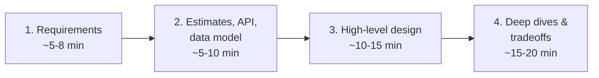
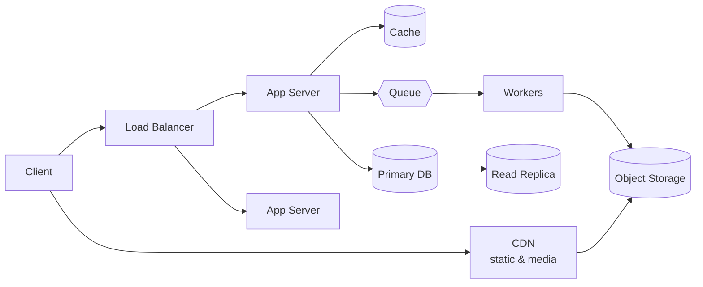

# System Design Interview Framework

> [!summary] What you'll learn
> What a system design interview is, who gets one, what interviewers are actually scoring, and a **repeatable 4-step framework** for running the 45 minutes, with what to say at each step and the common ways candidates fail. It ends with a reference of building blocks and a practice list.
>
> **What it is:** a system design (or "high-level design," HLD) interview is an open-ended 45–60 minute conversation where you design a large-scale system ("Design Twitter," "Design a URL shortener") on a whiteboard or shared doc. There is **no single correct answer**. You're evaluated on how you **reason about requirements and tradeoffs** and how clearly you communicate, not on whether you reproduce how Twitter really works.

Back to [[Design Index]] · Next: [[Back-of-the-Envelope Estimation]]

---

## Who gets this round? (2025–2026 landscape)

| Level | Typical design rounds | What's expected |
|---|---|---|
| **New grad / entry** (Google L3, Meta E3, Amazon SDE I / L4, Microsoft 59–60) | Usually **no** large-scale system design round. **Amazon SDE I has an [[Low-Level Design Interview\|object-oriented design]] round.** Design questions also come up in project deep dives and behavioral rounds. | Solid OOP/LLD; basic awareness of how web systems are built |
| **Mid-level** (Google L4, Meta E4, Amazon SDE II / L5, Microsoft 61–62) | **Yes, now standard in most loops.** Reports describe system design moving from senior-only into L4/E4 loops during 2024–2025. | A reasonable working design, about **two levels of depth** on key components, sound tradeoffs, clear communication. **Over-scoping is a common failure.** |
| **Senior+** (L5 / E5 / SDE III and above) | One or two rounds, deep | Drives the conversation; goes 3–4 levels deep; proactively covers failure modes, operations, evolution |

> [!info] Why prepare even as a new grad
> 1. Companies are adding design rounds at earlier levels.
> 2. Startups often run a design round for every engineering hire.
> 3. "Tell me about a project you built" turns into a design discussion ("how would it handle 100× the users?").
> 4. You'll use these concepts at work immediately: in design reviews, code reviews, and on-call.

---

## What interviewers are scoring

Most companies use a rubric along these lines:

| Dimension | What "good" looks like |
|---|---|
| **Problem navigation** | Clarifies ambiguous requirements, scopes the problem down, identifies what matters most |
| **Solution design** | A coherent architecture that actually satisfies the requirements; components have clear purposes |
| **Technical depth** | Can go deeper into 1–2 components (data model, caching strategy, consistency) when asked |
| **Tradeoffs** | Explains *why* one approach over another, and what is being given up |
| **Communication** | Thinks out loud, structures the discussion, uses the diagram, responds to hints and pushback |

> [!important] The most common hidden criterion
> **Can you justify every component?** If you add Kafka, you should be able to say what problem it solves *in this design*. "Because big companies use it" fails.

---

## The 4-step framework (~45 minutes)

### Step 1: Clarify requirements (don't skip this)

The prompt ("Design Instagram") is deliberately vague. Real engineering starts by **figuring out what to build**, and interviewers watch whether you do this.

**Functional requirements** describe **what the system does**. Narrow to the **3–4 most important features** and explicitly park the rest:
> "So the core features are: users can upload photos with captions, follow other users, and view a feed of photos from people they follow. I'll leave out comments, stories, DMs, and search unless we have time. Does that sound right?"

**Non-functional requirements** describe **qualities** the system must have. These drive the architecture far more than the features do:
| Quality | Question to ask | Why it matters |
|---|---|---|
| **Scale** | How many users (DAU)? Requests per second? Data volume? | Determines whether you need caching, sharding, CDNs |
| **Latency** | How fast must key operations be? ("feed loads in < 200 ms") | Drives caching, precomputation, data locality |
| **Availability vs consistency** | Is it OK if users briefly see stale data? | Decides CP vs AP choices (see [[Scalability & Core Concepts#CAP theorem]]) |
| **Durability** | Can we ever lose data? (photos, payments: never) | Replication, backups, write paths |
| **Read/write ratio** | Read-heavy (feeds, 100:1) or write-heavy (logging, IoT)? | Caching and replicas vs write-optimized storage |
| **Geography** | Global users? | CDNs, multi-region deployment |
| **Other** | Security, privacy, compliance, cost | May rule out options |

**Good clarifying questions:**
- Who are the users, and roughly how many? Global?
- What are the 2–3 most important use cases?
- Is it read-heavy or write-heavy?
- How fresh must data be? Is eventual consistency acceptable?
- What latency is acceptable for the main operations?
- Any special constraints (mobile on poor networks, regulatory)?

> Write the agreed requirements on the board. You'll refer back to them when justifying decisions, and in the wrap-up you'll check that you met each one.

### Step 2: Estimates, API, and data model

**Back-of-the-envelope estimates** (2–3 minutes; see [[Back-of-the-Envelope Estimation]]): calculate only what **affects design decisions**.
> "150M DAU × 20 feed views/day ≈ 3B/day ≈ 35K reads/sec, peaking near 100K. That's far more than a single database can serve, so we'll need caching and precomputed feeds. Writes are about 3K/sec, which is manageable. Photo storage is ~30 TB/day, so object storage plus a CDN."

**API design** (see [[API Design#API design in a system design interview]]): 3–5 core endpoints. This forces clarity about inputs and outputs.

**Data model**: the main entities, key fields, relationships, **and which kind of database and why** (see [[Databases & Storage]]).
> "Users and follows are relational, so Postgres. Posts are write-heavy, accessed by author and time, so they could go in Cassandra partitioned by user ID. Photos go in S3 with the URL stored on the post."

### Step 3: High-level design

Draw the main components and the data flow that satisfies the **functional** requirements. **Start simple** and make it work first; scale it in step 4.

Then **walk through each core use case on the diagram**:
> "When a user uploads a photo, the client first requests a presigned URL from the API, uploads directly to object storage, then calls `POST /posts` with the media ID. The app server writes the post to the DB and enqueues a fan-out job. Workers add the post ID to each follower's feed in the cache..."

Walking through flows is how you (and the interviewer) find gaps.

### Step 4: Deep dives and scaling

Now address the **non-functional** requirements and the bottlenecks. Usually the interviewer will steer you toward one or two areas; otherwise pick the most interesting ones yourself. This is where mid-level candidates differentiate themselves.

Typical deep-dive topics:
| Concern | Tools |
|---|---|
| Read hot spots, latency | [[Caching]], read replicas, CDN, precomputation |
| Write scale, data size | [[Databases & Storage#Sharding / Partitioning\|Sharding]], write-optimized stores, batching |
| Slow work in the request path | [[Messaging & Event Streaming\|Async queues and workers]] |
| Single points of failure | Redundancy, replication, failover ([[Reliability & Observability]]) |
| Consistency problems | Transactions, idempotency, sagas ([[Distributed Systems Patterns]]) |
| Specific algorithms | Feed fan-out, ID generation, rate limiting, geo-indexing, deduplication |
| Abuse | Rate limiting, authentication ([[Security Fundamentals]]) |

**Wrap up** in the last 2–3 minutes: summarize the design, check it against the requirements, name the remaining bottlenecks or risks, and mention what you'd monitor (key metrics and alerts) and what you'd improve with more time.

---

## How to talk about tradeoffs

Every decision has a cost. Saying it out loud is the single most valuable habit in these interviews.

**Useful sentence templates:**
- "We could do **A**, which gives us ___, or **B**, which gives us ___. Since our priority is ___, I'll go with **A**, accepting ___."
- "This adds operational complexity, so I'd only introduce it once ___ becomes a problem."
- "I'm choosing availability over consistency here, because a like count that's a few seconds stale is acceptable, but the page failing to load isn't."
- "The simplest approach is ___. It works until roughly ___ QPS; past that, we'd ___."

**Common tradeoffs to have ready:**
| Tradeoff | Example |
|---|---|
| Consistency vs availability | Bank balance (consistency) vs social feed (availability) |
| Latency vs consistency | Synchronous vs asynchronous replication |
| Read speed vs write speed | Denormalization and precomputed feeds speed reads but cost writes |
| Simplicity vs scalability | One database vs sharding |
| Cost vs performance | More cache memory, more replicas, more regions |
| Push vs pull | Fan-out on write vs fan-out on read ([[Design a News Feed]]) |
| SQL vs NoSQL | Transactions and flexible queries vs horizontal write scale |

---

## Common mistakes
- ❌ **Jumping straight to drawing** without clarifying requirements.
- ❌ **Over-engineering**: designing for a billion users when the requirement was 10,000, or adding every technology you know.
- ❌ **Buzzword soup**: "Kafka, Kubernetes, Cassandra, Redis" without explaining what each solves.
- ❌ **Silence**: the interviewer can't evaluate thinking they can't hear.
- ❌ **Ignoring hints**: when the interviewer asks "what happens if this server dies?", they're steering you to something they want to evaluate.
- ❌ **Not knowing your chosen tools**: if you pick Cassandra, be ready for "why not Postgres?" and "how is data partitioned?"
- ❌ **Spending 15 minutes on estimation arithmetic.**
- ❌ **Never committing**: listing five options without choosing one. Pick, justify, move on.
- ❌ **Forgetting failure**: what happens when a component is down, slow, or returns errors?

---

## Building-block cheat sheet

| Need | Reach for | Why / note |
|---|---|---|
| Distribute traffic across servers | **Load balancer** | Horizontal scale + health checks ([[Networking Essentials#Load balancers]]) |
| Serve static files and media globally, fast | **CDN** + **object storage (S3)** | Edge caching; S3 is cheap and durable ([[Networking Essentials#CDN]]) |
| Speed up hot reads | **Cache** (Redis, Memcached) | Memory is ~100× faster than disk ([[Caching]]) |
| Relational data, transactions, flexible queries | **PostgreSQL / MySQL** | The default choice ([[Databases & Storage]]) |
| Massive write throughput, simple key-based access | **Cassandra / DynamoDB / ScyllaDB** | Horizontal write scaling |
| Flexible documents | **MongoDB / DynamoDB / Firestore** | Varying schemas |
| Full-text search, fuzzy matching | **Elasticsearch / OpenSearch** | Inverted indexes |
| Decouple services; background work; absorb spikes | **Queue** (SQS, RabbitMQ) | [[Messaging & Event Streaming]] |
| Event streams with replay and many consumers | **Kafka / Kinesis** | Durable log |
| Real-time two-way communication | **WebSockets** | [[API Design#Real-time & push options]] |
| Unique IDs across many machines | **Snowflake IDs / UUIDv7** | [[Distributed Systems Patterns#Unique ID generation]] |
| Protect against abuse and overload | **Rate limiter** | [[Design a Rate Limiter]] |
| Spread keys evenly across nodes, minimal reshuffling | **Consistent hashing** | [[Distributed Systems Patterns#Consistent hashing]] |
| "Find nearby" queries | **Geohash / quadtree / S2 / H3 / PostGIS** | Spatial indexing |
| Analytics over huge datasets | **Data warehouse** (BigQuery, Snowflake, Redshift) + Spark | Columnar storage |
| Scheduled or delayed jobs | **Distributed scheduler**, cron, Airflow, delayed queues | |
| Coordination, leader election, config | **ZooKeeper / etcd** | Consensus-backed |

---

## Practice problems (roughly easiest to hardest)

**Start here (most common at mid-level):**
- [[Design a URL Shortener]] (TinyURL, bit.ly): key generation, read-heavy caching
- [[Design a Rate Limiter]]: algorithms, distributed counters
- Pastebin: like a URL shortener plus blob storage
- Key-value store: partitioning, replication, consistency
- Web crawler: queues, politeness, deduplication

**Next:**
- [[Design a News Feed]] (Twitter/X, Facebook, Instagram): fan-out, caching
- [[Design a Chat System]] (WhatsApp, Messenger, Slack): WebSockets, ordering, presence
- Notification system: multi-channel delivery, retries, preferences
- Typeahead / search autocomplete: tries, precomputed top-K, caching
- YouTube / Netflix: upload pipeline, transcoding, CDN streaming
- Dropbox / Google Drive: chunking, deduplication, sync

**Harder:**
- Uber / Lyft (geo-matching), Yelp (proximity search)
- Ticketmaster (high contention for limited inventory)
- Google Docs (collaborative editing with OT/CRDTs)
- Distributed job scheduler
- Payment system, stock exchange, ad click aggregator
- Leaderboard, top-K trending

**How to practice:** set a 45-minute timer, talk out loud (record yourself or practice with a friend), draw on paper or Excalidraw, then compare with a reference solution and note what you missed.

---

## Recommended resources
- ***System Design Interview: An Insider's Guide***, Vols. 1 & 2 (Alex Xu): the standard prep books; very readable
- ***Designing Data-Intensive Applications*** (Martin Kleppmann): the best book for *understanding* databases and distributed systems deeply
- **Hello Interview** (hellointerview.com): free problem breakdowns and a delivery framework from former FAANG interviewers
- **ByteByteGo** (Alex Xu's newsletter and YouTube): visual explanations
- **The System Design Primer** (GitHub: donnemartin/system-design-primer): free, comprehensive
- **Company engineering blogs**: Netflix, Uber, Meta, Discord, Stripe, Cloudflare, Airbnb, Slack. Real designs and tradeoffs.

Next: [[Back-of-the-Envelope Estimation]]
