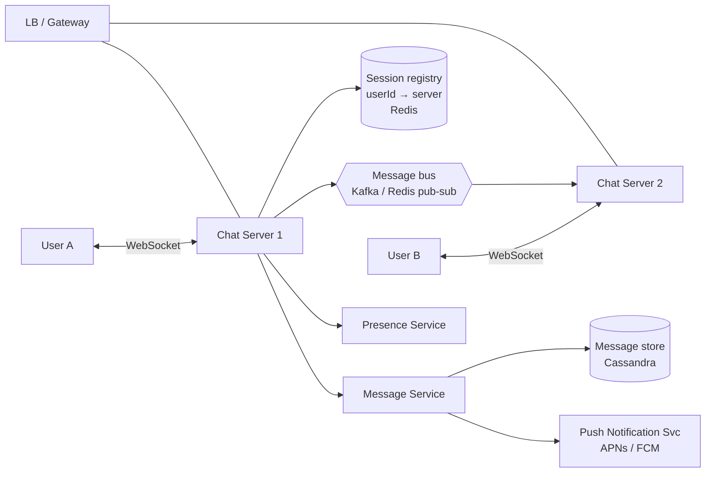

# Design a Chat System (WhatsApp / Messenger / Slack)

> [!summary]
> Real-time 1:1 and group messaging. It tests **persistent connections (WebSockets)**, **routing messages to the right server**, **message storage & ordering**, **offline delivery**, and **presence**. Very relevant to real-time work like Twitch chat integrations.

Back to [[Design Index]]

---

## 1. Requirements
**Functional:** 1:1 chat; group chat (≤ a few hundred members); online/last-seen presence; message delivery status (sent ✓ / delivered ✓✓ / read); message history across devices; push notifications when offline.
**Out of scope:** voice/video, E2E encryption details (mention it), media (mention S3 + CDN).

**Non-functional:** low latency (< ~200 ms delivery); **messages never lost** (durability); per-conversation **ordering**; high availability; huge scale (e.g., 500M DAU, ~50 messages/user/day → ~250K msgs/s).

## 2. Connection protocol
- HTTP polling/long polling: wasteful at scale.
- **WebSockets** ⭐: persistent, bidirectional, low overhead after the handshake. Clients hold a connection to a **chat server**. See [[API Design#Real-time & push options]].
- Stateless HTTP APIs still handle login, profile, history fetch, and group management.

## 3. High-level design



### Send flow (A → B)
1. A sends `{clientMsgId, conversationId, text}` over the WebSocket to Chat Server 1.
2. Server assigns a **server-side message ID / sequence number**, **persists** it to the message store (durability first), and acks A → ✓ "sent".
3. Look up B's connection in the **session registry** (`userId → chatServerId`).
4. If online: route via the message bus to Chat Server 2 → push to B over the WebSocket. B's client acks → ✓✓ "delivered" back to A.
5. If offline: store it as undelivered and send a **push notification** (APNs/FCM). When B reconnects, the client **syncs** messages since its last-seen sequence number.

## 4. Data model & storage
Massive write volume, simple access pattern (fetch the latest N messages of a conversation) → **wide-column store** (Cassandra/HBase/ScyllaDB). (Discord moved from MongoDB → Cassandra → ScyllaDB.)

```
messages
  conversation_id   (partition key)
  message_id        (clustering key, time-sortable, DESC)
  sender_id, body, created_at, type
```
- Partitioning by conversation keeps a chat's messages together and ordered.
- Huge group chats → bucket the partition by time (`conversation_id + month`) to avoid giant partitions.
- **conversations / members** tables: SQL is fine.
- **Per-user inbox** (latest message per conversation, unread counts) for the chat list screen.

## 5. Deep dives

### Message ordering
- Client timestamps are unreliable (clock skew). Use a **server-assigned, per-conversation monotonic sequence** (or Snowflake ID) when the message is persisted.
- Kafka partitioned by `conversation_id` preserves order within a conversation.

### Delivery guarantees & dedup
- At-least-once delivery with client retries → **dedupe with `clientMsgId`** (an idempotency key). See [[Distributed Systems Patterns#Idempotency]].
- Clients track the **last received sequence** and request gaps on reconnect.

### Group messaging
- Small groups: fan out to each member's connection (look up each member's server).
- Large channels (Slack/Discord): store once and let clients pull/subscribe per channel instead of per-user fan-out.

### Presence (online / last seen)
- Clients send a **heartbeat** every ~30 s; the presence service stores `lastSeen` in Redis with a TTL. Missing heartbeats → offline.
- Fan out presence changes only to friends who are online/viewing, and batch/throttle them (presence is chatty).

### Scaling WebSocket servers
- Each server holds ~tens to hundreds of thousands of connections. Sticky by connection, so the **registry** maps users → servers.
- On a server crash, clients reconnect (with backoff + jitter) to another server and sync missed messages.
- L4 load balancers handle long-lived connections well; use least-connections.

### Multi-device
- Each device has its own connection and sync cursor; deliver to all of a user's devices; read receipts sync across devices.

### Security
- TLS for transport; **E2E encryption** (Signal protocol: the server stores ciphertext only); auth on WebSocket connect (token in the initial handshake).

## 6. Tradeoffs to state
- Persist before delivering (durability over latency).
- Cassandra for write scale + time-ordered reads; SQL for relational metadata.
- Presence is eventually consistent, and that's acceptable.
- Push notifications go through the platform services (APNs/FCM); you don't hold mobile connections when apps are backgrounded.
