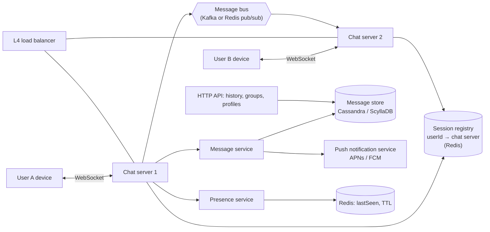
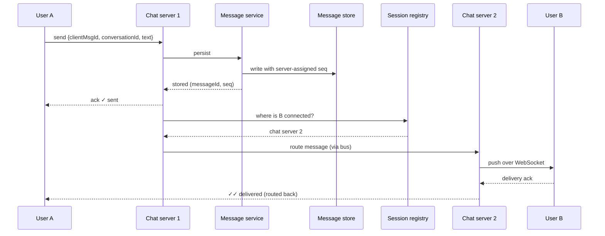

# Design a Chat System (WhatsApp / Messenger / Slack)

> [!summary] Why this problem
> Real-time 1:1 and group messaging. It tests **persistent connections (WebSockets)** and how to scale them, **routing a message to whichever server holds the recipient's connection**, **storage and ordering** of billions of messages, **delivery guarantees and deduplication**, **offline delivery and push notifications**, **presence**, and **multi-device sync**. It's closely related to real-time features like Twitch chat.

Back to [[Design Index]]

---

## 1. Requirements

**Functional:**
1. **1:1 chat** between users.
2. **Group chat** (say, up to a few hundred members; mention how very large channels differ).
3. **Delivery status**: sent ✓, delivered ✓✓, read (blue ticks).
4. **Online / last-seen presence.**
5. **Message history**, synced across a user's devices (phone, laptop).
6. **Push notifications** when the recipient is offline.

**Out of scope (mention briefly):** voice/video calls, end-to-end encryption internals, media details (use S3 + CDN), search.

**Non-functional:**
- **Low latency**: messages delivered in < ~200–500 ms when both users are online.
- **Durability**: a message the server acknowledged as "sent" must **never be lost**.
- **Ordering**: messages within a conversation appear in a consistent order for all participants.
- **High availability**, huge scale: e.g., 500M DAU × ~40 messages/day ≈ **20B messages/day ≈ ~230K messages/sec** average.
- Hundreds of millions of **concurrent connections**.

## 2. How clients and servers talk

| Option | Verdict |
|---|---|
| HTTP polling | Wasteful: most polls return nothing, and latency equals the poll interval |
| Long polling | Works, but each message needs a new request; awkward at scale |
| **WebSockets** | ✅ **Persistent, full-duplex** connection: the server pushes messages instantly, with low overhead per message |

So: each online client keeps a **WebSocket** connection to one **chat server**. Ordinary **HTTP APIs** handle everything that isn't real-time: login, profile, fetching history pages, creating groups, uploading media. See [[API Design#Real-time & push options]].

## 3. High-level design



**Components:**
- **Chat servers** (stateful): hold WebSocket connections, receive and push messages.
- **Session registry**: which chat server each online user (each device) is connected to. Redis, with entries removed when connections close or expire.
- **Message service + store**: persists messages and assigns ordering.
- **Message bus**: routes messages between chat servers.
- **Push notification service**: for offline recipients, via Apple Push Notification service (APNs) and Firebase Cloud Messaging (FCM).
- **Presence service**: online/last-seen status.

## 4. The send flow (A → B)



1. A's client sends the message with a client-generated **`clientMsgId`** (for deduplication) to its chat server.
2. The server **persists it first** (durability before delivery), assigning a **server-side message ID and a per-conversation sequence number**.
3. The server **acks A** → A's UI shows ✓ "sent." From here the message can't be lost.
4. The server looks up B's connection(s) in the session registry.
5. **B online**: route through the bus to B's chat server, which pushes it down B's WebSocket. B's client acks → ✓✓ "delivered" flows back to A. When B opens the conversation, a "read up to seq N" receipt flows back → read ticks.
6. **B offline**: the message waits in storage, and the **push notification service** sends a notification through APNs/FCM. When B's app reconnects, it **syncs**: "give me all messages in my conversations after the last sequence numbers I have."

## 5. Data model and storage

### Why a wide-column store
- **Massive write volume** (hundreds of thousands per second) of small, immutable records.
- A simple, dominant access pattern: **"get the latest N messages of conversation X, then older ones as I scroll."**
- That's exactly what **Cassandra / ScyllaDB / HBase** excel at (see [[Databases & Storage#NoSQL families]]). Discord famously moved its messages from MongoDB to Cassandra and later to ScyllaDB as volume grew into the trillions.

```sql
CREATE TABLE messages (
  conversation_id  uuid,
  bucket           int,          -- e.g., month number: keeps partitions from growing unbounded
  seq              bigint,       -- per-conversation sequence (or a Snowflake/time-sortable ID)
  message_id       uuid,
  sender_id        uuid,
  body             text,
  created_at       timestamp,
  PRIMARY KEY ((conversation_id, bucket), seq)
) WITH CLUSTERING ORDER BY (seq DESC);
```
- **Partition key `(conversation_id, bucket)`** keeps a conversation's recent messages together on one node and ordered; **bucketing by time** prevents enormous partitions for very active, long-lived group chats.
- **Relational metadata** (users, conversations, group membership, roles) fits fine in **PostgreSQL**.
- A per-user **inbox / conversation list** table: one row per (user, conversation) with the last message preview, last-read sequence, and unread count, to render the chat list screen quickly.

## 6. Deep dives

### Message ordering
- **Don't use client timestamps** for ordering: device clocks are wrong, and messages from different devices would interleave incorrectly.
- Assign a **server-side, per-conversation, monotonically increasing sequence number** when the message is persisted (e.g., an atomic counter per conversation in Redis or the DB, or route all writes for a conversation through one owner so it can assign sequence numbers). Time-sortable Snowflake IDs are a simpler alternative with near-perfect ordering.
- If messages flow through **Kafka partitioned by `conversation_id`**, ordering within a conversation is preserved end to end (see [[Messaging & Event Streaming#Ordering]]).
- Clients display messages **sorted by sequence**, and can detect **gaps** (have 41 and 43 → fetch 42).

### Delivery guarantees and duplicates
- Delivery is **at-least-once**: clients resend if they don't get an ack (network drop), and servers redeliver on reconnect.
- **Deduplicate** with the `clientMsgId` (unique per sender device): the server ignores a message whose `clientMsgId` it already stored and just re-acks it. This is an idempotency key ([[Distributed Systems Patterns#Idempotency]]).
- Each device tracks the **last sequence received** per conversation; on reconnect it requests everything after that, which recovers anything missed while offline or during a server crash.

### Routing between chat servers
When A and B are connected to different chat servers, the message has to cross between them:
- **Option 1: direct server-to-server**: look up B's server in the registry and forward via an internal RPC.
- **Option 2: pub/sub bus**: each chat server subscribes to a channel for itself (or for the users connected to it) on Redis Pub/Sub or a Kafka topic, and senders publish to the recipient's channel.
- Either way, the **session registry** is the lookup, updated on connect and disconnect, with TTLs refreshed by heartbeats so stale entries from crashed servers expire.

### Group messaging
- **Small groups** (≤ a few hundred): **fan out on write**. Store the message **once** in the conversation's partition, then deliver it to each member's online devices (look up each in the registry) and send pushes to offline members.
- **Large channels** (Slack/Discord-style servers with thousands to millions of members): per-member fan-out is too expensive. Store once; clients that have the channel **open** subscribe to it and receive live updates; others see an unread indicator and **fetch on open** (pull). This is the same push-vs-pull tradeoff as the [[Design a News Feed|news feed]].
- Read receipts in groups: track each member's **last-read sequence** rather than per-message receipts (much less data).

### Presence (online / last seen)
- Clients send a **heartbeat** every ~30 seconds over the WebSocket. The presence service stores `lastSeen` in Redis with a TTL slightly longer than the heartbeat interval. **No heartbeat → TTL expires → offline.**
- Presence is chatty: broadcasting every status change to every contact doesn't scale. Instead, **only send updates to users who are online and currently viewing** that contact (or the chat list), **batch and throttle** updates, and fetch on demand when a conversation opens.
- Presence is a perfect example of data where **eventual consistency is fine**.

### Scaling WebSocket servers
- Each chat server holds a large number of long-lived connections (tens of thousands to a million, depending on tuning, memory, and message rate). Capacity planning is by **concurrent connections**, not requests per second.
- Use **L4 load balancers** (or L7 with WebSocket support) and **least-connections** balancing for long-lived connections.
- Chat servers are **stateful** (they hold connections), so a server **crash** drops its users. Clients **reconnect** automatically (with exponential backoff + **jitter**, to avoid a thundering herd of reconnects), land on another server, re-register in the session registry, and **sync** missed messages from storage. Because messages were persisted before delivery, nothing is lost.
- **Deploys**: drain servers gradually (stop accepting new connections, ask clients to reconnect elsewhere) to avoid mass reconnect spikes.

### Multi-device support
- Each device has its own connection, registry entry, and sync cursor (`last seq received`).
- Messages are delivered to **all** of a user's online devices; messages the user **sends** from one device are also synced to their other devices.
- Read state syncs across devices (reading on the laptop clears the phone's unread badge).

### Media messages
The client uploads the image/video to **object storage** via a presigned URL, then sends a normal chat message containing the media reference. Recipients download from a **CDN**. Thumbnails are generated asynchronously.

### Security
- **TLS** for all connections (WSS).
- **Authenticate the WebSocket** at connect time (token in the handshake) and authorize every send (is the sender a member of this conversation?).
- **End-to-end encryption** (the Signal Protocol, used by WhatsApp and Signal): clients encrypt with keys the server never sees; the server stores and routes **ciphertext**. Tradeoffs: the server can't search, moderate, or index message content, and multi-device key management becomes more complex.
- Rate-limit sends to fight spam.

## 7. Tradeoffs to state explicitly
- **Persist before delivering**: slightly higher latency, in exchange for never losing an acknowledged message.
- **Wide-column store** for messages (write scale, time-ordered reads by conversation) plus **SQL** for relational metadata: polyglot persistence.
- **At-least-once + client-side dedup** instead of attempting exactly-once delivery.
- **Presence is eventually consistent**: cheap and good enough.
- **Fan-out on write for small groups, pull for huge channels.**

## Wrap-up
> "Clients hold WebSocket connections to stateful chat servers; a Redis session registry maps users to servers. On send, we persist to a Cassandra-style store partitioned by conversation with a server-assigned sequence number, ack the sender, then route to the recipient's server through a pub/sub bus, or send a push notification if they're offline. Clients dedupe by client message ID and sync by last-seen sequence on reconnect, so delivery is at-least-once without visible duplicates. Presence uses heartbeats with TTLs. I'd monitor delivery latency, connection counts per server, reconnect rates, and message store latency."
