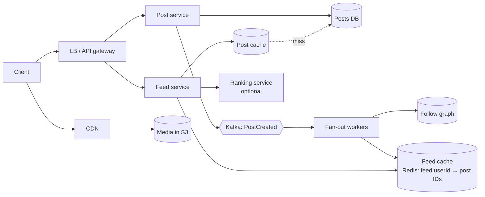
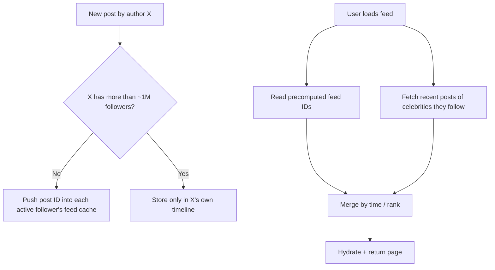

# Design a News Feed (Twitter/X, Facebook, Instagram)

> [!summary] Why this problem
> Users publish posts; each user sees a **home feed** of recent posts from the people they follow. It's one of the most-asked problems because the core challenge, **fan-out**, forces a real tradeoff between **write cost and read latency**, plus the famous **celebrity problem**. It also exercises caching, sharding, media storage, pagination, and ranking.

Back to [[Design Index]]

---

## 1. Requirements

**Functional:**
1. A user can **create a post** (text plus optional images/video).
2. A user can **follow/unfollow** other users.
3. A user can view their **home feed**: posts from people they follow, newest first (or ranked), **paginated** (infinite scroll).

**Out of scope (state it):** likes and comments in detail, search, notifications, ads, DMs, trending.

**Non-functional:**
- **Feed loads fast**: p99 < ~200–500 ms.
- **Highly available**; **eventual consistency is acceptable**: a new post may take a few seconds to appear in followers' feeds (AP choice).
- **Read-heavy**: far more feed views than posts.
- Scale: hundreds of millions of daily users.
- Posts and media are **durable** (never lost).

## 2. Estimates
(See [[Back-of-the-Envelope Estimation#Worked example: Twitter-like service]].)
- 150M DAU; ~2 posts/user/day → **~3K posts/sec** (peak ~10K).
- ~20 feed loads/user/day → **~30K feed reads/sec** (peak ~100K). **Read:write ≈ 10:1** or more.
- Media ~30 TB/day → object storage + CDN.
- Average user follows ~200 accounts; follower counts are wildly skewed (most users have < 1,000; a few have 100M+).

## 3. API
```
POST   /v1/posts                        { text, mediaIds[] }          → 201 { postId, createdAt }
GET    /v1/feed?cursor=<opaque>&limit=20                              → 200 { posts[], nextCursor }
POST   /v1/users/{userId}/follow                                      → 204
DELETE /v1/users/{userId}/follow                                      → 204
POST   /v1/media/upload-url             { contentType, sizeBytes }    → 200 { uploadUrl, mediaId }
```
The current user comes from the auth token, not a parameter. Feed pagination uses **cursors** ([[API Design#Pagination]]), because offsets break when new posts arrive.

## 4. Data model and storage

| Data | Store | Key design | Why |
|---|---|---|---|
| **Users** | PostgreSQL | `users(id, handle, name, avatar_url, ...)` | Relational, modest size, strong consistency |
| **Follows** (the social graph) | PostgreSQL, or a wide-column store at huge scale | `follows(follower_id, followee_id, created_at)`, indexed **both ways**: "who do I follow?" and "who follows me?" | Fan-out needs "all followers of X" quickly |
| **Posts** | **Cassandra/DynamoDB** (partitioned by `author_id`, clustered by `post_id DESC`) or sharded SQL | `post_id` is a **Snowflake ID** (time-sortable, see [[Distributed Systems Patterns#Unique ID generation]]) | Write-heavy, huge, accessed by author + time |
| **Feed cache** | **Redis** | `feed:{userId}` → list/sorted set of the latest ~500–800 **post IDs** (not full posts) | Precomputed feeds for fast reads |
| **Post cache** | Redis/Memcached | `post:{postId}` → post object | Hydrating IDs into full posts |
| **Media** | **S3** + **CDN** | Object key on the post | Never store media in the DB |
| **Counters** (likes, replies) | Redis counters, flushed periodically | `likes:{postId}` | Approximate is fine; avoid hot-row updates |

Storing only **IDs** in feed caches keeps them small, and a post edited or deleted once is reflected everywhere at hydration time.

## 5. High-level design



**Write path (publishing a post):**
1. The client uploads media directly to S3 via a presigned URL ([[Databases & Storage#Pattern: presigned URLs for uploads and downloads]]).
2. `POST /v1/posts`: the post service validates, assigns a Snowflake ID, writes the post to the posts DB, and publishes `PostCreated` to Kafka.
3. Responds **201 immediately**. Fan-out happens asynchronously.
4. **Fan-out workers** consume the event, look up the author's followers, and add the post ID to each follower's feed cache (strategy details below).

**Read path (loading the feed):**
1. `GET /v1/feed`: the feed service reads the next page of post IDs from `feed:{userId}`.
2. Merges in recent posts from any **celebrities** the user follows (hybrid strategy below).
3. **Hydrates** IDs into full posts with a batched multi-get from the post cache (falling back to the DB on misses), plus author info and counts.
4. Optionally **ranks** them, then returns the page with a `nextCursor`.

## 6. Deep dive: fan-out strategies (the core of the problem)

### Fan-out on write ("push")
When someone posts, **immediately push** the post ID into **every follower's** precomputed feed.
- ✅ **Reads are trivially fast**: the feed is already assembled; just read a list.
- ✅ Matches a read-heavy workload: pay once per post, read cheaply many times.
- ❌ **Write amplification**: one post creates as many cache writes as the author has followers. Fine for 200 followers, catastrophic for an account with **100M followers** (100M writes for one post, delaying everyone else's fan-out). This is the **celebrity problem**.
- ❌ Wasted work for followers who rarely log in.
- ❌ A new post takes time to reach the last follower when fan-out is large.

### Fan-out on read ("pull")
Store posts only by author. When a user loads their feed, **fetch recent posts from everyone they follow** and merge them by time (a k-way merge).
- ✅ **Cheap, fast writes**: one write per post, no amplification.
- ✅ No wasted work for inactive users; always up to date.
- ❌ **Slow, expensive reads**: following 1,000 accounts means querying 1,000 timelines (across many shards) on every feed load. At 100K feed loads/sec that's enormous.

### Hybrid (what large systems do; Twitter famously used this)
- Use **push for normal users** (the vast majority, with modest follower counts).
- Use **pull for celebrities** (accounts above a follower threshold, e.g., 100K–1M): their posts are **not** fanned out.
- At read time, the feed service takes the **precomputed feed** and **merges in recent posts from the celebrities this user follows** (a small number, cheaply fetched from their cached timelines).
- **Skip fan-out for inactive users** (no login in, say, 30 days). When they return, build their feed on demand with pull, then resume pushing.



| | Push (fan-out on write) | Pull (fan-out on read) | Hybrid |
|---|---|---|---|
| Write cost | High (× followers) | Low | Low for celebrities, moderate otherwise |
| Read cost | Very low | High | Low |
| Freshness | Small delay | Always fresh | Small delay |
| Celebrity problem | ❌ Severe | ✅ None | ✅ Handled |
| Best for | Most users | Celebrities, inactive users | **Real systems** |

## 7. Other deep dives

### Ranking (when the feed isn't purely chronological)
1. **Candidate generation**: gather a few hundred to a few thousand candidate posts (from the precomputed feed, celebrities, groups, maybe recommendations).
2. **Scoring**: an ML model predicts engagement (probability of like, comment, share, long view) using features such as recency, the user's affinity with the author, post type, and engagement so far.
3. **Re-ranking and filtering**: diversity (not 10 posts from one author in a row), removing already-seen posts, policy filters.
4. Ranking is expensive, so rank the **first pages** and cache the results briefly.

### Pagination
- The cursor encodes the position: the last post ID seen (Snowflake IDs are time-ordered). `GET /feed?cursor=<lastId>` returns the next older items.
- The Redis feed list holds only the **latest ~800** IDs per user. For deeper scrolling, fall back to **pull** from authors' timelines (rare: few users scroll that far).

### New posts while viewing
Show "5 new posts" without reloading: the client polls a lightweight endpoint (`GET /feed/new-count?since=<newestId>`) every 30–60 seconds, or the server pushes a notification over **SSE/WebSocket** ([[API Design#Real-time & push options]]).

### Media
Upload directly to S3 via presigned URLs; an async pipeline creates thumbnails and multiple resolutions (and transcodes video); serve everything through a **CDN** with fingerprinted URLs.

### Likes and counts
High-frequency increments on popular posts would create **hot rows** in the DB. Instead, increment counters in Redis (**write-behind**, see [[Caching#Write-behind (write-back)]]) and flush to the DB periodically. Displayed counts can be slightly stale.

### Deletes, edits, privacy, and unfollows
- **Delete**: remove the post from the posts store and post cache. Don't scrub millions of feed caches: during **hydration**, skip IDs that no longer exist. Feeds are self-healing.
- **Edit**: since feeds store IDs, hydration automatically shows the latest version.
- **Unfollow**: filter that author's posts at read time and/or remove them from the feed cache asynchronously.
- **Blocked users / private accounts**: filter during hydration by checking visibility rules.

### Sharding
- **Posts**: by `author_id` (fetch an author's timeline from one shard) or by `post_id` (even spread). Many designs use `author_id` for timeline locality.
- **Feed cache**: by `user_id` across a Redis cluster.
- **Follow graph**: by `follower_id` for "who do I follow" and a second copy by `followee_id` for "who follows X" (fan-out). Duplicating the data both ways is normal.

### Reliability
- Fan-out is **asynchronous** through Kafka, so a slow fan-out never blocks posting; consumer lag is monitored and workers auto-scale.
- If the feed cache is lost (Redis node failure), feeds are **rebuilt on demand with pull** for affected users. The cache is a derived, reconstructable view; the posts DB is the source of truth.

## 8. Tradeoffs to state explicitly
- **Push vs pull = write amplification vs read latency.** The hybrid gets the benefits of both for real-world follower distributions.
- **Eventual consistency** (AP): followers may see a post a few seconds late; that's acceptable for social feeds and buys availability and speed.
- **Memory vs depth**: keep only recent IDs per active user in Redis; serve older pages via pull.

## Wrap-up
> "Posts are written once to a Cassandra-style store keyed by author with time-sortable Snowflake IDs. A PostCreated event drives asynchronous fan-out: post IDs are pushed into Redis feed lists for followers of normal accounts, while celebrity posts are pulled and merged at read time. The feed service reads IDs, merges, hydrates from the post cache, optionally ranks, and paginates with cursors. Media goes through S3 and a CDN. I'd monitor feed p99 latency, fan-out lag, and cache hit rates."
