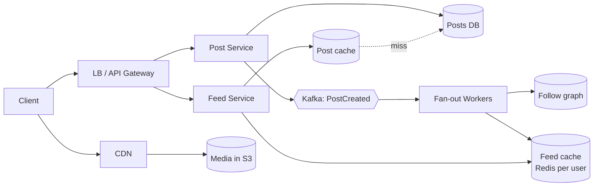

# Design a News Feed (Twitter/X, Facebook, Instagram)

> [!summary]
> Users post content; followers see a **timeline** of posts from people they follow. The core challenge is **fan-out**: precomputing feeds (fast reads) vs computing them on read (cheap writes), plus the **celebrity problem**.

Back to [[Design Index]]

---

## 1. Requirements
**Functional:** create a post (text + media); follow/unfollow; view the home feed (posts from followees, reverse-chronological or ranked), paginated.
**Out of scope (say so):** likes/comments detail, search, ads, DMs.

**Non-functional:** feed load p99 < ~200–500 ms; highly available (AP; slightly stale feeds are fine); read-heavy; eventual consistency OK (a post may take a few seconds to appear).

## 2. Estimates
(See [[Back-of-the-Envelope Estimation#Worked example: Twitter-like service]].) 150M DAU; ~3K posts/s; ~30K feed reads/s; media ~30 TB/day → object storage + CDN.

## 3. API
```
POST /v1/posts                      { text, mediaIds[] }   → 201 { postId }
GET  /v1/feed?cursor=&limit=20                             → { posts[], nextCursor }
POST /v1/users/{id}/follow    DELETE /v1/users/{id}/follow
POST /v1/media/upload-url                                  → { presignedUrl, mediaId }
```

## 4. Data model
- **users**(id, name, …): SQL.
- **follows**(follower_id, followee_id, created_at): graph-ish; index both directions. SQL, or a wide-column store keyed by user.
- **posts**(post_id [Snowflake, time-sortable], author_id, text, media_urls, created_at): Cassandra/DynamoDB partitioned by `author_id`, or sharded SQL.
- **feed cache**: Redis list/sorted set per user: `feed:{userId}` → [postId, …] (latest ~800).
- **media**: S3 + CDN.

## 5. High-level design



## 6. Deep dive: fan-out strategies

### Fan-out on write (push)
When a user posts, **push the post ID into every follower's feed cache**.
- ✅ Feed reads are fast and cheap (just read a precomputed list).
- ❌ Expensive writes: a user with 50M followers → 50M cache writes per post (**celebrity problem**); wasted work for inactive users.

### Fan-out on read (pull)
On feed request, fetch recent posts from everyone you follow and merge (k-way merge by time).
- ✅ Cheap writes; no wasted work; always fresh.
- ❌ Slow reads (follow 1,000 people → query 1,000 timelines); heavy read load.

### Hybrid ⭐ (what Twitter famously did)
- **Push** for normal users (most have < a few thousand followers).
- **Pull** for **celebrities** (followers > threshold): their posts are **not** fanned out. At read time, the feed service merges the precomputed feed + recent posts from the celebrities you follow.
- Skip fan-out to **inactive** users; build their feed on demand when they return.

### Feed read path
1. Read post IDs from `feed:{userId}` (cursor-paginated).
2. Merge in celebrity posts.
3. **Hydrate** IDs → full posts from the post cache (multi-get) + author info + counts.
4. (Optional) **Ranking**: score by recency, engagement, affinity → ML ranking service. Ranked feeds rank a candidate set rather than everything.

## 7. Other deep dives
- **Media upload**: presigned URL → client uploads directly to S3 → async processing (thumbnails, transcoding) → served via CDN.
- **Pagination**: cursor = last seen post ID/timestamp (stable as new posts arrive). See [[API Design#Pagination]].
- **Counts (likes, views)**: write-behind counters in Redis, flushed periodically; approximate is fine.
- **Hot posts**: cache aggressively; replicate hot keys.
- **New post appearing live**: client polling every N seconds, or SSE/WebSocket push of "new posts available".
- **Deletes/privacy**: on delete, remove from the posts DB; lazily filter deleted IDs during hydration (don't scrub 50M feeds).
- **Unfollow**: filter at read time and/or async cleanup.
- **Sharding**: posts by `author_id` (or post_id), feed cache by `user_id`.

## 8. Tradeoffs to state
- Push vs pull = **write amplification vs read latency**.
- Feed staleness is acceptable (AP), and fan-out is async via Kafka.
- Redis memory: only keep the last N IDs per active user; fall back to pull for older pages.
