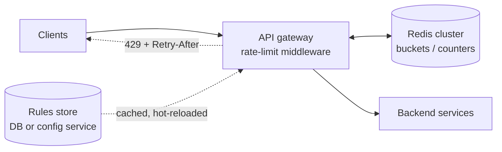

# Design a Rate Limiter

> [!summary] Why this problem
> A rate limiter caps **how many requests a client can make in a time window** (e.g., 100 requests per minute per API key) and rejects the excess. It's asked as a **system design** question (a distributed limiter in front of many servers) and as an **LLD/coding** question (implement a token bucket). It tests **algorithm knowledge**, **where components live**, **distributed counting with Redis**, **race conditions and atomicity**, and **failure handling**.

Back to [[Design Index]]

---

## Why rate limiting exists (the problems it solves)
1. **Prevent abuse and attacks**: brute-force password guessing, credential stuffing, scraping, spam, denial-of-service attempts.
2. **Protect shared resources**: one buggy client stuck in a retry loop shouldn't degrade the service for everyone else ("noisy neighbor").
3. **Control costs**: expensive operations (LLM calls, SMS, third-party APIs billed per request).
4. **Enforce business tiers**: free plan 1,000 requests/day; paid plan 100,000.
5. **Keep systems within their capacity** so they degrade gracefully instead of falling over.

## 1. Requirements

**Functional:**
- Limit requests per **client key**: user ID, API key, or IP address (or combinations).
- Support **multiple rules**: e.g., 100 req/min for `/api/search`, 5 login attempts per minute per account, 10,000 req/day per API key on the free tier.
- When limited, reject with **HTTP 429 Too Many Requests** and informative headers:
  ```http
  HTTP/1.1 429 Too Many Requests
  Retry-After: 30
  X-RateLimit-Limit: 100
  X-RateLimit-Remaining: 0
  X-RateLimit-Reset: 1761984000
  ```
- Rules can be changed **without redeploying**.

**Non-functional:**
- **Very low latency overhead** (it's on every request's path): ~1 ms or less.
- Works correctly across **many API servers** (a shared, distributed view of each client's usage).
- **Highly available**, and the limiter itself must not become the cause of outages.
- **Reasonably accurate**: slightly over-allowing under race conditions is usually acceptable; being wildly off isn't.

**Decide the failure mode:** if the limiter's data store is unavailable, **fail open** (allow traffic) for most APIs, to avoid an outage caused by the limiter, but **fail closed** (deny) for security-sensitive limits like login attempts. State this choice explicitly.

## 2. Where should the limiter live?
| Location | ✅ | ❌ |
|---|---|---|
| **Client-side** | Reduces wasted calls | **Not enforceable**: anyone can bypass it |
| **API gateway / reverse proxy** (Kong, Envoy, Nginx, AWS API Gateway, Cloudflare) | **Centralized**, consistent across all services; blocks traffic before it reaches your app | Coarse-grained; less app context (e.g., user tier) unless passed along |
| **Middleware inside each service** | Full application context (user plan, endpoint cost); per-service rules | Every service must implement it consistently |
| **Sidecar** (service mesh) | Uniform, language-independent | Infrastructure complexity |

A common answer: **coarse limits at the edge/gateway** (per IP, DDoS protection) plus **fine-grained limits in middleware** (per user and plan, per endpoint).

## 3. Algorithms

### Token bucket (the most common; used by AWS, Stripe, and many gateways)
**Idea:** each client has a bucket holding up to **capacity** tokens. Tokens are added at a steady **refill rate** (e.g., 10 per second). Each request consumes one token; if the bucket is empty, the request is rejected.

- **Capacity** = the maximum **burst** size; **refill rate** = the sustained average rate.
- ✅ Allows short **bursts** (natural for real clients: a page load fires 10 requests at once) while enforcing the long-term average.
- ✅ Tiny memory: two numbers per client (token count, last refill timestamp). Refill is computed lazily on each request, so no background timers are needed.

```javascript
class TokenBucket {
  constructor(capacity, refillPerSecond) {
    this.capacity = capacity;
    this.rate = refillPerSecond;
    this.tokens = capacity;          // start full
    this.lastRefill = Date.now();
  }
  tryConsume(cost = 1) {
    const now = Date.now();
    const elapsedSec = (now - this.lastRefill) / 1000;
    this.tokens = Math.min(this.capacity, this.tokens + elapsedSec * this.rate);   // lazy refill
    this.lastRefill = now;
    if (this.tokens >= cost) { this.tokens -= cost; return true; }
    return false;
  }
}

const bucket = new TokenBucket(10, 1);   // burst of 10, then 1 request/sec sustained
```
Requests with different costs (an expensive export costs 10 tokens) are easy to support.

### Leaky bucket
**Idea:** requests enter a FIFO queue (the bucket) that "leaks" (is processed) at a **constant rate**. If the queue is full, new requests are dropped.
- ✅ **Smooth, constant output rate**: ideal for protecting a downstream that can only handle a fixed rate (e.g., a legacy system or a third-party API limit).
- ❌ Bursts are queued (adding latency) or dropped; old queued requests can delay fresh ones.
- Variant: the "leaky bucket as a meter" is equivalent to the token bucket.

### Fixed window counter
**Idea:** count requests per client in fixed time windows (e.g., each calendar minute). Key: `ratelimit:user42:2026-11-01T10:05`. If the count exceeds the limit, reject. The counter resets when the next window starts.
- ✅ Very simple; one counter per client per window (Redis `INCR` + `EXPIRE`).
- ❌ **Boundary burst problem**: with a limit of 100/min, a client can send 100 requests at 10:05:59 and another 100 at 10:06:00: **200 requests in 2 seconds**, double the intended rate.

### Sliding window log
**Idea:** store the **timestamp of every request** (e.g., in a Redis sorted set). On each request, remove timestamps older than the window, count what's left, and allow if under the limit.
- ✅ **Exact**: no boundary problem.
- ❌ **Memory-heavy**: one entry per request per client (100 req/min × millions of clients adds up). Fine for low limits (like login attempts).

```javascript
// Redis sorted-set implementation sketch
const now = Date.now(), windowMs = 60_000;
await redis.multi()
  .zRemRangeByScore(key, 0, now - windowMs)       // drop old entries
  .zAdd(key, { score: now, value: `${now}-${Math.random()}` })
  .zCard(key)                                     // count in window
  .expire(key, 60)
  .exec();
```

### Sliding window counter (hybrid)
**Idea:** keep fixed-window counters for the current and previous window, and **estimate** the count over a sliding window by weighting the previous window by how much of it still overlaps:
```
estimate = current_window_count + previous_window_count × (1 − elapsed_fraction_of_current_window)
```
Example: limit 100/min. We're 15 s (25%) into the current minute; the previous minute had 80 requests, the current has 30. Estimate = 30 + 80 × 0.75 = **90** → allow.
- ✅ Smooths out the boundary burst problem with fixed-window memory cost (two counters).
- ❌ Approximate (assumes requests in the previous window were evenly spread), but very close in practice. Cloudflare has described using this approach at large scale.

### Comparison
| Algorithm | Bursts | Memory per client | Accuracy | Best for |
|---|---|---|---|---|
| **Token bucket** | Allowed up to capacity | 2 values | Good | **General API rate limiting (default choice)** |
| **Leaky bucket** | Smoothed into a constant rate | Queue | Good | Protecting fixed-capacity downstreams |
| **Fixed window** | Up to 2× at boundaries | 1 counter | Poor at edges | Simple daily/monthly quotas |
| **Sliding log** | Precise | 1 entry per request | Exact | Low limits needing precision (login attempts) |
| **Sliding window counter** | Smoothed | 2 counters | Very close | High-scale per-minute limits |

## 4. Distributed design

### Why local, in-memory counters aren't enough
With 20 API servers behind a load balancer, each server only sees ~1/20th of a client's requests. Per-server counters would let a client make 20× the limit. The counts must be **shared**.

### Architecture

1. A request arrives at the gateway (or middleware). It identifies the client (API key → user ID; otherwise IP) and finds the applicable rules (from a **locally cached** copy of the rules, refreshed periodically).
2. It checks and updates the client's counter/bucket in **Redis** (fast, in-memory, shared, built-in key expiry).
3. If allowed, it forwards the request; otherwise it returns **429** with headers.

### The race condition (and how to fix it)
Naively: server A reads the count (99), server B reads the count (99), both decide "under 100," both increment → **101 allowed**. Read-then-write from separate commands isn't atomic.

**Fixes:**
- **Atomic increments**: use `INCR`, which returns the **new** value atomically, and decide based on that returned value (no separate read).
- **Lua scripts** in Redis execute **atomically** (Redis runs one script at a time), so the "read tokens → refill → check → decrement → write" sequence of a token bucket happens as one step.

```lua
-- Fixed-window limiter, atomic. KEYS[1] = counter key, ARGV[1] = window seconds, ARGV[2] = limit
local current = redis.call("INCR", KEYS[1])
if current == 1 then
  redis.call("EXPIRE", KEYS[1], ARGV[1])        -- first request in this window sets the expiry
end
if current > tonumber(ARGV[2]) then
  return 0                                       -- reject
end
return 1                                         -- allow
```

```lua
-- Token bucket, atomic. KEYS[1] = bucket key; ARGV = capacity, refill_per_sec, now_ms, cost
local cap, rate, now, cost = tonumber(ARGV[1]), tonumber(ARGV[2]), tonumber(ARGV[3]), tonumber(ARGV[4])
local b = redis.call("HMGET", KEYS[1], "tokens", "ts")
local tokens = tonumber(b[1]) or cap
local ts = tonumber(b[2]) or now
tokens = math.min(cap, tokens + (now - ts) / 1000 * rate)
local allowed = 0
if tokens >= cost then tokens = tokens - cost; allowed = 1 end
redis.call("HSET", KEYS[1], "tokens", tokens, "ts", now)
redis.call("PEXPIRE", KEYS[1], math.ceil(cap / rate * 1000) * 2)   -- clean up idle buckets
return allowed
```

### Performance and scale
- **Latency**: one Redis round trip (~0.2–1 ms within the same datacenter/AZ). Keep Redis close to the gateways.
- **Throughput**: shard counters across a **Redis Cluster** by client key; each client's keys live on one shard.
- **Reduce Redis calls** for very high traffic: keep a small **local** allowance per server and sync with Redis periodically (approximate but much cheaper), or batch increments.
- **Memory**: keys expire automatically (TTL), so idle clients cost nothing.

### Multi-region
- **Per-region limits** (each region enforces its own share): simplest, and usually acceptable.
- **Global limits** with asynchronous synchronization between regions: approximate (a client could briefly exceed the limit by hitting several regions at once).
- Exact global limits would need cross-region coordination on every request, which is far too slow.

### Failure handling
- If Redis is unavailable or slow: use a short timeout on the Redis call, then **fail open** (allow) for normal APIs, with alerts. Optionally fall back to a conservative local in-memory limiter.
- For login and other security limits, **fail closed** (or fall back to a strict local limit).
- The limiter must never be the reason the whole API goes down.

## 5. Extras worth mentioning
- **Multiple dimensions at once**: per IP (stops anonymous abuse), per user (fairness), per API key/plan (business tiers), per endpoint (protect expensive operations), and global (protect the whole system).
- **Rate limiting vs throttling vs load shedding**: rejecting per-client excess vs slowing down/delaying requests vs dropping traffic under **global** overload regardless of client.
- **Good client behavior**: return `Retry-After` and `X-RateLimit-*` headers; clients should back off exponentially with jitter (see [[Reliability & Observability#Retries with exponential backoff + jitter]]).
- **Observability**: metrics on 429s per rule and per client, to spot attacks and to notice legitimate customers hitting limits (a sales opportunity or a misconfigured limit).
- **Allowlists** for internal services and health checks; **shadow mode** (log what *would* be limited) before enforcing a new rule.

## Wrap-up
> "I'd enforce limits at the API gateway using a token bucket per client and rule, stored in a Redis cluster and updated atomically with a Lua script, so concurrent requests on different servers can't over-allow. Rules are cached in the gateway and hot-reloaded. Limited requests get 429s with Retry-After. If Redis is unreachable, we fail open for normal endpoints and closed for login. I'd monitor 429 rates, Redis latency, and rule hit counts."
