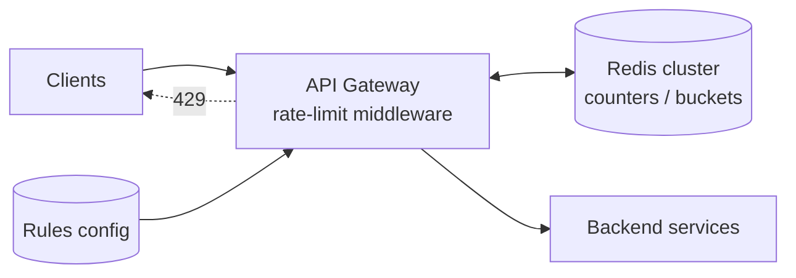

# Design a Rate Limiter

> [!summary]
> Limits how many requests a client can make in a time window. It protects services from abuse, DoS, and runaway clients, and controls cost. It's asked both as **system design** (distributed limiter) and **LLD/coding** (implement token bucket). Key topics: **algorithms**, **where it lives**, **distributed counters in Redis**, **race conditions**.

Back to [[Design Index]]

---

## 1. Requirements
**Functional**
- Limit requests per **client key** (user ID, API key, or IP) per rule (e.g., 100 req/min for `/api/search`, 5 login attempts/min).
- Reject excess requests with **429 Too Many Requests** + headers (`Retry-After`, `X-RateLimit-Limit`, `X-RateLimit-Remaining`, `X-RateLimit-Reset`).
- Rules configurable without redeploy.

**Non-functional**
- Very **low latency** overhead (it's in every request's path): ~1 ms.
- Works across **many API servers** (distributed).
- Highly available: if the limiter fails, **fail open** (allow traffic) for most APIs, or fail closed for sensitive ones (login). State the choice.
- Reasonably accurate (small over-allowance is OK).

## 2. Where does it live?
- **Client-side**: unreliable (clients can bypass it).
- **API Gateway / reverse proxy** (Kong, Envoy, Nginx, AWS API Gateway): centralized, the common answer.
- **Middleware in each service**: flexible per-service rules.
- **Sidecar** in a service mesh.

## 3. Algorithms

### Token bucket (most common: AWS, Stripe)
A bucket holds up to **capacity** tokens, refilled at **rate r** per second. Each request takes 1 token; if empty → reject.
- ✅ Allows **bursts** up to capacity while enforcing an average rate. Memory: 2 values per key.
- Params: capacity (burst size), refill rate.

```javascript
class TokenBucket {
  constructor(capacity, refillPerSec) {
    this.capacity = capacity; this.rate = refillPerSec;
    this.tokens = capacity; this.last = Date.now();
  }
  allow() {
    const now = Date.now();
    this.tokens = Math.min(this.capacity, this.tokens + ((now - this.last) / 1000) * this.rate);
    this.last = now;
    if (this.tokens >= 1) { this.tokens -= 1; return true; }
    return false;
  }
}
```

### Leaky bucket
Requests enter a FIFO queue that's processed at a **constant rate**; overflow is dropped.
- ✅ Smooth, steady output rate (good for protecting a downstream with a fixed capacity). ❌ Bursts get queued/dropped; recent requests can starve.

### Fixed window counter
Count requests per key per fixed window (`user:42:2026-10-16T10:05`). Reset each window.
- ✅ Simple, tiny memory (Redis `INCR` + `EXPIRE`).
- ❌ **Boundary burst**: 100 requests at 10:05:59 + 100 at 10:06:00 = 200 in 2 seconds.

### Sliding window log
Store the **timestamp of every request** (Redis sorted set); count those within the last N seconds.
- ✅ Precise. ❌ Memory-heavy (one entry per request).

### Sliding window counter (hybrid)
Estimate: `count = current_window + previous_window × (overlap fraction)`.
E.g., limit 100/min; 30 s into the current minute; previous = 80, current = 40 → 40 + 80 × 0.5 = 80 → allow.
- ✅ Smooths the boundary problem with fixed-window memory. Slightly approximate. Used by Cloudflare.

| Algorithm | Bursts | Memory | Accuracy | Notes |
|---|---|---|---|---|
| Token bucket | Allowed (configurable) | Low | Good | Default choice |
| Leaky bucket | Smoothed | Low | Good | Constant outflow |
| Fixed window | Boundary spikes | Lowest | Poor at edges | Simplest |
| Sliding log | Precise | High | Exact | Small scale |
| Sliding counter | Smoothed | Low | Approximate | Great balance |

## 4. Distributed design



- Counters live in **Redis** (fast, shared, TTL support), sharded by key across a Redis cluster.
- **Race condition**: two servers read count=99, both increment → 101 allowed. Fixes:
  - Atomic ops: `INCR` returns the new value; check after incrementing.
  - **Lua scripts** in Redis run atomically (read + refill + decrement in one step for token bucket).
- **Latency optimization**: local in-memory pre-check or batched sync to Redis (allow slight inaccuracy); keep Redis in the same AZ.
- **Rules**: stored in config (YAML/DB), cached in gateways, hot-reloaded.
- **Multi-region**: per-region limits (simpler) or async-synced global counters (approximate).
- **Failure**: if Redis is down → fail open (with alerts) to avoid an outage caused by the limiter itself.

```lua
-- Fixed-window in Redis, atomic
local current = redis.call("INCR", KEYS[1])
if current == 1 then redis.call("EXPIRE", KEYS[1], ARGV[1]) end
if current > tonumber(ARGV[2]) then return 0 else return 1 end
```

## 5. Extras to mention
- Different limits per tier (free vs paid), per endpoint, per IP and per user.
- **Rate limiting vs throttling vs load shedding**: rejecting per client vs slowing down vs dropping under global overload.
- Return helpful headers so good clients back off. Clients should use exponential backoff (see [[Reliability & Observability#Retries with exponential backoff + jitter]]).
- Monitoring: count 429s per rule; alert if legit traffic is being limited.
