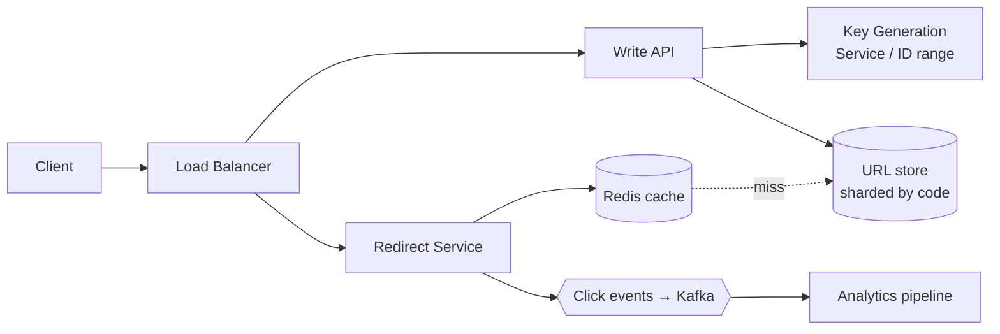

# Design a URL Shortener (TinyURL / bit.ly)

> [!summary]
> The classic warm-up problem. It tests **key generation**, **read-heavy scaling with caching**, **redirect semantics**, and **DB choice**. Practice it end to end in 35–45 minutes using the [[System Design Interview Framework]].

Back to [[Design Index]]

---

## 1. Requirements

**Functional**
1. Given a long URL, return a short URL (`sho.rt/aZ3kP9q`).
2. Visiting the short URL **redirects** to the original.
3. (Optional) Custom aliases, expiration, click analytics.

**Non-functional**
- **Very read-heavy** (~100:1 reads:writes).
- Redirect latency low (< ~50 ms server-side).
- Highly available (a broken link is bad), durable.
- Short codes must be **unique** and preferably **not guessable** (no enumeration).

## 2. Estimates
- 100M new URLs/month → **~40 writes/s**; reads ~**4K/s** (peak ~10–20K/s).
- 5 years × 1.2B/year = **6B URLs** × ~500 B ≈ **3 TB**.
- Code length: base62 (`a-z A-Z 0-9`). 62^6 ≈ 57B, 62^7 ≈ 3.5T → **7 chars** is plenty.
- Cache: hot 20% of daily reads easily fits in a few GB of Redis.

## 3. API
```
POST /api/v1/urls        { longUrl, customAlias?, expiresAt? }  → 201 { shortUrl, code }
GET  /{code}                                                       → 301/302 Location: longUrl
DELETE /api/v1/urls/{code}  (auth)                                 → 204
```

> [!question] 301 vs 302?
> - **301 Moved Permanently**: browsers cache it, so later clicks don't hit your server. Less load, but you **lose analytics**, and you can't change the target.
> - **302 Found / 307 Temporary**: every click hits your server, so analytics work and the target can change. **bit.ly-style services use 301/302 depending on needs; say the tradeoff.**

## 4. Data model
```
urls
  code        VARCHAR(10) PRIMARY KEY
  long_url    TEXT NOT NULL
  user_id     BIGINT NULL
  created_at  TIMESTAMP
  expires_at  TIMESTAMP NULL
```
Access pattern is a **pure key lookup by code**, so a key-value/NoSQL store (DynamoDB, Cassandra) fits perfectly. Postgres also works fine at 3 TB with sharding by code. Either answer is fine with justification.

## 5. High-level design



**Write path:** validate the URL → get a unique code → store `code → longUrl` → return.
**Read path:** look up the code in the **cache** → on a miss, read the DB and populate the cache → return a redirect. Emit a click event **asynchronously** (don't slow the redirect).

## 6. Deep dive: generating the short code

| Approach | How | Pros | Cons |
|---|---|---|---|
| **Hash + truncate** | `base62(md5(longUrl))[0:7]` | Same URL → same code (dedup) | **Collisions** → check DB and rehash/append salt; extra lookups |
| **Counter + base62** | Global auto-increment ID → base62 encode | No collisions; short | Central counter is a bottleneck/SPOF; **sequential codes are guessable** |
| **Counter with ranges** ⭐ | Each app server leases a block of IDs (e.g., 1M) from a coordinator (ZooKeeper/DB) and encodes locally | No collisions, no per-request coordination, scales | Guessable unless you shuffle/obfuscate bits; IDs lost if a server dies (fine) |
| **Pre-generated keys (KGS)** | Offline service generates random unique codes into a "free keys" table; servers grab batches | Random (unguessable), fast, no collisions | Extra service; must mark keys used atomically |
| **Random + check** | Random 7 chars; insert with a unique constraint; retry on conflict | Simple, unguessable | Retries grow as the space fills (negligible at 6B/3.5T) |

```javascript
const ALPHABET = "0123456789abcdefghijklmnopqrstuvwxyzABCDEFGHIJKLMNOPQRSTUVWXYZ";
function toBase62(n) {
  let s = "";
  do { s = ALPHABET[n % 62] + s; n = Math.floor(n / 62); } while (n > 0);
  return s;
}
toBase62(125); // "21"
```

## 7. Other deep dives
- **Caching**: cache-aside with LRU; very high hit rate (popular links). Hot links could even be served from CDN/edge. See [[Caching]].
- **Scaling the DB**: shard by `code` (hash) → even distribution. Read replicas.
- **Custom aliases**: check availability with a unique constraint; reserve offensive words.
- **Expiration**: TTL in DynamoDB/Cassandra, or a lazy check on read + a background cleanup job.
- **Analytics**: async click events → Kafka → stream processor → OLAP store (ClickHouse). Never block the redirect.
- **Abuse**: rate-limit creation per user/IP; scan for malware/phishing URLs (Google Safe Browsing).
- **Availability**: multiple AZs, replicated DB, stateless services.

## 8. Wrap-up talking points
"Read-heavy, so caching + replicas dominate. Key generation uses pre-allocated ID ranges encoded in base62 (or a KGS for unguessable codes). Analytics are async via Kafka. The main remaining risk is a hot-key spike, which a local cache or edge caching handles."
