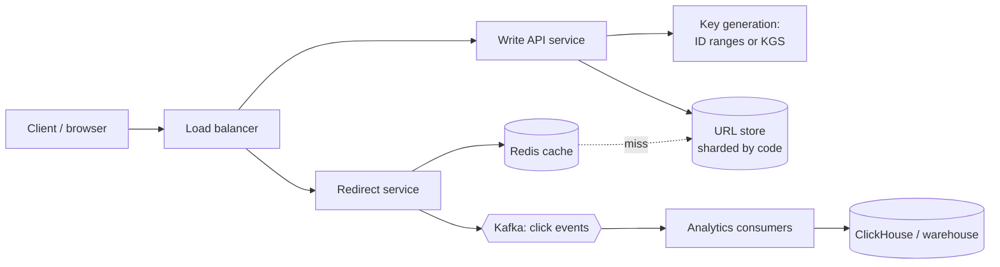

# Design a URL Shortener (TinyURL / bit.ly)

> [!summary] Why this problem
> The classic warm-up. It's small enough to finish in 45 minutes but touches the core skills: **requirements and estimation**, **API design**, **key generation** (the main deep dive), **read-heavy scaling with caching**, **database choice**, **redirect semantics**, and **async analytics**. Practice it end to end, out loud, using the [[System Design Interview Framework]].

Back to [[Design Index]]

---

## 1. Requirements

**Functional (agree on these with the interviewer):**
1. Given a long URL, create a **short URL** (e.g., `sho.rt/aZ3kP9q`).
2. Visiting the short URL **redirects** to the original long URL.
3. Optional: **custom aliases** (`sho.rt/my-sale`), **expiration**, **click analytics** (counts, referrers, countries).

**Out of scope (say so):** user accounts and dashboards beyond basic ownership, link editing, QR codes.

**Non-functional:**
- **Read-heavy**: links are created once and clicked many times (assume ~100:1 reads to writes).
- **Low redirect latency**: the redirect sits between a user and their destination; aim for < ~50 ms server-side.
- **Highly available**: a broken short link is visible to everyone who clicks it (printed on posters, in tweets). Availability beats strict consistency.
- **Durable**: a mapping must never be lost once created.
- **Unique** codes, and preferably **not guessable/enumerable** (otherwise people can crawl private links).

## 2. Back-of-the-envelope estimates
(See [[Back-of-the-Envelope Estimation#Worked example: URL shortener]].)

| Metric | Estimate | Implication |
|---|---|---|
| New URLs | 100M/month → **~40 writes/sec** | Writes are trivial for any database |
| Redirects | 100× → **~4,000 reads/sec** avg, peak ~10–20K/sec | Caching makes this cheap |
| Records over 5 years | ~6 billion | |
| Storage | 6B × ~500 bytes ≈ **3 TB** | Fits a small sharded cluster or managed NoSQL |
| Code length | base62 (`[0-9a-zA-Z]`): 62^6 ≈ 57B, **62^7 ≈ 3.5 trillion** | **7 characters** is plenty |
| Cache | The hot ~20% of daily traffic | A few GB of Redis |

## 3. API
```
POST /api/v1/urls
  body: { "longUrl": "https://example.com/some/very/long/path?x=1", "customAlias": "my-sale", "expiresAt": "2027-01-01T00:00:00Z" }
  → 201 Created  { "code": "aZ3kP9q", "shortUrl": "https://sho.rt/aZ3kP9q", "expiresAt": ... }
  → 409 Conflict if the custom alias is taken
  → 400 if the URL is invalid

GET /{code}
  → 301 or 302, header  Location: https://example.com/some/very/long/path?x=1
  → 404 if unknown, 410 Gone if expired

DELETE /api/v1/urls/{code}       (authenticated owner) → 204
GET    /api/v1/urls/{code}/stats  (authenticated owner) → 200 { clicks, byCountry, byReferrer, ... }
```

### 301 vs 302: a tradeoff interviewers like
| | **301 Moved Permanently** | **302 Found / 307 Temporary Redirect** |
|---|---|---|
| Browser behavior | **Caches** the redirect; later clicks may not even reach your server | Asks your server **every time** |
| Server load | Lower | Higher |
| Analytics | **Lose** repeat clicks (the browser skips you) | Every click is counted |
| Changing or expiring the target | Hard (browsers remember) | Easy |
| **Choose when** | Pure redirection, minimal load | **Analytics, editable/expiring links** (what most commercial shorteners want) |

## 4. Data model
```
urls
  code         VARCHAR(10)  PRIMARY KEY        -- the short code
  long_url     TEXT         NOT NULL
  owner_id     BIGINT       NULL
  created_at   TIMESTAMP    NOT NULL
  expires_at   TIMESTAMP    NULL
```
- The access pattern is a **pure key lookup** (`code → long_url`), with no joins and no complex queries. That makes a **key-value / NoSQL store** (DynamoDB, Cassandra) a natural fit: horizontally scalable, highly available, TTL support for expiration.
- **PostgreSQL also works fine** at 3 TB with the code as primary key, read replicas, and eventually sharding by code. Either choice is acceptable **with justification**.
- If you want "same long URL → same code" deduplication, add an index on a hash of `long_url` (optional, and per user if links are owned).
- Analytics events go to a **separate** store (see below), never as counters updated on the hot redirect path.

## 5. High-level design



**Write path:** validate the URL (format, length, block known malware/phishing domains) → obtain a unique code (deep dive below) → store `code → longUrl` → return the short URL.

**Read (redirect) path:**
1. Look up the code in **Redis**.
2. On a miss, read from the database and **populate the cache** (cache-aside, with a TTL).
3. Return a **302** with the `Location` header (or 404/410).
4. **Asynchronously** emit a click event (code, timestamp, referrer, user agent, IP-derived country) to Kafka. Never block the redirect on analytics.

Separating the write API and the redirect service lets you scale and deploy them independently (the redirect path is far hotter and more latency-sensitive).

## 6. Deep dive: generating short codes

This is the heart of the problem. Requirements: **unique**, **short**, ideally **unpredictable**, and **fast** without a bottleneck.

### Option A: hash the long URL and truncate
`code = base62(md5(longUrl))[0:7]`
- ✅ The same URL always gives the same code (natural dedup); no coordination.
- ❌ **Collisions**: truncating a hash to 7 characters means different URLs will eventually collide. On insert you must check whether the code exists (with a different URL) and, if so, rehash with a salt and try again. Extra DB round trips, and complexity under concurrency (use a unique constraint plus retry).
- ❌ If different users shorten the same URL, they share a code (fine for public links, a problem if links are owned and editable).

### Option B: a global counter, base62-encoded
Assign each new URL the next integer from a counter (1, 2, 3, ...) and encode it in base62.
```javascript
const ALPHABET = "0123456789abcdefghijklmnopqrstuvwxyzABCDEFGHIJKLMNOPQRSTUVWXYZ";
function toBase62(n) {
  let s = "";
  do { s = ALPHABET[n % 62] + s; n = Math.floor(n / 62); } while (n > 0);
  return s;
}
toBase62(1_000_000_000);   // "15FTGg": 6 chars for a billion URLs
```
- ✅ **No collisions**, ever; codes are as short as possible.
- ❌ A **single counter** is a bottleneck and single point of failure (a DB sequence or Redis `INCR` can actually handle ~40 writes/sec easily, but it's a central dependency).
- ❌ **Sequential codes are guessable**: `aZ3kP9q` → try `aZ3kP9r`, and anyone can enumerate every link.

### Option C: counter with pre-allocated ID ranges (recommended)
A small coordination service (ZooKeeper, etcd, or simply a DB row) hands each write server a **block of IDs** (e.g., 1,000,000 at a time). Each server assigns IDs from its block **locally**, with no network call per URL, and requests a new block when it runs out.
- ✅ No collisions, no per-request coordination, scales horizontally, and the coordinator being briefly down doesn't matter (servers have IDs in hand).
- ❌ Unused IDs in a block are lost if a server crashes (irrelevant with 3.5 trillion codes).
- To make codes **non-sequential**, apply a **reversible bit-shuffling/permutation** (or a lightweight block cipher like a Feistel network) to the ID before base62 encoding. Unique IDs map to unique, random-looking codes.

### Option D: pre-generated random keys (Key Generation Service, KGS)
An offline service generates **random unique 7-character codes** ahead of time and stores them in a "free keys" table. Write servers fetch **batches** of keys into memory and hand them out; keys are marked used atomically when fetched.
- ✅ Codes are random (unguessable), allocation is fast, and there are no collisions.
- ❌ Another service and table to operate; must ensure two servers never get the same batch (atomic "claim" operation).

### Option E: random code + insert with a uniqueness check
Generate a random 7-character code and insert it with a **unique constraint**; on conflict, retry with a new random code.
- ✅ Simplest possible; unguessable.
- ❌ Each insert needs a write that may fail; as the space fills, retries increase. With 6B used of 3.5T possible (~0.2%), collisions are very rare, so this is genuinely viable.

| Option | Collisions | Coordination | Guessable? | Complexity |
|---|---|---|---|---|
| Hash + truncate | Yes, handle with retries | None | No | Medium |
| Global counter | No | Central counter | **Yes** | Low |
| **Counter + ID ranges** | No | One call per block | Yes, unless shuffled | Low–medium |
| KGS (pre-generated) | No | Batch fetches | No | Medium |
| Random + unique check | Rare | None | No | Low |

> [!tip] What to say
> "I'd use pre-allocated ID ranges per server so there's no per-request coordination and no collisions, and run each ID through a reversible permutation before base62 so codes aren't sequential. Seven characters gives 3.5 trillion codes, far beyond our 6 billion."

## 7. Other deep dives

### Caching
- **Cache-aside** with Redis, LRU eviction, TTL of hours to days. The hit rate is very high because link popularity is extremely skewed (a viral link gets millions of clicks).
- **Hot links**: add a small in-process cache on redirect servers, or serve very popular redirects from the **CDN/edge** (edge workers can do the lookup and redirect close to users).
- **Negative caching**: cache "not found" briefly to protect the DB from scanners requesting random codes ([[Caching#Cache penetration]]).
- On delete or expiry, **invalidate** the cache entry.

### Scaling the database
- Writes (~40/sec) are not a concern. Reads are mostly absorbed by the cache.
- Add **read replicas** for cache misses; **shard by `code`** (hash-based, which distributes evenly) as data grows. NoSQL stores do this automatically.

### Custom aliases
- Insert with the alias as the key; a unique constraint rejects duplicates → 409.
- Validate characters and length; **reserve** words (`api`, `admin`, `login`) and block offensive terms.
- Keep custom aliases in the same namespace as generated codes (or prefix one of them) so they can't collide.

### Expiration
- Store `expires_at`. Check it **lazily** on read (return 410 if past) and run a **background job** to delete expired rows, or use the database's native **TTL** (DynamoDB TTL, Cassandra TTL).

### Analytics
- The redirect service publishes click events to **Kafka** (fire-and-forget, buffered) → stream processors aggregate (clicks per link per minute, by country, by referrer) → store in an OLAP database (**ClickHouse**, Druid, BigQuery) for the stats dashboard.
- This keeps analytics off the latency-critical path, and a slow analytics system can't break redirects.

### Abuse and security
- **Rate limit** URL creation per user/IP ([[Design a Rate Limiter]]).
- Check destinations against malware/phishing lists (e.g., Google Safe Browsing) at creation and periodically afterward; disable bad links.
- Optionally show an interstitial warning page for flagged links.
- Non-sequential codes prevent enumeration of private links.

### Availability
- Stateless services across multiple availability zones; replicated database; the cache is an optimization, so if Redis fails, the system still works (slower).
- For global users: deploy redirect services in several regions with replicated data (mappings are immutable once created, which makes multi-region replication easy because there are no write conflicts).

## 8. Wrap-up (what to say at the end)
> "It's a read-heavy system, so the redirect path is optimized with Redis caching (and edge caching for the hottest links), and the store is a horizontally scalable key-value database sharded by code. Codes come from pre-allocated ID ranges, permuted and base62-encoded, so there are no collisions and no per-request coordination. Analytics are fully asynchronous through Kafka. I'd monitor redirect p99 latency, cache hit rate, 404 rate (a spike could mean scanning), and Kafka consumer lag. With more time, I'd add multi-region redirects and malware rescanning."

## Common follow-up questions
- *How do you handle 100× traffic on one viral link?* Hot-key caching at the edge or in-process; the DB never sees it.
- *What if two users shorten the same URL?* Either share a code (hash-based dedup) or give each its own (owned links). Discuss the tradeoff.
- *How do you prevent someone from guessing links?* Non-sequential codes (KGS or permutation), plus a large code space.
- *Why not put click counts directly in the URL table?* A row update on every click creates write contention on hot rows and slows redirects; aggregate asynchronously instead.
