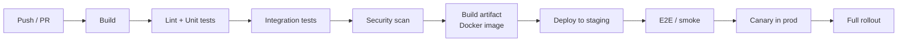

# CI/CD, Deployment & Infrastructure

> [!summary]
> How code gets from your laptop to production safely, many times a day. You'll interact with this daily at any large company: **Git workflows, CI pipelines, containers, Kubernetes, deployment strategies, feature flags, infrastructure as code, and cloud services**.

Back to [[Design Index]] · Related: [[Reliability & Observability]] · [[Testing Strategy]]

---

## Version control workflows
- **Trunk-based development** ⭐: everyone merges small changes to `main` frequently (daily), and unfinished features hide behind **feature flags**. Used by Google and Meta, and recommended by DORA research.
- **GitHub flow**: short-lived feature branch → PR → review → merge to main → deploy.
- **GitFlow**: `develop`, `release/*`, `hotfix/*` branches. Heavier; suits versioned/boxed releases (mobile apps, libraries).
- Know: rebase vs merge, squash merges, resolving conflicts, `git bisect` (find the commit that introduced a bug), conventional commits (`feat:`, `fix:`), semantic versioning (`MAJOR.MINOR.PATCH`).

## CI/CD
- **Continuous Integration**: on every push/PR, automatically **build → lint → unit/integration tests → security scans**. Merge only when green.
- **Continuous Delivery**: every change on main is **deployable** (a release is a button click).
- **Continuous Deployment**: every change that passes the pipeline **auto-deploys** to production.


Tools: GitHub Actions, GitLab CI, Jenkins, CircleCI, Buildkite, ArgoCD (GitOps), Spinnaker.

**DORA metrics** (how high-performing teams are measured): deployment frequency, lead time for changes, change failure rate, time to restore service.

---

## Deployment strategies

| Strategy | How | ✅ | ❌ |
|---|---|---|---|
| **Recreate** | Stop old, start new | Simple | Downtime |
| **Rolling** | Replace instances a few at a time | No downtime; default in Kubernetes | Two versions run at once; slow rollback |
| **Blue-green** | Two identical environments; switch traffic from blue (old) to green (new) at once | Instant switch and **instant rollback** | 2× infrastructure during deploy; DB migrations must suit both |
| **Canary** ⭐ | Route a small % (1% → 5% → 25% → 100%) to the new version, watch metrics, auto-rollback if errors rise | Limits blast radius; real traffic validation | Needs good monitoring and automation |
| **Shadow / dark launch** | Mirror real traffic to the new version without returning its responses | Test under real load safely | Side effects must be suppressed |
| **A/B testing** | Route users by cohort to compare **product** outcomes | Data-driven product decisions | Not a safety mechanism per se |

### Feature flags (toggles)
Decouple **deploy** (code is in prod) from **release** (users see it).
- Gradual rollouts (5% of users), internal dogfooding, kill switches for incidents, A/B experiments.
- Tools: LaunchDarkly, Unleash, Statsig, internal systems.
- Clean up old flags; they're tech debt.

### Database migrations safely: expand → migrate → contract
Never make a breaking schema change in one deploy, because old and new code run simultaneously during rollout.
1. **Expand**: add the new column/table (nullable); deploy code that writes to **both**.
2. **Migrate**: backfill existing data; switch reads to the new column.
3. **Contract**: once nothing uses the old column, remove it in a later deploy.
Tools: Flyway, Liquibase, Prisma Migrate, Knex/Sequelize migrations, Rails/Django migrations.

---

## Containers & orchestration

### Docker
Package an app plus its dependencies into an **image**; run it as an isolated **container** (shares the host kernel → lighter than VMs).
```dockerfile
FROM node:20-alpine
WORKDIR /app
COPY package*.json ./
RUN npm ci --omit=dev
COPY . .
EXPOSE 3000
CMD ["node", "server.js"]
```
Know: image vs container, layers and caching, multi-stage builds, registries (ECR, Docker Hub), `docker compose` for local multi-service dev.

### Kubernetes (K8s)
The standard container orchestrator: schedules containers across a cluster, restarts failures, scales, and handles rollouts.

| Concept | What |
|---|---|
| **Pod** | Smallest unit: one or more containers sharing network/storage |
| **Deployment** | Desired state for stateless pods (replicas, rolling updates) |
| **Service** | Stable network endpoint/load balancing to pods |
| **Ingress** | HTTP routing from outside into Services |
| **ConfigMap / Secret** | Configuration and sensitive values |
| **StatefulSet** | Pods with stable identity/storage (databases, Kafka) |
| **HPA** | Horizontal Pod Autoscaler (scale on CPU/custom metrics) |
| **Namespace** | Logical isolation |
| **Liveness/readiness probes** | Health checks. See [[Reliability & Observability#Health checks]] |
| **Helm** | Package manager/templating for K8s manifests |

(Google runs Borg internally, K8s's ancestor; Amazon teams often use ECS/EKS or internal tooling. Expect company-specific tools, but the concepts transfer.)

---

## Infrastructure as Code (IaC)
Define infrastructure in versioned, reviewable code instead of clicking in consoles.
- **Terraform** (multi-cloud, declarative; OpenTofu is the open-source fork), **AWS CloudFormation/CDK**, **Pulumi** (real programming languages).
- Benefits: reproducible environments, code review for infra, drift detection.
- **GitOps**: the Git repo is the source of truth; tools like ArgoCD/Flux sync the cluster to it.

## Environments
`local → dev → staging (prod-like) → production`. Config via environment variables (12-factor). Keep staging as close to prod as practical.

### The Twelve-Factor App (cloud-native principles; skim these)
Codebase in VCS · explicit dependencies · **config in env vars** · backing services as attached resources · strict build/release/run separation · **stateless processes** · port binding · scale out via processes · disposability (fast start, graceful shutdown) · dev/prod parity · **logs as event streams** · admin tasks as one-off processes.

---

## Cloud services map (AWS names, with GCP/Azure equivalents)

| Need | AWS | GCP | Azure |
|---|---|---|---|
| VMs | EC2 | Compute Engine | Virtual Machines |
| Containers (managed K8s) | EKS / ECS / Fargate | GKE / Cloud Run | AKS / Container Apps |
| Serverless functions | Lambda | Cloud Functions / Cloud Run | Functions |
| Object storage | S3 | Cloud Storage | Blob Storage |
| Relational DB | RDS / Aurora | Cloud SQL / AlloyDB / Spanner | Azure SQL / PostgreSQL |
| NoSQL | DynamoDB | Firestore / Bigtable | Cosmos DB |
| Cache | ElastiCache (Redis/Valkey) | Memorystore | Azure Cache for Redis |
| Queue / pub-sub | SQS / SNS / EventBridge | Pub/Sub | Service Bus / Event Grid |
| Streaming | Kinesis / MSK (Kafka) | Pub/Sub / Dataflow | Event Hubs |
| CDN | CloudFront | Cloud CDN | Front Door / CDN |
| DNS | Route 53 | Cloud DNS | Azure DNS |
| Load balancer | ALB / NLB | Cloud Load Balancing | Load Balancer / App Gateway |
| Data warehouse | Redshift | BigQuery | Synapse |
| Secrets | Secrets Manager / KMS | Secret Manager / KMS | Key Vault |
| Monitoring | CloudWatch / X-Ray | Cloud Monitoring / Trace | Monitor / App Insights |
| IAM | IAM | IAM | Entra ID / RBAC |

**Regions & Availability Zones**: a region is a geographic area containing multiple isolated AZs (datacenters). Deploy across ≥ 2–3 AZs for high availability; multi-region for disaster recovery and global latency.

## Self-test
- [ ] Canary vs blue-green: when would you choose each?
- [ ] How do feature flags separate deploy from release?
- [ ] Walk through renaming a DB column with zero downtime.
- [ ] Pod vs Deployment vs Service in Kubernetes.
- [ ] Why trunk-based development?
