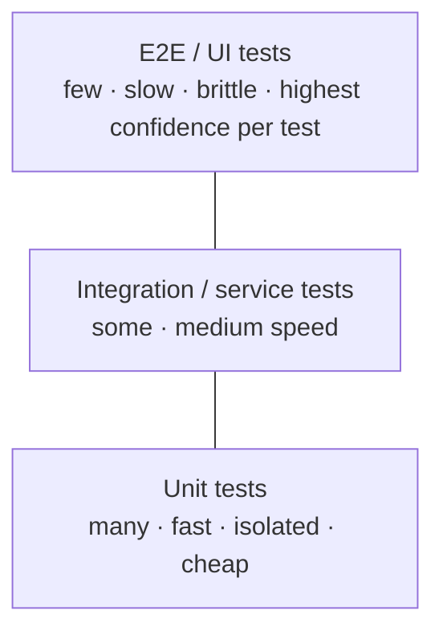

# Testing Strategy

> [!summary] What you'll learn
> Why automated tests matter, the different **levels of testing** (unit, integration, contract, end-to-end) and what each is good for, the **test pyramid** and its alternatives, **test doubles** (mocks, stubs, fakes, spies) and when to use them, how to write **good tests**, **TDD**, **coverage**, and specialized testing (performance, security, property-based). Testability is also a **design** property: code that's hard to test is usually tightly coupled, which connects this note to [[SOLID Principles#D — Dependency Inversion Principle (DIP)|DIP]] and dependency injection.

Back to [[Design Index]] · Related: [[CI-CD & Deployment]]

---

## Why automated tests?
1. **Confidence to change code.** Without tests, every refactor or new feature risks silently breaking something. Tests let teams deploy many times a day.
2. **Catch bugs early**, when they're cheapest to fix (in CI minutes after writing them, not in production weeks later).
3. **Living documentation**: tests show exactly how code is meant to be used and what it guarantees.
4. **Better design**: writing a test for code is the first time it gets "used," and hard-to-test code reveals coupling problems.
5. **Required at large companies**: code review will ask for tests, and CI blocks merges when tests fail.

---

## The levels of testing

### Unit tests
- **What:** test a **single unit** (a function, class, or module) **in isolation**, with dependencies replaced by test doubles when they involve I/O.
- **Speed:** milliseconds each. Thousands run in seconds.
- **Good at:** business logic, calculations, edge cases, branching. Pinpointing exactly what broke.
- **Limits:** don't prove that units work **together** or that real dependencies behave as assumed.

```javascript
// pricing.js
export function applyDiscount(subtotalCents, { tier, couponPercent = 0 }) {
  if (subtotalCents < 0) throw new Error("Subtotal cannot be negative");
  const tierPercent = { regular: 0, member: 10, vip: 20 }[tier] ?? 0;
  const percent = Math.min(tierPercent + couponPercent, 50);        // cap total discount at 50%
  return Math.round(subtotalCents * (1 - percent / 100));
}

// pricing.test.js (Jest/Vitest)
describe("applyDiscount", () => {
  it("applies the member discount", () => {
    expect(applyDiscount(10_000, { tier: "member" })).toBe(9_000);
  });
  it("stacks tier and coupon discounts", () => {
    expect(applyDiscount(10_000, { tier: "member", couponPercent: 15 })).toBe(7_500);
  });
  it("caps the total discount at 50%", () => {
    expect(applyDiscount(10_000, { tier: "vip", couponPercent: 40 })).toBe(5_000);
  });
  it("treats unknown tiers as regular", () => {
    expect(applyDiscount(10_000, { tier: "platinum" })).toBe(10_000);
  });
  it("rejects negative subtotals", () => {
    expect(() => applyDiscount(-1, { tier: "regular" })).toThrow("negative");
  });
});
```

### Integration tests
- **What:** test **several components together**, often with **real infrastructure**: your service plus a real Postgres, Redis, or message broker running in Docker; or an HTTP endpoint through its middleware, controller, service, and repository.
- **Speed:** seconds each.
- **Good at:** catching problems at the **boundaries**: SQL that doesn't work, wrong ORM mappings, transaction behavior, serialization, middleware ordering, configuration.
- **Tools:** **Supertest** (HTTP against an Express app), **Testcontainers** (spin up real databases in Docker per test run), docker-compose test environments.

```javascript
// orders.int.test.js: real Express app + real Postgres (Testcontainers)
import request from "supertest";
import { app } from "../app.js";

it("creates an order and returns 201", async () => {
  const res = await request(app)
    .post("/orders")
    .set("Authorization", `Bearer ${testToken}`)
    .send({ items: [{ sku: "KC-01", qty: 2 }] });

  expect(res.status).toBe(201);
  const row = await db.query("SELECT * FROM orders WHERE id = $1", [res.body.id]);
  expect(row.rows[0].status).toBe("placed");
});
```

### Contract tests
- **The problem:** in microservices, service A (the consumer) calls service B (the provider). Unit tests of A mock B, so they pass even if B changes its API. Full end-to-end tests catch it, but they're slow and flaky.
- **What:** the consumer records its **expectations** of the provider's API (a "contract": "GET /users/42 returns `{ id, email }`"); the provider's CI **verifies** it still satisfies every consumer's contract. Breaking changes are caught **before deploy**, without spinning up both services together.
- **Tools:** **Pact**, Spring Cloud Contract; schema checks with OpenAPI or Protobuf compatibility tools.

### End-to-end (E2E) tests
- **What:** test the **whole system** the way a user does: a real browser clicking through the UI, against a deployed environment with real services.
- **Speed:** seconds to minutes each.
- **Good at:** confidence that **critical user journeys** work (sign up, log in, checkout).
- **Limits:** **slow, expensive, and flaky** (timing issues, test data, environment problems); when they fail, the cause can be anywhere. Keep them **few**, covering only the most important flows.
- **Tools:** **Playwright** (popular, fast, multi-browser), Cypress, Selenium.

```javascript
// checkout.e2e.spec.js (Playwright)
import { test, expect } from "@playwright/test";

test("guest can buy a keycap set", async ({ page }) => {
  await page.goto("/products/cherry-mx-set");
  await page.getByRole("button", { name: "Add to cart" }).click();
  await page.getByRole("link", { name: "Checkout" }).click();
  await page.getByLabel("Email").fill("test@example.com");
  await page.getByRole("button", { name: "Place order" }).click();
  await expect(page.getByText("Thanks for your order")).toBeVisible();
});
```

---

## The test pyramid


**The idea** (Mike Cohn): have **many** fast, cheap unit tests at the base, **fewer** integration tests in the middle, and **very few** slow E2E tests at the top. This gives fast feedback and broad coverage without a slow, flaky test suite.

**The "ice cream cone" anti-pattern** is the inverse: mostly manual and E2E tests, few unit tests. The result is slow feedback, flaky CI, and bugs found late.

### Alternatives you'll hear about
- **Testing Trophy** (Kent C. Dodds, popular in frontend): static analysis (TypeScript, ESLint) at the base, then unit tests, then the **largest layer: integration tests**, then a few E2E tests. The argument: for UIs, testing components the way users use them (React Testing Library) gives more confidence per test than testing implementation details. "Write tests. Not too many. Mostly integration."
- **Testing Honeycomb** (Spotify, for microservices): mostly **integration** tests of each service through its API, with fewer pure unit tests and very few cross-service E2E tests.

The common principle across all of them: **get the most confidence for the least cost and flakiness**, and choose the level that matches the risk.

---

## Other kinds of tests

| Type | Purpose | Tools / notes |
|---|---|---|
| **Static analysis** | Catch type errors, unused code, likely bugs without running anything | TypeScript, ESLint, SonarQube |
| **Smoke tests** | A quick "is it alive?" check after a deploy (home page loads, health endpoint OK, can log in) | Run automatically post-deploy |
| **Regression tests** | Ensure a fixed bug **stays fixed** | Rule: **every bug fix comes with a test that would have caught it** |
| **Performance / load tests** | Measure latency and throughput at expected load; find the breaking point before users do | k6, JMeter, Gatling, Locust, Artillery |
| **Stress tests** | Push beyond capacity to see how the system fails (gracefully?) | |
| **Soak (endurance) tests** | Run at normal load for hours or days to find memory leaks and resource exhaustion | |
| **Chaos tests** | Inject failures (kill instances, add latency) to verify resilience | See [[Reliability & Observability#Chaos engineering]] |
| **Security tests** | **SAST** (static code scanning), **DAST** (scanning a running app), dependency scanning, penetration tests | Snyk, Semgrep, OWASP ZAP, CodeQL |
| **Snapshot tests** | Compare rendered output against a stored snapshot | Easy to overuse; people blindly accept updated snapshots. Keep them small and focused |
| **Property-based tests** | Generate hundreds of random inputs and check that **invariants** always hold ("sorting twice equals sorting once"; "decode(encode(x)) === x") | fast-check (JS), Hypothesis (Python). Great at finding edge cases you didn't think of |
| **Mutation testing** | Automatically introduce small bugs ("mutants") into the code and check whether tests fail; surviving mutants reveal weak tests | Stryker (JS), PIT (Java) |
| **Accessibility tests** | Catch a11y issues (missing labels, contrast) | axe-core, Lighthouse |
| **Visual regression** | Detect unintended UI changes via screenshot diffs | Chromatic, Percy |
| **A/B tests** | Product experiments in production comparing variants on real metrics | Not correctness tests, but you'll hear the term constantly |

---

## Test doubles

When the code under test depends on something slow, non-deterministic, expensive, or external (a database, an email provider, the current time, randomness), tests replace it with a **test double**. (The term comes from "stunt double." Gerard Meszaros's taxonomy.)

| Double | What it is | Example |
|---|---|---|
| **Dummy** | Passed around to fill a parameter, never actually used | `new OrderService(db, null /* logger not used here */)` |
| **Stub** | Returns **canned answers** to calls | `paymentGateway.charge = async () => ({ status: "succeeded" })` |
| **Fake** | A **working, lightweight implementation** | An in-memory repository backed by a `Map`; an in-memory email outbox |
| **Spy** | Records **how it was called** so you can assert on it afterward | `const send = jest.fn(); ... expect(send).toHaveBeenCalledWith(...)` |
| **Mock** | Pre-programmed with **expectations** about calls, and verifies them | Expect `charge` to be called exactly once with 5000 cents |

In everyday speech (and in Jest), "mock" is used loosely for all of these.

```javascript
// Dependency injection makes doubles easy: no monkey-patching needed
class ShippingService {
  constructor({ orders, notifier, clock = () => new Date() }) { Object.assign(this, { orders, notifier, clock }); }
  async markShipped(orderId) {
    const order = await this.orders.findById(orderId);
    if (!order) throw new Error("Order not found");
    order.status = "shipped";
    order.shippedAt = this.clock();
    await this.orders.save(order);
    await this.notifier.send(order.userId, `Order ${order.id} has shipped!`);
  }
}

test("marks the order shipped and notifies the customer", async () => {
  const orders = new InMemoryOrderRepo([{ id: "o1", userId: "u7", status: "paid" }]);   // fake
  const notifier = { send: jest.fn() };                                                // spy
  const fixedTime = new Date("2026-11-01T10:00:00Z");
  const svc = new ShippingService({ orders, notifier, clock: () => fixedTime });       // stubbed clock

  await svc.markShipped("o1");

  expect((await orders.findById("o1")).status).toBe("shipped");
  expect((await orders.findById("o1")).shippedAt).toEqual(fixedTime);
  expect(notifier.send).toHaveBeenCalledWith("u7", expect.stringContaining("shipped"));
});
```

### When to use doubles, and when not
- ✅ Replace things at **system boundaries**: network calls to other services and third-party APIs, email/SMS, payment providers, the **clock**, **randomness**, and the filesystem.
- ✅ Use **fakes** for repositories in unit tests of business logic (fast and realistic).
- ⚠️ For the **database**, prefer **real** databases in integration tests (Testcontainers) over mocking the query layer. Mocked SQL tests pass while the real SQL is broken.

> [!warning] Over-mocking
> Tests that mock every collaborator end up asserting **implementation details** ("method X called method Y with Z"). They break on every refactor even when behavior is unchanged, and they pass even when the real integration is broken. **Test behavior through public interfaces; mock only at boundaries.**

---

## Writing good tests

### Properties of good unit tests: FIRST
- **Fast**: milliseconds, so the whole suite runs constantly.
- **Isolated / Independent**: no test depends on another's side effects or on execution order.
- **Repeatable**: same result every time, on every machine. No real time, randomness, or network unless controlled.
- **Self-validating**: pass or fail automatically (assertions), with no manual log inspection.
- **Timely**: written alongside (or before) the code.

### Structure: Arrange–Act–Assert (Given–When–Then)
```javascript
it("rejects withdrawal exceeding balance", () => {
  // Arrange (Given)
  const account = new BankAccount();
  account.deposit(100);
  // Act (When) + Assert (Then)
  expect(() => account.withdraw(150)).toThrow("Insufficient funds");
  expect(account.balance).toBe(100);           // state unchanged
});
```

### More guidelines
- **One behavior per test**, with a **descriptive name** that reads like a specification: `"returns 429 when the rate limit is exceeded"`, not `"test2"`.
- **Test edge cases**: empty inputs, zero, negative numbers, maximum sizes, null/undefined, unicode, duplicates, boundaries (exactly at the limit), time zones and daylight-saving transitions, concurrency.
- **Test error paths**, not just the happy path.
- **Avoid logic in tests** (loops and conditionals): tests should be obviously correct.
- **Make failures informative**: a failing test should tell you what broke without a debugger.
- **Fix or delete flaky tests promptly.** A flaky test (passes sometimes, fails sometimes) teaches the team to ignore red builds, which defeats the purpose of CI. Common causes: timing and `sleep` calls, shared state between tests, dependence on test order, real network calls, unseeded randomness, and time-of-day dependencies.
- **Keep test data minimal and explicit**: use **test data builders** or factories (`aUser().withRole("admin").build()`, see [[Creational Patterns#Builder]]) so each test shows only the details that matter to it.

---

## TDD (Test-Driven Development)

**The cycle: Red → Green → Refactor** (Kent Beck):
1. **Red**: write a small test for the next bit of behavior. Run it and watch it **fail** (proving the test actually tests something).
2. **Green**: write the **minimum** code to make it pass.
3. **Refactor**: clean up the code (and tests) with the tests as a safety net.
4. Repeat in small steps.

**Benefits:** forces you to think about the interface and behavior before implementation; naturally produces testable, decoupled designs; gives a comprehensive regression suite; keeps scope small.
**Criticisms:** slower for exploratory or UI-heavy work; can lead to over-mocked designs if done mechanically.
In practice, many engineers use TDD selectively: for business logic, bug fixes (write the failing regression test first), and well-understood algorithms.

**BDD (Behavior-Driven Development)** extends TDD with specifications in business language, often in the **Gherkin** format:
```gherkin
Feature: Free shipping
  Scenario: Order over the threshold
    Given a cart with a subtotal of $60
    When the customer checks out
    Then shipping should be free
```
Tools like Cucumber map these steps to code.

---

## Code coverage
- **Line coverage**: percentage of lines executed by tests. **Branch coverage**: percentage of `if/else` branches taken (more meaningful).
- Coverage tells you what is **definitely untested**. It does **not** tell you whether the tests are good: 100% coverage with weak or missing assertions catches nothing.
- Many teams aim for roughly **70–80%** overall, with higher expectations for critical code (payments, auth, core business logic), and enforce "don't decrease coverage" checks in CI rather than chasing 100%.

---

## Testing in production (enterprise reality)
No staging environment perfectly matches production, so large companies also verify changes **in production**, safely:
- **Feature flags** and gradual rollouts (1% → 10% → 100%), with automatic rollback on error spikes.
- **Canary deployments** compared against the stable version's metrics.
- **Synthetic monitoring**: automated scripts that continuously run key user journeys against production and alert on failure.
- **Dark launches / shadow traffic**: run the new code path on real traffic without showing users the result, and compare outputs.
See [[CI-CD & Deployment]].

---

## Quick self-test
- [ ] Unit vs integration vs contract vs E2E: what does each catch that the others don't?
- [ ] Explain the test pyramid and why E2E tests should be few. What's the testing trophy, and why is it popular for frontends?
- [ ] Dummy vs stub vs fake vs spy vs mock, with an example of each.
- [ ] How does dependency injection make code testable? Rewrite a class that does `new EmailClient()` internally to be testable.
- [ ] What should you mock, and what should you not? What's the danger of over-mocking?
- [ ] What makes a test flaky? Name four causes and fixes.
- [ ] Walk through the TDD cycle. When is TDD most useful?
- [ ] Why is 100% coverage not a good goal?
- [ ] What's contract testing, and why is it useful for microservices?

Next: [[CI-CD & Deployment]]
