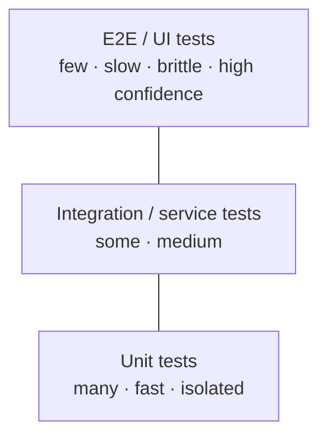

# Testing Strategy

> [!summary]
> Good design and testability go hand in hand: code that's hard to test is usually tightly coupled (see [[SOLID Principles#D — Dependency Inversion Principle (DIP)|DIP]]). Know the **test pyramid**, **test doubles**, **TDD**, and what each layer of testing is for.

Back to [[Design Index]]

---

## The test pyramid



| Level | Tests | Speed | Example tools (JS / Java / Python) |
|---|---|---|---|
| **Unit** | One function/class in isolation; dependencies faked | ms | Jest, Vitest, Mocha / JUnit, Mockito / pytest |
| **Integration** | Several components together, e.g. service + real DB (in Docker) | seconds | Supertest, Testcontainers |
| **Contract** | Consumer and provider agree on API shape without full E2E | fast | Pact |
| **End-to-end (E2E)** | Whole system through the UI/API like a user | slow | Playwright, Cypress, Selenium |

Alternative models: the **testing trophy** (Kent C. Dodds) emphasizes **integration tests** for frontends; the **honeycomb** suits microservices (mostly integration/contract).

## Other test types
- **Smoke tests**: quick "is it alive?" checks after deploy.
- **Regression tests**: make sure old bugs stay fixed (add a test with every bug fix).
- **Performance/load tests**: k6, JMeter, Gatling, Locust. Find limits before users do.
- **Stress / soak tests**: beyond capacity / over long durations (memory leaks).
- **Chaos tests**: see [[Reliability & Observability#Chaos engineering]].
- **Security tests**: SAST (static analysis), DAST (dynamic scanning), dependency scanning, pen tests.
- **Snapshot tests**: UI output compared to a stored snapshot. Easy to over-use.
- **Property-based tests**: generate many random inputs to check invariants (fast-check, Hypothesis).
- **Mutation testing**: mutate code to see if the tests catch it (measures test quality).
- **A/B tests**: product experiments in production (not correctness tests).

## Test doubles

| Double | What it does |
|---|---|
| **Dummy** | Passed around, never used |
| **Stub** | Returns canned answers |
| **Fake** | Working lightweight implementation (in-memory DB/repo) |
| **Spy** | Records how it was called |
| **Mock** | Pre-programmed with expectations; verifies interactions |

```javascript
// Unit test with an injected fake (thanks, dependency injection)
test("notifies user when order ships", async () => {
  const sender = { send: jest.fn() };                  // spy/mock
  const svc = new ShippingService({ sender, orders: new InMemoryOrderRepo([{ id: 1, userId: 7 }]) });
  await svc.markShipped(1);
  expect(sender.send).toHaveBeenCalledWith(7, expect.stringContaining("shipped"));
});
```

> [!warning] Over-mocking
> Tests that mock everything verify implementation details and break on every refactor. Prefer testing **behavior through public interfaces**; mock only at **boundaries** (network, time, randomness, third-party APIs).

## Good unit tests are FIRST
**Fast, Isolated/Independent, Repeatable, Self-validating, Timely.**
Structure: **Arrange – Act – Assert** (or Given–When–Then).
One behavior per test; descriptive names: `returns 429 when limit exceeded`.

## TDD (Test-Driven Development)
**Red → Green → Refactor**: write a failing test, write the minimal code to pass, then clean up.
- ✅ Drives testable design, gives a safety net, keeps scope small.
- Not universally practiced, but understanding it is expected.
- **BDD**: behavior specs in business language (Gherkin `Given/When/Then`, Cucumber).

## Coverage
- Line/branch coverage is a **signal, not a goal**. 100% coverage with weak assertions is worthless.
- Teams often target ~70–80% with focus on critical paths.

## Testing in production (enterprise reality)
- Feature flags, canaries, synthetic monitoring, dark launches, shadow traffic. See [[CI-CD & Deployment]].

## Self-test
- [ ] Explain the test pyramid and why E2E tests should be few.
- [ ] Mock vs stub vs fake.
- [ ] How does dependency injection make code testable?
- [ ] What's contract testing, and why is it useful for microservices?
