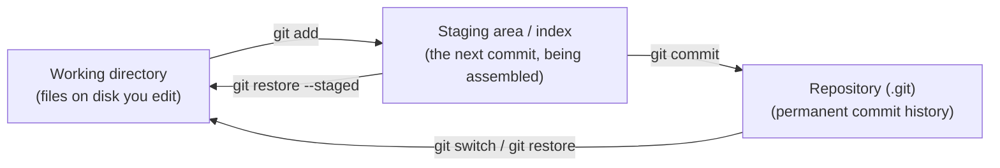
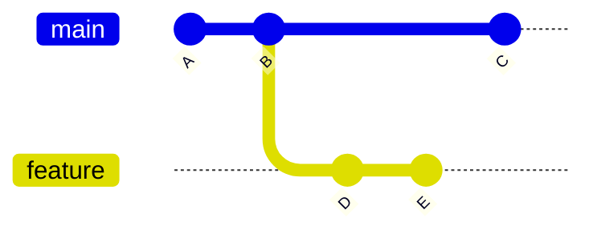

# How Git Thinks

> [!summary] What you'll learn
> Most Git fear comes from not knowing **what Git is actually storing** and **what each command changes**. Once you have the right mental model, commands like `reset`, `rebase` and `checkout` stop feeling like magic spells and start feeling like "move this pointer" or "copy that snapshot."
>
> This note covers: commits as **snapshots**, the **three places your code lives** (working directory, staging area, repository), **branches as movable labels**, what **HEAD** is, and the big one: **why committed work is very hard to lose**, and which work *can* actually be lost.

Back to [[00 Git Index]] · Next: [[02 Setup and Your First Commit]]

---

## A commit is a snapshot, not a diff

When you run `git commit`, Git saves a **complete snapshot** of every tracked file as it looked in the staging area at that moment. (Internally it's efficient: files that didn't change are stored once and shared between snapshots.)

Each commit records:

| Part | What it is |
|---|---|
| **Snapshot** | The full contents of every tracked file |
| **Parent(s)** | The commit(s) that came right before it. A normal commit has one parent, a merge commit has two, the very first commit has none |
| **Author + committer** | Name, email and timestamp |
| **Message** | Your description of the change |
| **ID (hash)** | A 40-character SHA-1 like `c9a6f53e1b...`, computed from everything above. You usually use the first 7 characters |

Two consequences of this design matter a lot:

1. **A commit can never be changed.** Its ID is a fingerprint of its contents *and its parent*. Change anything (the message, a file, the parent) and you get a **different commit with a different ID**. Commands that seem to "edit" history (`commit --amend`, `rebase`) actually **create new commits** and move a label to them. The old commits still exist.
2. **History is a chain of parent pointers.** Each commit points back to its parent, so a commit "knows" its entire history. That's how `git log` works: start somewhere and walk backwards.

When Git *shows* you a diff (`git show`, `git log -p`), it's computing it on the fly by comparing a snapshot with its parent's snapshot.

---

## The three places your code lives

This is the single most important picture in Git:



| Place | What it is | How things get there |
|---|---|---|
| **Working directory** (working tree) | The actual files in your project folder that your editor opens | You edit them |
| **Staging area** (also called the **index**) | A draft of your **next commit**. It starts as a copy of the last commit; `git add` updates it | `git add <file>` copies the file's current contents into the draft |
| **Repository** | The `.git` folder: every commit, branch and tag ever made | `git commit` turns the staging area into a permanent snapshot |

### Why the staging area exists

Beginners often wonder why Git doesn't just commit whatever changed. The staging area lets you **choose what goes into each commit**. Say you fixed a bug *and* reformatted a file *and* left some debug `console.log`s. You can stage just the bug fix, commit it with a clear message, then stage the formatting as a separate commit, and never stage the debug lines. Small, focused commits are much easier for teammates to review and much easier to undo later.

A subtle point: `git add` stages the file **as it is at that moment**. If you edit the file again after `git add`, the new edits are *not* staged. `git status` will show the same file under both "Changes to be committed" and "Changes not staged for commit." That's normal; run `git add` again to include the newer edits.

### Tracked vs untracked

- **Tracked** files are ones Git knows about: they were in the last commit or have been staged.
- **Untracked** files are new files Git has never been told about. Git won't include them in commits until you `git add` them, and **Git can't restore them if you delete them**, because it never had a copy.
- **Ignored** files match a pattern in `.gitignore` (like `node_modules/` or `.env`). Git pretends they don't exist.

---

## Branches are just movable labels

This is where most people's mental model is wrong. A branch is **not** a copy of your code or a folder. A branch is a **tiny file containing one commit ID**. That's it.



Here `main` is a label pointing at commit `C`, and `feature` is a label pointing at `E`. Commits `A` and `B` belong to both branches' histories.

- **Creating a branch** = creating a new label pointing at the current commit. It's instant and copies no files.
- **Committing on a branch** = making a new commit whose parent is where the label points, then **moving the label forward** to the new commit.
- **Deleting a branch** = deleting the label. The commits stay in the repository (see "why work is hard to lose" below).

Once you see branches as labels, many "scary" commands become simple:

| Command | What it really does |
|---|---|
| `git branch feature` | Make a new label `feature` pointing at the current commit |
| `git reset --hard abc123` | Move the current branch's label to `abc123` (and make your files match) |
| `git merge feature` | Create a commit that combines two histories, or just slide the label forward if possible |
| `git rebase main` | Copy your commits onto a new base, then move your label to the copies |

## HEAD: "where you are right now"

**HEAD** is Git's name for "the commit you currently have checked out." Usually HEAD points at a **branch**, which in turn points at a commit:

```text
HEAD -> main -> C
```

When you commit, the branch HEAD points to moves forward, and HEAD comes along.

You'll see HEAD used in commands as a reference point:
- `HEAD` = the current commit
- `HEAD~1` (or `HEAD~`) = its parent, one commit back
- `HEAD~3` = three commits back
- `HEAD^2` = the *second* parent of a merge commit (rarely needed)

### Detached HEAD

If you check out a specific commit instead of a branch (`git switch --detach abc123`, or check out a tag), HEAD points **directly at a commit** with no branch in between. Git calls this **detached HEAD**:

```text
HEAD detached at de4543c
```

It sounds alarming but it isn't broken. It's useful for looking around at old code. The only catch: if you make commits here, **no branch label points at them**, so once you switch away they're hard to find. If you want to keep work you did in detached HEAD, give it a label before leaving: `git switch -c my-new-branch`. See [[11 Recovery Cookbook#I made commits in detached HEAD]].

---

## Local vs remote

Your repository is **complete on your own machine**. Every clone has the full history. GitHub is just another copy that the team agrees to treat as the shared source of truth.

- **`origin`** is the default nickname for the remote you cloned from (or added).
- **`origin/main`** is a **remote-tracking branch**: your local, read-only memory of where `main` was on GitHub *the last time you talked to it*. It only updates when you `git fetch` (or `git pull`, which fetches). It is **not** live.
- **`main`** is your local branch. It's only connected to `origin/main` through the commands you run.

This is why "my branch is up to date with 'origin/main'" can be a lie: it means "up to date with what I last fetched." Run `git fetch` first if you want the truth. More in [[05 Remotes - Fetch, Pull, Push]].

---

## Why committed work is very hard to lose

This is the key to feeling safe with Git:

> [!tip] The safety rule
> **Once something is committed, Git almost never deletes it.** Commands like `reset`, `rebase`, `commit --amend` and `branch -D` move or remove **labels**. The commits themselves stay in the repository, and Git keeps a log of everywhere HEAD and each branch has pointed (the **reflog**) for **90 days by default** (30 days for commits nothing points to any more).

So if you `reset --hard` to the wrong place, or a rebase goes badly, or you delete a branch, you can almost always get it back with `git reflog`. That's covered step by step in [[09 Undoing Things Safely#The reflog is your safety net]].

### What *can* actually be lost

Be careful with work Git has **never seen**:

| Risky situation | Why it's risky |
|---|---|
| **Uncommitted changes to tracked files** + `git reset --hard`, `git restore <file>`, `git checkout -- <file>`, `git switch --discard-changes` | These overwrite your working files with a committed version. Edits that were never committed (or at least staged) are gone |
| **Untracked files** + `git clean -f` | `clean` deletes files Git doesn't track, and Git never had a copy |
| **Force-pushing** over commits a teammate pushed | Their commits disappear from the shared branch (they may still have a local copy, but you've made a mess). See [[05 Remotes - Fetch, Pull, Push#Force pushing safely]] |
| Commits not reachable from any branch, **after the reflog expires** (months) | Git's garbage collection eventually removes them |

That leads to the single most useful habit in this whole guide:

> [!important] Commit early, commit often (on a branch)
> A messy "WIP" commit on your own branch is **infinitely safer** than perfect uncommitted changes. You can clean up the commits later with an interactive rebase ([[08 Rebasing#Interactive rebase for cleaning up your commits]]) before anyone reviews them. Committed = recoverable.

And the second most useful habit: **run `git status` before and after every command you're unsure about.** It tells you which branch you're on, whether anything is uncommitted, and whether you're in the middle of a merge or rebase, usually with hints about what to do next.

---

## Quick self-test
- [ ] What does a commit contain? Why can't a commit ever be modified?
- [ ] Name the three places your code lives and the command that moves changes between each.
- [ ] Why does the staging area exist? Give a real example of when it helps.
- [ ] What is a branch, physically? What happens to the branch when you commit?
- [ ] What is HEAD? What does "detached HEAD" mean and how do you keep commits made there?
- [ ] What's the difference between `main` and `origin/main`? When does `origin/main` update?
- [ ] Which kinds of work can Git recover, and which kinds can be permanently lost?

Next: [[02 Setup and Your First Commit]]
