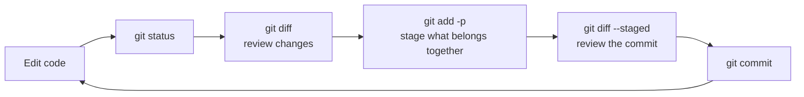

# The Everyday Loop

> [!summary] What you'll learn
> You already know `add`, `commit`, `push`. This note makes that loop **deliberate**: read `git status` properly, **review your changes with `git diff` before committing**, stage only part of a file with `git add -p`, write commit messages teammates appreciate, and explore history with `git log` and `git show`. It also covers small, safe fixes like `--amend` and unstaging.

Back to [[00 Git Index]] · Prev: [[02 Setup and Your First Commit]] · Next: [[04 Branches and Merging]]

---

## The loop



The two steps most self-taught developers skip are the **reviews**: `git diff` before staging and `git diff --staged` before committing. They take seconds and catch leftover `console.log`s, accidental file changes and secrets before they become history.

---

## `git status`: your dashboard

Run it constantly. A typical output mid-work:

```text
On branch feature/login
Your branch is ahead of 'origin/feature/login' by 1 commit.
  (use "git push" to publish your local commits)

Changes to be committed:
  (use "git restore --staged <file>..." to unstage)
	modified:   src/auth.js

Changes not staged for commit:
  (use "git add <file>..." to update what will be committed)
  (use "git restore <file>..." to discard changes in working directory)
	modified:   src/auth.js
	modified:   src/login.jsx

Untracked files:
  (use "git add <file>..." to include in what will be committed)
	src/session.js
```

How to read it, top to bottom:
1. **Which branch you're on.** Check this before committing. Committing to the wrong branch is the most common mistake (and is fixable: [[11 Recovery Cookbook#I committed to the wrong branch]]).
2. **Ahead/behind** compared to the remote branch, *as of your last fetch*.
3. **Changes to be committed:** what's staged (goes into the next commit).
4. **Changes not staged:** tracked files edited since you last staged them. `auth.js` appears in both sections: part of it is staged, and there are newer edits that aren't.
5. **Untracked:** new files Git has never seen.

Git even prints the command to undo each state. During a merge or rebase, `status` also tells you that you're mid-operation and how to continue or abort.

**Short form:** `git status -s` shows two columns per file (left = staged, right = unstaged): `M ` staged modification, ` M` unstaged modification, `MM` both, `??` untracked, `A ` new file staged, `UU` conflict.

---

## `git diff`: see exactly what changed

| Command | Compares | Use it to |
|---|---|---|
| `git diff` | Working directory vs staging area | See edits you **haven't staged** yet |
| `git diff --staged` (same as `--cached`) | Staging area vs last commit | See **exactly what the next commit will contain** |
| `git diff HEAD` | Working directory vs last commit | See all uncommitted changes, staged or not |
| `git diff main...feature` | What `feature` changed since it branched from `main` | Preview what a PR will contain |
| `git diff abc123 def456` | Two commits | Compare any two points |
| `git diff --stat` | (any of the above) | Just list files and line counts |
| `git diff -- path/to/file` | (any of the above) | Limit to one file or folder |

Reading diff output:

```diff
diff --git a/greet.js b/greet.js
--- a/greet.js
+++ b/greet.js
@@ -1,3 +1,3 @@
 function greet(name) {
-  return "Hello, " + name;
+  return "Hi, " + name + "!";
 }
```

`-` lines were removed, `+` lines were added, and unmarked lines are context. `@@ -1,3 +1,3 @@` means "starting at line 1, 3 lines before and 3 lines after." A changed line shows up as one removal plus one addition.

> [!tip] Use your editor too
> VS Code's Source Control panel shows the same information visually: click a file to see a side-by-side diff, and use the `+` icon to stage it. The command line and GUI work on the same repository, so mix them freely. Knowing the commands means you understand what the buttons do.

---

## `git add`: build focused commits

| Command | Stages |
|---|---|
| `git add file.js` | One file |
| `git add src/` | Everything changed under a folder |
| `git add .` | Everything changed in the current folder and below, including new files |
| `git add -u` | Modified and deleted **tracked** files only (skips new untracked files) |
| `git add -p` | **Interactively, hunk by hunk** (most useful) |

### `git add -p` (patch mode)

This is how you split unrelated changes in one file into separate commits. Git shows each changed chunk ("hunk") and asks what to do:

```text
@@ -10,6 +10,7 @@ export async function login(email, password) {
   const user = await findUser(email);
+  console.log("DEBUG user", user);
   if (!user) throw new AuthError("Invalid credentials");
(1/3) Stage this hunk [y,n,q,a,d,s,e,?]?
```

| Key | Meaning |
|---|---|
| `y` | Stage this hunk |
| `n` | Don't stage it (leave it in your working directory) |
| `s` | **Split** into smaller hunks (if the changes aren't adjacent) |
| `e` | Edit the hunk by hand (choose individual lines) |
| `q` | Quit; hunks staged so far stay staged |
| `?` | Help |

Here you'd press `n` for the debug line. Afterwards, `git diff --staged` shows what you staged, and `git diff` shows what's left.

`git restore -p <file>` works the same way in reverse: it discards hunks you choose from your working directory (great for deleting debug lines, but that work is gone for good).

---

## `git commit`: and writing good messages

```sh
git commit                 # opens your editor for a full message (subject + body)
git commit -m "Subject"    # one-line message
git commit -am "Subject"   # stage all modified TRACKED files and commit (skips untracked files and the review step)
```

### What makes a good commit

- **One logical change per commit.** "Add login validation" and "Fix typo in README" are two commits. If your message needs the word "and," consider splitting it.
- **It should leave the code working.** Each commit on `main` should build and pass tests. That's what makes `git bisect` and `git revert` useful later.
- On your **own branch**, messy WIP commits are fine. You can tidy them before review ([[08 Rebasing#Interactive rebase for cleaning up your commits]]), and many teams squash-merge PRs anyway.

### Message format

```text
Add rate limiting to login endpoint                   <- subject: imperative, ~50 chars, no period

Repeated failed logins from one IP could brute-force   <- blank line, then the body: WHY, wrapped ~72 chars
passwords. Limit to 5 attempts per minute per IP and
return 429 with a Retry-After header.

Closes #142                                            <- references (GitHub auto-closes the issue on merge)
```

- **Imperative mood** ("Add", "Fix", "Remove"), as if completing the sentence "If applied, this commit will ___." Git's own messages ("Merge branch...", "Revert...") follow this style.
- The **subject says what**; the **body says why** (the diff already shows how). Future-you running `git blame` on a weird line will thank present-you.
- Many teams use **Conventional Commits**: `feat: add rate limiting`, `fix: handle empty email`, `chore: bump deps`, `docs:`, `refactor:`, `test:`. Follow whatever the repo already does: check `git log --oneline`.

Bad: `fixed stuff`, `wip`, `changes`, `asdf`, `addressed PR comments` (on `main`).

### Amending the last commit

Forgot a file, or made a typo in the message?

```sh
git add forgotten-file.js
git commit --amend              # opens the editor to adjust the message too
git commit --amend --no-edit    # keep the same message
git commit --amend -m "Better message"
```

`--amend` **replaces** the last commit with a new one (new ID). That's completely safe if you **haven't pushed** it. If you have pushed it, the remote has the old version, so you'd need to force-push, which is fine on your own feature branch and **not fine on a shared branch**. See [[05 Remotes - Fetch, Pull, Push#Force pushing safely]].

---

## Exploring history

### `git log`

```sh
git log                                  # full details, newest first (press q to quit, / to search)
git log --oneline                        # one line per commit
git log --oneline --graph --all          # ASCII graph of ALL branches: your best friend
git log -5                               # last 5 commits
git log -p path/to/file                  # every change to one file, with diffs
git log --follow -p path/to/file         # same, following the file across renames
git log --author="Brendan"               # filter by author
git log --since="2 weeks ago"            # filter by date
git log --grep="login"                   # search commit MESSAGES
git log -S "rateLimit"                   # search CODE: commits that added or removed this string (the "pickaxe")
git log main..feature                    # commits on feature that aren't on main
git log origin/main..main                # commits you haven't pushed yet
```

The graph view, which you'll use constantly to understand where branches are:

```text
*   bcd1fea (HEAD -> main) Merge branch 'feature/excited'
|\
| * 8e35175 (feature/excited) Add excitement to greeting
* | 383904f Use friendlier greeting
|/
* c9a6f53 (origin/main) Initial commit
```

The names in parentheses are labels: `HEAD -> main` means you're on `main`, and `origin/main` shows where GitHub's `main` was at your last fetch (here, GitHub doesn't have your last three commits yet).

A handy alias: `git config --global alias.lg "log --oneline --graph --all --decorate"`, then just type `git lg`.

### `git show`

```sh
git show                    # the last commit: message + diff
git show abc123             # a specific commit
git show abc123 --stat      # just the files it touched
git show abc123:src/app.js  # the whole file as it was in that commit
```

### `git blame`

```sh
git blame src/auth.js          # who last changed each line, in which commit
git blame -L 40,60 src/auth.js # only lines 40-60
git blame -w -C src/auth.js    # ignore whitespace changes and detect code moved from other files
```

Use it to find the **commit** behind a line, then `git show <sha>` to read *why* it was written that way (and which PR it came from). It's for understanding, not finger-pointing. VS Code's GitLens extension shows blame inline.

---

## Moving, deleting and other small things

```sh
git mv old.js new.js          # rename (Git also detects renames done in your file explorer)
git rm file.js                # delete the file and stage the deletion
git rm --cached file.js       # stop tracking but keep it on disk (see .gitignore fixes)
git restore --staged file.js  # unstage (keeps your edits)
git restore file.js           # DISCARD unstaged edits to a file (permanent!)
```

Undoing in general (including the dangerous commands) gets its own note: [[09 Undoing Things Safely]].

---

## Quick self-test
- [ ] Interpret every section of a `git status` output. Why can one file appear as both staged and unstaged?
- [ ] What's the difference between `git diff`, `git diff --staged` and `git diff HEAD`?
- [ ] You changed one file to fix a bug, and also added debug logging. How do you commit only the fix?
- [ ] Write a good commit message for adding password reset emails. What goes in the subject vs the body?
- [ ] When is `git commit --amend` safe, and when does it cause problems?
- [ ] How do you find the commit that introduced the string `legacyAuth` into the codebase?
- [ ] What does `git log origin/main..main` show?

Next: [[04 Branches and Merging]]
