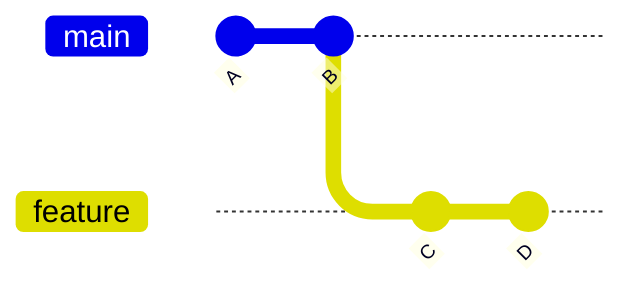
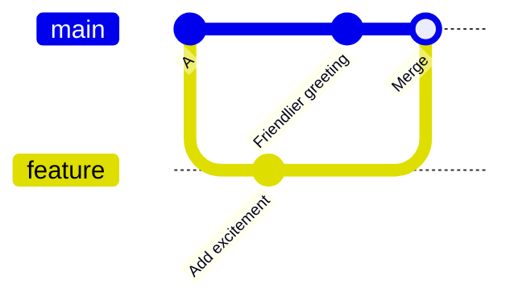

# Branches and Merging

> [!summary] What you'll learn
> How to create, switch between and delete branches; what actually happens when you switch; and the two kinds of merge (**fast-forward** and **three-way merge commit**), including why Git picks one or the other. Merging is how separate lines of work come back together. Once you can picture it, conflicts ([[07 Resolving Merge Conflicts]]) and rebasing ([[08 Rebasing]]) make sense too.

Back to [[00 Git Index]] · Prev: [[03 The Everyday Loop]] · Next: [[05 Remotes - Fetch, Pull, Push]]

---

## Why branches

A branch gives you an **isolated line of work**. You can experiment, commit half-finished code and make a mess without affecting `main` or your teammates. When the work is ready, it's merged back (on a team, through a pull request).

Because a branch is just a label pointing at a commit ([[01 How Git Thinks#Branches are just movable labels]]), branches are free to create. Make one for **every** task: a feature, a bug fix, even a five-minute experiment.

---

## Working with branches

```sh
git branch                      # list local branches (* marks the current one)
git branch -a                   # include remote-tracking branches (origin/...)
git branch -vv                  # show each branch's last commit and upstream + ahead/behind

git switch -c feature/login     # create a branch from where you are, and switch to it
git switch -c fix/header origin/main   # create a branch starting from a specific point
git switch main                 # switch to an existing branch
git switch -                    # switch back to the previous branch (like cd -)

git branch -m new-name          # rename the current branch
git branch -d feature/login     # delete a branch (refuses if it has unmerged work)
git branch -D feature/login     # force delete, even if unmerged
```

> [!info] `switch` vs `checkout`
> `git checkout` is the old do-everything command: it switches branches **and** restores files, which made it easy to misuse. Git 2.23 split it into **`git switch`** (branches) and **`git restore`** (files). You'll still see `git checkout -b feature` (= `git switch -c feature`) and `git checkout main` in tutorials and from teammates. They do the same thing.

### Naming branches

Teams usually use a prefix plus a short description, sometimes with a ticket number:
`feature/password-reset`, `fix/login-redirect-loop`, `chore/upgrade-react-19`, `docs/api-readme`, `JIRA-142-rate-limit`. Check the repo's existing branches or CONTRIBUTING.md and match them.

### What happens when you switch

`git switch other-branch`:
1. Moves HEAD to point at `other-branch`.
2. Updates your working directory and staging area to match that branch's latest commit. Files that differ get rewritten, files that only exist on the other branch appear, and files that only exist on the current branch disappear (they're safe in the commits, not deleted).
3. **Carries your uncommitted changes along**, if that can be done without conflicts.

That third point surprises people. Uncommitted changes don't belong to any branch; they live in your working directory. If they don't conflict with the target branch, they come with you. If they would be overwritten, Git **refuses** to switch rather than destroy your work:

```text
error: Your local changes to the following files would be overwritten by checkout:
	src/auth.js
Please commit your changes or stash them before you switch branches.
Aborting
```

That error is Git protecting you. Your options:
- **Commit** the work on the current branch (a WIP commit is fine), then switch. Usually the best choice.
- **Stash** it: `git stash`, switch, do your thing, come back, `git stash pop`. See [[10 Stash, Cherry-pick and Other Tools#git stash]].

> [!warning] Avoid `git switch --discard-changes` / `git checkout -f`
> These force the switch by **throwing away** your uncommitted changes. Only use them when you're sure.

---

## Merging

`git merge <branch>` brings the commits from `<branch>` **into the branch you're currently on**. Always check which branch you're on first: the merge target is where you are, not what you type.

```sh
git switch main            # go to the branch that should RECEIVE the changes
git merge feature/login    # bring feature/login's commits into main
```

Depending on how the histories relate, Git does one of two things.

### Case 1 - Fast-forward

If `main` hasn't moved since you branched, `feature` simply contains `main`'s history plus more commits:



There's nothing to combine, so Git just **slides the `main` label forward** to `D`. No new commit is created:

```text
Updating c9a6f53..8e35175
Fast-forward
 greet.js | 2 +-
 1 file changed, 1 insertion(+), 1 deletion(-)
```

Afterwards, history is a straight line, and it looks as though the commits were made directly on `main`.

### Case 2 - Three-way merge (merge commit)

If both branches have new commits since they split, there's no way to just slide a label:



Git performs a **three-way merge** using three snapshots:
1. The **merge base**: the most recent commit both branches share (`A`).
2. The tip of your current branch ("ours").
3. The tip of the branch being merged ("theirs").

For each file, Git asks: compared to the base, what did each side change?
- Only one side changed something → take that change.
- Both sides made the **same** change → take it once.
- Both sides changed **the same lines differently** → **conflict**. Git can't guess, so it stops and asks you ([[07 Resolving Merge Conflicts]]).

When everything combines cleanly, Git creates a **merge commit** with **two parents**, recording that the histories were joined. Your editor opens with a default message like `Merge branch 'feature/excited'`, which you can keep.

```text
*   bcd1fea Merge branch 'feature/excited'
|\
| * 8e35175 Add excitement to greeting
* | 383904f Use friendlier greeting
|/
* c9a6f53 Initial commit
```

Notice that changes to **different parts** of the same file merge automatically. Conflicts only happen when both sides touched the same or adjacent lines.

### Controlling the merge type

```sh
git merge --ff-only feature   # only merge if it can fast-forward; otherwise refuse (safe for syncing)
git merge --no-ff feature     # always create a merge commit, even if a fast-forward was possible
git merge --squash feature    # stage all of feature's changes as ONE set; you then commit it yourself
```

- `--no-ff` keeps a visible record that "these commits came in together as a feature."
- `--squash` is what GitHub's **"Squash and merge"** button does: the whole branch becomes one commit on `main`. Note that Git won't consider the branch "merged" afterwards (the original commits aren't in `main`'s history), so `git branch -d` will refuse and you'll need `-D`. See [[06 Team Workflow and Pull Requests#Merge strategies on GitHub]].

### Undoing a merge

- **Mid-merge, with conflicts, want out:** `git merge --abort` puts everything back to before the merge.
- **Merged locally, not pushed:** `git reset --hard ORIG_HEAD` (Git saves the pre-merge position in `ORIG_HEAD`). Make sure you have no uncommitted work first.
- **Merge already pushed / on `main`:** don't rewrite history; **revert** it with `git revert -m 1 <merge-commit>`. See [[11 Recovery Cookbook#A merged PR broke main]].

---

## Deleting branches safely

```sh
git branch -d feature/login
```

`-d` (lowercase) is safe: it **refuses** if the branch has commits that aren't merged:

```text
error: the branch 'scratch' is not fully merged.
If you are sure you want to delete it, run 'git branch -D scratch'
```

`-D` deletes anyway. Even then, the commits still exist for a while, and you can recover the branch from the reflog ([[11 Recovery Cookbook#I deleted a branch I needed]]).

Deleting the **remote** branch (usually GitHub does this when a PR merges):

```sh
git push origin --delete feature/login
```

Clean up local references to remote branches that are gone: `git fetch --prune` (automatic if you set `fetch.prune true`).

---

## Quick self-test
- [ ] What physically happens when you create a branch? When you switch to one?
- [ ] You have uncommitted changes and run `git switch main`. When do the changes come along, and when does Git refuse?
- [ ] You want to merge `feature` into `main`. Which branch do you need to be on?
- [ ] When does Git fast-forward, and when does it create a merge commit? What are the three snapshots in a three-way merge?
- [ ] Two branches edited different functions in the same file. Will that conflict?
- [ ] What's the difference between `--ff-only`, `--no-ff` and `--squash`?
- [ ] Why might `git branch -d` refuse to delete a branch whose PR was squash-merged?

Next: [[05 Remotes - Fetch, Pull, Push]]
