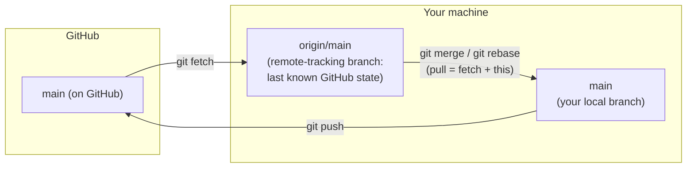

# Remotes: Fetch, Pull, Push

> [!summary] What you'll learn
> How your local repo talks to GitHub. The key ideas: **`origin/main` is a cached snapshot, not a live view**; **`fetch` is always safe** (it only downloads); **`pull` = fetch + integrate** (merge or rebase); and **push only succeeds if it doesn't throw away anyone's commits**, unless you force it. You'll learn to read "rejected" errors, why "divergent branches" happens, and how to force-push without destroying a teammate's work.

Back to [[00 Git Index]] · Prev: [[04 Branches and Merging]] · Next: [[06 Team Workflow and Pull Requests]]

---

## The moving parts



| Thing | What it is |
|---|---|
| **Remote** (`origin`) | A nickname for a URL. `git remote -v` lists them. A fork workflow often has two: `origin` (your fork) and `upstream` (the original repo) |
| **Remote-tracking branch** (`origin/main`) | Your local, read-only record of where a branch was on the remote at the last fetch. You never commit to it directly |
| **Upstream / tracking relationship** | A link from a local branch to a remote branch (set by `push -u` or `clone`), so `git push`, `git pull` and ahead/behind counts know what to compare against. `git branch -vv` shows it |

---

## `git fetch`: always safe

```sh
git fetch            # download new commits and branches from origin; update origin/* labels
git fetch --prune    # also delete origin/* labels for branches deleted on GitHub
git fetch --all      # all remotes
```

`fetch` **never touches your local branches or working files.** It only downloads commits and moves the `origin/...` labels. Run it whenever you like, as often as you like. Then look before you leap:

```sh
git status                          # now ahead/behind is accurate
git log --oneline main..origin/main # commits on GitHub that you don't have
git log --oneline origin/main..main # commits you have that GitHub doesn't
git diff main origin/main           # what changed
```

Get in the habit of **fetch first, then decide** whenever you're unsure what's on the remote.

---

## fetch vs pull

`git pull` is two commands in one:

```text
git pull  =  git fetch  +  git merge origin/<branch>     (default)
git pull --rebase  =  git fetch  +  git rebase origin/<branch>
```

What happens in the integrate step depends on how your branch and the remote relate.

### Case 1: You have no new local commits → fast-forward

The remote has new commits and you don't. Your branch just slides forward. No decisions needed. This is the normal case when you update `main` before starting new work.

### Case 2: Both sides have new commits → divergent branches

You committed locally, and meanwhile a teammate pushed. Each side has commits the other doesn't. Modern Git (2.27+) refuses to guess what to do unless you've configured it:

```text
hint: You have divergent branches and need to specify how to reconcile them.
hint: You can do so by running one of the following commands sometime before
hint: your next pull:
hint:
hint:   git config pull.rebase false  # merge
hint:   git config pull.rebase true   # rebase
hint:   git config pull.ff only       # fast-forward only
...
fatal: Need to specify how to reconcile divergent branches.
```

The options:

| Option | Result | When to prefer |
|---|---|---|
| **merge** (`pull.rebase false`) | Creates a merge commit like `Merge branch 'main' of github.com:org/repo` | Rarely. These merge commits add noise and carry no real meaning |
| **rebase** (`pull.rebase true`) | Replays your local commits on top of the remote's. History stays linear, as if you'd pulled first and then committed | **Most of the time.** Your unpushed commits are yours to rewrite, so this is safe. This is what most teams expect |
| **fast-forward only** (`pull.ff only`) | Refuses unless it can fast-forward | Strict/cautious. Forces you to decide manually every time branches diverge |

With `pull.rebase true` (recommended in [[02 Setup and Your First Commit#Recommended settings (and why)]]):

```text
$ git pull
Successfully rebased and updated refs/heads/main.

$ git log --oneline -3
9c146ba Add entry point      <- your commit, replayed on top (new ID)
dedb3ba Add README           <- teammate's commit
bcd1fea Merge branch 'feature/excited'
```

If your commits conflict with the incoming ones, the rebase stops and you resolve it exactly as in [[08 Rebasing#Resolving conflicts during a rebase]]. `git rebase --abort` gets you back to where you were.

> [!tip] Pull with a clean working directory
> Commit (or stash) before pulling. With `rebase.autoStash true`, Git stashes and restores automatically, but it's still easiest to reason about a pull when `git status` is clean.

---

## `git push`

```sh
git push                        # push the current branch to its upstream
git push -u origin feature/x    # first push of a new branch: create it on GitHub + set upstream
git push origin --delete feature/x   # delete a branch on GitHub
git push origin v1.2.0          # push a tag
```

### Why pushes get rejected

A normal push only succeeds if it's a **fast-forward on the remote**: the remote branch's current commit must already be in your history. Then your push just adds commits on top and nothing is lost. If someone else pushed first, your push would **erase their commits**, so Git refuses:

```text
To github.com:org/app.git
 ! [rejected]        main -> main (fetch first)
error: failed to push some refs to 'github.com:org/app.git'
hint: Updates were rejected because the remote contains work that you do not
hint: have locally. This is usually caused by another repository pushing to
hint: the same ref. If you want to integrate the remote changes, use
hint: 'git pull' before pushing again.
```

This is **normal and safe**: nothing was lost. The fix is to integrate their work, then push:

```sh
git pull --rebase     # or just "git pull" with pull.rebase=true
# resolve any conflicts, then:
git push
```

A related message is `! [rejected] main -> main (non-fast-forward)`. It means the same thing: your branch and the remote have diverged. It also appears after you've rewritten commits you'd already pushed (amend, rebase), which is when you need a force push.

> [!danger] Never "fix" a rejected push by force-pushing without understanding why
> `git push --force` on a rejected push will **delete your teammate's commits from GitHub**. A rejection almost always means "pull first."

---

## Force pushing safely

### When a force push is legitimate

You rewrote commits **you had already pushed** to **your own feature branch**: you amended, rebased onto `main`, or squashed with interactive rebase. The remote still has the old commits, your branch has new ones with different IDs, and a normal push is rejected as non-fast-forward. Here, replacing the remote branch is exactly what you want.

### When it's never OK

- On `main`/`develop` or any shared branch other people build on. (Most teams protect these on GitHub so it's impossible anyway.)
- On a feature branch a teammate is also pushing to, unless you've coordinated.

### `--force` vs `--force-with-lease` vs `--force-if-includes`

| Command | Behavior |
|---|---|
| `git push --force` | Overwrite the remote branch, **no questions asked**. Avoid it |
| `git push --force-with-lease` | Overwrite only if the remote branch is still where **your `origin/branch` thinks it is**. If someone pushed since you last fetched, it refuses |
| `git push --force-with-lease --force-if-includes` | Also checks that the remote's current commit is **actually in your local branch's history** (Git 2.30+). The safest option |

Here's the trap with `--force-with-lease` alone (the output below is from a real test). A teammate pushes a fix to your branch. If you then force-push with a lease without fetching, Git protects you:

```text
 ! [rejected]        feature/login -> feature/login (stale info)
```

But if you run `git fetch` first (or your editor auto-fetches in the background), `origin/feature/login` now includes the teammate's commit, so the lease "matches", and the force push **silently erases their commit**:

```text
 + b9c441e...aeb8a56 feature/login -> feature/login (forced update)
```

`--force-if-includes` closes that hole. Same scenario, fetch included:

```text
 ! [rejected]        feat -> feat (remote ref updated since checkout)
```

So set up an alias and use it every time:

```sh
git config --global alias.pushf "push --force-with-lease --force-if-includes"
git pushf
```

If it's rejected, someone pushed to your branch. Run `git log --oneline HEAD..origin/feature/login` to see their commits, rebase onto them (`git rebase origin/feature/login`), then push again.

---

## Working with forks (open source)

When you can't push to the original repository:

```sh
git clone git@github.com:brendan/project.git     # clone YOUR fork
git remote add upstream git@github.com:original/project.git
git fetch upstream
git switch -c fix/typo upstream/main             # branch from the latest original code
# ...commit...
git push -u origin fix/typo                      # push to your fork, then open a PR to the original
```

Keep your fork's `main` current with `git switch main && git pull --rebase upstream main && git push`.

---

## Quick self-test
- [ ] What's the difference between `main`, `origin/main`, and `main` on GitHub? Which commands update each?
- [ ] Why is `git fetch` always safe? What does `git pull` do on top of it?
- [ ] Explain "divergent branches." What do merge, rebase and ff-only each do with them, and which would you choose for your own unpushed commits?
- [ ] Your push is rejected with `(fetch first)`. What happened, and what's the correct fix?
- [ ] When is a force push legitimate? When is it never OK?
- [ ] Explain how `--force-with-lease` can still erase a teammate's commit, and what `--force-if-includes` adds.

Next: [[06 Team Workflow and Pull Requests]]
