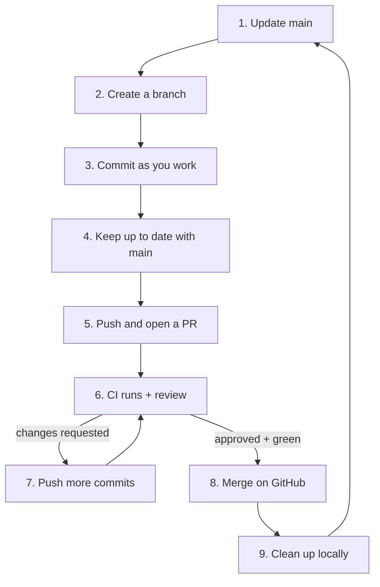

# Team Workflow and Pull Requests

> [!summary] What you'll learn
> What working with Git on a team actually looks like day to day. This walks through the **feature-branch / pull request workflow** (used at nearly every company) from picking up a ticket to deleting the branch after merge, with every command and the reason for it. It also covers keeping your branch up to date, responding to review feedback, the three GitHub merge buttons, branch protection, and other workflows you may run into (Git Flow, trunk-based development).

Back to [[00 Git Index]] · Prev: [[05 Remotes - Fetch, Pull, Push]] · Next: [[07 Resolving Merge Conflicts]]

---

## The rules most teams follow

1. **`main` is always deployable.** It's protected: nobody pushes to it directly, and changes land only through reviewed pull requests with passing CI.
2. **One branch per task**, created from the latest `main`.
3. **Small PRs.** A 200-line PR gets a careful review within hours; a 2,000-line PR gets a skim days later. Split big features into a series of PRs (behind a feature flag if needed).
4. **Your branch is yours.** You can rebase, amend and force-push your own feature branch freely (with `--force-with-lease --force-if-includes`). **Shared branches are never rewritten.**
5. **Keep branches short-lived.** The longer a branch lives, the further it drifts from `main` and the worse the eventual conflicts. Days, not weeks.

---

## The full lifecycle of a change



### 1. Start from an up-to-date main

```sh
git switch main
git pull                 # with pull.rebase=true; on main this should just fast-forward
```

**Why:** branching from a stale `main` means you start out behind, and you'll hit conflicts with work that's already merged. If `git pull` on `main` ever says something other than a fast-forward, you've accidentally committed to `main`: see [[11 Recovery Cookbook#I committed to main instead of a branch]].

> [!tip] Shortcut that skips updating local main
> `git fetch && git switch -c feature/password-reset origin/main` branches straight from GitHub's latest `main`. Many people never touch their local `main` at all.

### 2. Create a branch for the task

```sh
git switch -c feature/password-reset
```

Use the naming convention your team uses, often including the ticket ID (`feature/PROJ-142-password-reset`), which lets Jira or Linear link the branch automatically.

### 3. Commit as you work

Use the everyday loop from [[03 The Everyday Loop]]: small commits, reviewed with `git diff --staged`. While the branch is private, don't worry about perfect commits. Commit whenever you reach a working state, or before trying something risky. You can clean up later.

Push early, even before you're done:

```sh
git push -u origin feature/password-reset    # or just "git push" with push.autoSetupRemote
```

**Why push unfinished work?** It's a backup if your laptop dies, it lets teammates see what you're doing, and you can open a **draft PR** to get early feedback and run CI.

### 4. Keep your branch up to date with main

While you work, teammates merge into `main`. Integrate their changes regularly (daily, or before opening the PR) so conflicts stay small and you're testing against current code.

**Option A: rebase onto main** (the most common choice for your own branch)

```sh
git fetch
git rebase origin/main
# resolve conflicts if any (see "08 Rebasing"), then:
git push --force-with-lease --force-if-includes   # needed if you'd already pushed the branch
```

Your commits get replayed on top of the latest `main`, as if you'd started your work today. History stays linear and the PR shows only your changes. The force push is needed because the rebase created new commits (see [[08 Rebasing]]).

**Option B: merge main into your branch**

```sh
git fetch
git merge origin/main
# resolve conflicts if any, commit, then:
git push          # no force push needed
```

This adds a "Merge remote-tracking branch 'origin/main'" commit to your branch. Nothing is rewritten, so it's the right choice when **someone else is also committing to your branch** (rebasing would rewrite commits they have). It's slightly noisier, but if the team squash-merges PRs, the noise never reaches `main`.

> [!tip] Which one?
> Solo feature branch → **rebase**. Branch shared with a teammate → **merge** (or coordinate before rebasing). Follow the team convention when there is one. GitHub's "Update branch" button on a PR does option B (or option A if you pick "Update with rebase").

### 5. Open the pull request

Before you open it, review your own diff the way a reviewer would:

```sh
git fetch
git log --oneline origin/main..HEAD       # the commits the PR will contain
git diff origin/main...HEAD --stat        # files changed
git diff origin/main...HEAD               # the full diff
```

Optionally clean up the commits with interactive rebase ([[08 Rebasing#Interactive rebase for cleaning up your commits]]), run the tests and linter locally, then push and open the PR on GitHub (or `gh pr create`).

A good PR description:

```markdown
## What
Adds password reset via emailed one-time link.

## Why
Users locked out currently have to email support (≈30 tickets/week). Closes #142.

## How
- `POST /auth/reset-request` creates a single-use token (hashed, 30 min expiry)
- `POST /auth/reset` validates the token and updates the password
- Rate limited to 3 requests/hour per email

## Testing
- Unit tests for token generation and expiry
- Manually tested the full flow locally with Mailpit

## Screenshots
(before/after of the reset form)
```

The **why** and **how to test** are what reviewers need most. Link the ticket. Keep the PR focused: unrelated cleanups go in a separate PR.

### 6. CI and code review

- **CI** (GitHub Actions or similar) runs tests, linting and builds on your branch. Fix failures before asking for review.
- **Reviewers** comment on lines, ask questions, or request changes. Respond to every comment, either with a fix ("Done in a1b2c3d") or a reply explaining your reasoning. Don't take it personally: review is how teams share knowledge and catch bugs.
- When you review others' PRs, be specific and kind, separate blocking issues from nitpicks (prefix with "nit:"), and approve when it's good enough, not perfect.

### 7. Address feedback

Make the changes and push **new commits**:

```sh
git add -p
git commit -m "Validate token expiry on server"
git push
```

**Why new commits rather than amending?** Reviewers can click "changes since last review" and see only what changed. If you rewrite history mid-review (amend, rebase), GitHub can't show that, and reviewers have to re-read everything.

A tidy alternative some teams use is **fixup commits**: `git commit --fixup <sha>` during review, then `git rebase -i --autosquash origin/main` right before merge. See [[08 Rebasing#Fixup commits and autosquash]].

If `main` moved and now conflicts with your PR, GitHub shows "This branch has conflicts that must be resolved." Resolve it locally with step 4 (rebase or merge), then push. Walkthrough: [[07 Resolving Merge Conflicts#Scenario 3 - My PR has conflicts with main]].

### 8. Merge

Once the PR is approved and CI is green, merge it with the button the team uses (next section). Usually the PR author merges, so they can watch the deploy.

### 9. Clean up

```sh
git switch main
git pull                              # get the merged result
git branch -d feature/password-reset  # delete the local branch
git fetch --prune                     # drop origin/feature/password-reset (GitHub deleted it)
```

If the PR was **squash-merged**, `git branch -d` will say the branch is "not fully merged," because the squashed commit has a different ID from your branch's commits. Once you've confirmed the PR is merged on GitHub, `git branch -D` is safe.

---

## Merge strategies on GitHub

The merge button has three modes. The repo settings decide which are allowed.

| Button | What lands on `main` | Pros | Cons |
|---|---|---|---|
| **Create a merge commit** | All your commits + a merge commit with two parents | Full history preserved; easy to revert the whole PR (revert the merge commit) | `main`'s history gets busy, and WIP commits like "fix typo" end up there |
| **Squash and merge** | **One** new commit containing the whole PR | `main` reads like a list of features, one commit per PR; WIP commits vanish; easy to revert | Individual commit history is lost from `main`; local branch looks unmerged (use `-D`); stacked branches need `rebase --onto` |
| **Rebase and merge** | Each of your commits replayed onto `main`, no merge commit | Linear history that keeps individual commits | Every commit should be clean and buildable, so you need to tidy up before merging; commit IDs change |

**Squash and merge** is the most common default, especially at startups, because it doesn't depend on everyone writing perfect commits. Find out what the team uses on your first day; it affects how much you need to polish commits before merging.

---

## Branch protection (why you can't break `main`)

Repo admins configure rules on `main` such as:
- Require a pull request before merging (no direct pushes)
- Require N approving reviews, and possibly CODEOWNERS approval for certain folders
- Require status checks (CI) to pass
- Require the branch to be up to date with `main` before merging
- Block force pushes and deletion

So you **can't** accidentally force-push to `main` or skip review at most companies. Your feature branches are where all the flexibility (and responsibility) is.

---

## Other workflows you may meet

| Workflow | How it works | Where you'll see it |
|---|---|---|
| **GitHub Flow** (described above) | `main` + short-lived feature branches + PRs; deploy from `main` | Most web companies and startups |
| **Trunk-based development** | Everyone integrates into `main` (the "trunk") at least daily with tiny PRs or direct commits; unfinished features hide behind **feature flags** | Google, Meta, high-velocity teams with strong CI |
| **Git Flow** | Long-lived `main` (production) and `develop` (integration) branches, plus `feature/*`, `release/*` and `hotfix/*` branches | Products with scheduled versioned releases (mobile apps, installed software). Considered heavyweight for continuously deployed web apps |
| **Release branches** | `main` keeps moving; `release/2.4` is cut for stabilization; fixes go to `main` and are **cherry-picked** to the release branch | Software that supports multiple versions |
| **Fork + PR** | Contributors push to their own forks and open PRs to the original repo | Open source |

**Hotfixes** in GitHub Flow are just urgent normal PRs: branch from `main`, fix, fast-track the review, merge, deploy. With release branches, the fix lands on `main`, then gets cherry-picked onto the release branch ([[10 Stash, Cherry-pick and Other Tools#git cherry-pick]]).

---

## Day-one checklist for a new team

- [ ] Clone, follow the README setup, run the tests.
- [ ] Read CONTRIBUTING.md, the PR template, and the commit message convention (`git log --oneline -20` shows what people actually do).
- [ ] Ask: squash, rebase or merge commits? Rebase or merge to update branches? Branch naming?
- [ ] Set your Git email to the one tied to your work GitHub account (per-repo `git config user.email` if it's different from your personal one).
- [ ] Make your first PR small (a docs fix, a tiny bug) to learn the pipeline end to end.

---

## Quick self-test
- [ ] Walk through every step from "picked up a ticket" to "branch deleted," with commands.
- [ ] Why start from the latest `main`? What's a shortcut that skips updating local `main`?
- [ ] Rebase vs merge to update your feature branch: what does each do, and when do you choose each?
- [ ] Why push new commits rather than amend during review?
- [ ] Compare the three GitHub merge buttons. Which is most common, and what does it mean for your local branch afterwards?
- [ ] What does branch protection prevent?
- [ ] How does a hotfix flow in GitHub Flow vs with release branches?

Next: [[07 Resolving Merge Conflicts]]
