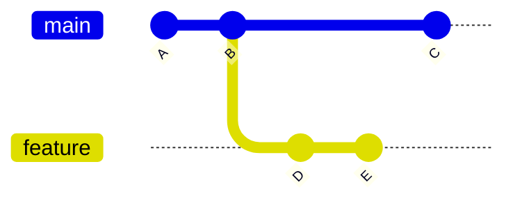
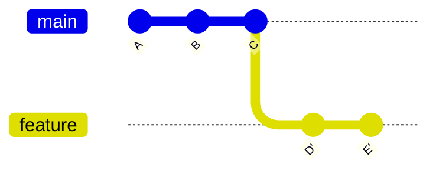

# Rebasing

> [!summary] What you'll learn
> Rebasing feels dangerous because it "rewrites history." It's much less scary once you know exactly what it does: **it copies your commits onto a new starting point and moves your branch label to the copies.** The originals still exist (recoverable via the reflog), and there's one rule that keeps you out of trouble with teammates: **only rebase commits nobody else has built on.**
>
> This note covers: what rebase does step by step, rebase vs merge, the golden rule, rebasing onto `main`, resolving conflicts mid-rebase, **interactive rebase** (squash, fixup, reword, reorder, drop, split), fixup commits with autosquash, `--onto` for stacked branches, and how to **undo any rebase**.

Back to [[00 Git Index]] · Prev: [[07 Resolving Merge Conflicts]] · Next: [[09 Undoing Things Safely]]

---

## What rebase actually does

You branched `feature` from `main` at commit `B` and made two commits. Meanwhile `main` got commit `C`:



`git rebase main` (while on `feature`) does this:

1. Finds the commits on `feature` that aren't on `main`: `D` and `E`.
2. Temporarily sets them aside and moves to the tip of `main` (`C`).
3. **Replays** each commit, one at a time, on top: it applies `D`'s changes to `C`, creating a **new** commit `D'`, then applies `E`'s changes to make `E'`.
4. Moves the `feature` label to `E'`.



`D'` and `E'` have the same changes and messages as `D` and `E`, but **new IDs**, because their parent is different (a commit's ID depends on its parent, see [[01 How Git Thinks#A commit is a snapshot, not a diff]]). The old `D` and `E` aren't deleted. Nothing points at them any more, but the reflog remembers them, so you can undo the whole rebase.

The result: it's as if you'd started your work **after** `C` landed. History is a straight line.

---

## Rebase vs merge

Both integrate changes from one branch into another. They differ in what history looks like afterwards.

| | `git merge main` (on feature) | `git rebase main` (on feature) |
|---|---|---|
| What it does | Creates a merge commit joining the two histories | Replays your commits on top of `main` |
| Existing commits | Untouched | **Replaced** by new copies (new IDs) |
| History shape | Branchy, with merge commits | Linear |
| Conflicts | Resolved **once**, in the merge commit | Resolved **per commit** as each one replays (possibly several times) |
| Safe on shared branches? | **Yes**, nothing is rewritten | **No** if others have the old commits |
| Needs a force push if already pushed? | No | Yes |

Neither is "correct." Teams choose based on what they want history to look like. A common combination: **rebase your own feature branch onto `main` to stay current, then squash-merge the PR.**

---

## The golden rule

> [!danger] Don't rebase commits that other people have based work on
> Rebasing replaces commits with new copies. If a teammate has the **old** commits (they pulled your branch, or branched off it), their history and yours now disagree. Their next pull tries to combine both versions, producing duplicate commits and confusing conflicts.

In practice:
- ✅ **Rebasing local commits you haven't pushed**: always safe. That's what `git pull --rebase` does.
- ✅ **Rebasing your own pushed feature branch** that only you work on: safe. Push with `--force-with-lease --force-if-includes` afterwards ([[05 Remotes - Fetch, Pull, Push#Force pushing safely]]).
- ⚠️ **A feature branch a teammate also commits to:** coordinate first ("I'm rebasing `feature/x` now, please push your work and re-pull after"), or merge instead.
- ❌ **`main`, `develop`, release branches, or anything shared:** never. (Branch protection usually blocks it anyway.)

---

## Rebasing your branch onto the latest main

The everyday use case: you want your feature branch to include what's been merged to `main` since you started.

```sh
git switch feature/login
git status                 # clean? if not, commit or stash (or rely on rebase.autoStash)
git fetch
git rebase origin/main
```

Clean result:

```text
Successfully rebased and updated refs/heads/feature/login.
```

Then, if the branch was already pushed:

```sh
git push --force-with-lease --force-if-includes
```

Why `origin/main` instead of `main`? After `git fetch`, `origin/main` is the latest version on GitHub, even if you haven't updated your local `main`. It saves a step and avoids rebasing onto a stale local `main`.

> [!tip] Safety label before a big rebase
> `git branch backup/login-before-rebase` takes a split second and gives you a named copy of the old branch. If the rebase goes wrong, `git reset --hard backup/login-before-rebase` puts you back. Delete it once you're happy. (The reflog does the same job, but a named label is easier when you're nervous.)

---

## Resolving conflicts during a rebase

Because commits replay one at a time, the rebase **pauses** at any commit whose changes conflict:

```text
Auto-merging greet.js
CONFLICT (content): Merge conflict in greet.js
error: could not apply 486d823... Add bye()
hint: Resolve all conflicts manually, mark them as resolved with
hint: "git add/rm <conflicted_files>", then run "git rebase --continue".
hint: You can instead skip this commit: run "git rebase --skip".
hint: To abort and get back to the state before "git rebase", run "git rebase --abort".
```

`git status` shows where you are:

```text
interactive rebase in progress; onto aefa576
Last command done (1 command done):
   pick 486d823 Add bye()
Next command to do (1 remaining command):
   pick 21c5af8 Add note
You are currently rebasing branch 'feature/farewell' on 'aefa576'.
  (fix conflicts and then run "git rebase --continue")
  (use "git rebase --skip" to skip this patch)
  (use "git rebase --abort" to check out the original branch)

Unmerged paths:
  (use "git restore --staged <file>..." to unstage)
  (use "git add <file>..." to mark resolution)
	both modified:   greet.js
```

The loop:

```sh
# 1. fix the conflict markers in each file (see "07 Resolving Merge Conflicts")
git add greet.js
git rebase --continue     # applies the next commit; may stop again
# ...repeat until "Successfully rebased"
```

Things to know while paused:
- You're in a **detached HEAD** state on purpose (the rebase is building new commits). Don't switch branches. Finish with `--continue` or `--abort`.
- **ours = the branch you're rebasing onto (main); theirs = your commit being replayed.** That's the reverse of a merge. See [[07 Resolving Merge Conflicts#Scenario 4 - Conflict during a rebase]] for the full worked example.
- `git rebase --abort` at any point returns your branch to **exactly** how it was before you started. Use it freely.
- `git rebase --skip` discards the current commit entirely. Only use it when the commit is genuinely redundant (for example, the same change already landed on `main`).
- If the same lines conflict at commit after commit, abort, squash your branch into fewer commits first (next section), and rebase again. Or merge `main` in instead.

After it finishes, **run the tests**: each replayed commit was combined with new code.

---

## Interactive rebase for cleaning up your commits

`git rebase -i` lets you **edit your branch's commit list** before others see it: combine WIP commits, fix messages, reorder or drop commits. This is how people turn a messy branch into a clean, reviewable series.

Say your branch has:

```text
d9f650b Add login validation
de4543c fix typo
97c7cf2 WIP
82edc6d Add login form
```

Rebase interactively onto where the branch started:

```sh
git rebase -i main          # or: git rebase -i HEAD~4 (the last 4 commits)
```

Your editor opens a **todo list**, oldest commit first (the opposite order from `git log`). This is real output:

```text
pick 82edc6d Add login form
pick 97c7cf2 WIP
pick de4543c fix typo
pick d9f650b Add login validation

# Rebase ae3e7cd..d9f650b onto ae3e7cd (4 commands)
#
# Commands:
# p, pick <commit> = use commit
# r, reword <commit> = use commit, but edit the commit message
# e, edit <commit> = use commit, but stop for amending
# s, squash <commit> = use commit, but meld into previous commit
# f, fixup [-C | -c] <commit> = like "squash" but keep only the previous
#                    commit's log message, unless -C is used, in which case
#                    keep only this commit's message; -c is same as -C but
#                    opens the editor
# x, exec <command> = run command (the rest of the line) using shell
# b, break = stop here (continue rebase later with 'git rebase --continue')
# d, drop <commit> = remove commit
...
# These lines can be re-ordered; they are executed from top to bottom.
#
# If you remove a line here THAT COMMIT WILL BE LOST.
#
# However, if you remove everything, the rebase will be aborted.
```

Edit the words at the start of the lines, then save and close. Git executes the list from top to bottom:

```text
pick 82edc6d Add login form
fixup 97c7cf2 WIP
fixup de4543c fix typo
reword d9f650b Add login validation
```

Result: "WIP" and "fix typo" are folded into "Add login form" (their messages discarded), and Git stops to let you improve the validation commit's message. Two clean commits instead of four.

### The commands, and when to use each

| Command | What it does | Use it for |
|---|---|---|
| `pick` | Keep the commit as is | Default |
| `reword` | Keep the changes, edit the message | Fixing a bad or misspelled message |
| `squash` | Merge into the **previous** commit, and edit the combined message | Combining two meaningful commits into one |
| `fixup` | Merge into the previous commit, **discard this message** | Folding in "fix typo", "WIP", "address review" commits |
| `drop` (or delete the line) | Remove the commit and its changes | Throwing away an experiment or debug commit |
| *reorder lines* | Change commit order | Grouping related commits (may cause conflicts if they touch the same lines) |
| `edit` | Stop after applying this commit so you can amend it | Changing a commit's contents, or splitting it in two |
| `exec <cmd>` | Run a shell command at that point | `exec npm test` after each line to check every commit builds |
| `break` | Pause here | Inspecting the state mid-rebase |

`squash` and `fixup` always combine into the line **above**, so the first line can't be a squash or fixup.

### Splitting one commit into two (`edit`)

```text
edit 82edc6d Add login form and fix header bug
pick d9f650b Add login validation
```

When the rebase stops at that commit:

```sh
git reset HEAD~          # undo the commit but KEEP its changes in your working directory (unstaged)
git add src/Header.jsx
git commit -m "Fix header overflow on mobile"
git add src/LoginForm.jsx
git commit -m "Add login form"
git rebase --continue
```

`git reset HEAD~` here is safe: it only moves the label back one commit. The changes stay in your files (see [[09 Undoing Things Safely#git reset in depth]]).

### Squash everything into one commit (shortcut)

```sh
git reset --soft $(git merge-base HEAD origin/main)   # move the label to where the branch started; all changes stay staged
git commit -m "Add login with validation"
```

This keeps all your changes but replaces the branch's commits with a single new one. It's the same result as a squash merge, done locally.

---

## Fixup commits and autosquash

During review, a cleaner way to make "small fix to an earlier commit" changes:

```sh
git log --oneline
# a1b2c3d Add login validation
# e4f5a6b Add login form

# fix a bug that belongs in "Add login form":
git add src/LoginForm.jsx
git commit --fixup e4f5a6b       # creates "fixup! Add login form"
git push                         # reviewers see the fix as its own commit
```

Before merging, fold all the fixups into their targets automatically:

```sh
git rebase -i --autosquash origin/main    # --autosquash is automatic if rebase.autosquash=true
```

The todo list opens with each `fixup!` commit already moved under its target and marked `fixup`. Save, close, then force-push with lease. The history ends up as if each commit had been right the first time.

---

## Moving a branch to a different base with --onto

`git rebase --onto <new-base> <old-base> <branch>` means: take the commits on `<branch>` that come after `<old-base>`, and replay them onto `<new-base>`.

### Use case 1: stacked branches after a squash merge

You built `feature-b` on top of `feature-a` (because B needed A's code). `feature-a` was **squash-merged** into `main`, so `main` has A's changes as one new commit. A normal `git rebase main` on `feature-b` would try to replay **A's original commits too**, causing conflicts with their own squashed version. Tell Git to replay only B's own commits:

```sh
git fetch
git rebase --onto origin/main feature-a feature-b
# "replay the commits of feature-b that come after feature-a, onto origin/main"
```

(If the local `feature-a` label is gone, use the commit ID where B started.)

### Use case 2: branched from the wrong place

You accidentally created `fix/typo` from `feature/big-thing` instead of `main`, so your PR would include all of big-thing's commits:

```sh
git rebase --onto origin/main feature/big-thing fix/typo
```

Now `fix/typo` contains only your typo commit, on top of `main`.

> [!tip] Rebasing a stack in one go
> With `git rebase --update-refs` (or `git config --global rebase.updateRefs true`, Git 2.38+), rebasing the top branch of a stack also moves the labels of the branches underneath it.

---

## Undoing a rebase

Rebase finished but the result is wrong (bad conflict resolution, wrong base)? The old commits still exist.

**Right after the rebase:** Git saves the pre-rebase position in `ORIG_HEAD`:

```sh
git reset --hard ORIG_HEAD
```

(`ORIG_HEAD` is overwritten by the next reset, merge or rebase, so use it immediately.)

**Any time later: use the reflog.**

```sh
git reflog
```

```text
d9f650b HEAD@{0}: rebase (finish): returning to refs/heads/feature/login
...
a7c3e21 HEAD@{5}: commit: Add login validation      <- the last state BEFORE the rebase started
```

Look for the entry just **before** `rebase (start)`, then:

```sh
git reset --hard a7c3e21     # or: git reset --hard feature/login@{1}
```

`feature/login@{1}` means "where the `feature/login` branch label pointed one move ago." After a rebase, that's the pre-rebase tip. Check with `git log --oneline feature/login@{1}` first. Full details: [[09 Undoing Things Safely#The reflog is your safety net]].

If you had already force-pushed the bad rebase, reset as above, then force-push again (with lease) to put the remote branch back.

---

## Rebase safety checklist

- [ ] Working directory clean (`git status`), or autostash on
- [ ] I'm on the right branch, and it's **mine** (or the team agreed)
- [ ] `git fetch` first, then rebase onto `origin/main`
- [ ] Optional: `git branch backup/<name>`
- [ ] Conflicts: fix → `git add` → `git rebase --continue`; when in doubt, `git rebase --abort`
- [ ] Run the tests afterwards
- [ ] Push with `--force-with-lease --force-if-includes`, never plain `--force`

---

## Quick self-test
- [ ] Describe, step by step, what `git rebase main` does. Why do the rebased commits get new IDs? What happens to the old ones?
- [ ] Compare rebase and merge: history shape, how conflicts are handled, and safety on shared branches.
- [ ] State the golden rule. Is it safe to rebase your own pushed feature branch? What must you do afterwards?
- [ ] During a rebase conflict, what do `--continue`, `--skip` and `--abort` each do?
- [ ] You have 6 messy commits. How do you turn them into 2 clean ones? What's the difference between `squash` and `fixup`?
- [ ] How do you split one commit into two during an interactive rebase?
- [ ] Explain `git commit --fixup` + `--autosquash`. Why is it nicer for reviewers?
- [ ] `feature-a` was squash-merged and you have `feature-b` stacked on it. What command rebases B correctly, and why does a plain rebase cause trouble?
- [ ] A rebase went wrong an hour ago. How do you get back to the pre-rebase state?

Next: [[09 Undoing Things Safely]]
