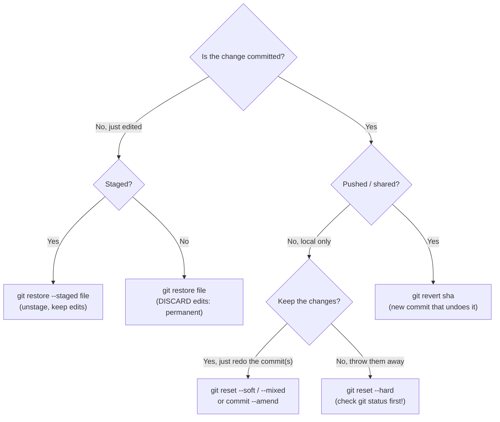

# Undoing Things Safely

> [!summary] What you'll learn
> Every undo command in Git, **ranked by how dangerous it is**, with what it actually changes. The core distinction: **`revert` adds a new commit that cancels an old one (safe for shared history)**, while **`reset` moves your branch label (rewrites history, local use only)**. You'll learn the three modes of `reset` (`--soft`, `--mixed`, `--hard`), when `restore` is enough, and the **reflog**, which can bring back almost any commit you think you've lost.

Back to [[00 Git Index]] · Prev: [[08 Rebasing]] · Next: [[10 Stash, Cherry-pick and Other Tools]]

---

## First: which kind of "undo" do you need?



## The danger ladder

| Command | What it changes | Can you get it back? | Danger |
|---|---|---|---|
| `git restore --staged <file>` | Unstages; edits stay in the file | Nothing is lost | 🟢 Safe |
| `git commit --amend` (unpushed) | Replaces the last commit | Yes, the old commit is in the reflog | 🟢 Safe locally |
| `git revert <sha>` | Adds a **new** commit that cancels an old one | Yes, revert the revert | 🟢 Safe, even on shared branches |
| `git reset --soft <sha>` | Moves the branch label; changes stay **staged** | Yes, via the reflog | 🟢 Safe locally |
| `git reset <sha>` (`--mixed`) | Moves the label; changes stay in files, **unstaged** | Yes, via the reflog | 🟢 Safe locally |
| `git stash` | Shelves uncommitted changes | Yes, `git stash pop` (and even dropped stashes can be found) | 🟢 Safe |
| `git reset --hard <sha>` | Moves the label **and overwrites your files** | Commits: yes (reflog). **Uncommitted edits: no** | 🟠 Check `git status` first |
| `git restore <file>` / `git checkout -- <file>` | Overwrites a file with the committed version | **No**, unless the edits were staged earlier | 🟠 Careful |
| Force push | Replaces the remote branch | Your commits: yes. Teammates' overwritten commits: only from their machines | 🔴 Only on your own branch, with lease |
| `git clean -fd` | **Deletes untracked files** | **No.** Git never had them | 🔴 Always dry-run with `-n` first |

The pattern: **anything that was committed is recoverable** (for ~90 days). Anything that was never committed can be lost by `--hard`, `restore`, `clean` or `--discard-changes`.

---

## Undoing uncommitted changes

```sh
git restore --staged file.js     # unstage (opposite of git add); your edits stay
git restore file.js              # discard unstaged edits: file goes back to the staged/committed version
git restore -p file.js           # discard selected hunks only (interactive)
git restore .                    # discard ALL unstaged edits in this folder
git restore --source=HEAD~3 file.js   # bring back a file as it was 3 commits ago
git restore --source=main file.js     # take another branch's version of one file
```

Older equivalents you'll see online: `git reset HEAD file` (unstage) and `git checkout -- file` (discard).

> [!warning] `git restore <file>` is one of the few truly destructive commands
> It overwrites your file without asking. If unsure, commit or stash first: `git stash` is the "undo-able discard."

### Recovering a deleted file

- **Deleted but not committed yet:** `git restore path/to/file`
- **Deleted in some earlier commit:** find the commit that deleted it, then restore from its parent:
  ```sh
  git log --oneline --diff-filter=D -- path/to/file    # find the commit that deleted it
  git restore --source=<sha>~1 path/to/file             # restore from the commit before that
  ```

---

## git revert - undo a commit by adding a new one

```sh
git revert a1b2c3d
```

```text
[feature/login 30c2e30] Revert "Add login validation"
```

Git computes the **inverse** of that commit's changes and commits it. History shows both the original and the revert, and nothing is rewritten, so **it's the right tool for anything already pushed to a shared branch**, including `main`.

```sh
git revert --no-edit a1b2c3d        # accept the default message
git revert a1b2c3d e4f5a6b          # several commits (creates one revert each)
git revert --no-commit HEAD~3..HEAD # revert the last 3 together, then commit once
git revert -m 1 <merge-sha>         # revert a MERGE commit (see below)
```

**Reverting a merge commit** needs `-m 1`. A merge has two parents, and `-m 1` says "the mainline is parent 1 (the branch that was merged into, usually `main`), so undo what parent 2 brought in." This is how you back out a whole merged PR. See [[11 Recovery Cookbook#A merged PR broke main]].

If the reverted code conflicts with later changes, resolve it like any conflict and run `git revert --continue`.

---

## git reset in depth

`git reset <target>` **moves the current branch's label to `<target>`**. The mode decides what happens to the staging area and your files:

| Mode | Branch label | Staging area | Working files | Typical use |
|---|---|---|---|---|
| `--soft` | Moves | **Unchanged**: undone commits' changes become staged | Unchanged | "Uncommit" to recombine or rewrite the last few commits |
| `--mixed` (default) | Moves | Reset to match target: changes become **unstaged** | Unchanged | "Uncommit and unstage," then re-add selectively (splitting commits) |
| `--hard` | Moves | Reset | **Reset: files overwritten to match target** | Throw everything away and go back to a known state |

Example: the last two commits are wrong. They're local, never pushed.

```sh
git log --oneline -3
# e5f6a7b Add debug endpoint   <- HEAD
# c3d4e5f Half-done refactor
# a1b2c3d Add login form

git reset --soft HEAD~2   # label back to a1b2c3d; both commits' changes sit staged, ready to recommit
git reset HEAD~2          # same, but the changes are unstaged (pick what to re-add)
git reset --hard HEAD~2   # same, but the changes are GONE from your files (commits still in the reflog)
```

> [!important] Before any `reset --hard`
> 1. Run `git status`. Any uncommitted change listed will be **permanently** destroyed.
> 2. If there's anything you might want, `git stash` (or commit) first.
> 3. Committed work is safe either way: you can always come back via the reflog.

Other common resets:

```sh
git reset --hard origin/main   # make my local branch exactly match GitHub (discards local commits + edits)
git reset --hard ORIG_HEAD     # undo the last merge/rebase/reset (ORIG_HEAD = position before it)
git reset --merge              # back out of a conflicted merge or stash pop, keeping unrelated local edits
```

### reset vs revert: the one rule

- **Local, unpushed commits:** reset (or amend, or interactive rebase) is fine. Nobody else has them.
- **Pushed commits on a shared branch:** **revert.** Resetting and force-pushing would yank history out from under your teammates.
- **Pushed commits on your own feature branch:** either. Reset plus force-with-lease is fine if nobody else uses the branch.

---

## The reflog is your safety net

Every time HEAD moves (commit, checkout, reset, rebase, merge, amend, pull), Git writes an entry in the **reflog**. It's local to your machine, and entries last 90 days by default (30 for commits no branch can reach). It's how you recover from almost any "I lost my commits" situation.

Real run: three commits reset away by accident.

```text
$ git reset --hard HEAD~3
HEAD is now at 82edc6d Add login form

$ git reflog
82edc6d HEAD@{0}: reset: moving to HEAD~3
d9f650b HEAD@{1}: rebase (finish): returning to refs/heads/feature/login
d9f650b HEAD@{2}: rebase (start): checkout main
...
```

Read it as "where HEAD was, newest first." `HEAD@{1}` (commit `d9f650b`) is where HEAD was right before the reset. Recovery:

```text
$ git reset --hard HEAD@{1}
HEAD is now at d9f650b Add login validation
```

All three commits are back.

### How to use the reflog calmly

1. `git reflog` (add `--date=relative` to see when each move happened).
2. Find the line describing the state you want: "commit: ...", "rebase (start)" (the line **below** it is the pre-rebase state), "checkout: moving from X to Y", and so on.
3. **Inspect before acting:** `git log --oneline -5 <sha>` or `git show <sha>`.
4. Restore it, choosing the least destructive way:
   ```sh
   git branch rescue <sha>        # safest: just put a label on it, then look around
   git switch rescue
   # or, to move your current branch back there:
   git reset --hard <sha>         # after checking git status for uncommitted work
   ```

Branch-specific reflogs exist too: `git reflog show feature/login`, and `feature/login@{1}` means "where this branch pointed one move ago." Time-based forms like `main@{yesterday}` and `HEAD@{2.hours.ago}` also work.

### Last resort: dangling objects

Lost something that isn't in the reflog, like a dropped stash, or a file you had **staged** (`git add`) and then wiped with `reset --hard`? Staged content was saved as an object when you ran `git add`:

```sh
git fsck --lost-found        # lists "dangling commit" and "dangling blob" objects
git show <sha>               # inspect each candidate
```

Dangling blobs are file contents without names; `git show` them to find yours. This is why even `git add` gives you some protection, and why **never-staged edits are the only truly unrecoverable kind.**

---

## `git clean`: deleting untracked files

`git clean` removes files Git doesn't track (build junk, stray generated files). Since Git never had copies, **there's no undo.**

```sh
git clean -n       # DRY RUN: list what would be deleted (always do this first)
git clean -nd      # dry run including untracked directories
git clean -fd      # actually delete untracked files and directories
git clean -fdx     # also delete IGNORED files (node_modules, .env!), so think twice
git clean -i       # interactive: choose what to delete
```

You'll rarely need it. To get a clean slate for a build, `rm -rf node_modules dist` is more explicit.

---

## Quick self-test
- [ ] Rank these from safest to most dangerous: `reset --hard`, `revert`, `restore --staged`, `clean -fd`, `reset --soft`, `restore <file>`.
- [ ] Explain the three modes of `git reset`: what happens to the branch label, the staging area and your files?
- [ ] When must you use `revert` instead of `reset`? How do you revert a merge commit?
- [ ] You ran `git reset --hard HEAD~5` by mistake. Recover, step by step.
- [ ] What two kinds of work can the reflog **not** recover? Why can staged-but-lost changes sometimes be found?
- [ ] How do you restore a file that was deleted three commits ago?
- [ ] What should you always run before `git clean`?

Next: [[10 Stash, Cherry-pick and Other Tools]]
